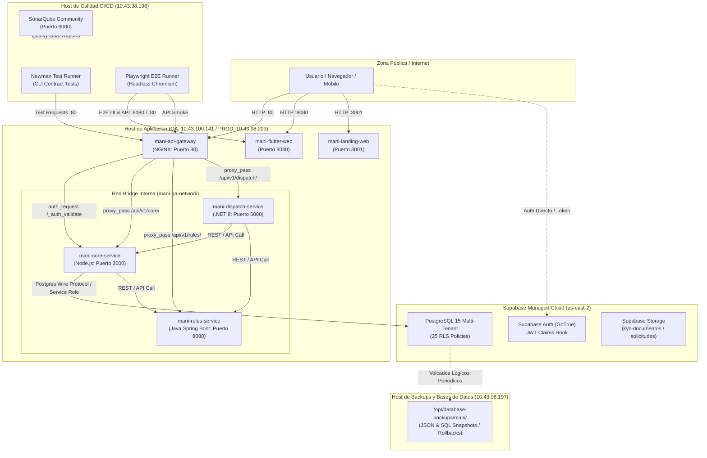
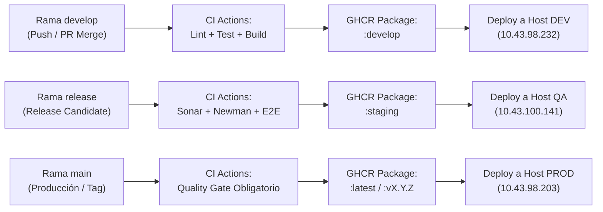

# TRAMA · MANI — Documento de Infraestructura V3
## Vista Física: Topología Operativa, Seguridad, Persistencia y Guía de Despliegue (DEV, QA, PROD, CI/CD y Backups)

| Metadato | Valor |
| :--- | :--- |
| **Proyecto** | MANI — Plataforma SaaS Multi-Tenant de Formalización de Operaciones de Servicio |
| **Organización** | TRAMA · Ingeniería de Software |
| **Documento** | Documento de Infraestructura V3 (Vista Física del modelo 4+1) |
| **Versión** | 3.0 — Entrega 4 (Sprint 4 Review / Consolidación Operativa) |
| **Fecha** | 17 de Octubre, 2026 |
| **Estado** | **Aprobado y Verificado Operativamente** |
| **Ticket Jira Principal** | `DOC4-05` (SCRUM-1248) |
| **Subtareas Vinculadas** | `SCRUM-1296` (Consolidar topología operativa, bases y pipelines) y `SCRUM-1297` (Publicar guía de despliegue y recuperación) |
| **Responsables** | Daniel Ávila (DevOps Lead), Nicolás León (DevOps Secundario), Santiago (QA & Security Lead), Sara Albarracín (Scrum Master) |
| **Fuentes y Tareas Previas** | [`CFG4-01`](./ACTA_AUDITORIA_DEV_QA_CFG4-01.md), [`CFG4-04`](./POLITICA_CONFIGURACION_JWT_CFG4-04.md), [`CFG4-03`](./GUIA_OPERATIVA_CALIDAD_QA_CFG4-03.md), [`CFG-26`](./PLAN_ALINEACION_SUPABASE_PROD_QA_CFG-26.md), [`CFG4-02`](./ACTA_CONSOLIDACION_POSTGRESQL_CFG4-02.md), [`ADR-0004`](../../adr/ADR-0004-cicd-multirepo-ambientes.md), [`ADR-0005`](../../adr/ADR-0005-devsecops.md), [`ADR-0012`](../../adr/ADR-0012-persistencia-multitenant.md), [`ADR-0015`](../../adr/ADR-0015-pruebas-aislamiento-multitenant.md), [`ADR-0018`](../../adr/ADR-0018-identificacion-tenant.md), [`ADR-0028`](../../adr/ADR-0028-nombres-repositorios-y-ambientes.md), [`ADR-0030`](../../adr/ADR-0030-propiedad-esquema-y-frontera-de-datos.md), [`ADR-0031`](../../adr/ADR-0031-politica-configuracion-jwt-ambientes.md) |

---

## Control de Versiones

| Versión | Fecha | Descripción del Cambio | Responsable | Estado |
| :---: | :---: | :--- | :---: | :---: |
| 1.0 | 2026-09-23 | Versión inicial de Entrega 2. Topología teórica preliminar y propuesta de segregación. | Daniel Ávila | Superada |
| 2.0 | 2026-10-07 | Versión de transición arquitectónica (Sprint 3). Adopción de modelo multi-repo y Gateway NGINX. | Daniel Ávila | Superada |
| **3.0** | **2026-10-17** | **Versión consolidada y operativa del Sprint 4.** Formalización de 5 VMs dedicadas (DEV, QA, PROD, Calidad y Backups). Consolidación de base de datos Supabase con 8 migraciones y 25 políticas RLS ([ADR-0012](../../adr/ADR-0012-persistencia-multitenant.md), [ADR-0030](../../adr/ADR-0030-propiedad-esquema-y-frontera-de-datos.md)). Perímetro de validación JWT ([ADR-0031](../../adr/ADR-0031-politica-configuracion-jwt-ambientes.md)). Cadena de calidad automatizada con SonarQube, Newman y Playwright ([`CFG4-03`](./GUIA_OPERATIVA_CALIDAD_QA_CFG4-03.md)). Runbook de despliegue y contingencia probado. | **Daniel Ávila** | **Vigente / Aprobada** |

---

## Índice

1. [Propósito y Alcance](#1-propósito-y-alcance)
2. [Principios de Infraestructura y Vista Física](#2-principios-de-infraestructura-y-vista-física)
3. [Topología Operativa: Inventario de Máquinas Virtuales](#3-topología-operativa-inventario-de-máquinas-virtuales)
4. [Diagrama de Despliegue Físico](#4-diagrama-de-despliegue-físico)
5. [Perímetro de Seguridad, NGINX Gateway y Autenticación JWT](#5-perímetro-de-seguridad-nginx-gateway-y-autenticación-jwt)
6. [Consolidación de Persistencia PostgreSQL Supabase](#6-consolidación-de-persistencia-postgresql-supabase)
7. [Cadena de Calidad Automatizada: SonarQube, Newman y Playwright](#7-cadena-de-calidad-automatizada-sonarqube-newman-y-playwright)
8. [Pipeline CI/CD y Estrategia de Promoción GHCR](#8-pipeline-cicd-y-estrategia-de-promoción-ghcr)
9. [Guía Operativa de Despliegue, Arranque y Recuperación (Runbook)](#9-guía-operativa-de-despliegue-arranque-y-recuperación-runbook)
10. [Custodia de Respaldos en VM Dedicada y Plan de Rollback](#10-custodia-de-respaldos-en-vm-dedicada-y-plan-de-rollback)
11. [Checklist Operativo para Paso a Producción](#11-checklist-operativo-para-paso-a-producción)
12. [Trazabilidad con Backlog y Criterios de Cierre](#12-trazabilidad-con-backlog-y-criterios-de-cierre)

---

## 1. Propósito y Alcance

El presente documento constituye la **Vista Física oficial del modelo 4+1** para el sistema MANI al cierre del Sprint 4. Su objetivo es documentar con precisión técnica y evidencia empírica:
1. **Dónde y cómo se ejecutan los contenedores del sistema**, especificando recursos, puertos, variables y segregación de red.
2. **Cómo se garantiza el aislamiento multi-tenant** en reposo (PostgreSQL RLS) y en tránsito (perímetro JWT en Gateway).
3. **Cómo opera la cadena de calidad continua** para prevenir regresiones funcionales o de seguridad antes de promover cambios a producción.
4. **Cómo se despliegan, operan y recuperan los servicios** ante eventuales contingencias sin pérdida de información ni indisponibilidad prolongada.

**Fuera de Alcance:** Lógica interna de casos de uso de negocio (documentada en el SDD), contratos de OpenAPI (documentados en `MANI-APIGateway`), y algoritmos de machine learning futuros.

---

## 2. Principios de Infraestructura y Vista Física

1. **Segregación Estricta de Ambientes:** Existen tres ambientes lógicos de aplicación (**DEV → QA → PROD**) desplegados sobre infraestructura virtual aislada, más dos servidores dedicados de soporte (**Calidad CI/CD** y **Bases de Datos & Backups**).
2. **Inmutabilidad de Artefactos OCI:** Las imágenes Docker se compilan una única vez por commit/tag en GitHub Actions, se publican en GitHub Packages (GHCR) y se despliegan mediante digest y etiquetas semánticas (`:develop`, `:staging`, `:latest`).
3. **Persistencia Compartida por Ambiente con RLS ([ADR-0012](../../adr/ADR-0012-persistencia-multitenant.md)):** Se utiliza una base PostgreSQL administrada por ambiente (Supabase PROD y Supabase QA), con aislamiento lógico enforced a nivel de motor mediante Row Level Security.
4. **Propiedad Institucional del Esquema en Core Node ([ADR-0030](../../adr/ADR-0030-propiedad-esquema-y-frontera-de-datos.md)):** `MANI-Node` gobierna la evolución DDL de la base compartida. Ningún servicio realiza queries SQL cruzadas; las dependencias se consumen vía HTTP interno.
5. **Perímetro de Seguridad Fail-Closed ([ADR-0031](../../adr/ADR-0031-politica-configuracion-jwt-ambientes.md)):** NGINX intercepta toda petición externa, valida perimetralmente la firma del token JWT y el claim `tenant_id` contra Core Node, e inyecta encabezados de confianza hacia upstream.
6. **Desacople Documental:** Los respaldos de base de datos, volcados SQL y scripts de contingencia se custodian en un host dedicado, manteniendo el repositorio `MANI-docs` estrictamente para documentación versionada.

---

## 3. Topología Operativa: Inventario de Máquinas Virtuales

La infraestructura física está compuesta por **cinco máquinas virtuales dedicadas**, aprovisionadas con Linux Ubuntu 22.04 LTS:

| Host / VM | Dirección IP | Propósito Operativo | Rama Git / Tag OCI | Puertos Expuestos | Acceso / Credenciales |
|---|---|---|---|---|---|
| **Host DEV** | `10.43.98.232` | Ambiente de Desarrollo Integrado | `develop` / `:develop` | `80` (Gateway), `3001` (Landing), `8080` (Web) | `estudiante` / `11DarkGray*1` |
| **Host QA** | `10.43.100.141` | Ambiente de Staging / Certificación QA | `release` / `:staging` | `80` (Gateway), `3001` (Landing), `8080` (Web) | `estudiante` / `santi2583953` |
| **Host PROD** | `10.43.98.203` | Ambiente Productivo MVP | `main` / `:latest` | `80` (Gateway), `3001` (Landing), `8080` (Web) | `estudiante` / `Turquesa+681` |
| **Host Calidad** | `10.43.98.196` | SonarQube Server, Newman & Playwright Runners | N/A (Herramientas CI) | `9000` (SonarQube) | `estudiante` / `Nieve+4416Sn` |
| **Host Backups** | `10.43.98.197` | Custodia de Volcados Lógicos y Rollback | N/A (Storage DB) | `22` (SSH / SFTP seguro) | `estudiante` / `Verdefuerte+` |

### 3.1 Mapeo de Contenedores y Red Interna por Host de Aplicación (DEV, QA, PROD)

Cada máquina de aplicación ejecuta una instancia de Docker Engine con Docker Compose bajo la red bridge interna `mani-<ambiente>-network`:

| Contenedor Docker | Tecnología / Stack | Puerto Interno | Puerto Mapeado en Host | Función en el Sistema |
|---|---|:---:|:---:|---|
| `mani-api-gateway` | NGINX 1.25 Alpine | `80` | `0.0.0.0:80->80` | Reverse proxy perimetral, SSL offloading y ruteo JWT. |
| `mani-core-service` | Node.js 20 LTS (Express) | `3000` | Solo red interna | Identidad, usuarios, aliados, categorías y validación token. |
| `mani-rules-service` | Java 17 (Spring Boot 3) | `8080` | Solo red interna | Motor de reglas, tarifación y ranking de cobertura. |
| `mani-dispatch-service`| .NET 8 (ASP.NET Core) | `5000` | Solo red interna | Orquestación de solicitudes, despacho y asignación atómica. |
| `mani-flutter-web` | Flutter Web 3.x (Nginx) | `80` | `0.0.0.0:8080->80` | Aplicación Web SPA para clientes y aliados. |
| `mani-landing-web` | React / HTML5 (Nginx) | `80` | `0.0.0.0:3001->80` | Portal público institucional y captación de clientes. |

---

## 4. Diagrama de Despliegue Físico



---

## 5. Perímetro de Seguridad, NGINX Gateway y Autenticación JWT

En cumplimiento de [`ADR-0018`](../../adr/ADR-0018-identificacion-tenant.md) y [`ADR-0031`](../../adr/ADR-0031-politica-configuracion-jwt-ambientes.md), el sistema implementa una **arquitectura perimetral fail-closed**:

### 5.1 Mecanismo de Validación Perimetral
1. **Emisión de Tokens:** Supabase Auth (GoTrue) emite tokens JWT firmados criptográficamente (algoritmo asimétrico RS256 en ambientes modernos / HS256 con secret de entorno). El token incluye en `app_metadata` los claims:
   - `tenant_id`: UUID del tenant al que pertenece el usuario.
   - `user_role`: Rol canónico (`admin_tenant`, `aliado`, `cliente`).
2. **Intercepción en Gateway:** Toda petición dirigida a `/api/v1/rules/*`, `/api/v1/dispatch/*` o `/api/v1/core/*` es interceptada por la directiva NGINX `auth_request /_auth_validate`.
3. **Subrequest a Core Node:** NGINX remite el header `Authorization: Bearer <token>` al endpoint interno `/_auth_validate` en `mani-core-service:3000`.
   - Si la firma es inválida o el token ha expirado: Core responde `401 Unauthorized`.
   - Si el claim `tenant_id` está ausente: Core responde `401 Unauthorized` (evitando bypass multi-tenant).
   - Si el token es íntegro y válido: Core responde `200 OK` devolviendo en encabezados de respuesta `X-Tenant-Id`, `X-User-Role`, `X-User-Id`.
4. **Inyección Confiable:** NGINX captura los headers validados y los inyecta en la llamada upstream (`proxy_set_header X-Tenant-Id $auth_tenant_id`). Los servicios internos consumen exclusivamente estos encabezados y desestiman cualquier claim no validado por Gateway.

---

## 6. Consolidación de Persistencia PostgreSQL Supabase

En atención a [`ADR-0012`](../../adr/ADR-0012-persistencia-multitenant.md), [`ADR-0030`](../../adr/ADR-0030-propiedad-esquema-y-frontera-de-datos.md) y las ejecuciones de [`CFG-26`](./PLAN_ALINEACION_SUPABASE_PROD_QA_CFG-26.md) y [`CFG4-02`](./ACTA_CONSOLIDACION_POSTGRESQL_CFG4-02.md):

### 6.1 Instancias de Base de Datos
- **PROD:** `MANI` (`tjxueukivwxsgipltqwb`, `us-east-2`, Supabase Cloud).
- **QA:** `MANI-QA` (`hpsxdotaizzclkeufzct`, `us-east-2`, Supabase Cloud).

### 6.2 Catálogo Consolidado de Migraciones Versionadas
Ambas bases de datos registran en `public.schema_migrations` exactamente las **8 migraciones versionadas inmutables**:
- `001_initial_schema.sql`: 17 tablas base, extensiones `pgcrypto` y `uuid-ossp`.
- `002_verificacion_aliados.sql`: Columnas de decisión de verificación y RPCs de bandeja.
- `003_categorias_servicio.sql`: Catálogo de categorías y flujos operativos.
- `004_aliado_categorias.sql`: Índice único anti-duplicados, trigger de tenant y RPCs de categorías.
- `005_aceptar_rechazar_solicitud.sql`: Tabla `solicitud_rechazo`, asignación atómica (`UPDATE ... WHERE estado = 'PENDIENTE' AND aliado_id IS NULL`).
- `006_crear_solicitud.sql`: Fotos, descripción, idempotencia y corrección de zonas.
- `007_normalizar_dominios.sql`: Homologación de dominios a mayúsculas y verificación de constraints.
- `008_add_aliado_ausencia.sql`: Extensión `btree_gist`, tabla `aliado_ausencia`, exclusión temporal GIST y RLS.

### 6.3 Políticas de Seguridad Row Level Security (RLS)
- **PROD:** 25 políticas activas cubriendo el 100% de las tablas públicas.
- **QA:** 23 políticas activas cubriendo el 100% de las tablas públicas.
- **Aislamiento Multi-Tenant:** Toda consulta autenticada filtra estrictamente por `tenant_id = (((auth.jwt() -> 'app_metadata'::text) ->> 'tenant_id'::text))::uuid)`.

---

## 7. Cadena de Calidad Automatizada: SonarQube, Newman y Playwright

En concordancia con [`CFG4-03`](./GUIA_OPERATIVA_CALIDAD_QA_CFG4-03.md), el **Host de Calidad (`10.43.98.196`)** concentra las tres herramientas de certificación operativa:

### 7.1 SonarQube Community 10.7
- **Acceso:** `http://10.43.98.196:9000` (Administración de Quality Gates, Cobertura y Deuda Técnica).
- **Quality Gates Vinculantes:** Cobertura de código ≥ 80%, 0 Vulnerabilidades críticas, Bloqueo de PRs en rojo.

### 7.2 Newman Runner (API Contract & Multi-Tenant Tests)
- **Ubicación:** `/opt/quality/runners/newman/`
- **Script de Ejecución:** `/opt/quality/runners/newman/run_newman_qa.sh`
- **Resultados Certificados en QA:** 5 peticiones, 10 aserciones, 0 fallos, 16 ms de latencia promedio.
- **Reportes:** Publicados en `/opt/quality/reports/newman/qa-contract-report.html` y `.json`.

### 7.3 Playwright Runner (E2E & UI Smoke Tests)
- **Ubicación:** `/opt/quality/runners/playwright/`
- **Script de Ejecución:** `/opt/quality/runners/playwright/run_playwright_qa.sh`
- **Resultados Certificados en QA:** 6/6 tests aprobados en 1.4 segundos (Healthcheck Gateway, Core, Rules, Dispatch, Rechazo 401 perimetral y Correlation ID).
- **Reportes:** Publicados en `/opt/quality/reports/playwright/index.html` y `.json`.

---

## 8. Pipeline CI/CD y Estrategia de Promoción GHCR

El flujo de entrega continua opera sobre GitHub Actions y GitHub Packages (GHCR) bajo la política de ramificación GitFlow simplificado ([`ADR-0004`](../../adr/ADR-0004-cicd-multirepo-ambientes.md)):



---

## 9. Guía Operativa de Despliegue, Arranque y Recuperación (Runbook)

### 9.1 Procedimiento de Despliegue Automatizado en VMs
Para actualizar los servicios en cualquier host (DEV, QA, PROD), el operador o el runner CI/CD ejecuta la secuencia estándar:

```bash
# 1. Conexión SSH al Host objetivo (ejemplo QA)
ssh estudiante@10.43.100.141

# 2. Navegar al directorio de infraestructura
cd /opt/mani

# 3. Autenticación en GHCR (si el token expira)
echo $GHCR_PAT | docker login ghcr.io -u <usuario> --password-stdin

# 4. Pull de las nuevas imágenes OCI
docker compose pull

# 5. Despliegue sin interrupción de servicio (recrea solo contenedores modificados)
docker compose up -d --remove-orphans

# 6. Verificación inmediata de salud de contenedores
docker compose ps
curl -i http://localhost/health
```

### 9.2 Procedimiento de Arranque en Frío (Cold Start)
Si una máquina virtual sufre un reinicio inesperado:
1. Validar que el demonio de Docker esté activo: `sudo systemctl status docker`.
2. Verificar que los puertos `80`, `3001` y `8080` no estén ocupados por procesos zombies: `ss -tulpn | grep -E ':(80|3001|8080)'`.
3. Iniciar el stack completo: `cd /opt/mani && docker compose up -d`.
4. Monitorear los logs de inicialización: `docker compose logs -f --tail 20`.

---

## 10. Custodia de Respaldos en VM Dedicada y Plan de Rollback

### 10.1 Custodia de Respaldos en Host Dedicado (`10.43.98.197`)
En cumplimiento de las buenas prácticas de segregación de responsabilidades, ningún respaldo binario o script SQL operativo se aloja en el repositorio de documentación `MANI-docs`. Todos los artefactos residen en el **Servidor de Bases de Datos y Respaldos**:

- **Servidor:** `estudiante@10.43.98.197`
- **Directorio de Volcados Lógicos:** `/opt/database-backups/mani/pre-consolidation/`
  - `backup_prod_tjxueukivwxsgipltqwb_pre_consolidation.json` (31 KB)
  - `backup_prod_tjxueukivwxsgipltqwb_data.sql` (6.8 KB)
  - `backup_qa_hpsxdotaizzclkeufzct_pre_consolidation.json` (129 KB)
  - `backup_qa_hpsxdotaizzclkeufzct_data.sql` (89 KB)

### 10.2 Plan de Rollback Operativo
En caso de detectar una anomalía crítica tras un despliegue:

#### 1. Rollback de Contenedores y Código
```bash
# En el host afectado (ejemplo: 10.43.100.141)
cd /opt/mani
# Modificar docker-compose.yml para fijar la imagen al commit/tag previo estable
# o revertir el pull:
docker compose stop
docker compose up -d <servicio_previo>
```

#### 2. Rollback Seguro de Base de Datos
Los scripts de reversión no destructivos se ejecutan desde el servidor de backups:
- **Reversión de Ausencias (Migración 008):**
  `/opt/database-backups/mani/rollback/rollback_008_add_aliado_ausencia.sql`
  *(Preserva los datos en la tabla temporal `_bak_aliado_ausencia_rollback` antes de retirar la tabla).*
- **Reversión de Solicitudes y Categorías (Migraciones 005 y 004):**
  `/opt/database-backups/mani/rollback/rollback_005_004.sql`
  *(Preserva los registros de rechazos en `_bak_solicitud_rechazo_rollback` antes de retirar RPCs).*

---

## 11. Checklist Operativo para Paso a Producción

Antes de autorizar cualquier despliegue sobre el **Host PROD (`10.43.98.203`)**, se debe verificar la siguiente lista de control:

- [x] **Paridad de Migraciones:** PROD y QA cuentan con las 8 migraciones aplicadas (`001` a `008`) en `schema_migrations`.
- [x] **Aislamiento Multi-Tenant:** 25 políticas RLS activas en PROD y 23 en QA con filtrado estricto por `tenant_id`.
- [x] **Secretos Segregados:** Las credenciales de PROD (`tjxueukivwxsgipltqwb`) jamás se utilizan en DEV o QA.
- [x] **Calidad Certificada en QA:** Quality Gate en SonarQube en verde, 10/10 aserciones Newman aprobadas y 6/6 tests Playwright aprobados.
- [x] **Respaldos Previos Custodiados:** Volcados lógicos de base de datos extraídos y almacenados en `10.43.98.197`.
- [x] **Healthchecks en Verde:** `mani-api-gateway`, `mani-core-service`, `mani-rules-service` y `mani-dispatch-service` responden `HTTP 200 UP`.
- [x] **Defensa Perimetral Activa:** Intentos de acceso sin token JWT o con token adulterado reciben inmediatamente `HTTP 401 Unauthorized`.

---

## 12. Trazabilidad con Backlog y Criterios de Cierre

| Requerimiento / Tarea | Referencia Documental | Estado Operativo | Evidencia |
|---|---|:---:|---|
| **Consolidar Topología Operativa (DOC4-05)** | [`SCRUM-1248`](../product/BACKLOG_MANI.md) | **CUMPLIDO** | Secciones §2, §3 y §4 de este documento. |
| **Inventario de Ambientes y Accesos** | `SCRUM-1296` | **CUMPLIDO** | Tabla de 5 VMs en Sección §3. |
| **Auditoría DEV y QA** | [`CFG4-01`](./ACTA_AUDITORIA_DEV_QA_CFG4-01.md) | **CUMPLIDO** | Acta de auditoría con matriz de componentes. |
| **Configuración JWT por Ambiente** | [`CFG4-04`](./POLITICA_CONFIGURACION_JWT_CFG4-04.md) / [`ADR-0031`](../../adr/ADR-0031-politica-configuracion-jwt-ambientes.md) | **CUMPLIDO** | Flujo perimetral `auth_request` en Sección §5. |
| **Cadena de Calidad QA** | [`CFG4-03`](./GUIA_OPERATIVA_CALIDAD_QA_CFG4-03.md) | **CUMPLIDO** | SonarQube, Newman y Playwright en Sección §7. |
| **Alineación y Consolidación DB** | [`CFG-26`](./PLAN_ALINEACION_SUPABASE_PROD_QA_CFG-26.md) / [`CFG4-02`](./ACTA_CONSOLIDACION_POSTGRESQL_CFG4-02.md) | **CUMPLIDO** | Paridad de 8 migraciones y 25 RLS en Sección §6. |
| **Guía de Despliegue y Recuperación** | `SCRUM-1297` | **CUMPLIDO** | Runbook operativo y rollback en Secciones §9 y §10. |

Con la publicación de este documento, la tarea **DOC4-05 (SCRUM-1248)** queda formalmente **completada y entregada para el Sprint 4 de MANI**.
