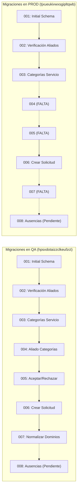

# Plan de Auditoría, Alineación y Estrategia de Migración/Rollback Supabase (PROD y QA) — CFG-26

- **Código:** CFG-26
- **Subtareas Jira:**
  - `SCRUM-1294`: DevOps - Comparar proyectos Supabase PROD y QA y migraciones (Daniel, DevOps).
  - `SCRUM-1295`: DevOps - Validar estrategia de sincronización y rollback (Daniel, DevOps).
- **Hito / Bloqueo:** Esta entrega debe completarse y validarse **ANTES de SCRUM-1106**.
- **Responsable:** Daniel (DevOps Lead) con validación técnica de Santiago y Mesa de Arquitectura.
- **Fecha:** 17 de Octubre, 2026.
- **Alcance Exclusivo:** INVENTARIO, COMPARACIÓN, ESTRATEGIA DE BACKUPS Y PLAN DE ROLLBACK. *(La ejecución física se ejecuta en CFG4-02 / SCRUM-1298 y SCRUM-1299)*.
- **ADRs Vinculantes:**
  - [`ADR-0012`](../../adr/ADR-0012-persistencia-multitenant.md): Persistencia multi-tenant mediante esquemas compartidos y Row Level Security (RLS).
  - [`ADR-0015`](../../adr/ADR-0015-pruebas-aislamiento-multitenant.md): Pruebas de aislamiento multi-tenant.
  - [`ADR-0018`](../../adr/ADR-0018-identificacion-tenant.md): Identificación de tenant vía claims verificados en token JWT.
  - [`ADR-0030`](../../adr/ADR-0030-propiedad-esquema-y-frontera-de-datos.md): Propiedad del esquema en Core Node (`MANI-Node`) y frontera de datos entre microservicios vía HTTP sin queries SQL cruzadas.

---

## 1. Contexto y Objetivos

Para cumplir con el modelo operativo del MVP y el Sprint 4, el sistema MANI utiliza **una base de datos PostgreSQL compartida por ambiente** provista sobre la infraestructura de Supabase:
- **PROD:** Proyecto Supabase `MANI` (Ref: `tjxueukivwxsgipltqwb`, Región: `us-east-2`, Estado: `ACTIVE_HEALTHY`).
- **QA:** Proyecto Supabase `MANI-QA` (Ref: `hpsxdotaizzclkeufzct`, Región: `us-east-2`, Estado: `ACTIVE_HEALTHY`).

El objetivo de esta tarea (CFG-26) es auditar minuciosamente el estado real de ambos ambientes, identificar las brechas de esquema, migraciones, políticas RLS y datos, y estructurar una estrategia rigurosa de respaldo, migración controlada y procedimiento de rollback seguro que garantice **cero pérdida de datos preexistentes**.

---

## 2. Inventario y Matriz Comparativa Detallada (SCRUM-1294)

La auditoría se realizó mediante conexión directa a través del servidor MCP oficial `@supabase/mcp-server-supabase` y llamadas autenticadas a la Management API de Supabase.

### 2.1 Resumen Ejecutivo de Ambientes

| Parámetro | Ambiente PROD (`MANI`) | Ambiente QA (`MANI-QA`) | Diagnóstico / Estado |
|---|---|---|---|
| **Project Ref** | `tjxueukivwxsgipltqwb` | `hpsxdotaizzclkeufzct` | Proyectos aislados en `us-east-2`. |
| **URL Base** | `https://tjxueukivwxsgipltqwb.supabase.co` | `https://hpsxdotaizzclkeufzct.supabase.co` | Correctamente separados. |
| **Tablas en esquema `public`** | 19 tablas | 23 tablas | Divergencia: QA contiene 4 tablas adicionales (`consentimiento_usuario`, `documento_legal`, `poc_asignacion_log`, `solicitud_rechazo`). |
| **Migraciones en `schema_migrations`** | 4 registradas (`001`, `002`, `003`, `006`) | 7 registradas (`001`, `002`, `003`, `004`, `005`, `006`, `007`) | Crítico: PROD saltó `004` y `005`, y le falta `007`. |
| **Migración `008` (Sprint 4)** | No aplicada | No aplicada | Pendiente en ambos ambientes (`008_add_aliado_ausencia.sql`). |
| **Políticas RLS en `public`** | 3 políticas (solo en `cobertura_aliado`) | 22 políticas (en 20 tablas públicas) | **Vulnerabilidad Crítica:** PROD tiene 18 tablas sin RLS. |
| **Funciones / RPCs en `public`** | 28 funciones | 32 funciones | PROD carece de las RPCs de categorías y asignación (`guardar_mis_categorias`, `aceptar_solicitud`, etc.). |
| **Triggers en `public`** | 0 triggers | 2 triggers (`trg_aliado_categoria_tenant`) | En PROD falta el disparador de validación de tenant en `aliado_categoria`. |
| **Extensiones requeridas** | `pgcrypto` (1.3), `uuid-ossp` (1.1) | `pgcrypto` (1.3), `uuid-ossp` (1.1) | Ambos requieren `btree_gist` para la migración `008`. |

---

### 2.2 Inventario de Tablas y Conteo de Registros

| Tabla | Registros PROD | Registros QA | Propósito y Estado |
|---|:---:|:---:|---|
| `tenant` | 3 | 3 | Entidades tenant del sistema (Plomería Express, Electricistas Pro, Cerrajería Total). |
| `zona` | 0 | 3 | Catálogo geográfico de zonas (Bogotá, Chapinero, Suba). |
| `usuario` | 9 | 64 | Cuentas de usuario registradas (PROD tiene 9 usuarios en producción/staging). |
| `aliado` | 3 | 56 | Perfiles de aliados prestadores de servicio. |
| `cliente` | 0 | 3 | Perfiles de clientes solicitantes de servicio. |
| `categoria_servicio` | 3 | 3 | Catálogo de servicios (Plomería, Electricidad, Cerrajería). |
| `aliado_categoria` | 0 | 56 | Relación de categorías atendidas por aliado. |
| `cobertura_aliado` | 0 | 52 | Zonas cubiertas declaradas por los aliados. |
| `sitio` | 0 | 3 | Direcciones / inmuebles del cliente. |
| `solicitud` | 0 | 1 | Solicitudes de servicio publicadas. |
| `solicitud_foto` | 0 | 0 | Fotos adjuntas a las solicitudes (bucket `solicitudes`). |
| `solicitud_rechazo` | **No existe** | 0 | Creada por migración `005`. Registra rechazos de solicitudes por aliado. |
| `aliado_ausencia` | **No existe** | **No existe** | Creada por migración `008`. Ausencias temporales del aliado. |
| `documento_legal` | **No existe** | 6 | Creada en SCRUM-856 (Términos, Condiciones y Habeas Data). |
| `consentimiento_usuario` | **No existe** | 4 | Creada en SCRUM-856 (Aceptaciones de términos por usuario). |
| `poc_asignacion_log` | **No existe** | 13 | Tabla de telemetría de la PoC CFG-09 (concurrencia de despacho). |
| `cotizacion` | 0 | 0 | Cotizaciones económicas emitidas por aliados. |
| `mensaje` | 0 | 0 | Mensajería de chat entre cliente y aliado en una solicitud. |
| `evento_servicio` | 0 | 0 | Línea de tiempo de eventos de servicio. |
| `calificacion` | 0 | 0 | Calificaciones bidireccionales post-servicio. |
| `notificacion` | 2 | 0 | Bandeja de notificaciones in-app. |
| `documento_kyc` | 0 | 4 | Documentos de identidad y verificación de aliados. |
| `tarifa_referencia` | 0 | 0 | Tarifas mínimas, típicas y máximas por categoría. |
| `schema_migrations` | 4 | 7 | Tabla de control de versiones de base de datos. |

---

### 2.3 Comparación de Migraciones Registradas



- **En QA:** Secuencia `001` a `007` perfectamente aplicada y verificada.
- **En PROD:** Se aplicaron `001`, `002`, `003` y se saltó directamente a `006`, omitiendo:
  - `004_aliado_categorias.sql`: Índice único anti-duplicados, trigger de aislamiento de tenant y funciones `guardar_mis_categorias` y `obtener_mis_categorias`.
  - `005_aceptar_rechazar_solicitud.sql`: Tabla `solicitud_rechazo`, asignación atómica anti-doble asignación (`UPDATE ... WHERE estado = 'PENDIENTE' AND aliado_id IS NULL`), funciones `aceptar_solicitud` y `rechazar_solicitud`.
  - `007_normalizar_dominios.sql`: Homologación de dominios a mayúsculas (`ACTIVO`, `VERIFICADO`, `ASIGNADA`), validación de constraints `ck_categoria_estado` y compatibilidad con el Custom Access Token Hook.

---

### 2.4 Comparación de Políticas de Seguridad Row Level Security (RLS)

- **En QA:** Cumple [`ADR-0012`](../../adr/ADR-0012-persistencia-multitenant.md) y [`ADR-0015`](../../adr/ADR-0015-pruebas-aislamiento-multitenant.md). Dispone de **22 políticas RLS**:
  - `tenant_isolation_<tabla>` en `aliado`, `aliado_categoria`, `calificacion`, `categoria_servicio`, `cliente`, `cobertura_aliado`, `cotizacion`, `documento_kyc`, `evento_servicio`, `mensaje`, `notificacion`, `sitio`, `solicitud`, `tarifa_referencia`, `usuario`. Expresión canónica:
    ```sql
    USING (tenant_id = (((auth.jwt() -> 'app_metadata'::text) ->> 'tenant_id'::text))::uuid)
    ```
  - Catálogos compartidos de lectura global: `lectura_global_tenant` en `tenant`, `lectura_global_zona` en `zona`.
  - Lectura de identidad para emisión de claims: `hook_lee_usuario` en `usuario` para el rol `supabase_auth_admin`.
  - Políticas de servicio en `documento_legal` y `consentimiento_usuario` para `service_role`.
- **En PROD:** Solamente cuenta con **3 políticas** sobre `cobertura_aliado` (`cobertura_aliado_owner_delete`, `_insert`, `_update`). Todas las demás tablas tienen RLS habilitado pero sin políticas declaradas, lo cual rechazaría cualquier lectura proveniente de tokens de usuario estándar (`authenticated`).

---

## 3. Estrategia de Backups y Custodia en Host Dedicado (SCRUM-1295)

Para garantizar el cumplimiento de buenas prácticas de ingeniería de software, los artefactos de respaldo binarios y los scripts operativos **no se almacenan en el repositorio de documentación** `MANI-docs`. En su lugar, se custodian en la **Máquina Virtual dedicada de Bases de Datos y Respaldos**:

- **Host Dedicado:** `10.43.98.197` (Ubuntu 22.04.5 LTS Jammy Jellyfish)
- **Usuario de Operación:** `estudiante`
- **Ruta de Almacenamiento en Servidor:** `/opt/database-backups/mani/pre-consolidation/`

### 3.1 Artefactos de Respaldo Generados y Custodiados
1. **Ambiente PROD (`tjxueukivwxsgipltqwb`):**
   - Metadata de Esquema y DDL: `/opt/database-backups/mani/pre-consolidation/backup_prod_tjxueukivwxsgipltqwb_pre_consolidation.json` (31 KB)
   - Datos en Sentencias INSERT SQL: `/opt/database-backups/mani/pre-consolidation/backup_prod_tjxueukivwxsgipltqwb_data.sql` (6.8 KB)
2. **Ambiente QA (`hpsxdotaizzclkeufzct`):**
   - Metadata de Esquema y DDL: `/opt/database-backups/mani/pre-consolidation/backup_qa_hpsxdotaizzclkeufzct_pre_consolidation.json` (129 KB)
   - Datos en Sentencias INSERT SQL: `/opt/database-backups/mani/pre-consolidation/backup_qa_hpsxdotaizzclkeufzct_data.sql` (89 KB)

Ambos respaldos verifican la existencia íntegra de los 9 usuarios y 3 aliados de PROD, y de los 64 usuarios y 56 aliados de QA, listos para restauración inmediata mediante `ON CONFLICT DO NOTHING`.

---

## 4. Estrategia de Sincronización y Rollback Seguro (SCRUM-1295)

### 4.1 Plan de Sincronización en QA (`hpsxdotaizzclkeufzct`)

Dado que QA ya se encuentra en la versión `007`, la única acción pendiente es aplicar la migración del Sprint 4:
1. Validar pre-condiciones: extensión `btree_gist` y tabla `aliado`.
2. Ejecutar `008_add_aliado_ausencia.sql`:
   - Crea `aliado_ausencia` con clave foránea compuesta `(aliado_id, tenant_id)`.
   - Restricción temporal de exclusión `ex_aliado_ausencia_solapamiento`.
   - Política RLS `Aliado lee sus propias ausencias`.
   - Registro en `schema_migrations` (`version = '008'`).

### 4.2 Plan de Sincronización en PROD (`tjxueukivwxsgipltqwb`)

Para evitar cualquier conflicto de orden DDL, se aplica la siguiente secuencia:
1. **Paso 1: Aplicar `004_aliado_categorias.sql`:**
   - Crea índice único `uq_aliado_categoria` y trigger de validación de tenant.
   - Crea RPCs `guardar_mis_categorias`, `obtener_mis_categorias`, `listar_categorias_tenant`.
   - Registra `'004'` en `schema_migrations`.
2. **Paso 2: Aplicar `005_aceptar_rechazar_solicitud.sql`:**
   - Crea tabla `solicitud_rechazo` con RLS.
   - Crea funciones de asignación atómica `aceptar_solicitud` y `rechazar_solicitud`.
   - Registra `'005'` en `schema_migrations`.
3. **Paso 3: Re-validar `_sol_zona_cubierta` (corrección de 006):**
   - Asegurar que la función `_sol_zona_cubierta` mantenga el soporte `_zona_activa(z.estado)` introducido en la migración `006`.
4. **Paso 4: Aplicar `007_normalizar_dominios.sql`:**
   - Ejecuta normalización de enumeraciones (ya verificadas en PROD).
   - Valida constraints `ck_categoria_estado` y `ck_categoria_flujo`.
   - Registra `'007'` en `schema_migrations`.
5. **Paso 5: Sincronizar Políticas RLS Multi-Tenant:**
   - Desplegar las políticas `tenant_isolation_*` en las tablas pendientes para alcanzar paridad absoluta con QA y cumplir con [`ADR-0012`](../../adr/ADR-0012-persistencia-multitenant.md).
6. **Paso 6: Aplicar `008_add_aliado_ausencia.sql`:**
   - Instala `btree_gist`, crea `aliado_ausencia` y su RLS.
   - Registra `'008'` en `schema_migrations`.
7. **Paso 7: Sincronizar tablas legales de Habeas Data:**
   - Crear `documento_legal` y `consentimiento_usuario` con RLS activo para soporte de SCRUM-856.

---

### 4.3 Procedimientos de Rollback Seguro y Custodia en VM

Los scripts de contingencia y reversión no destructivos se encuentran almacenados y custodiados en la **Máquina Virtual de Bases de Datos (`10.43.98.197`)** bajo el directorio `/opt/database-backups/mani/rollback/`:

1. **Rollback de 008 (`/opt/database-backups/mani/rollback/rollback_008_add_aliado_ausencia.sql`):**
   - Si la tabla `aliado_ausencia` contiene datos, los preserva automáticamente en `_bak_aliado_ausencia_rollback`.
   - Elimina la política RLS y la tabla `aliado_ausencia`.
   - Retira la restricción única `ux_aliado_id_tenant`.
   - Elimina el registro `'008'` de `schema_migrations`.
2. **Rollback de 005 y 004 (`/opt/database-backups/mani/rollback/rollback_005_004.sql`):**
   - Preserva los datos de `solicitud_rechazo` en `_bak_solicitud_rechazo_rollback`.
   - Retira las RPCs y la tabla `solicitud_rechazo`.
   - Retira triggers e índices de `aliado_categoria`.
   - Elimina los registros `'005'` y `'004'` de `schema_migrations`.

---

## 5. Definición de Terminado (DoD) y Criterio de Cierre (CFG-26)

- [x] Inventario completo de conexiones, tablas, esquemas, RLS, migraciones, secrets y seeds documentado.
- [x] Matriz comparativa exhaustiva PROD vs QA validada con datos en vivo.
- [x] Respaldos lógicos JSON y SQL pre-consolidación generados y custodiados en la máquina virtual dedicada `10.43.98.197` en `/opt/database-backups/mani/pre-consolidation/`.
- [x] Scripts de rollback seguros e idempotentes elaborados y custodiados en la máquina virtual dedicada `10.43.98.197` en `/opt/database-backups/mani/rollback/`.
- [x] Plan de sincronización secuencial y transaccional diseñado sin riesgo de sobreescritura destructiva ni pérdida de datos.
- [x] Documento validado y listo para dar paso a la ejecución en `CFG4-02` (SCRUM-1298 y SCRUM-1299) antes de `SCRUM-1106`.
