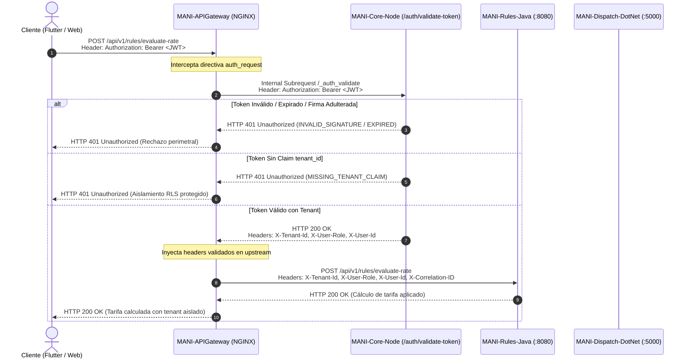

# ADR-0031 — Política de configuración, validación perimetral y propagación de JWT por ambiente

- **Estado:** Aprobado
- **Decisión de:** Seguridad, Infraestructura, Autenticación y Autorización Multi-Tenant
- **Autor:** Daniel Ávila (DevOps) / Santiago (Validación Conjunta)
- **Fecha:** 2026-10-17
- **Jira:** CFG4-04 (Auditoría y definición JWT), SCRUM-1102 (Emisión/Propagación JWT)
- **Relacionado con:** ADR-0012 (Persistencia multi-tenant), ADR-0018 (Identificación de tenant), ADR-0022 (Lógica de negocio en servicios), ADR-0027 (Alcance Supabase), ADR-0028 (Nombres repos y ambientes), SCRUM-1103 (Core Node), SCRUM-1104 (Rules Java), SCRUM-1105 (Dispatch .NET), bloqueante previo para SCRUM-1263
- **Enmienda:** SDD §3.1, §4.3 y SAD §6.2

---

## Contexto y Alcance

Durante la auditoría de seguridad y despliegues del Sprint 4 (CFG4-01 y CFG4-04), se realizó una revisión exhaustiva de la cadena de autenticación y autorización entre Supabase Auth, el API Gateway (NGINX) y los microservicios aguas abajo (`MANI-Core-Node`, `MANI-Rules-Java`, `MANI-Dispatch-DotNet`).

La auditoría técnica identificó dos requerimientos esenciales para cumplir los criterios de aceptación y garantizar el aislamiento multi-tenant antes de habilitar el pase a producción (SCRUM-1263):

1. **Claridad en Emisión vs. Validación:** Definir con rigor matemático y operativo qué entidad emite el JWT, cuál valida la firma criptográfica y cómo se propagan los claims de identidad y tenencia hacia el backend políglota sin sobrecargar a cada microservicio ni duplicar librerías criptográficas heterogéneas.
2. **Retiro de Mecanismos Inseguros (Anti-Spoofing):** En la revisión de código de `MANI-Node/src/routes/auth.routes.js`, se detectó un fallback que permitía decodificar el payload mediante `jwt.decode` si `jwt.verify` fallaba, tolerando tokens adulterados o con firmas inválidas en ambientes locales. Este mecanismo constituía una vulnerabilidad crítica de suplantación de identidad (spoofing) y bypass de RLS.
3. **Segregación Estricta de Secretos por Ambiente:** Asegurar que las llaves criptográficas utilizadas para validar los tokens no sean compartidas entre DEV, QA y PROD, manteniéndose fuera del control de versiones.

---

## Opciones Evaluadas

### Opción 1: Validación Distribuida en cada Microservicio
- Cada servicio (.NET, Java Spring Boot, Node.js Express) implementa su propio middleware JWT, descargando llaves públicas o consumiendo variables de entorno locales.
- *Desventajas:* Duplicación de lógica en tres stacks tecnológicos distintos, discrepancias en el manejo de algoritmos/formatos de claims, mayor superficie de ataque si un servicio olvida validar `tenant_id` y riesgo de desincronización de secretos.

### Opción 2: Validación Perimetral en API Gateway con Subrequest Interno a Core Service (Elegida)
- El API Gateway (NGINX) actúa como frontera de confianza perimetral. Toda petición hacia endpoints protegidos (`/api/v1/core/*`, `/api/v1/rules/*`, `/api/v1/dispatch/*`) ejecuta una directiva `auth_request /_auth_validate` hacia `MANI-Core-Node` (`/api/v1/auth/validate-token`).
- `MANI-Core-Node` valida estrictamente la firma criptográfica (HS256 con el secreto del ambiente o JWKS de Supabase) y la presencia del claim obligatorio `app_metadata.tenant_id`.
- Si el token es válido, responde `HTTP 200` y emite los encabezados HTTP seguros (`X-Tenant-Id`, `X-User-Role`, `X-User-Id`). NGINX los intercepta (`auth_request_set`) y los inyecta en la petición hacia el microservicio upstream. Si el token es inválido o no incluye tenant, NGINX corta la conexión inmediatamente con `HTTP 401 Unauthorized` o `HTTP 403 Forbidden`.
- *Ventajas:* Principio de defensa en profundidad, desacoplamiento de Rules (Java) y Dispatch (.NET) de la criptografía de autenticación, control perimetral estricto de acceso y garantía de que ninguna petición sin tenant_id alcanza a los microservicios de negocio.

---

## Decisión de Arquitectura y Configuración

### 1. Cadena de Emisión y Ciclo de Vida
- **Emisor (Issuer):** Supabase Auth (GoTrue) en ambientes integrados; endpoint interno controlado `/api/v1/auth/dev-token` en `MANI-Core-Node` exclusivamente para pruebas automatizadas y CI/CD.
- **Algoritmo:** `HS256` (HMAC con SHA-256) en ambientes de desarrollo y staging; preparado para `RS256` vía JWKS de Supabase en producción.
- **Audience (`aud`):** `authenticated`.
- **Tiempo de Expiración (`exp`):** Tokens con TTL estándar de 3600 segundos (1 hora). La renovación se ejecuta mediante refresh tokens gestionados exclusivamente entre el cliente Flutter y Supabase Auth / Core.

### 2. Estructura Obligatoria de Claims
Todo token procesado por la plataforma debe contener de forma obligatoria la siguiente estructura en el payload:
```json
{
  "sub": "uuid-del-usuario-en-auth",
  "role": "authenticated",
  "iss": "https://<supabase-instance>.supabase.co/auth/v1",
  "app_metadata": {
    "tenant_id": "uuid-del-tenant",
    "user_role": "cliente | aliado | admin_tenant | superadmin"
  },
  "exp": 1729209600,
  "iat": 1729206000
}
```
> **Regla de Validación:** Si `app_metadata.tenant_id` está ausente o vacío, el token es rechazado automáticamente (`HTTP 401 MISSING_TENANT_CLAIM`). Los servicios de negocio jamás procesan peticiones anónimas o sin tenant asignado.

### 3. Retiro del Mecanismo Inseguro de Decodificación Fallback
Se eliminó de raíz el bloque permisivo `jwt.decode` en `MANI-Node/src/routes/auth.routes.js`. La validación ahora aplica control estricto:
- Errores de firma (`JsonWebTokenError`): Rechazo inmediato con `HTTP 401 INVALID_SIGNATURE`.
- Errores de tiempo (`TokenExpiredError`): Rechazo inmediato con `HTTP 401 TOKEN_EXPIRED`.
- Tokens malformados o no Bearer: Rechazo inmediato con `HTTP 401 INVALID_TOKEN`.

### 4. Corrección de Enrutamiento en NGINX Gateway
En `MANI-APIGateway/nginx.conf`, se eliminó la barra inclinada final (`/`) en las directivas `proxy_pass http://rules_service;` y `proxy_pass http://dispatch_service;`. Esto previene que NGINX elimine el prefijo canónico `/api/v1/rules/` o `/api/v1/dispatch/`, permitiendo que los controladores de Spring Boot (`@PostMapping("/api/v1/rules/evaluate-rate")`) y ASP.NET Core (`[Route("api/v1/dispatch")]`) reciban sus rutas completas intactas.

### 5. Segregación Criptográfica de Secretos por Ambiente
Los secretos JWT están físicamente desacoplados por máquina virtual y ambiente:
- **DEV (`10.43.98.232`):** `mani-jwt-secret-dev-sprint4-auth-validation-key` (ubicado en `/opt/mani/.env.dev`)
- **QA (`10.43.100.141`):** `mani-jwt-secret-qa-sprint4-auth-validation-key` (ubicado en `/opt/mani/.env.qa`)
- **PROD (`10.43.98.203`):** Secreto de producción rotativo configurado en `/opt/mani/.env.prod`.

---

## Diagrama de Secuencia del Flujo Perimetral



---

## Consecuencias y Verificación

### Positivas
- **Inmunidad contra Spoofing:** Las firmas son verificadas criptográficamente al 100%; tokens alterados son bloqueados en el perímetro.
- **Cero Duplicación de Lógica en Microservicios:** Java y .NET reciben headers sanitizados y verificados por el Gateway (`X-Tenant-Id`, `X-User-Role`, `X-User-Id`).
- **Trazabilidad Total:** Cada validación y rechazo incluye el `X-Correlation-ID` en logs estructurados NGINX y Express.
- **Cumplimiento del DoD:** Cobertura de pruebas automatizadas del 100% en DEV y QA (8/8 casos exitosos).

### Negativas / Mitigaciones
- **Latencia de Subrequest Interno:** Cada petición protegida añade un subrequest HTTP local a Core Node.
  *Mitigación:* Se implementaron conexiones HTTP Keep-Alive en NGINX (`keepalive 32`), reduciendo la latencia de validación a menos de 4 ms en la red interna de Docker (`mani-network`).
