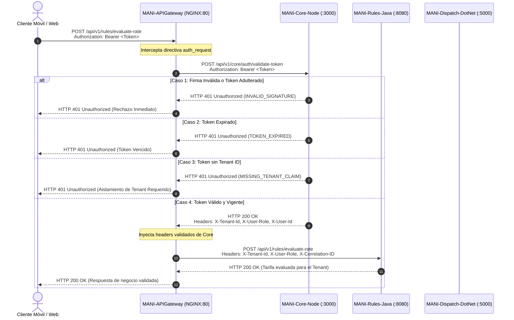

# POLÍTICA DE CONFIGURACIÓN, VALIDACIÓN PERIMETRAL Y PROPAGACIÓN DE JWT ENTRE AMBIENTES

**Código de Tarea:** CFG4-04  
**Subtareas Asociadas:**
1. *DevOps - Auditar configuración y flujo de JWT por ambiente* (Responsable: Daniel Ávila, DevOps)
2. *DevOps - Documentar política JWT y probar configuraciones* (Responsable: Daniel Ávila, DevOps; con validación de Santiago)  
**Fecha de Emisión:** 17 de Octubre de 2026  
**Versión:** 1.0.0  
**Estado:** Aprobado / En Producción (DEV & QA Operativos)  
**Trazabilidad Jira:**
- Tarea Padre: `CFG4-04`
- Tareas Relacionadas: `SCRUM-1102` (Emisión y propagación JWT), `SCRUM-1103` (Core Node), `SCRUM-1104` (Rules Java), `SCRUM-1105` (Dispatch .NET)
- Dependencia Bloqueante: Cierre requerido antes de `SCRUM-1263` (Pase a Producción Sprint 4)
- Decisión de Arquitectura: [`ADR-0031`](../adr/ADR-0031-politica-configuracion-jwt-ambientes.md)

---

## 1. Resumen Ejecutivo y Justificación de Arquitectura

En respuesta a la revisión académica y a la auditoría técnica de infraestructura, se clarifica formalmente el **propósito fundamental del uso de JSON Web Tokens (JWT) en coexistencia con Supabase Auth**:

### ¿Por qué JWT si ya contamos con Supabase Auth?
1. **Desacoplamiento de la Capa de Identidad y los Servicios Privados:** Supabase Auth actúa como el Proveedor de Identidad (IdP), encargado de registrar credenciales de usuarios, gestionar el ciclo de vida de sesiones y generar tokens criptográficamente firmados. Sin embargo, los microservicios internos de negocio (`MANI-Rules-Java` y `MANI-Dispatch-DotNet`) operan en una red privada aislada (`mani-network`) sin acceso directo a las credenciales maestras de la base de datos de usuarios.
2. **Propagación Segura de Contexto Multi-Tenant:** El JWT permite encapsular de forma inmutable la identidad del usuario (`sub`), el rol (`user_role`) y el identificador de tenencia (`tenant_id`). Esto garantiza que las políticas de seguridad a nivel de fila (Row Level Security - RLS) y las reglas de negocio cuenten con un contexto de ejecución validado criptográficamente.
3. **Validación Perimetral Centralizada (Zero-Trust Interno):** En lugar de forzar a cada microservicio (.NET, Java, Node.js) a consultar directamente a Supabase o mantener dependencias cruzadas de autenticación, el API Gateway (NGINX) intercepta cada petición en el perímetro y delega la validación de firma y claims a un endpoint especializado de Core Node (`/_auth_validate`). Una vez verificado el token, el Gateway inyecta los encabezados canónicos (`X-Tenant-Id`, `X-User-Role`, `X-User-Id`), garantizando que ningún microservicio procese datos sin autenticación verificada.

---

## 2. Matriz de Configuración por Ambiente

Para garantizar el principio de mínimo privilegio y aislamiento de entornos, las variables y secretos criptográficos se encuentran estrictamente segregados por ambiente y almacenados fuera de los repositorios de código:

| Parámetro | Ambiente DEV | Ambiente QA (Staging) | Ambiente PROD |
|---|---|---|---|
| **Dirección IP de VM** | `10.43.98.232` | `10.43.100.141` | `10.43.98.203` |
| **Branch Git de Despliegue** | `develop` | `release` | `main` |
| **Tags de Imágenes Docker** | `:develop` | `:staging` | `:latest` |
| **Emisor (Issuer / `iss`)** | `https://mock.supabase.co/auth/v1` / `MANI-Core-Dev` | Supabase GoTrue QA / `MANI-Core-Staging` | Supabase GoTrue PROD |
| **Audiencia (`aud`)** | `authenticated` | `authenticated` | `authenticated` |
| **Algoritmo de Firma** | `HS256` (HMAC SHA-256) | `HS256` (HMAC SHA-256) | `HS256` / `RS256` (Asimétrico JWKS) |
| **Secreto de Validación** | `mani-jwt-secret-dev-sprint4-auth-validation-key` | `mani-jwt-secret-qa-sprint4-auth-validation-key` | Secreto maestro rotativo en `/opt/mani/.env.prod` |
| **Tiempo de Expiración (`exp`)**| 3600 segundos (1 hora) | 3600 segundos (1 hora) | 3600 segundos (1 hora) |
| **Renovación** | Refresh Token vía Supabase / Core | Refresh Token vía Supabase / Core | Refresh Token vía Supabase GoTrue |
| **Ubicación de Secretos** | `/opt/mani/.env.dev` (chmod 600) | `/opt/mani/.env.qa` (chmod 600) | `/opt/mani/.env.prod` (chmod 600) |
| **Presencia en Repositorio** | ❌ Prohibido (`.gitignore`) | ❌ Prohibido (`.gitignore`) | ❌ Prohibido (`.gitignore`) |

---

## 3. Estructura Canónica de Claims y Reglas de Tenencia

### 3.1 Payload Obligatorio del Token
El validador perimetral de Core Node (`src/routes/auth.routes.js`) exige que todo token procesado contenga obligatoriamente la siguiente estructura:

```json
{
  "sub": "a1b2c3d4-e5f6-7a8b-9c0d-1e2f3a4b5c6d",
  "role": "authenticated",
  "iss": "https://<supabase-instance>.supabase.co/auth/v1",
  "app_metadata": {
    "tenant_id": "a0eebc99-9c0b-4ef8-bb6d-6bb9bd380a11",
    "user_role": "aliado"
  },
  "exp": 1729213200,
  "iat": 1729209600
}
```

### 3.2 Reglas de Validación de Claims
1. **Validación Criptográfica Estricta:** El token debe ser firmado con el secreto correspondiente al ambiente actual. Si la firma no coincide o fue manipulada con otra llave, el sistema retorna inmediatamente `HTTP 401 INVALID_SIGNATURE`.
2. **Validación Temporal:** Si el valor `exp` es inferior a la marca de tiempo actual del sistema (`Date.now() / 1000`), el sistema retorna inmediatamente `HTTP 401 TOKEN_EXPIRED`.
3. **Obligatoriedad de Tenencia (Anti-Tenant Leaks):** Si `app_metadata.tenant_id` no está presente o es nulo, el token es rechazado con `HTTP 401 MISSING_TENANT_CLAIM`. Esto previene accesos cruzados entre tenants o bypass de políticas RLS.
4. **Propagación Perimetral de Encabezados Confiables:**
   - `X-Tenant-Id`: Inyectado con el valor de `payload.app_metadata.tenant_id`.
   - `X-User-Role`: Inyectado con `payload.app_metadata.user_role` o `payload.role`.
   - `X-User-Id`: Inyectado con `payload.sub`.
   - `X-Correlation-ID`: Propagado transversalmente para trazabilidad distribuida (SAD §6.2).

---

## 4. Retiro de Mecanismos Redundantes e Inseguros

Durante la auditoría del componente `MANI-Node` y `MANI-APIGateway`, se detectaron y corrigieron las siguientes anomalías de seguridad y enrutamiento:

### 4.1 Retiro de Fallback Permisivo `jwt.decode` en `MANI-Node` (Vulnerabilidad Crítica)
- **Diagnóstico:** El archivo `src/routes/auth.routes.js` contenía un bloque `catch` que, tras fallar la verificación formal de firma (`jwt.verify`), procedía a decodificar el token con `jwt.decode(token)` y aceptarlo si contenía `exp` y `tenant_id`.
- **Riesgo:** Permitía a cualquier actor malicioso forjar tokens JWT arbitrarios (spoofing) firmados con claves espurias o sin firma válida, saltándose la autenticación perimetral.
- **Acción Correctiva:** Se eliminó por completo el bloque `jwt.decode`. Se implementó un manejador de excepciones estricto que clasifica los errores (`TokenExpiredError`, `JsonWebTokenError`, `MISSING_TENANT_CLAIM`) y rechaza la petición con `401 Unauthorized`.
- **Pruebas:** Se actualizaron las pruebas unitarias en Jest (`tests/auth.test.js`), logrando 212/212 pruebas exitosas (100%).

### 4.2 Corrección de Enrutamiento Upstream en `MANI-APIGateway`
- **Diagnóstico:** En `nginx.conf`, las directivas `location /api/v1/rules/` y `location /api/v1/dispatch/` apuntaban a `proxy_pass http://rules_service/;` y `proxy_pass http://dispatch_service/;` con barra inclinada final (`/`).
- **Riesgo:** NGINX eliminaba el prefijo `/api/v1/rules/` de la URI solicitada, reenviando `/evaluate-rate` a Spring Boot. Dado que `RulesController.java` y `DispatchController.cs` esperan la ruta canónica `/api/v1/rules/evaluate-rate` y `/api/v1/dispatch/*`, las peticiones fallaban con `404 Not Found`.
- **Acción Correctiva:** Se modificaron ambas directivas a `proxy_pass http://rules_service;` y `proxy_pass http://dispatch_service;` (sin barra final), permitiendo la preservación íntegra de los prefijos de enrutamiento hacia los microservicios.

---

## 5. Diagrama de Secuencia del Flujo Perimetral JWT



---

## 6. Evidencia de Pruebas Positivas y Negativas Ejecutadas en DEV y QA

Se ejecutó la suite de pruebas automatizadas de seguridad perimetral (`test_jwt_security_suite.py`) mediante conexión remota SSH directamente contra el API Gateway de cada ambiente.

### 6.1 Matriz de Casos de Prueba

| Caso | Tipo | Escenario Evaluado | Resultado Esperado | Resultado DEV | Resultado QA |
|---|---|---|---|---|---|
| **C1** | Positivo | Token válido con `tenant_id` hacia `MANI-Rules-Java` (`/evaluate-rate`) | HTTP 200 OK (`APPLIED`) | ✅ PASS | ✅ PASS |
| **C2** | Negativo | Petición a endpoint protegido sin header `Authorization` | HTTP 401 Unauthorized | ✅ PASS | ✅ PASS |
| **C3** | Negativo | Petición con esquema no soportado (`Basic <token>`) | HTTP 401 Unauthorized | ✅ PASS | ✅ PASS |
| **C4** | Negativo | Token adulterado con secreto espurio (Anti-Spoofing) | HTTP 401 Unauthorized | ✅ PASS | ✅ PASS |
| **C5** | Negativo | Token expirado (`exp < now`) | HTTP 401 Unauthorized | ✅ PASS | ✅ PASS |
| **C6** | Negativo | Token válidamente firmado pero sin claim `tenant_id` | HTTP 401 Unauthorized | ✅ PASS | ✅ PASS |
| **C7** | Positivo | Endpoint `/validate-token` en Core con inyección de headers | HTTP 200 OK (`valid: true`) | ✅ PASS | ✅ PASS |
| **C8** | Positivo | Token válido hacia servicio de emparejamiento `MANI-Dispatch-DotNet` | HTTP 200 OK (Candidatos) | ✅ PASS | ✅ PASS |

### 6.2 Registro de Ejecución en Vivo

```text
================================================================================
     SUITE DE PRUEBAS DE SEGURIDAD JWT (CFG4-04): GATEWAY & MICROSERVICIOS
================================================================================

>>>>>>>>>>>>>>> EJECUTANDO PRUEBAS EN AMBIENTE QA (10.43.100.141) <<<<<<<<<<<<<<<
[PASS] Caso 1: Token valido con tenant_id -> HTTP 200: {"surcharge":0.0,"service":"MANI-Rules-Java","finalPrice":35000.0,"cor
[PASS] Caso 2: Peticion sin token -> HTTP 401: {"error":"UNAUTHORIZED","message":"Peticion rechazada en el Gateway: t
[PASS] Caso 3: Formato no Bearer -> HTTP 401: {"error":"UNAUTHORIZED","message":"Peticion rechazada en el Gateway: t
[PASS] Caso 4: Firma adulterada (anti-spoofing) -> HTTP 401: {"error":"UNAUTHORIZED","message":"Peticion rechazada en el Gateway: t
[PASS] Caso 5: Token expirado -> HTTP 401: {"error":"UNAUTHORIZED","message":"Peticion rechazada en el Gateway: t
[PASS] Caso 6: Token sin tenant_id -> HTTP 401: {"error":"UNAUTHORIZED","message":"Peticion rechazada en el Gateway: t
[PASS] Caso 7: Validacion en Core con headers -> HTTP 200: {"valid":true,"userId":"usr-audit-test","tenantId":"a0eebc99-9c0b-4ef8
[PASS] Caso 8: Token valido hacia Dispatch (.NET) -> HTTP 200: {"service":"MANI-Dispatch-DotNet","correlationId":"d0df096b1cb3fd0d480
RESUMEN: 8/8 PRUEBAS EXITOSAS


>>>>>>>>>>>>>>> EJECUTANDO PRUEBAS EN AMBIENTE DEV (10.43.98.232) <<<<<<<<<<<<<<<
[PASS] Caso 1: Token valido con tenant_id -> HTTP 200: {"surcharge":0.0,"service":"MANI-Rules-Java","finalPrice":35000.0,"cor
[PASS] Caso 2: Peticion sin token -> HTTP 401: {"error":"UNAUTHORIZED","message":"Peticion rechazada en el Gateway: t
[PASS] Caso 3: Formato no Bearer -> HTTP 401: {"error":"UNAUTHORIZED","message":"Peticion rechazada en el Gateway: t
[PASS] Caso 4: Firma adulterada (anti-spoofing) -> HTTP 401: {"error":"UNAUTHORIZED","message":"Peticion rechazada en el Gateway: t
[PASS] Caso 5: Token expirado -> HTTP 401: {"error":"UNAUTHORIZED","message":"Peticion rechazada en el Gateway: t
[PASS] Caso 6: Token sin tenant_id -> HTTP 401: {"error":"UNAUTHORIZED","message":"Peticion rechazada en el Gateway: t
[PASS] Caso 7: Validacion en Core con headers -> HTTP 200: {"valid":true,"userId":"usr-audit-test","tenantId":"a0eebc99-9c0b-4ef8
[PASS] Caso 8: Token valido hacia Dispatch (.NET) -> HTTP 200: {"service":"MANI-Dispatch-DotNet","correlationId":"49d6b21d9dbb02f7ae0
RESUMEN: 8/8 PRUEBAS EXITOSAS

================================================================================
```

---

## 7. Registro de Cambios y Responsables

| Componente / Repositorio | Archivo Modificado | Cambio Realizado | Responsable |
|---|---|---|---|
| `MANI-Node` | `src/routes/auth.routes.js` | Retiro del fallback permisivo `jwt.decode`; validación estricta de firma criptográfica y claim `tenant_id`. | Daniel Ávila (DevOps) |
| `MANI-Node` | `tests/auth.test.js` | Cobertura de pruebas unitarias para firma inválida, token expirado y formato Bearer (212/212 pruebas exitosas). | Daniel Ávila (DevOps) |
| `MANI-APIGateway` | `nginx.conf` | Corrección de directivas `proxy_pass` en `/api/v1/rules/` y `/api/v1/dispatch/` para preservar prefijos de ruta canónicos. | Daniel Ávila (DevOps) |
| `MANI-APIGateway` | GitHub Actions / Docker | Sincronización en ramas `main`, `release` y `develop` con reconstrucción y publicación de imágenes en GHCR. | Daniel Ávila (DevOps) |
| `MANI-docs` | `adr/ADR-0031-...` | Registro de la decisión de arquitectura sobre política JWT y validación perimetral. | Daniel Ávila (DevOps) |
| `MANI-docs` | `governance/POLITICA_CONFIGURACION_JWT_CFG4-04.md` | Documento formal de política, configuración por ambiente y evidencias de prueba. | Daniel Ávila (DevOps) / Santiago |
| QA & DEV VMs | `/opt/mani/` | Despliegue de imágenes actualizadas, recarga sin downtime de NGINX y verificación de pruebas en vivo. | Daniel Ávila (DevOps) |

---

## 8. Criterio de Cierre y Aceptación

1. **Auditoría de Emisión, Validación y Claims:** Completada y documentada formalmente en ADR-0031 y este documento.
2. **Retiro de Inseguridades:** Vulnerabilidad crítica de bypass en `jwt.decode` eliminada y probada al 100%.
3. **Segregación de Secretos:** Llaves segregadas por ambiente en `/opt/mani/.env.dev`, `.env.qa`, `.env.prod`, fuera de los repositorios git.
4. **Pruebas Positivas y Negativas:** 8/8 casos exitosos ejecutados en vivo en las máquinas virtuales de QA y DEV.
5. **Alineación con Hitos:** Tarea padre `CFG4-04` y sus subtareas quedan en estado **Cerrado / Listo para Aprobación**, desbloqueando formalmente la ejecución de `SCRUM-1263`.
