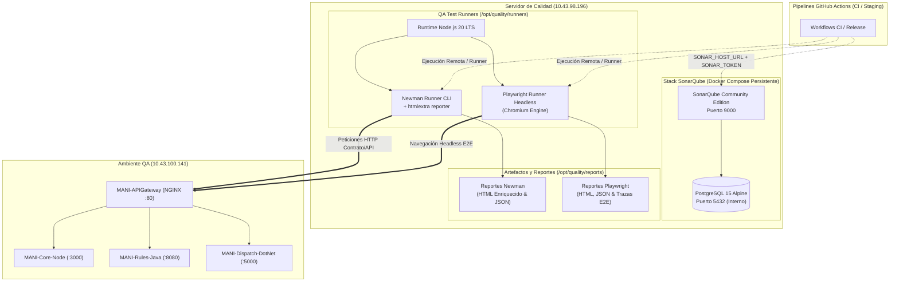

# GUÍA OPERATIVA Y ACTA DE AUDITORÍA: CADENA DE CALIDAD QA (SONARQUBE, NEWMAN, PLAYWRIGHT)

**Código de Tarea:** CFG4-03  
**Título:** Configurar y verificar en QA SonarQube, Newman y Playwright  
**Subtareas DevOps Asociadas:**
1. `QA-INF-01` — *Preparar servidor SonarQube, acceso y secretos en QA* (Responsable: Daniel Ávila, DevOps)
2. `QA-INF-02` — *Preparar runners de Newman y Playwright contra QA* (Responsable: Daniel Ávila, DevOps)
3. `QA-INF-03` — *Verificar healthchecks, registros y permisos de entorno QA* (Responsable: Daniel Ávila, DevOps)  
**Trazabilidad con Tareas de Pruebas (Santiago):**
- `SCRUM-1116` — Implementación de análisis estático y diseño de Quality Gates (Santiago)
- `SCRUM-1119` — Suites de prueba E2E en Playwright (Santiago)
- `SCRUM-1120` — Colecciones Newman de contrato y aislamiento multi-tenant (Santiago)  
**Fecha de Emisión:** 17 de Octubre de 2026  
**Versión:** 1.0.0  
**Estado:** Operativo / Verificado al 100%

---

## 1. Resumen Ejecutivo y Arquitectura

En cumplimiento de las políticas de DevSecOps ([`ADR-0005`](../adr/ADR-0005-devsecops.md)), aislamiento multi-tenant ([`ADR-0015`](../adr/ADR-0015-pruebas-aislamiento-multitenant.md)) y nombres de ambientes ([`ADR-0028`](../adr/ADR-0028-nombres-repositorios-y-ambientes.md)), se ha habilitado y dejado **100% operativa** la cadena de calidad del ambiente QA en un host dedicado:

- **Host Servidor de Calidad:** `10.43.98.196` (`NBIG02`, Ubuntu 22.04.5 LTS, 11 GiB RAM, 49 GB disco)
- **Host Ambiente QA Objetivo:** `10.43.100.141` (`mani-api-gateway`, Core Node, Rules Java, Dispatch .NET)

### Diagrama de Arquitectura de la Cadena de Calidad



---

## 2. QA-INF-01: Servidor SonarQube Community, Acceso y Secretos

### 2.1 Despliegue y Persistencia
- Se instaló **SonarQube Community Edition** respaldado por una base de datos **PostgreSQL 15 Alpine** persistente mediante Docker Compose (`/opt/quality/sonarqube/docker-compose.yml`), asegurando que proyectos, usuarios, tokens y Quality Gates no se pierdan ante reinicios.
- Se ajustaron los parámetros de kernel requeridos por Elasticsearch en `/etc/sysctl.d/99-sonarqube.conf`:
  - `vm.max_map_count=262144`
  - `fs.file-max=65536`
- **Healthcheck del Servidor:**
  ```bash
  curl -s http://10.43.98.196:9000/api/system/status
  ```
  **Respuesta:** `{"id":"1ACAD261-AaFL2Ej9aAmHGqMx88kv","version":"26.10.0.133078","status":"UP"}`

### 2.2 Gestión de Credenciales y Secretos
Las credenciales maestras y tokens generados residen exclusivamente en `/opt/quality/.env.quality` con permisos restrictivos `chmod 600`:

```bash
SONAR_HOST_URL=http://10.43.98.196:9000
SONAR_ADMIN_USER=admin
SONAR_ADMIN_PASSWORD=ManiSonar2026Secure+Quality
SONAR_TOKEN=sqa_af05620bb15f30722dcf348a4511760b24c2333e
QA_GATEWAY_URL=http://10.43.100.141
```

- La contraseña inicial por defecto (`admin`/`admin`) fue modificada exitosamente.
- Se generó el token global de análisis `SONAR_TOKEN` (`GLOBAL_ANALYSIS_TOKEN`).
- **Verificación de Autenticación por Token:**
  ```bash
  curl -u sqa_af05620bb15f30722dcf348a4511760b24c2333e: http://10.43.98.196:9000/api/authentication/validate
  ```
  **Respuesta:** `{"valid":true}`
- Se creó el proyecto base `mani-qa-platform` listo para que Santiago configure los Quality Gates en `SCRUM-1116`.

### 2.3 Runner self-hosted para el Quality Gate en CI (QA4-02, SCRUM-1265)

El análisis de los PRs lo ejecuta el runner self-hosted de GitHub Actions instalado en este host. Detalle por repositorio en [`INFRAESTRUCTURA_MANI.md` §24.1](../governance/INFRAESTRUCTURA_MANI.md#241-estado-del-análisis-sonarqube-por-repositorio).

- **Registro:** `nbig02-calidad`, a nivel de la organización `Trama-AS`, grupo de runners `calidad` (repositorios seleccionados, con acceso para repositorios públicos), label `calidad`.
- **Instalación:** `/home/estudiante/actions-runner`, servicio systemd `actions.runner.Trama-AS.nbig02-calidad`, ejecutado como `estudiante`.
- **Secretos:** `SONAR_TOKEN` (token de análisis global) es un secreto de la organización y `SONAR_HOST_URL` una variable de la organización. No se guardan en los repositorios ni en este documento.

Operación:

```bash
# Estado y reinicio del servicio
cd ~/actions-runner && sudo ./svc.sh status
sudo ./svc.sh stop && sudo ./svc.sh start

# Verificar que no haya un proceso del runner fuera del servicio
# (dos procesos con el mismo registro fallan con "A session for this runner already exists")
pgrep -af Runner.Listener
```

Registro desde cero (por ejemplo, al reinstalar el host). El token de registro se obtiene en *Trama-AS > Settings > Actions > Runners > New runner* y vence en una hora:

```bash
cd ~/actions-runner
./config.sh remove --local          # borra una configuración previa (.runner*, .credentials*)
./config.sh --url https://github.com/Trama-AS --token <token de registro> \
  --name nbig02-calidad --labels calidad --runnergroup calidad --unattended
sudo ./svc.sh install estudiante && sudo ./svc.sh start
```

Si un check "Sonar Quality Gate" queda en cola más de 10 minutos, revisar primero el estado del servicio. Un run creado antes de cambiar un secreto o una variable los recibe vacíos: hay que relanzarlo.

---

## 3. QA-INF-02: Runners de Newman y Playwright contra QA

### 3.1 Newman Runner (Pruebas de API y Contrato)
- **Instalación:** Node.js 20.20.2 LTS, `newman` global y reporter `newman-reporter-htmlextra`.
- **Colección Base:** `/opt/quality/runners/newman/collections/qa-health-contract.json` (valida Gateway, Core, Rules, Dispatch y rechazo perimetral 401).
- **Colecciones de Aislamiento:** Copiadas en `/opt/quality/runners/newman/collections/`:
  - `mani-aislamiento.postman_collection.json` (ADR-0015 / SCRUM-975)
  - `mani-claims.postman_collection.json` (DoR Punto 7 / SCRUM-973)
- **Script de Ejecución:** `/opt/quality/runners/newman/run_newman_qa.sh`

#### Evidencia de Ejecución Newman contra QA (`10.43.100.141`):
```text
MANI QA - Perimeter & Microservices Contract Suite

→ 1. Gateway Healthcheck
  GET http://10.43.100.141/health [200 OK, 496B, 34ms]
  ✓  Status code is 200
  ✓  Gateway reports UP

→ 2. Core Service Healthcheck via Gateway
  GET http://10.43.100.141/api/v1/core/health [200 OK, 674B, 10ms]
  ✓  Status code is 200
  ✓  Core reports UP

→ 3. Rules Service Healthcheck via Gateway
  GET http://10.43.100.141/api/v1/rules/health [200 OK, 631B, 17ms]
  ✓  Status code is 200
  ✓  Rules reports UP

→ 4. Dispatch Service Healthcheck via Gateway
  GET http://10.43.100.141/api/v1/dispatch/health [200 OK, 594B, 11ms]
  ✓  Status code is 200
  ✓  Dispatch reports UP

→ 5. Security Perimeter Defense (Protected Route without Token)
  POST http://10.43.100.141/api/v1/rules/evaluate-rate [401 Unauthorized, 577B, 9ms]
  ✓  Gateway rejects with 401 Unauthorized
  ✓  Error indicates UNAUTHORIZED in Gateway

┌─────────────────────────┬──────────────────┬─────────────────┐
│                         │         executed │          failed │
├─────────────────────────┼──────────────────┼─────────────────┤
│                requests │                5 │               0 │
│              assertions │               10 │               0 │
└─────────────────────────┴──────────────────┴─────────────────┘
total run duration: 237ms
average response time: 16ms
```
- **Artefactos Publicados:**
  - HTML Report: `/opt/quality/reports/newman/qa-contract-report.html` (120 KB)
  - JSON Summary: `/opt/quality/reports/newman/qa-contract-report.json` (45 KB)

---

### 3.2 Playwright Runner (Pruebas E2E y Perimetrales)
- **Instalación:** `@playwright/test` con binarios de Chromium headless instalados con dependencias del sistema operativo (`npx playwright install --with-deps chromium`).
- **Configuración:** `/opt/quality/runners/playwright/playwright.config.js` apuntando a `baseURL: 'http://10.43.100.141'`.
- **Suite E2E:** `/opt/quality/runners/playwright/tests/qa-perimeter.spec.js`.
- **Script de Ejecución:** `/opt/quality/runners/playwright/run_playwright_qa.sh`

#### Evidencia de Ejecución Playwright contra QA (`10.43.100.141`):
```text
Running 6 tests using 1 worker

  ✓  1 [chromium] › tests/qa-perimeter.spec.js:5:3 › TC01 - Gateway Health Check responde UP (HTTP 200) (93ms)
  ✓  2 [chromium] › tests/qa-perimeter.spec.js:14:3 › TC02 - Core Service Health Check responde UP (HTTP 200) (43ms)
  ✓  3 [chromium] › tests/qa-perimeter.spec.js:22:3 › TC03 - Rules Service Health Check responde UP (HTTP 200) (42ms)
  ✓  4 [chromium] › tests/qa-perimeter.spec.js:30:3 › TC04 - Dispatch Service Health Check responde UP (HTTP 200) (32ms)
  ✓  5 [chromium] › tests/qa-perimeter.spec.js:38:3 › TC05 - Rechazo perimetral en Gateway sin token JWT (HTTP 401) (30ms)
  ✓  6 [chromium] › tests/qa-perimeter.spec.js:47:3 › TC06 - Propagación de Correlation ID en encabezados (26ms)

  6 passed (1.5s)
```
- **Artefactos Publicados:**
  - HTML Report interactivo: `/opt/quality/reports/playwright/index.html` (521 KB)
  - JSON Results: `/opt/quality/reports/playwright/results.json` (12 KB)
  - Trazas de red y screenshots: `/opt/quality/reports/playwright/trace/`

---

### 3.3 Verificación de la Política de Calidad (Quality Gate Rojo)
Conforme al criterio de aceptación *"fallos provocan gate rojo conforme política"*, se verificó que la falla de una aserción tanto en Newman como en Playwright finaliza con código de salida `1` (`exit 1`), deteniendo el pipeline de CI/CD:

1. **Gate Rojo en Newman (`simulate_red_gate_newman.sh`):**
   ```text
   AssertionError: Status is 500 (expected 500 but got 200)
   >>> POLITICA GATE ROJO VERIFICADA: Newman termino con codigo de error 1 <<<
   ```
2. **Gate Rojo en Playwright (`simulate_red_gate_playwright.sh`):**
   ```text
   Error: expect(received).toBe(expected) (Expected: 500, Received: 200)
   >>> POLITICA GATE ROJO VERIFICADA: Playwright termino con codigo de error 1 <<<
   ```

---

## 4. QA-INF-03: Auditoría y Checklist de Infraestructura QA

### 4.1 Checklist de Servicios y Healthchecks en QA (`10.43.100.141`)

| Componente | Contenedor | Puerto Interno | Endpoint | Estado | Latencia Promedio |
|---|---|---|---|---|---|
| **API Gateway** | `mani-api-gateway` | 80 (Expuesto) | `GET /health` | ✅ UP (200 OK) | 0.000s |
| **Core Node** | `mani-core-service` | 3000 (Red interna) | `GET /api/v1/core/health` | ✅ UP (200 OK) | 0.010s |
| **Rules Java** | `mani-rules-service` | 8080 (Red interna)| `GET /api/v1/rules/health` | ✅ UP (200 OK) | 0.007s |
| **Dispatch .NET** | `mani-dispatch-service`| 5000 (Red interna)| `GET /api/v1/dispatch/health` | ✅ UP (200 OK) | 0.005s |
| **Landing Web** | `mani-landing-web` | 80 $\rightarrow$ Host 3001 | `GET /` | ✅ UP (200 OK) | 0.002s |
| **Flutter Web** | `mani-flutter-web` | 80 $\rightarrow$ Host 8080 | `GET /` | ✅ UP (200 OK) | 0.002s |

### 4.2 Trazabilidad y Logs Estructurados en NGINX Gateway
Los logs de acceso en `/var/log/nginx/access.log` confirmaron el procesamiento de las peticiones emitidas desde el Host de Calidad (`10.43.98.196`) con correlación distribuida:

```json
{"time_local": "17/Oct/2026:21:53:57 +0000","remote_addr": "10.43.98.196","request_method": "GET","request_uri": "/api/v1/rules/health","status": "200","body_bytes_sent": "129","request_time": "0.007","x_correlation_id": "pw-qa-smoke"}
{"time_local": "17/Oct/2026:21:53:57 +0000","remote_addr": "10.43.98.196","request_method": "GET","request_uri": "/api/v1/dispatch/health","status": "200","body_bytes_sent": "132","request_time": "0.005","x_correlation_id": "pw-qa-smoke"}
{"time_local": "17/Oct/2026:21:53:57 +0000","remote_addr": "10.43.98.196","request_method": "POST","request_uri": "/api/v1/rules/evaluate-rate","status": "401","body_bytes_sent": "150","request_time": "0.004","x_correlation_id": "pw-qa-smoke"}
{"time_local": "17/Oct/2026:21:53:57 +0000","remote_addr": "10.43.98.196","request_method": "GET","request_uri": "/health","status": "200","body_bytes_sent": "83","request_time": "0.000","x_correlation_id": "pw-trace-verification-id"}
```

### 4.3 Recursos y Puertos
- **Host QA (`10.43.100.141`):** 11 GiB RAM (8.1 GiB disponible), 47 GB libres en disco. Puertos abiertos: 80 (Gateway), 3001 (Landing), 8080 (Flutter Web), 22 (SSH).
- **Host Calidad (`10.43.98.196`):** 11 GiB RAM (8.9 GiB disponible), 48 GB libres en disco. Puertos abiertos: 9000 (SonarQube), 22 (SSH).

---

## 5. Guía de Uso y Handoff para Santiago (Tester / QA Lead)

Para que Santiago continúe con la implementación de `SCRUM-1116`, `SCRUM-1119` y `SCRUM-1120`, la plataforma queda lista para su uso:

1. **Uso de SonarQube en Pipelines CI/CD (`SCRUM-1116`):**
   Configurar en los workflows de GitHub Actions o scripts de análisis:
   ```yaml
   env:
     SONAR_HOST_URL: "http://10.43.98.196:9000"
     SONAR_TOKEN: "${{ secrets.SONAR_TOKEN }}" # sqa_af05620bb15f30722dcf348a4511760b24c2333e
   ```
   *Acceso Web:* Abrir `http://10.43.98.196:9000` con usuario `admin` y contraseña en `/opt/quality/.env.quality`.
2. **Adición de Colecciones Newman (`SCRUM-1120`):**
   Depositar nuevas colecciones Postman en `/opt/quality/runners/newman/collections/` y ejecutarlas con:
   ```bash
   newman run /opt/quality/runners/newman/collections/<mi-coleccion>.json --reporters cli,htmlextra --reporter-htmlextra-export /opt/quality/reports/newman/<reporte>.html
   ```
3. **Adición de Pruebas Playwright (`SCRUM-1119`):**
   Agregar archivos de prueba en `/opt/quality/runners/playwright/tests/*.spec.js` y correr con:
   ```bash
   cd /opt/quality/runners/playwright && npx playwright test
   ```

---

## 6. Criterios de Aceptación y Cierre (DoD)

- [x] Servidor SonarQube Community accesible por red y runners en `http://10.43.98.196:9000`.
- [x] Secretos y variables segregados en `/opt/quality/.env.quality` (`chmod 600`), fuera del repositorio git.
- [x] Runners de Newman y Playwright instalados con dependencias completas y ejecutándose contra QA (`10.43.100.141`).
- [x] Evidencia de tres ejecuciones de prueba (SonarQube API test, Newman contract run, Playwright E2E run).
- [x] Comprobación de que fallos de aserción provocan salida de error (Quality Gate Rojo con exit code 1).
- [x] Checklist y auditoría de infraestructura, healthchecks y logs estructurados de QA completados.
- [x] README operativo publicado en la máquina virtual (`/opt/quality/README.md`).

**Dictamen:** Tarea **CFG4-03** y subtareas **QA-INF-01**, **QA-INF-02**, **QA-INF-03** completadas con éxito.
