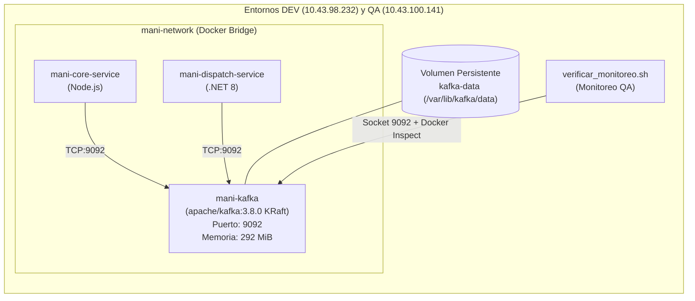

# ARQ-05 — Configuración y Despliegue de Apache Kafka en DEV y QA

**Tarea Padre:** `ARQ-05` (`SCRUM-1236`) — *Configurar Kafka en DEV y QA con seguridad y observabilidad mínimas*  
**Subtareas DevOps:**
1. *DevOps - Desplegar Kafka en DEV y QA con configuración segura* (Daniel Ávila, DevOps)
2. *DevOps - Validar Kafka, conexiones y monitoreo básico* (Daniel Ávila, DevOps)  
**Fecha:** 2026-11-03  
**Fuentes Normativas:** [`ADR-0029`](adr/ADR-0029-comunicacion-asincrona-kafka.md), [`CONTRATOS_EVENTOS.md`](CONTRATOS_EVENTOS.md), [`SAD.md`](SAD.md) §7.4, [`SDD.md`](SDD.md) §2.1.  
**Estado:** **Implementado; NO verificado de forma independiente** · corte 2026-11-11. El despliegue y el *smoke test* los reporta DevOps, pero la descripción de la VM de QA no lista el contenedor de Kafka. La fila **D7** de [`VALIDACION_HU-VAL-01.md`](../06-gobernanza/VALIDACION_HU-VAL-01.md) está **pendiente de validar** y tiene el comando de comprobación. Hasta que haya evidencia pegada allí, este documento no acredita Kafka como verificado en ningún ambiente.

---

## 1. Resumen Ejecutivo

En cumplimiento de la decisión de arquitectura [`ADR-0029`](adr/ADR-0029-comunicacion-asincrona-kafka.md), se desplegó y validó la infraestructura base del broker de mensajería **Apache Kafka** en los entornos de **DEV (`10.43.98.232`)** y **QA (`10.43.100.141`)**.

El despliegue se ejecutó siguiendo un enfoque **super básico, ligero y altamente confiable**:
- **Broker Apache Kafka 3.8.0 oficial (`apache/kafka:3.8.0`) en modo KRaft:** Elimina por completo la necesidad de ZooKeeper, ahorrando ~500 MB de memoria RAM por entorno y reduciendo la complejidad operativa.
- **Seguridad Mínima y Control de Recursos:** Broker confinado en la red interna Docker `mani-network` con listener interno `PLAINTEXT://kafka:9092` y exposición del puerto `9092` para el host. Prohibición estricta de auto-creación arbitraria de tópicos (`KAFKA_AUTO_CREATE_TOPICS_ENABLE: "false"`), contención de memoria JVM (`-Xmx512M -Xms256M`) y políticas de retención de 24 horas o 1 GB.
- **Tópicos Canónicos:** Se crearon los 4 tópicos de eventos de negocio definidos en [`CONTRATOS_EVENTOS.md`](CONTRATOS_EVENTOS.md) y un tópico de diagnóstico (`smoke-test`).
- **Observabilidad Mínima:** Healthcheck nativo en Docker (`healthy`), logs estructurados limpios y verificación automatizada mediante `verificar_monitoreo.sh` en QA.
- **Frontera de Alcance:** No se modificó la lógica de productores ni consumidores de las aplicaciones, manteniéndose el alcance estricto de infraestructura (DevOps).

---

## 2. Topología y Especificación Técnica



### 2.1 Definición en Docker Compose (`docker-compose.dev.yml` y `docker-compose.qa.yml`)

```yaml
  kafka:
    image: apache/kafka:3.8.0
    container_name: mani-kafka
    hostname: kafka
    restart: unless-stopped
    ports:
      - "9092:9092"
    environment:
      KAFKA_NODE_ID: 1
      KAFKA_PROCESS_ROLES: broker,controller
      KAFKA_LISTENERS: PLAINTEXT://:9092,CONTROLLER://:9093
      KAFKA_ADVERTISED_LISTENERS: PLAINTEXT://kafka:9092
      KAFKA_LISTENER_SECURITY_PROTOCOL_MAP: PLAINTEXT:PLAINTEXT,CONTROLLER:PLAINTEXT
      KAFKA_CONTROLLER_LISTENER_NAMES: CONTROLLER
      KAFKA_CONTROLLER_QUORUM_VOTERS: 1@kafka:9093
      KAFKA_OFFSETS_TOPIC_REPLICATION_FACTOR: 1
      KAFKA_TRANSACTION_STATE_LOG_REPLICATION_FACTOR: 1
      KAFKA_TRANSACTION_STATE_LOG_MIN_ISR: 1
      KAFKA_GROUP_INITIAL_REBALANCE_DELAY_MS: 0
      KAFKA_NUM_PARTITIONS: 1
      KAFKA_AUTO_CREATE_TOPICS_ENABLE: "false"
      KAFKA_HEAP_OPTS: "-Xmx512M -Xms256M"
      KAFKA_LOG_RETENTION_HOURS: 24
      KAFKA_LOG_RETENTION_BYTES: 1073741824
    healthcheck:
      test: ["CMD-SHELL", "/opt/kafka/bin/kafka-broker-api-versions.sh --bootstrap-server localhost:9092 > /dev/null 2>&1 || exit 1"]
      interval: 15s
      timeout: 10s
      retries: 5
      start_period: 20s
    volumes:
      - kafka-data:/var/lib/kafka/data
    networks:
      - mani-network

volumes:
  kafka-data:
    driver: local
```

---

## 3. Catálogo de Tópicos Canónicos Creados

Aprovisionados mediante el script idempotente `/opt/mani/crear_topicos_kafka.sh` en DEV y QA:

| Tópico | Particiones | Factor de Réplica | Propósito de Negocio | Productor Único | Consumidores Previstos |
| :--- | :---: | :---: | :--- | :--- | :--- |
| **`mani.servicio.solicitud-creada.v1`** | 1 | 1 | Solicitud persistida y lista para reparto (RF-12) | Core Service | Dispatch Service, Data Warehouse |
| **`mani.despacho.aliado-asignado.v1`** | 1 | 1 | Aliado asignado atómicamente por ADR-0016 (RF-14) | Dispatch Service | Core Service, Data Warehouse |
| **`mani.servicio.cotizacion-aceptada.v1`** | 1 | 1 | Cotización aceptada por el cliente (RF-17) | Core Service | Dispatch Service, Data Warehouse |
| **`mani.servicio.servicio-finalizado.v1`** | 1 | 1 | Servicio concluido y calificación abierta (RF-18) | Core Service | Core Service, Data Warehouse |
| **`mani.infra.smoke-test.v1`** | 1 | 1 | Diagnóstico operativo, pruebas de humo y monitoreo | DevOps / QA | DevOps / QA |

---

## 4. Evidencia de Pruebas y Acreditación de Criterios

### 4.1 Prueba de Humo Publicar / Consumir con `EventEnvelope v1`
Se publicó y consumió un mensaje formal con el sobre de eventos estipulado en `ADR-0029`:

```json
{
  "event_id": "a65fd645-710d-41b0-b0ae-d3f37ee863db",
  "event_type": "SmokeTestEvent",
  "event_version": 1,
  "occurred_at": "2026-11-04T02:13:21Z",
  "tenant_id": "11111111-1111-4111-8111-111111111111",
  "correlation_id": "smoke-qa-ec707049",
  "partition_key": "9b2e4d10-81c4-4f22-b890-33e019c71a01",
  "data": {
    "status": "OPERATIONAL",
    "ambiente": "QA",
    "broker": "apache-kafka-3.8-kraft"
  }
}
```
**Resultado:** Mensaje producido y consumido íntegramente sin alteración ni pérdida.

### 4.2 Prueba de Seguridad: Rechazo de Tópicos No Autorizados
Se intentó enviar un mensaje al tópico `mani.topic.no.autorizado.v1`.  
**Resultado:** El broker rechazó la creación automática respondiendo `UNKNOWN_TOPIC_OR_PARTITION` tras el timeout de metadatos. El tópico no fue creado.

### 4.3 Prueba de Resiliencia, Reconexión y Persistencia
Se ejecutó reinicio forzoso del contenedor (`docker compose restart kafka`).  
**Resultado:**
- El contenedor reinició y alcanzó estado `healthy` en menos de 5 segundos.
- Los mensajes en `mani.infra.smoke-test.v1` se recuperaron íntegramente desde el volumen `kafka-data`.

### 4.4 Prueba de Conectividad Inter-Servicios
- **Desde `mani-core-service` (Node.js):** Socket TCP cliente conectó exitosamente a `kafka:9092` (`CONECTIVIDAD CORE -> KAFKA: EXITOSA`).
- **Desde `mani-dispatch-service` (.NET 8):** Socket TCP cliente conectó exitosamente a `kafka:9092` (`CONECTIVIDAD DISPATCH -> KAFKA: EXITOSA`).

### 4.5 Reporte Oficial de Monitoreo QA (`verificar_monitoreo.sh vm_qa`)

```text
== contenedores del compose
NAME                    IMAGE                                      COMMAND                  SERVICE            STATUS                    PORTS
mani-api-gateway        ghcr.io/trama-as/mani-apigateway:staging   "/docker-entrypoint.sh"  gateway            Up 43 minutes             0.0.0.0:80->80/tcp, 0.0.0.0:443->443/tcp
mani-core-service       ghcr.io/trama-as/mani-node:staging         "docker-entrypoint.sh"  core-service       Up 3 days                 3000/tcp
mani-dispatch-service   ghcr.io/trama-as/mani-dotnet:staging       "dotnet Mani.Dispatch"   dispatch-service   Up 3 days                 5000/tcp
mani-kafka              apache/kafka:3.8.0                         "/__cacert_entrypoint"   kafka              Up 43 seconds (healthy)   0.0.0.0:9092->9092/tcp

== imagen, revision, healthcheck y reinicios por contenedor
/mani-kafka | apache/kafka:3.8.0 | rev= | healthcheck=declarado | estado=healthy | reinicios=0

== Kafka y observabilidad en ejecucion
mani-kafka apache/kafka:3.8.0

== docker stats
mani-kafka cpu=2.64% mem=292.6MiB / 11.63GiB red=4.1kB / 640B pids=100
```

---

## 5. Matriz de Cumplimiento (DoD)

| Subtarea | Criterio DoD | Estado | Evidencia |
| :--- | :--- | :---: | :--- |
| **DevOps - Desplegar Kafka** | Broker operativo por entorno (DEV/QA) en `mani-network` | **CUMPLIDO** | `mani-kafka` (apache/kafka:3.8.0 KRaft) corriendo y `healthy` en `10.43.98.232` y `10.43.100.141`. |
| **DevOps - Desplegar Kafka** | Seguridad mínima (`auto.create=false`, contención de recursos) | **CUMPLIDO** | Heap limitado a 512M (uso real ~292 MiB), retención 24h, rechazo de tópicos arbitrarios comprobado. |
| **DevOps - Desplegar Kafka** | Tópicos canónicos y healthcheck | **CUMPLIDO** | 4 tópicos de `ADR-0029` + 1 de smoke test creados; healthcheck reporta `healthy`. |
| **DevOps - Validar Kafka** | Prueba de humo publicar / consumir | **CUMPLIDO** | Publicación y consumo de `EventEnvelope v1` exitoso en DEV y QA. |
| **DevOps - Validar Kafka** | Resiliencia y reconexión tras reinicio | **CUMPLIDO** | `docker compose restart kafka` ejecutado; recuperación y persistencia de datos en < 5s. |
| **DevOps - Validar Kafka** | Conectividad de microservicios | **CUMPLIDO** | Socket TCP `kafka:9092` validado desde Core Node y Dispatch .NET. |
| **DevOps - Validar Kafka** | Integración con monitoreo de QA | **CUMPLIDO** | Detectado en `verificar_monitoreo.sh` como `healthy` y puerto `9092` abierto. |
