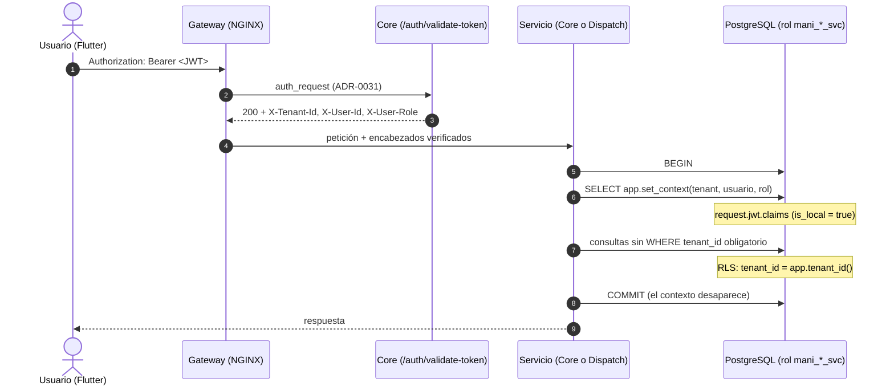

# CFG-23a.3 — Diseño del modelo de identidad en base de datos y casos cross-tenant esperados

- **Jira:** SCRUM-1197 (subtarea de CFG-23a, SCRUM-1103)
- **Autor:** Juan Sebastián Álvarez Rodríguez
- **Fecha:** 2026-10-17
- **Estado:** Para Mesa de Arquitectura (CFG-23a.4)
- **Decisión:** [ADR-0032](../adr/ADR-0032-identidad-de-servicio-en-base-de-datos.md) (Propuesto)
- **Insumos:** [inventario CFG-23a.1](01-inventario-rls.md), [PoC](../../07-calidad/PoC/PoC-CFG23a-identidad-servicio-rls/README.md)
- **Insumo de:** CFG-23b (SCRUM-1104), que versiona y aplica; CFG-23c (SCRUM-1105), que acredita

## 1. Resumen

Cada servicio se conecta con **su propio rol sin `BYPASSRLS`** y, como primera sentencia de cada transacción, fija la identidad ya verificada con `app.set_context(tenant, usuario, rol)`. Las políticas leen tenant, usuario y rol **solo** de ese contexto (`app.tenant_id()`, `app.user_id()`, `app.user_role()`), que es el mismo `request.jwt.claims` que PostgREST establece. Resultado:

- una política única para servicios y PostgREST;
- falla cerrada cuando falta el contexto;
- la frontera de datos de ADR-0030 impuesta por `GRANT`.

## 2. Flujo



## 3. Componentes en el motor

Definición de referencia ejecutable: [`01-modelo.sql` de la PoC](../../07-calidad/PoC/PoC-CFG23a-identidad-servicio-rls/01-modelo.sql), secciones 2, 3 y 6.

| Componente | Definición | Notas |
|---|---|---|
| `mani_core_svc` | `NOLOGIN NOBYPASSRLS` en migración (`LOGIN` asignado por operaciones fuera de git, ADR-0031 §5), no dueño, no miembro de `authenticated` | contraseña por ambiente en `/opt/mani/.env.{dev,qa,prod}` |
| `mani_dispatch_svc` | ídem | Rules no tiene rol en el incremento actual: sus *overrides* por tenant viven en la configuración del servicio (`MANI-Java`); `mani_rules_svc` (`ModeloDatos.md` §6.3) solo se crearía si el tarifario pasa a persistirse desde Rules |
| `GRANT USAGE ON SCHEMA auth` + `EXECUTE` sobre `auth.uid()`/`auth.jwt()` | a ambos roles | sin esto toda consulta falla con `permission denied for schema auth` (hallazgo de la PoC) |
| Esquema `app` | `REVOKE ALL FROM PUBLIC`; `USAGE` a `authenticated` y roles de servicio | no se expone en PostgREST |
| `app.tenant_id()`, `app.user_id()`, `app.user_role()` | `STABLE`, `search_path = ''`, leen `auth.jwt()`/`auth.uid()` | devuelven `NULL` ante claim ausente o malformado, sin error |
| `app.set_context(uuid, uuid, text)` | `set_config('request.jwt.claims', …, true)`; rechaza tenant `NULL` (`MANI-RLS-400`) | `EXECUTE` solo a roles de servicio |

## 4. Contexto por tipo de flujo

| Flujo | `set_context(tenant, usuario, rol)` | Ejemplo |
|---|---|---|
| Autenticado vía Gateway | `X-Tenant-Id`, `X-User-Id`, `X-User-Role` | CRUD de categorías del Backoffice |
| Interno servicio → servicio | los mismos encabezados que reenvía el llamador (ADR-0030 §2) | Dispatch pide a Core la elegibilidad |
| Lectura pre-auth | tenant resuelto desde `X-Tenant-Slug`, usuario `NULL`, rol `anonimo` | `GET /catalog` del registro |
| Registro pre-auth | tenant resuelto desde `X-Tenant-Slug`, usuario recién creado en Supabase Auth, rol registrado | registro de aliado: `createUser` → `set_context` → insertar `usuario`/`aliado`/`documento_kyc` |
| Asíncrono (ADR-0029) | tenant y usuario del evento, rol `servicio` | consumidor de notificaciones |

Resolver el slug requiere leer `tenant` **antes** de tener contexto; por eso `tenant` conserva una política de lectura `USING (true)` (§5), que expone solo `slug`, `nombre` y `estado`. La pregunta M4 de la Mesa lo confirma.

## 5. Políticas resultantes por tabla

Propiedad por dominio según ADR-0022/0030. «Patrón T» = `USING (tenant_id = app.tenant_id()) WITH CHECK (tenant_id = app.tenant_id())`, siempre con `ENABLE` + `FORCE` y `TO` explícito. `authenticated` se mantiene en el `TO` de las tablas que el camino PostgREST legado aún toque.

| Tabla | Dueño | `mani_core_svc` | `mani_dispatch_svc` | Política |
|---|---|---|---|---|
| `tenant` | Core | SELECT | SELECT | lectura `USING (true)` (directorio público de slugs, ADR-0018); escritura solo `postgres` |
| `zona` | Core | SELECT | SELECT | sin `tenant_id` (geografía global): lectura `USING (true)`, escritura solo `postgres` |
| `usuario` | Core | CRUD | — | Patrón T. Filas con `tenant_id NULL` quedan invisibles (falla cerrada) |
| `categoria_servicio` | Core | CRUD | — | Patrón T. **Reemplaza** la lectura pública `USING (true)` de hoy |
| `aliado`, `cliente`, `sitio`, `aliado_categoria`, `aliado_ausencia`, `cobertura_aliado` | Core | CRUD | — | Patrón T. Dispatch obtiene elegibilidad de Core por HTTP (ADR-0030) |
| `documento_kyc` | Core | SELECT, INSERT | — | tenant **y** (aliado propio **o** `admin_tenant`); alta solo para el propio aliado. **Reemplaza** las dos `true` |
| `cotizacion`, `evento_servicio`, `calificacion`, `mensaje`, `notificacion` | Core | CRUD | — | Patrón T, más propiedad por autor donde la historia lo exija |
| `documento_legal`, `consentimiento_usuario` | Core | SELECT, INSERT | — | las de `MANI-Node` 0004 (ya por claim), migradas a `app.*` y con `TO` explícito |
| `solicitud` | Core crea; Dispatch acepta | SELECT, INSERT, UPDATE | SELECT, UPDATE | lectura Patrón T; alta con rol `cliente`; **aceptar con rol `aliado`** (corrige H-02/KI-13); demás transiciones de Core por rol en CFG-23b. Reemplaza `tenant_isolation_solicitud` |
| `solicitud_rechazo` | Dispatch | — | SELECT, INSERT | Patrón T **y** aliado propio |
| `solicitud_foto` | Core | SELECT, INSERT | — | Patrón T |
| `tarifa_referencia` | **por decidir (M2)** | CRUD (propuesto) | — | Rules evalúa en memoria/configuración sin base (ADR-0022); Core persiste y consulta a Rules por HTTP (ADR-0030 §2). Si se persiste en `reglas`, aplica `mani_rules_svc` (`ModeloDatos.md` §6.3) |

Storage (`storage.objects`) se mantiene con `kyc_isolation`, que ya toma el tenant del claim. Las políticas del bucket `solicitudes`, que hoy solo comparan `auth.uid()`, pasan a exigir también la carpeta del tenant. Core escribe en Storage con `service_role` (ADR-0032 §6): la ruta `{tenant_id}/{user_id}/…` se arma desde el contexto, nunca desde la petición.

## 6. Integración en cada servicio

Una sola puerta de acceso a datos por servicio; un acceso fuera de ella es un defecto de revisión.

**Core (Node, `pg`):**

```js
// src/infrastructure/db/withTenantContext.js
async function withTenantContext(pool, { tenantId, userId = null, role }, work) {
  const client = await pool.connect();
  try {
    await client.query('BEGIN');
    await client.query('SELECT app.set_context($1, $2, $3)', [tenantId, userId, role]);
    const result = await work(client);
    await client.query('COMMIT');
    return result;
  } catch (err) {
    await client.query('ROLLBACK');
    throw err;
  } finally {
    client.release();
  }
}
```

Los repositorios Supabase que hoy usan `.from()` con `service_role` migran a `pg` con este helper. Como paso intermedio, ADR-0032 admite crear el cliente supabase-js con el `Authorization` del usuario; ese camino no sirve en pre-auth ni en procesos asíncronos.

**Dispatch (.NET, Npgsql):**

```csharp
await using var conn = await dataSource.OpenConnectionAsync(ct);
await using var tx = await conn.BeginTransactionAsync(ct);
await using (var ctx = new NpgsqlCommand("SELECT app.set_context(@t, @u, @r)", conn, tx))
{
    ctx.Parameters.AddWithValue("t", tenantId);   // X-Tenant-Id del Gateway
    ctx.Parameters.AddWithValue("u", (object?)userId ?? DBNull.Value);
    ctx.Parameters.AddWithValue("r", userRole);
    await ctx.ExecuteNonQueryAsync(ct);
}
// UPDATE condicional de aceptación (ADR-0016) dentro de la misma transacción
await tx.CommitAsync(ct);
```

Reglas de revisión que CFG-23b vuelve verificables en CI:

1. ningún `set_config(…, false)` ni `SET` sin `LOCAL` en código de servicio;
2. ningún `.from()`/`.rpc()` con el cliente `service_role`;
3. `DATABASE_URL` de cada servicio apunta a su rol, nunca a `postgres`.

## 7. Los seis casos cross-tenant esperados

Los de Políticas DevOps §13.4 y QAS-01. Datos: tenants T1 y T2 del seed QA (`seed_qa_multitenant.sql`), un usuario por rol en cada uno (CFG-23c-1).

**Cada caso tiene dos verificaciones.** La del servicio, a través del Gateway, es la que exige QAS-01. La del motor exige que, con el rol de servicio y el contexto de T1, el recurso de T2 no aparezca aunque la consulta no filtre por tenant. Esta segunda es el criterio de cierre de SCRUM-1334 y la que demuestra que RLS opera.

| # | Escenario | Respuesta esperada del servicio (vía Gateway) | Resultado esperado en el motor (`mani_*_svc`, contexto T1) | PoC |
|---|---|---|---|---|
| 1 | **Lectura de otro tenant.** Token de T1 pide por id un recurso de T2 (p. ej. `GET /api/v1/core/catalog/categories/{id T2}`) | `404`, sin distinguir «no existe» de «no es tuyo» | `SELECT … WHERE id = <T2>` → 0 filas | C1 |
| 2 | **Listado de recursos ajenos.** Token de T1 lista (`GET /api/v1/core/catalog/categories`) | `200` solo con recursos de T1 | `SELECT` sin `WHERE tenant_id` → solo filas de T1 | C2 |
| 3 | **Escritura en otro tenant.** Token de T1 crea con `tenantId` de T2 en el cuerpo, o edita un id de T2 | `403 TENANT_MISMATCH` o `404`; nada persistido en T2 | `INSERT` con `tenant_id` T2 → `42501` (*row-level security*); `UPDATE` que muda una fila a T2 → `42501`; `UPDATE` de fila de T2 → 0 filas | C3 |
| 4 | **Borrado ajeno.** Token de T1 desactiva o borra un id de T2 | `404`; el recurso de T2 intacto | `DELETE … WHERE id = <T2>` → 0 filas; un `DELETE` sin `WHERE` solo alcanza T1 | C4 |
| 5 | **Token expirado o alterado.** Firma inválida, `exp` vencido o sin `tenant_id` | `401` en el Gateway (ADR-0031); el servicio no recibe la petición | sin `set_context` o con claim corrupto → 0 filas y escritura rechazada; `set_context` sin tenant → `MANI-RLS-400` | C5 |
| 6 | **Documentos KYC de otro aliado o tenant.** Aliado A de T1 pide el KYC del aliado B de T1 y uno de T2; admin de T1 pide los de T2; acceso directo o por servicio a objeto de Storage bajo ruta de otro tenant `{T2}/{user_id}/…` | `403`/`404` para A sobre B y T2; el admin de T1 ve solo los de T1; Storage deniega cualquier lectura o escritura sobre la ruta `{T2}/…` cuando el contexto es T1 | A ve solo su `documento_kyc`; no puede dar de alta a nombre de B; el admin de T1 ve los de T1 y ninguno de T2; `kyc_isolation` y el servicio rechazan rutas con prefijo `{T2}/…` | C6 |

Propiedades adicionales que CFG-23c debe incluir, porque protegen el mecanismo y no un endpoint:

| # | Propiedad | Resultado esperado | PoC |
|---|---|---|---|
| P1 | El contexto no se hereda entre transacciones de la misma conexión del pool | la siguiente transacción sin `set_context` ve 0 filas | P1 |
| P3 | Frontera de datos (ADR-0030) | `mani_dispatch_svc` recibe `permission denied` en `notificacion` y `aliado` | P3 |
| P4 | Rol en la aceptación (H-02/KI-13) | un `cliente` no puede aceptar; un `aliado` de T1 no acepta una solicitud de T2 | P4 |
| P5 | Un cliente no fabrica contexto | `authenticated`/`anon` no ejecutan `app.set_context` | P5 |

**Evidencia esperada por caso** (Políticas DevOps §13.4, QAS-01):

- reporte Newman con versión del servicio y fecha;
- salida SQL de la verificación del motor con el `X-Correlation-ID` de la petición;
- ausencia de datos de T2 en ambos.

## 8. Plan para CFG-23b

Cada paso se puede desplegar sin romper el anterior, porque las políticas no cambian nada mientras los servicios sigan con `BYPASSRLS`.

| Paso | Qué | Dónde | Efecto visible |
|---|---|---|---|
| 1 | Cerrar exposiciones (ADR-0032 §8): revocar `anon` de `registrar_aliado_persona_natural` y `registrar_aliado_empresa`, eliminar las `true` de `documento_kyc`, RLS en las 11 tablas | `MANI-Node/db/migrations/0005_cerrar_exposiciones_rls.sql` + `db/verify/0005_verificar_exposiciones.sql` (**entregado en `MANI-Node` PR #28, SCRUM-1334**) | ninguno para servicios ni para Flutter (solo usa 3 RPC `SECURITY DEFINER`) |
| 2 | Esquema `app`, helpers, `set_context`, roles `NOLOGIN` y `GRANT` sobre `auth` | migración `00NN_contexto_identidad.sql` | ninguno |
| 3 | `FORCE RLS`, políticas de §5 y `GRANT` por rol | migración `00NN_politicas_por_tenant.sql` | ninguno con `BYPASSRLS` |
| 4 | `withTenantContext` en todos los repositorios de Core y transacción + `set_context` en Dispatch | `MANI-Node`, `MANI-.NET` | ninguno: con `postgres`, `set_context` es inocuo |
| 5 | Operaciones (DevOps, Daniel Ávila) asigna `LOGIN PASSWORD` a `mani_core_svc` y `mani_dispatch_svc` fuera de git (`/opt/mani/.env.{dev,qa,prod}`, ADR-0031 §5) y cambia `DATABASE_URL` de cada servicio a su rol en QA | secretos de QA | **aquí RLS empieza a operar**; correr CFG-23c |
| 6 | Igual en PROD tras aprobar CFG-23c | secretos de PROD | — |

**Reversa:** volver `DATABASE_URL` a la credencial anterior en el paso 5 restaura el comportamiento previo sin tocar datos. Las migraciones 1–3 no se revierten porque no afectan a quien tiene `BYPASSRLS`.

La numeración final la fija CFG-23b contra la serie de `MANI-Node` vigente al momento de abrir el PR. Hoy hay `0002`–`0004` en PR sin fusionar.

## 9. Riesgos

| Riesgo | Mitigación |
|---|---|
| Un repositorio accede fuera de `withTenantContext` y, con el rol nuevo, ve 0 filas | falla cerrada: aparece como defecto funcional en QA, no como fuga; reglas de CI de §6 |
| Latencia por la sentencia extra por transacción | medir en la ruta de QAS-03 tras el paso 5 |
| Storage con `service_role` | rutas construidas desde el contexto; caso 6 incluye el objeto de Storage |
| Funciones `SECURITY DEFINER` heredadas omiten RLS | no se conceden a roles de servicio; se retiran según ADR-0022 |
| Drift entre repositorio y QA (`tenant_isolation_solicitud`) | correr el anexo A del inventario en QA antes del paso 1 |
| Usuarios con `tenant_id NULL` (p. ej. un superadmin) invisibles para los servicios | intencional; un caso multi-tenant exige ADR propio |
