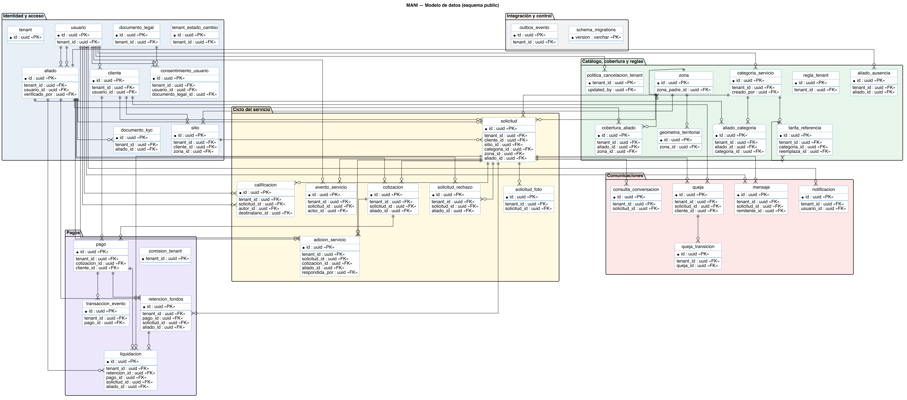
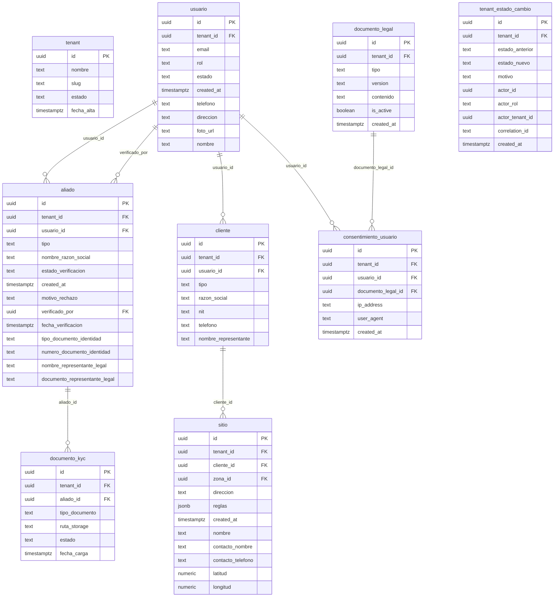
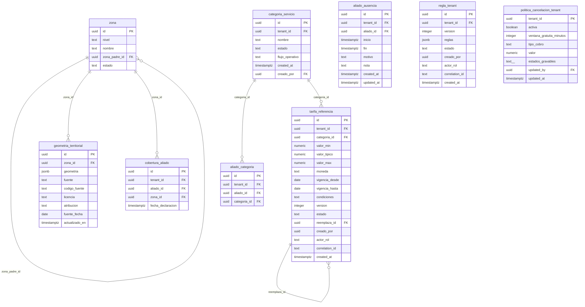
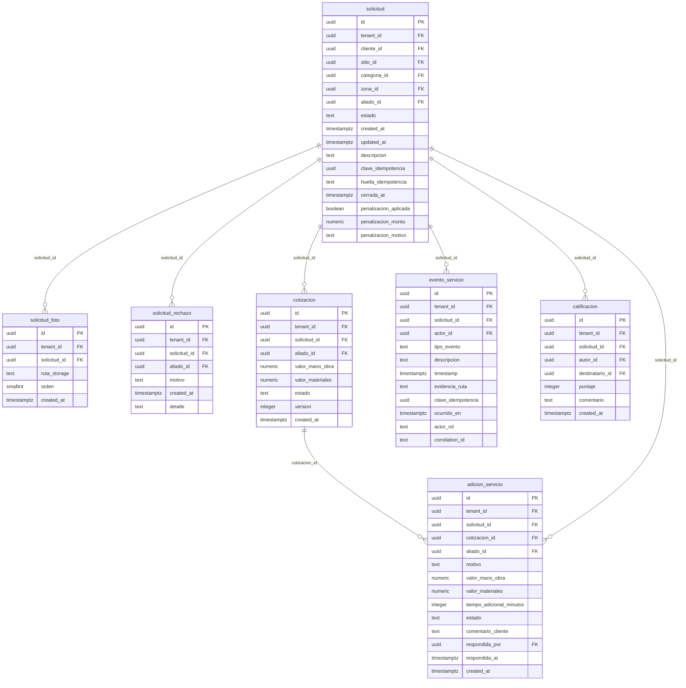
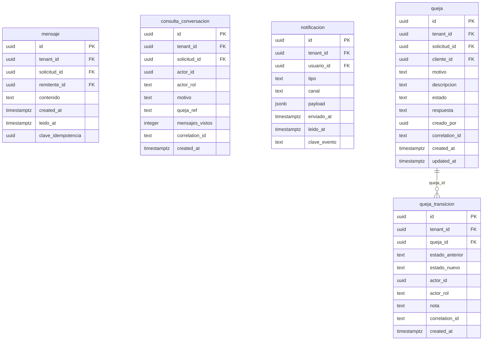
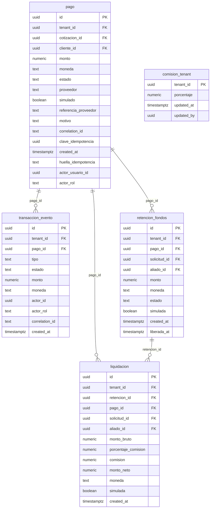
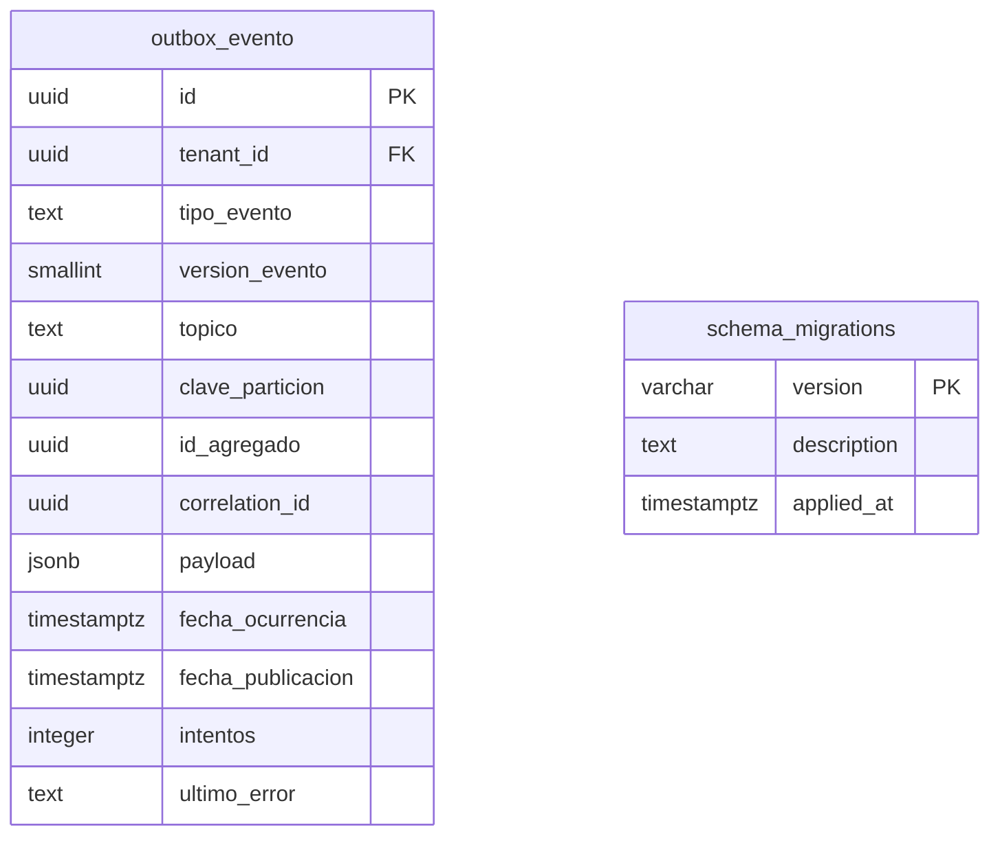

# MANI — Modelo de Datos

## Modelo conceptual, lógico, físico, DDL y diccionario de datos

**Plataforma operacional:** Supabase
**Motor de base de datos:** PostgreSQL
**Arquitectura de datos:** multi-tenant con propiedad por dominio
**Origen:** el modelo de las secciones 3 a 8 se obtiene de la base resultante de aplicar la serie única de migraciones de Core (`MANI-Node/db/migrations`) sobre el esquema base de `MANI-APIGateway/database`. Describe las 37 tablas del esquema `public`.

---

## Estructura del documento

1. Propósito y separación de responsabilidades
2. Glosario de datos
3. Modelo conceptual
4. Modelo lógico
5. DER lógico
6. Modelo físico
7. DDL operacional
8. Diccionario de datos
9. Relación datos ↔ servicios

---

# 1. Propósito y separación de responsabilidades

Este documento es la fuente de verdad del **modelo de datos** de MANI. No redefine la arquitectura de software: la arquitectura SOA, las vistas C4, los atributos de calidad, los patrones y el despliegue se especifican en [SAD.md](SAD.md) y [SDD.md](SDD.md).

La separación es intencional:

- **SAD y SDD:** cómo está organizado y desplegado el software.
- **Modelo de Datos:** qué información existe, cómo se relaciona, cómo se persiste y quién la escribe.

## 1.1 Decisiones de persistencia

- **Supabase** es la plataforma administrada de datos de MANI y **PostgreSQL** su motor. No son alternativas separadas.
- Hay **una base por ambiente**, con las tablas de negocio en el esquema `public` y las funciones de contexto en el esquema `app`.
- **Core Service es dueño de la serie única de migraciones** ([ADR-0030](adr/ADR-0030-propiedad-esquema-y-frontera-de-datos.md) §1): Rules y Dispatch no versionan DDL.
- El aislamiento por tenant lo dan `tenant_id` en cada tabla, RLS con `FORCE` y un rol de base de datos por servicio ([ADR-0012](adr/ADR-0012-persistencia-multitenant.md), [ADR-0032](adr/ADR-0032-identidad-de-servicio-en-base-de-datos.md)).
- Los identificadores son `UUID`; los instantes, `timestamptz`.

---

# 2. Glosario de datos

Este glosario define los términos que se utilizan de forma recurrente en el modelo de datos.
El glosario general de negocio y metodología del proyecto continúa siendo la fuente autoritativa
para conceptos que no sean específicamente de datos.

| Término                            | Definición                                                                                                                                                                                      |
| ----------------------------------- | ------------------------------------------------------------------------------------------------------------------------------------------------------------------------------------------------ |
| **Tenant**                    | Empresa independiente que utiliza MANI y cuyos datos, usuarios y configuración deben permanecer aislados de los demás tenants.                                                                 |
| **Usuario**                   | Identidad registrada en MANI que puede asumir uno o varios roles dentro del contexto autorizado.                                                                                                 |
| **Cliente**                   | Actor que solicita un servicio. Puede ser persona natural o empresa.                                                                                                                             |
| **Aliado**                    | Prestador habilitado para atender servicios dentro de las categorías y zonas declaradas.                                                                                                        |
| **KYC**                       | Información y documentación utilizada para verificar un aliado.                                                                                                                                |
| **Categoría**                | Tipo de servicio ofrecido dentro de MANI.                                                                                                                                                        |
| **Zona**                      | Unidad administrativa del catálogo geográfico utilizada para definir cobertura.                                                                                                                |
| **Cobertura**                 | Conjunto de zonas en las que un aliado declara prestar servicios. Es una declaración estable del aliado y no depende del calendario.                                                            |
| **Disponibilidad**            | Franja de agenda concreta (fecha y horas) en la que un aliado puede atender servicios. **No es lo mismo que cobertura:** la cobertura dice *dónde*, la disponibilidad dice *cuándo*. |
| **Sitio de servicio**         | Ubicación registrada por un cliente empresa donde se presta el servicio. Tiene siempre una zona asignada y puede declarar reglas y condiciones propias visibles al aliado.                      |
| **Tarifario**                 | Tabla de referencia por tenant y categoría con valores mínimo, típico y máximo, usada para alertar cotizaciones fuera de rango. No fija el precio: lo contrasta.                             |
| **Calificación**             | Valoración que una parte emite sobre la otra al finalizar el servicio. Es bidireccional y condición de cierre.                                                                                 |
| **Conversación**             | Hilo de mensajería asociado a una solicitud, consultable después de cerrada.                                                                                                                   |
| **Mensaje**                   | Entrada individual de una conversación.                                                                                                                                                         |
| **Queja**                     | Reclamación registrada sobre un servicio. Pertenece al segundo incremento.                                                                                                                      |
| **Solicitud**                 | Petición de servicio creada por un cliente para un sitio y una categoría determinados.                                                                                                         |
| **Cotización**               | Propuesta económica asociada a una solicitud, diferenciando los componentes definidos por el negocio.                                                                                           |
| **Asignación**               | Vinculación efectiva entre una solicitud y el aliado que obtuvo la aceptación válida.                                                                                                         |
| **Regla de tenant**           | Configuración de negocio que modifica el comportamiento operacional de MANI para un tenant sin requerir despliegue de código específico.                                                      |
| **RLS**                       | *Row-Level Security* de PostgreSQL utilizada como barrera adicional de aislamiento de filas entre tenants.                                                                                     |
| **OLTP**                      | Modelo de datos operacional orientado al procesamiento transaccional de MANI.                                                                                                                    |
| **DDL**                       | *Data Definition Language*; sentencias SQL utilizadas para crear y modificar estructuras de base de datos.                                                                                     |
| **Diccionario de datos (DD)** | Catálogo estructurado de tablas, atributos, tipos, restricciones y significado funcional de los datos.                                                                                          |

---

---

# 3. Modelo conceptual

El modelo gira en torno a tres ideas: el **tenant** como raíz de aislamiento, la **solicitud** como eje del ciclo del servicio, y los **perfiles** (aliado y cliente) que se asocian a un usuario.

[](diagrams/datos/ModeloDatos.png)

> **Figura 1 — Modelo de datos.** Fuente: [`diagrams/datos/ModeloDatos.puml`](diagrams/datos/ModeloDatos.puml), generada desde la base tras aplicar las migraciones; imagen en [`diagrams/datos/ModeloDatos.png`](diagrams/datos/ModeloDatos.png). Solo muestra claves; las columnas completas están en el §5 y en el §8. Toda tabla, salvo `zona` y `schema_migrations`, lleva `tenant_id → tenant`, y esa relación no se dibuja para no saturar el diagrama.

Relaciones entre entidades (sin la referencia universal a `tenant`):

```mermaid
erDiagram
    aliado ||--o{ adicion_servicio : "aliado_id"
    cotizacion ||--o{ adicion_servicio : "cotizacion_id"
    usuario ||--o{ adicion_servicio : "respondida_por"
    solicitud ||--o{ adicion_servicio : "solicitud_id"
    usuario ||--o{ aliado : "usuario_id"
    usuario ||--o{ aliado : "verificado_por"
    aliado ||--o{ aliado_ausencia : "aliado_id"
    aliado ||--o{ aliado_categoria : "aliado_id"
    categoria_servicio ||--o{ aliado_categoria : "categoria_id"
    usuario ||--o{ calificacion : "autor_id"
    usuario ||--o{ calificacion : "destinatario_id"
    solicitud ||--o{ calificacion : "solicitud_id"
    usuario ||--o{ categoria_servicio : "creado_por"
    usuario ||--o{ cliente : "usuario_id"
    aliado ||--o{ cobertura_aliado : "aliado_id"
    zona ||--o{ cobertura_aliado : "zona_id"
    documento_legal ||--o{ consentimiento_usuario : "documento_legal_id"
    usuario ||--o{ consentimiento_usuario : "usuario_id"
    solicitud ||--o{ consulta_conversacion : "solicitud_id"
    aliado ||--o{ cotizacion : "aliado_id"
    solicitud ||--o{ cotizacion : "solicitud_id"
    aliado ||--o{ documento_kyc : "aliado_id"
    usuario ||--o{ evento_servicio : "actor_id"
    solicitud ||--o{ evento_servicio : "solicitud_id"
    zona ||--o{ geometria_territorial : "zona_id"
    aliado ||--o{ liquidacion : "aliado_id"
    pago ||--o{ liquidacion : "pago_id"
    retencion_fondos ||--o{ liquidacion : "retencion_id"
    solicitud ||--o{ liquidacion : "solicitud_id"
    usuario ||--o{ mensaje : "remitente_id"
    solicitud ||--o{ mensaje : "solicitud_id"
    usuario ||--o{ notificacion : "usuario_id"
    cliente ||--o{ pago : "cliente_id"
    cotizacion ||--o{ pago : "cotizacion_id"
    usuario ||--o{ politica_cancelacion_tenant : "updated_by"
    cliente ||--o{ queja : "cliente_id"
    solicitud ||--o{ queja : "solicitud_id"
    queja ||--o{ queja_transicion : "queja_id"
    aliado ||--o{ retencion_fondos : "aliado_id"
    pago ||--o{ retencion_fondos : "pago_id"
    solicitud ||--o{ retencion_fondos : "solicitud_id"
    cliente ||--o{ sitio : "cliente_id"
    zona ||--o{ sitio : "zona_id"
    aliado ||--o{ solicitud : "aliado_id"
    categoria_servicio ||--o{ solicitud : "categoria_id"
    cliente ||--o{ solicitud : "cliente_id"
    sitio ||--o{ solicitud : "sitio_id"
    zona ||--o{ solicitud : "zona_id"
    solicitud ||--o{ solicitud_foto : "solicitud_id"
    aliado ||--o{ solicitud_rechazo : "aliado_id"
    solicitud ||--o{ solicitud_rechazo : "solicitud_id"
    categoria_servicio ||--o{ tarifa_referencia : "categoria_id"
    tarifa_referencia ||--o{ tarifa_referencia : "reemplaza_id"
    pago ||--o{ transaccion_evento : "pago_id"
    zona ||--o{ zona : "zona_padre_id"
    tenant ||--o{ usuario : "tenant_id"
    tenant ||--o{ categoria_servicio : "tenant_id"
    tenant ||--o{ solicitud : "tenant_id"
```



## 3.1 Dominios

| Dominio                       | Entidades                                                                                                                                                                                              | Dueño de escritura                   |
| ----------------------------- | ------------------------------------------------------------------------------------------------------------------------------------------------------------------------------------------------------ | ------------------------------------- |
| Identidad y acceso            | `tenant`, `usuario`, `aliado`, `documento_kyc`, `cliente`, `sitio`, `documento_legal`, `consentimiento_usuario`, `tenant_estado_cambio`                                              | Core                                  |
| Catálogo, cobertura y reglas | `zona`, `geometria_territorial`, `categoria_servicio`, `aliado_categoria`, `cobertura_aliado`, `aliado_ausencia`, `tarifa_referencia`, `regla_tenant`, `politica_cancelacion_tenant` | Core                                  |
| Ciclo del servicio            | `solicitud`, `solicitud_foto`, `solicitud_rechazo`, `cotizacion`, `adicion_servicio`, `evento_servicio`, `calificacion`                                                                  | Core; `solicitud_rechazo`, Dispatch |
| Comunicaciones                | `mensaje`, `consulta_conversacion`, `notificacion`, `queja`, `queja_transicion`                                                                                                              | Core                                  |
| Pagos                         | `pago`, `transaccion_evento`, `retencion_fondos`, `comision_tenant`, `liquidacion`                                                                                                           | Core                                  |
| Integración y control        | `outbox_evento`, `schema_migrations`                                                                                                                                                               | Core                                  |

---

# 4. Modelo lógico

Cada entidad con su propósito, su dueño y sus relaciones. El detalle de columnas, tipos y restricciones está en el §8.

## 4.1 Identidad y acceso

### `tenant`

Empresa que usa MANI. Es la raíz del aislamiento: casi toda tabla de negocio lleva su `tenant_id`.

- **Dueño de escritura:** Core.
- **Clave primaria:** `id`.

### `usuario`

Cuenta de acceso de una persona dentro de un tenant, con su rol (cliente, aliado, administrador). Se corresponde con el usuario de Supabase Auth.

- **Dueño de escritura:** Core.
- **Clave primaria:** `id`.

### `aliado`

Perfil del aliado que presta el servicio: persona natural, empresa o empleado directo, con su estado de verificación.

- **Dueño de escritura:** Core.
- **Clave primaria:** `id`.
- **Referencias:** `usuario_id` → `usuario`, `verificado_por` → `usuario`.

### `documento_kyc`

Documento de verificación (KYC) que sube un aliado; el archivo vive en Storage y aquí queda su ruta y estado.

- **Dueño de escritura:** Core.
- **Clave primaria:** `id`.
- **Referencias:** `aliado_id` → `aliado`.

### `cliente`

Perfil del cliente que solicita servicios: persona natural o empresa.

- **Dueño de escritura:** Core.
- **Clave primaria:** `id`.
- **Referencias:** `usuario_id` → `usuario`.

### `sitio`

Sede o lugar de servicio de un cliente, con su zona, contacto y reglas de acceso.

- **Dueño de escritura:** Core.
- **Clave primaria:** `id`.
- **Referencias:** `cliente_id` → `cliente`, `zona_id` → `zona`.

### `documento_legal`

Documento legal vigente de un tenant (términos, política de datos) que el usuario debe aceptar.

- **Dueño de escritura:** Core.
- **Clave primaria:** `id`.

### `consentimiento_usuario`

Registro de aceptación de un documento legal por un usuario (habeas data).

- **Dueño de escritura:** Core.
- **Clave primaria:** `id`.
- **Referencias:** `documento_legal_id` → `documento_legal`, `usuario_id` → `usuario`.

### `tenant_estado_cambio`

Historial inmutable de los cambios de estado de un tenant, con su actor.

- **Dueño de escritura:** Core.
- **Clave primaria:** `id`.

## 4.2 Catálogo, cobertura y reglas

### `zona`

Catálogo global de zonas geográficas en jerarquía ciudad → localidad → barrio.

- **Dueño de escritura:** Core.
- **Clave primaria:** `id`.
- **Referencias:** `zona_padre_id` → `zona`.

### `geometria_territorial`

Límite geográfico de una zona como GeoJSON en JSONB. No hay PostGIS: no hay consultas espaciales.

- **Dueño de escritura:** Core.
- **Clave primaria:** `id`.
- **Referencias:** `zona_id` → `zona`.

### `categoria_servicio`

Categoría de servicio que ofrece un tenant y su flujo operativo (con cotización o tarifa estándar).

- **Dueño de escritura:** Core.
- **Clave primaria:** `id`.
- **Referencias:** `creado_por` → `usuario`.

### `aliado_categoria`

Categorías que atiende cada aliado.

- **Dueño de escritura:** Core.
- **Clave primaria:** `id`.
- **Referencias:** `aliado_id` → `aliado`, `categoria_id` → `categoria_servicio`.

### `cobertura_aliado`

Zonas en las que el aliado declara cobertura; es única por aliado y zona.

- **Dueño de escritura:** Core.
- **Clave primaria:** `id`.
- **Referencias:** `aliado_id` → `aliado`, `zona_id` → `zona`.

### `aliado_ausencia`

Ausencias programadas del aliado; no se solapan entre sí.

- **Dueño de escritura:** Core.
- **Clave primaria:** `id`.
- **Referencias:** `aliado_id` → `aliado`.

### `tarifa_referencia`

Tarifa de referencia por categoría y tenant, con mínimo, típico y máximo y versionada.

- **Dueño de escritura:** Core.
- **Clave primaria:** `id`.
- **Referencias:** `categoria_id` → `categoria_servicio`, `reemplaza_id` → `tarifa_referencia`.

### `regla_tenant`

Regla operativa configurable por tenant (comisión, penalización, ventanas), inmutable y versionada.

- **Dueño de escritura:** Core.
- **Clave primaria:** `id`.

### `politica_cancelacion_tenant`

Política de cancelación y penalización de un tenant.

- **Dueño de escritura:** Core.
- **Clave primaria:** `tenant_id`.
- **Referencias:** `updated_by` → `usuario`.

## 4.3 Ciclo del servicio

### `solicitud`

Solicitud de servicio. Core es su único escritor, también del estado después de la asignación (decisión 6A).

- **Dueño de escritura:** Core.
- **Clave primaria:** `id`.
- **Referencias:** `aliado_id` → `aliado`, `categoria_id` → `categoria_servicio`, `cliente_id` → `cliente`, `sitio_id` → `sitio`, `zona_id` → `zona`.

### `solicitud_foto`

Fotos que el cliente adjunta a la solicitud.

- **Dueño de escritura:** Core.
- **Clave primaria:** `id`.
- **Referencias:** `solicitud_id` → `solicitud`.

### `solicitud_rechazo`

Rechazo de una oferta por un aliado, con motivo. Es de Dispatch y la única tabla con la que escribe.

- **Dueño de escritura:** Dispatch.
- **Clave primaria:** `id`.
- **Referencias:** `aliado_id` → `aliado`, `solicitud_id` → `solicitud`.

### `cotizacion`

Cotización versionada del aliado, con mano de obra y materiales separados y el resultado de la validación tarifaria.

- **Dueño de escritura:** Core.
- **Clave primaria:** `id`.
- **Referencias:** `aliado_id` → `aliado`, `solicitud_id` → `solicitud`.

### `adicion_servicio`

Adición de monto por imprevisto durante la ejecución, que el cliente acepta o rechaza.

- **Dueño de escritura:** Core.
- **Clave primaria:** `id`.
- **Referencias:** `aliado_id` → `aliado`, `cotizacion_id` → `cotizacion`, `respondida_por` → `usuario`, `solicitud_id` → `solicitud`.

### `evento_servicio`

Bitácora inmutable del servicio: transiciones de estado y eventos de ejecución, con hora de captura y evidencia.

- **Dueño de escritura:** Core.
- **Clave primaria:** `id`.
- **Referencias:** `actor_id` → `usuario`, `solicitud_id` → `solicitud`.

### `calificacion`

Calificación bidireccional entre cliente y aliado al cerrar el servicio.

- **Dueño de escritura:** Core.
- **Clave primaria:** `id`.
- **Referencias:** `autor_id` → `usuario`, `destinatario_id` → `usuario`, `solicitud_id` → `solicitud`.

## 4.4 Comunicaciones

### `mensaje`

Mensaje de la conversación de un servicio entre cliente y aliado.

- **Dueño de escritura:** Core.
- **Clave primaria:** `id`.
- **Referencias:** `remitente_id` → `usuario`, `solicitud_id` → `solicitud`.

### `consulta_conversacion`

Registro inmutable de las consultas administrativas a una conversación.

- **Dueño de escritura:** Core.
- **Clave primaria:** `id`.
- **Referencias:** `solicitud_id` → `solicitud`.

### `notificacion`

Notificación a un usuario, incluida la oferta de despacho a cada aliado (una por aliado y solicitud).

- **Dueño de escritura:** Core.
- **Clave primaria:** `id`.
- **Referencias:** `usuario_id` → `usuario`.

### `queja`

Queja de un usuario sobre un servicio.

- **Dueño de escritura:** Core.
- **Clave primaria:** `id`.
- **Referencias:** `cliente_id` → `cliente`, `solicitud_id` → `solicitud`.

### `queja_transicion`

Historial inmutable de las transiciones de estado de una queja.

- **Dueño de escritura:** Core.
- **Clave primaria:** `id`.
- **Referencias:** `queja_id` → `queja`.

## 4.5 Pagos

### `pago`

Pago de un cliente por una cotización; hoy simulado, con clave de idempotencia y huella del cuerpo.

- **Dueño de escritura:** Core.
- **Clave primaria:** `id`.
- **Referencias:** `cliente_id` → `cliente`, `cotizacion_id` → `cotizacion`.

### `transaccion_evento`

Registro inmutable de los eventos de una transacción de pago.

- **Dueño de escritura:** Core.
- **Clave primaria:** `id`.
- **Referencias:** `pago_id` → `pago`.

### `retencion_fondos`

Retención de fondos de un pago hasta que finaliza el servicio.

- **Dueño de escritura:** Core.
- **Clave primaria:** `id`.
- **Referencias:** `aliado_id` → `aliado`, `pago_id` → `pago`, `solicitud_id` → `solicitud`.

### `comision_tenant`

Comisión vigente de un tenant sobre los servicios.

- **Dueño de escritura:** Core.
- **Clave primaria:** `tenant_id`.

### `liquidacion`

Liquidación al aliado por un servicio, con comisión y neto.

- **Dueño de escritura:** Core.
- **Clave primaria:** `id`.
- **Referencias:** `aliado_id` → `aliado`, `pago_id` → `pago`, `retencion_id` → `retencion_fondos`, `solicitud_id` → `solicitud`.

## 4.6 Integración y control

### `outbox_evento`

Outbox transaccional de Core: eventos de negocio pendientes de publicar en Kafka (ADR-0029).

- **Dueño de escritura:** Core.
- **Clave primaria:** `id`.

### `schema_migrations`

Control de migraciones aplicadas.

- **Dueño de escritura:** Core.
- **Clave primaria:** `version`.

---

# 5. DER lógico

Un diagrama por dominio, con todas las columnas. Las referencias entre dominios se listan debajo de cada diagrama; la referencia a `tenant` no se dibuja.

## 5.1 Identidad y acceso



Referencias a otros dominios: `sitio.zona_id` → `zona`. Todas las tablas del dominio, salvo las que no lo declaran, llevan `tenant_id → tenant`.

## 5.2 Catálogo, cobertura y reglas



Referencias a otros dominios: `aliado_ausencia.aliado_id` → `aliado`, `aliado_categoria.aliado_id` → `aliado`, `categoria_servicio.creado_por` → `usuario`, `cobertura_aliado.aliado_id` → `aliado`, `politica_cancelacion_tenant.updated_by` → `usuario`. Todas las tablas del dominio, salvo las que no lo declaran, llevan `tenant_id → tenant`.

## 5.3 Ciclo del servicio



Referencias a otros dominios: `adicion_servicio.aliado_id` → `aliado`, `adicion_servicio.respondida_por` → `usuario`, `calificacion.autor_id` → `usuario`, `calificacion.destinatario_id` → `usuario`, `cotizacion.aliado_id` → `aliado`, `evento_servicio.actor_id` → `usuario`, `solicitud.aliado_id` → `aliado`, `solicitud.categoria_id` → `categoria_servicio`, `solicitud.cliente_id` → `cliente`, `solicitud.sitio_id` → `sitio`, `solicitud.zona_id` → `zona`, `solicitud_rechazo.aliado_id` → `aliado`. Todas las tablas del dominio, salvo las que no lo declaran, llevan `tenant_id → tenant`.

## 5.4 Comunicaciones



Referencias a otros dominios: `consulta_conversacion.solicitud_id` → `solicitud`, `mensaje.remitente_id` → `usuario`, `mensaje.solicitud_id` → `solicitud`, `notificacion.usuario_id` → `usuario`, `queja.cliente_id` → `cliente`, `queja.solicitud_id` → `solicitud`. Todas las tablas del dominio, salvo las que no lo declaran, llevan `tenant_id → tenant`.

## 5.5 Pagos



Referencias a otros dominios: `liquidacion.aliado_id` → `aliado`, `liquidacion.solicitud_id` → `solicitud`, `pago.cliente_id` → `cliente`, `pago.cotizacion_id` → `cotizacion`, `retencion_fondos.aliado_id` → `aliado`, `retencion_fondos.solicitud_id` → `solicitud`. Todas las tablas del dominio, salvo las que no lo declaran, llevan `tenant_id → tenant`.

## 5.6 Integración y control



---

# 6. Modelo físico

## 6.1 Esquemas y propiedad

Una base PostgreSQL por ambiente. Las 37 tablas de negocio viven en el esquema `public`; el esquema `app` contiene las funciones de contexto de identidad y las del outbox, y no se expone por PostgREST. La propiedad de los datos se ejerce **por tabla**, no por esquema ([ADR-0030](adr/ADR-0030-propiedad-esquema-y-frontera-de-datos.md)):

| Dominio                       | Tablas                                                                                                                                                                                                 | Escribe                               |
| ----------------------------- | ------------------------------------------------------------------------------------------------------------------------------------------------------------------------------------------------------ | ------------------------------------- |
| Identidad y acceso            | `tenant`, `usuario`, `aliado`, `documento_kyc`, `cliente`, `sitio`, `documento_legal`, `consentimiento_usuario`, `tenant_estado_cambio`                                              | Core                                  |
| Catálogo, cobertura y reglas | `zona`, `geometria_territorial`, `categoria_servicio`, `aliado_categoria`, `cobertura_aliado`, `aliado_ausencia`, `tarifa_referencia`, `regla_tenant`, `politica_cancelacion_tenant` | Core                                  |
| Ciclo del servicio            | `solicitud`, `solicitud_foto`, `solicitud_rechazo`, `cotizacion`, `adicion_servicio`, `evento_servicio`, `calificacion`                                                                  | Core; `solicitud_rechazo`, Dispatch |
| Comunicaciones                | `mensaje`, `consulta_conversacion`, `notificacion`, `queja`, `queja_transicion`                                                                                                              | Core                                  |
| Pagos                         | `pago`, `transaccion_evento`, `retencion_fondos`, `comision_tenant`, `liquidacion`                                                                                                           | Core                                  |
| Integración y control        | `outbox_evento`, `schema_migrations`                                                                                                                                                               | Core                                  |

Core es el único escritor de `solicitud`, incluido su estado después de la asignación (decisión 6A, [ADR-0035](adr/ADR-0035-frontera-de-asignacion-6a.md)). Dispatch solo escribe `solicitud_rechazo` y no tiene acceso a ninguna otra tabla. Rules no accede a la base: sus reglas y tarifas las persiste y sirve Core.

Separar físicamente las bases por servicio exige un ADR nuevo que revise ADR-0012.

## 6.2 Aislamiento por tenant en el modelo físico

- Toda tabla, salvo `tenant` (es la raíz), `zona` y `geometria_territorial` (catálogo global) y `schema_migrations`, lleva `tenant_id` con clave foránea a `tenant`.
- RLS está habilitado en todas las tablas salvo `schema_migrations`, con `FORCE` en todas salvo `tenant`, `zona` y `outbox_evento`. Las políticas toman el tenant del contexto de la transacción (`app.tenant_id()`), fijado con `app.set_context` (§6.5).
- `aliado_ausencia` refuerza el aislamiento con una clave foránea compuesta `(aliado_id, tenant_id)`; un trigger valida que la cobertura de un aliado sea del mismo tenant (`validar_tenant_cobertura_aliado`).
- El tenant sale siempre del JWT verificado, nunca del cuerpo de la petición ([ADR-0018](adr/ADR-0018-identificacion-tenant.md)).

## 6.3 Permisos por rol

Hay dos roles de servicio, ambos `NOLOGIN NOBYPASSRLS` en la migración (el `LOGIN` y la contraseña los asigna operaciones fuera de git, [ADR-0031](adr/ADR-0031-politica-configuracion-jwt-ambientes.md) §5): `mani_core_svc` para Core y `mani_dispatch_svc` para Dispatch. Ninguno es dueño de tablas ni miembro de `authenticated`. Privilegios por tabla:

| Tabla                           | Dueño   | `mani_core_svc`              | `mani_dispatch_svc` |
| ------------------------------- | -------- | ------------------------------ | --------------------- |
| `adicion_servicio`            | Core     | INSERT, SELECT, UPDATE         | —                    |
| `aliado`                      | Core     | DELETE, INSERT, SELECT, UPDATE | —                    |
| `aliado_ausencia`             | Core     | DELETE, INSERT, SELECT, UPDATE | —                    |
| `aliado_categoria`            | Core     | DELETE, INSERT, SELECT, UPDATE | —                    |
| `calificacion`                | Core     | DELETE, INSERT, SELECT, UPDATE | —                    |
| `categoria_servicio`          | Core     | DELETE, INSERT, SELECT, UPDATE | —                    |
| `cliente`                     | Core     | DELETE, INSERT, SELECT, UPDATE | —                    |
| `cobertura_aliado`            | Core     | DELETE, INSERT, SELECT, UPDATE | —                    |
| `comision_tenant`             | Core     | INSERT, SELECT, UPDATE         | —                    |
| `consentimiento_usuario`      | Core     | DELETE, INSERT, SELECT         | —                    |
| `consulta_conversacion`       | Core     | INSERT, SELECT                 | —                    |
| `cotizacion`                  | Core     | DELETE, INSERT, SELECT, UPDATE | —                    |
| `documento_kyc`               | Core     | DELETE, INSERT, SELECT, UPDATE | —                    |
| `documento_legal`             | Core     | INSERT, SELECT                 | —                    |
| `evento_servicio`             | Core     | DELETE, INSERT, SELECT, UPDATE | —                    |
| `geometria_territorial`       | Core     | SELECT                         | —                    |
| `liquidacion`                 | Core     | INSERT, SELECT                 | —                    |
| `mensaje`                     | Core     | DELETE, INSERT, SELECT, UPDATE | —                    |
| `notificacion`                | Core     | DELETE, INSERT, SELECT, UPDATE | —                    |
| `outbox_evento`               | Core     | INSERT, SELECT                 | —                    |
| `pago`                        | Core     | INSERT, SELECT                 | —                    |
| `politica_cancelacion_tenant` | Core     | INSERT, SELECT, UPDATE         | —                    |
| `queja`                       | Core     | INSERT, SELECT, UPDATE         | —                    |
| `queja_transicion`            | Core     | INSERT, SELECT                 | —                    |
| `regla_tenant`                | Core     | INSERT, SELECT, UPDATE         | —                    |
| `retencion_fondos`            | Core     | INSERT, SELECT, UPDATE         | —                    |
| `schema_migrations`           | Core     | —                             | —                    |
| `sitio`                       | Core     | DELETE, INSERT, SELECT, UPDATE | —                    |
| `solicitud`                   | Core     | INSERT, SELECT, UPDATE         | —                    |
| `solicitud_foto`              | Core     | INSERT, SELECT                 | —                    |
| `solicitud_rechazo`           | Dispatch | —                             | INSERT, SELECT        |
| `tarifa_referencia`           | Core     | INSERT, SELECT, UPDATE         | —                    |
| `tenant`                      | Core     | SELECT                         | —                    |
| `tenant_estado_cambio`        | Core     | INSERT, SELECT                 | —                    |
| `transaccion_evento`          | Core     | INSERT, SELECT                 | —                    |
| `usuario`                     | Core     | DELETE, INSERT, SELECT, UPDATE | —                    |
| `zona`                        | Core     | SELECT                         | —                    |

Las FK entre tablas no requieren `SELECT`. Los roles `anon` y `authenticated` conservan los privilegios que las migraciones heredadas les conceden para el camino PostgREST en retiro ([ADR-0027](adr/ADR-0027-alcance-supabase-cliente-flutter.md)); RLS es lo que limita su alcance.

## 6.4 RLS: estado por tabla y reglas

| Tabla                           | RLS | `FORCE` | Políticas                                                                                                                                                                                                                                                                                                                                                |
| ------------------------------- | :-: | :-------: | --------------------------------------------------------------------------------------------------------------------------------------------------------------------------------------------------------------------------------------------------------------------------------------------------------------------------------------------------------- |
| `adicion_servicio`            | sí |    sí    | `adicion_servicio_tenant` (ALL, a mani_core_svc)                                                                                                                                                                                                                                                                                                        |
| `aliado`                      | sí |    sí    | `aliado_tenant` (ALL, a authenticated,mani_core_svc)                                                                                                                                                                                                                                                                                                    |
| `aliado_ausencia`             | sí |    sí    | `aliado_ausencia_tenant` (ALL, a authenticated,mani_core_svc)                                                                                                                                                                                                                                                                                           |
| `aliado_categoria`            | sí |    sí    | `aliado_categoria_tenant` (ALL, a authenticated,mani_core_svc)                                                                                                                                                                                                                                                                                          |
| `calificacion`                | sí |    sí    | `calificacion_tenant` (ALL, a authenticated,mani_core_svc)                                                                                                                                                                                                                                                                                              |
| `categoria_servicio`          | sí |    sí    | `categoria_servicio_tenant` (ALL, a authenticated,mani_core_svc)                                                                                                                                                                                                                                                                                        |
| `cliente`                     | sí |    sí    | `cliente_tenant` (ALL, a authenticated,mani_core_svc)                                                                                                                                                                                                                                                                                                   |
| `cobertura_aliado`            | sí |    sí    | `cobertura_aliado_tenant` (ALL, a authenticated,mani_core_svc)                                                                                                                                                                                                                                                                                          |
| `comision_tenant`             | sí |    sí    | `comision_tenant_tenant` (ALL, a mani_core_svc)                                                                                                                                                                                                                                                                                                         |
| `consentimiento_usuario`      | sí |    sí    | `consentimiento_usuario_alta` (INSERT, a authenticated,mani_core_svc); `consentimiento_usuario_borrado` (DELETE, a mani_core_svc); `consentimiento_usuario_propio` (SELECT, a authenticated,mani_core_svc)                                                                                                                                          |
| `consulta_conversacion`       | sí |    sí    | `consulta_conversacion_tenant` (ALL, a mani_core_svc)                                                                                                                                                                                                                                                                                                   |
| `cotizacion`                  | sí |    sí    | `cotizacion_tenant` (ALL, a authenticated,mani_core_svc)                                                                                                                                                                                                                                                                                                |
| `documento_kyc`               | sí |    sí    | `documento_kyc_alta` (INSERT, a authenticated,mani_core_svc); `documento_kyc_alta_admin_empleado_directo` (INSERT, a mani_core_svc); `documento_kyc_borrado` (DELETE, a authenticated,mani_core_svc); `documento_kyc_lectura` (SELECT, a authenticated,mani_core_svc); `documento_kyc_resolucion_admin` (UPDATE, a authenticated,mani_core_svc) |
| `documento_legal`             | sí |    sí    | `documento_legal_alta` (INSERT, a mani_core_svc); `documento_legal_lectura` (SELECT, a anon,authenticated,mani_core_svc)                                                                                                                                                                                                                              |
| `evento_servicio`             | sí |    sí    | `evento_servicio_tenant` (ALL, a authenticated,mani_core_svc)                                                                                                                                                                                                                                                                                           |
| `geometria_territorial`       | sí |    sí    | `geometria_territorial_lectura` (SELECT, a mani_core_svc)                                                                                                                                                                                                                                                                                               |
| `liquidacion`                 | sí |    sí    | `liquidacion_tenant` (ALL, a mani_core_svc)                                                                                                                                                                                                                                                                                                             |
| `mensaje`                     | sí |    sí    | `mensaje_tenant` (ALL, a authenticated,mani_core_svc)                                                                                                                                                                                                                                                                                                   |
| `notificacion`                | sí |    sí    | `notificacion_tenant` (ALL, a authenticated,mani_core_svc)                                                                                                                                                                                                                                                                                              |
| `outbox_evento`               | sí |    no    | `outbox_evento_tenant` (ALL, a mani_core_svc)                                                                                                                                                                                                                                                                                                           |
| `pago`                        | sí |    sí    | `pago_tenant` (ALL, a mani_core_svc)                                                                                                                                                                                                                                                                                                                    |
| `politica_cancelacion_tenant` | sí |    sí    | `politica_cancelacion_tenant_isolation` (ALL, a mani_core_svc)                                                                                                                                                                                                                                                                                          |
| `queja`                       | sí |    sí    | `queja_alta_cliente` (INSERT, a mani_core_svc); `queja_gestion_admin` (UPDATE, a mani_core_svc); `queja_lectura` (SELECT, a mani_core_svc)                                                                                                                                                                                                          |
| `queja_transicion`            | sí |    sí    | `queja_transicion_alta` (INSERT, a mani_core_svc); `queja_transicion_lectura` (SELECT, a mani_core_svc)                                                                                                                                                                                                                                               |
| `regla_tenant`                | sí |    sí    | `regla_tenant_isolation` (ALL, a mani_core_svc)                                                                                                                                                                                                                                                                                                         |
| `retencion_fondos`            | sí |    sí    | `retencion_fondos_tenant` (ALL, a mani_core_svc)                                                                                                                                                                                                                                                                                                        |
| `schema_migrations`           | no |    no    | —                                                                                                                                                                                                                                                                                                                                                        |
| `sitio`                       | sí |    sí    | `sitio_tenant` (ALL, a authenticated,mani_core_svc)                                                                                                                                                                                                                                                                                                     |
| `solicitud`                   | sí |    sí    | `solicitud_alta_cliente` (INSERT, a authenticated,mani_core_svc); `solicitud_lectura` (SELECT, a authenticated,mani_core_svc); `solicitud_transicion_core` (UPDATE, a mani_core_svc)                                                                                                                                                                |
| `solicitud_foto`              | sí |    sí    | `solicitud_foto_tenant` (ALL, a authenticated,mani_core_svc)                                                                                                                                                                                                                                                                                            |
| `solicitud_rechazo`           | sí |    sí    | `solicitud_rechazo_aliado` (ALL, a authenticated,mani_dispatch_svc); `solicitud_rechazo_lectura_despacho` (SELECT, a mani_dispatch_svc)                                                                                                                                                                                                               |
| `tarifa_referencia`           | sí |    sí    | `tarifa_referencia_tenant` (ALL, a mani_core_svc)                                                                                                                                                                                                                                                                                                       |
| `tenant`                      | sí |    no    | `tenant_estado_plataforma` (UPDATE, a mani_core_svc); `tenant_lectura` (SELECT, a authenticated,mani_core_svc)                                                                                                                                                                                                                                        |
| `tenant_estado_cambio`        | sí |    sí    | `tenant_estado_cambio_plataforma` (ALL, a mani_core_svc)                                                                                                                                                                                                                                                                                                |
| `transaccion_evento`          | sí |    sí    | `transaccion_evento_tenant` (ALL, a mani_core_svc)                                                                                                                                                                                                                                                                                                      |
| `usuario`                     | sí |    sí    | `usuario_tenant` (ALL, a authenticated,mani_core_svc)                                                                                                                                                                                                                                                                                                   |
| `zona`                        | sí |    no    | `zona_lectura` (SELECT, a authenticated,mani_core_svc)                                                                                                                                                                                                                                                                                                  |

Reglas que se derivan de [ADR-0032](adr/ADR-0032-identidad-de-servicio-en-base-de-datos.md):

- **Ningún servicio conecta con un rol que salte RLS.** `service_role` y `postgres` tienen `BYPASSRLS`: con ellos las políticas no se evalúan y la autorización por tenant en código sería la única defensa.
- **Toda tabla de negocio con `tenant_id` tiene RLS habilitado y `FORCE ROW LEVEL SECURITY`**, para que el dueño tampoco la salte.
- **Las políticas toman el tenant del contexto firmado** (`app.tenant_id()`), no de `auth.uid()` implícito, y declaran `TO` el rol al que aplican.
- **`anon` no recibe privilegios sobre tablas de negocio ni `EXECUTE` sobre funciones `SECURITY DEFINER` de registro.**
- **Las funciones `SECURITY DEFINER` heredadas** (`crear_solicitud`, `aceptar_solicitud` y similares) no las invocan los servicios; su lógica vive en Core ([ADR-0022](adr/ADR-0022-logica-de-negocio-en-servicios.md)).

## 6.5 Modelo de identidad en el motor

Decidido en [ADR-0032](adr/ADR-0032-identidad-de-servicio-en-base-de-datos.md). Mientras un servicio conecte con un rol con `BYPASSRLS`, las políticas de esta sección no filtran: el modelo se aplica cuando cada servicio conecta con su rol. La definición ejecutable de referencia es [`01-modelo.sql` de la PoC](../07-calidad/PoC/PoC-CFG23a-identidad-servicio-rls/README.md).

### Componentes en el motor

| Componente                                                                         | Definición                                                                                                                                      | Notas                                                                                                                                                                                                                                                                   |
| ---------------------------------------------------------------------------------- | ------------------------------------------------------------------------------------------------------------------------------------------------ | ----------------------------------------------------------------------------------------------------------------------------------------------------------------------------------------------------------------------------------------------------------------------- |
| `mani_core_svc`, `mani_dispatch_svc`                                           | `NOLOGIN NOBYPASSRLS` en migración (`LOGIN` lo asigna operaciones fuera de git, ADR-0031 §5); no dueños, no miembros de `authenticated` | contraseña por ambiente en `/opt/mani/.env.{dev,qa,prod}`. Rules no tiene rol en este incremento: sus *overrides* por tenant viven en la configuración del servicio, y `mani_rules_svc` (§6.3) solo se crearía si el tarifario pasa a persistirse desde Rules |
| `GRANT USAGE ON SCHEMA auth` + `EXECUTE` sobre `auth.uid()` y `auth.jwt()` | a ambos roles                                                                                                                                    | sin esto toda consulta falla con `permission denied for schema auth`, hallazgo de la PoC                                                                                                                                                                              |
| Esquema `app`                                                                    | `REVOKE ALL FROM PUBLIC`; `USAGE` a `authenticated` y a los roles de servicio                                                              | no se expone en PostgREST                                                                                                                                                                                                                                               |
| `app.tenant_id()`, `app.user_id()`, `app.user_role()`                        | `STABLE`, `search_path = ''`, leen `auth.jwt()` y `auth.uid()`                                                                           | devuelven `NULL` ante claim ausente o malformado, sin error                                                                                                                                                                                                           |
| `app.set_context(uuid, uuid, text)`                                              | `set_config('request.jwt.claims', …, true)`; rechaza tenant `NULL` con `MANI-RLS-400`                                                     | `EXECUTE` solo a los roles de servicio: un cliente no puede fabricar contexto                                                                                                                                                                                         |

### Qué contexto fija cada tipo de flujo

| Flujo                        | `set_context(tenant, usuario, rol)`                                                   | Ejemplo                                                                                                      |
| ---------------------------- | --------------------------------------------------------------------------------------- | ------------------------------------------------------------------------------------------------------------ |
| Autenticado vía Gateway     | `X-Tenant-Id`, `X-User-Id`, `X-User-Role`                                         | CRUD de categorías del Backoffice                                                                           |
| Interno servicio → servicio | los mismos encabezados que reenvía el llamador (ADR-0030 §2)                          | Dispatch pide a Core la elegibilidad                                                                         |
| Lectura pre-auth             | tenant resuelto desde `X-Tenant-Slug`, usuario `NULL`, rol `anonimo`              | `GET /catalog` del registro                                                                                |
| Registro pre-auth            | tenant desde `X-Tenant-Slug`, usuario recién creado en Supabase Auth, rol registrado | registro de aliado: `createUser` → `set_context` → insertar `usuario`, `aliado`, `documento_kyc` |
| Asíncrono (ADR-0029)        | tenant y usuario del evento, rol `servicio`                                           | consumidor de notificaciones                                                                                 |

Resolver el slug obliga a leer `tenant` **antes** de tener contexto; por eso `tenant` conserva una
política de lectura `USING (true)` que expone solo `slug`, `nombre` y `estado` (ADR-0018).

### Políticas por tabla

Las políticas vigentes son las del §6.4. «Patrón T» = `USING (tenant_id = app.tenant_id()) WITH CHECK (tenant_id = app.tenant_id())`, siempre con `ENABLE` + `FORCE` y `TO` explícito.

### Funciones del esquema `app` y funciones heredadas

| Función                                                                                                                                                                                                                                   | Esquema | `SECURITY DEFINER` | Para qué                                                                                                           |
| ------------------------------------------------------------------------------------------------------------------------------------------------------------------------------------------------------------------------------------------ | ------- | :------------------: | ------------------------------------------------------------------------------------------------------------------- |
| `bloquear_modificacion_queja_transicion()`                                                                                                                                                                                               | app     |          no          | Trigger: la transición de queja es inmutable                                                                       |
| `bloquear_modificacion_tenant_estado_cambio()`                                                                                                                                                                                           | app     |          no          | Trigger: el cambio de estado del tenant es inmutable                                                                |
| `es_aliado_del_usuario(p_aliado_id uuid)`                                                                                                                                                                                                | app     |         sí         | Comprueba que el aliado pertenece al usuario                                                                        |
| `outbox_marcar_publicados(p_ids uuid[])`                                                                                                                                                                                                 | app     |         sí         | Marca eventos como publicados                                                                                       |
| `outbox_registrar_fallo(p_ids uuid[], p_error text)`                                                                                                                                                                                     | app     |         sí         | Registra un fallo de publicación                                                                                   |
| `outbox_tomar_pendientes(p_limite integer)`                                                                                                                                                                                              | app     |         sí         | El relay toma los eventos pendientes del outbox                                                                     |
| `proteger_inmutabilidad_regla_tenant()`                                                                                                                                                                                                  | app     |          no          | Trigger: las reglas de tenant no se editan                                                                          |
| `proteger_transicion_queja()`                                                                                                                                                                                                            | app     |          no          | Trigger: valida las transiciones de una queja                                                                       |
| `proteger_version_tarifa()`                                                                                                                                                                                                              | app     |          no          | Trigger: versiona la tarifa en lugar de editarla                                                                    |
| `set_context(p_tenant_id uuid, p_user_id uuid, p_user_role text)`                                                                                                                                                                        | app     |          no          | Fija tenant, usuario y rol de la transacción (`set_config(..., true)`); rechaza tenant nulo con `MANI-RLS-400` |
| `tenant_id()`                                                                                                                                                                                                                            | app     |          no          | Tenant del contexto actual                                                                                          |
| `user_id()`                                                                                                                                                                                                                              | app     |          no          | Usuario del contexto actual                                                                                         |
| `user_role()`                                                                                                                                                                                                                            | app     |          no          | Rol del contexto actual                                                                                             |
| `validar_jerarquia_zona()`                                                                                                                                                                                                               | app     |         sí         | Trigger: valida la jerarquía de zonas                                                                              |
| `validar_tenant_cobertura_aliado()`                                                                                                                                                                                                      | app     |         sí         | Trigger: la cobertura del aliado es del mismo tenant                                                                |
| `_cat_aliado_actual(OUT o_tenant uuid, OUT o_aliado uuid)`                                                                                                                                                                               | public  |         sí         | Función heredada del camino PostgREST (se retira según ADR-0022)                                                  |
| `_cat_json(p_categoria_id uuid)`                                                                                                                                                                                                         | public  |          no          | Trigger o función auxiliar                                                                                         |
| `_cat_tenant_admin_actual()`                                                                                                                                                                                                             | public  |         sí         | Función heredada del camino PostgREST (se retira según ADR-0022)                                                  |
| `_cat_validar_tenant_aliado_categoria()`                                                                                                                                                                                                 | public  |         sí         | Función heredada del camino PostgREST (se retira según ADR-0022)                                                  |
| `_sol_aliado_actual(OUT o_tenant uuid, OUT o_aliado uuid, OUT o_verificado boolean)`                                                                                                                                                     | public  |         sí         | Función heredada del camino PostgREST (se retira según ADR-0022)                                                  |
| `_sol_aliado_elegible(p_aliado_id uuid, p_solicitud_id uuid)`                                                                                                                                                                            | public  |          no          | Trigger o función auxiliar                                                                                         |
| `_sol_json(p_solicitud_id uuid, p_aliado_id uuid)`                                                                                                                                                                                       | public  |          no          | Trigger o función auxiliar                                                                                         |
| `_sol_zona_cubierta(p_aliado_id uuid, p_zona_id uuid)`                                                                                                                                                                                   | public  |          no          | Trigger o función auxiliar                                                                                         |
| `_solc_cliente_actual(OUT o_tenant uuid, OUT o_cliente uuid)`                                                                                                                                                                            | public  |         sí         | Función heredada del camino PostgREST (se retira según ADR-0022)                                                  |
| `_solc_json(p_solicitud_id uuid)`                                                                                                                                                                                                        | public  |          no          | Trigger o función auxiliar                                                                                         |
| `_ver_aliado_json(p_aliado_id uuid)`                                                                                                                                                                                                     | public  |          no          | Trigger o función auxiliar                                                                                         |
| `_ver_tenant_admin_actual()`                                                                                                                                                                                                             | public  |         sí         | Función heredada del camino PostgREST (se retira según ADR-0022)                                                  |
| `_zona_activa(p_estado text)`                                                                                                                                                                                                            | public  |          no          | Trigger o función auxiliar                                                                                         |
| `aceptar_solicitud(p_solicitud_id uuid)`                                                                                                                                                                                                 | public  |         sí         | Función heredada del camino PostgREST (se retira según ADR-0022)                                                  |
| `bloquear_modificacion_consulta_conversacion()`                                                                                                                                                                                          | public  |          no          | Trigger o función auxiliar                                                                                         |
| `bloquear_modificacion_evento_servicio()`                                                                                                                                                                                                | public  |          no          | Trigger o función auxiliar                                                                                         |
| `bloquear_modificacion_transaccion_evento()`                                                                                                                                                                                             | public  |          no          | Trigger o función auxiliar                                                                                         |
| `buscar_zonas_cliente(p_texto text)`                                                                                                                                                                                                     | public  |         sí         | Función heredada del camino PostgREST (se retira según ADR-0022)                                                  |
| `crear_categoria_servicio(p_nombre text, p_flujo_operativo text, p_activa boolean)`                                                                                                                                                      | public  |         sí         | Función heredada del camino PostgREST (se retira según ADR-0022)                                                  |
| `crear_solicitud(p_categoria_id uuid, p_descripcion text, p_sitio_id uuid, p_direccion text, p_zona_id uuid, p_fotos text[], p_clave_idempotencia uuid)`                                                                                 | public  |         sí         | Función heredada del camino PostgREST (se retira según ADR-0022)                                                  |
| `gist_translate_cmptype_btree(integer)`                                                                                                                                                                                                  | public  |          no          | Trigger o función auxiliar                                                                                         |
| `guardar_mis_categorias(p_categoria_ids uuid[])`                                                                                                                                                                                         | public  |         sí         | Función heredada del camino PostgREST (se retira según ADR-0022)                                                  |
| `listar_aliados_verificacion()`                                                                                                                                                                                                          | public  |         sí         | Función heredada del camino PostgREST (se retira según ADR-0022)                                                  |
| `listar_categorias_admin()`                                                                                                                                                                                                              | public  |         sí         | Función heredada del camino PostgREST (se retira según ADR-0022)                                                  |
| `listar_categorias_cliente()`                                                                                                                                                                                                            | public  |         sí         | Función heredada del camino PostgREST (se retira según ADR-0022)                                                  |
| `listar_categorias_tenant()`                                                                                                                                                                                                             | public  |         sí         | Función heredada del camino PostgREST (se retira según ADR-0022)                                                  |
| `listar_mis_sitios()`                                                                                                                                                                                                                    | public  |         sí         | Función heredada del camino PostgREST (se retira según ADR-0022)                                                  |
| `listar_solicitudes_aliado()`                                                                                                                                                                                                            | public  |         sí         | Función heredada del camino PostgREST (se retira según ADR-0022)                                                  |
| `obtener_aliado_verificacion(p_aliado_id uuid)`                                                                                                                                                                                          | public  |         sí         | Función heredada del camino PostgREST (se retira según ADR-0022)                                                  |
| `obtener_mis_categorias()`                                                                                                                                                                                                               | public  |         sí         | Función heredada del camino PostgREST (se retira según ADR-0022)                                                  |
| `rechazar_solicitud(p_solicitud_id uuid, p_motivo text)`                                                                                                                                                                                 | public  |         sí         | Función heredada del camino PostgREST (se retira según ADR-0022)                                                  |
| `registrar_aliado_empresa(p_usuario_id uuid, p_tenant_id uuid, p_email text, p_razon_social text, p_nit text, p_nombre_representante text, p_doc_representante text, p_telefono_contacto text, p_categoria_id uuid, p_documentos jsonb)` | public  |         sí         | Función heredada del camino PostgREST (se retira según ADR-0022)                                                  |
| `registrar_aliado_persona_natural(p_usuario_id uuid, p_tenant_id uuid, p_email text, p_nombre_completo text, p_categoria_id uuid, p_documentos jsonb)`                                                                                   | public  |         sí         | Función heredada del camino PostgREST (se retira según ADR-0022)                                                  |
| `registrar_cliente_persona_natural(p_usuario_id uuid, p_tenant_id uuid, p_email text, p_nombre_completo text, p_telefono text, p_direccion_hogar text)`                                                                                  | public  |         sí         | Función heredada del camino PostgREST (se retira según ADR-0022)                                                  |
| `resolver_verificacion_aliado(p_aliado_id uuid, p_decision text, p_motivo text)`                                                                                                                                                         | public  |         sí         | Función heredada del camino PostgREST (se retira según ADR-0022)                                                  |
| `tstz_dist(timestamp with time zone, timestamp with time zone)`                                                                                                                                                                          | public  |          no          | Trigger o función auxiliar                                                                                         |

Storage mantiene `kyc_isolation`, que ya toma el tenant del claim. Las políticas del bucket
`solicitudes`, que hoy solo comparan `auth.uid()`, pasan a exigir también la carpeta del tenant.
Core escribe en Storage con `service_role` (ADR-0032 §6): la ruta `{tenant_id}/{user_id}/…` se arma
desde el contexto, **nunca** desde la petición.

### Cómo lo integra cada servicio

Una sola puerta de acceso a datos por servicio; un acceso fuera de ella es un defecto de revisión.
Core (Node, `pg`) envuelve toda operación en un `withTenantContext` que abre la transacción, invoca
`app.set_context(tenantId, userId, role)`, ejecuta el trabajo y hace `COMMIT` o `ROLLBACK`. Los
repositorios que hoy usan `.from()` con `service_role` migran a `pg` con ese helper; como paso
intermedio, ADR-0032 admite crear el cliente supabase-js con el `Authorization` del usuario, camino
que **no** sirve en pre-auth ni en procesos asíncronos. Dispatch (.NET, Npgsql) abre la transacción,
ejecuta `SELECT app.set_context(@t, @u, @r)` con los encabezados del Gateway y deja dentro de esa
misma transacción el `UPDATE` condicional que le corresponda.

Tres reglas verificables en CI:

1. ningún `set_config(…, false)` ni `SET` sin `LOCAL` en código de servicio;
2. ningún `.from()` ni `.rpc()` con el cliente `service_role`;
3. el `DATABASE_URL` de cada servicio apunta a su rol, nunca a `postgres`.

### Riesgos del cambio

| Riesgo                                                                                           | Mitigación                                                                                              |
| ------------------------------------------------------------------------------------------------ | -------------------------------------------------------------------------------------------------------- |
| Un repositorio accede fuera de `withTenantContext` y, con el rol nuevo, ve 0 filas             | falla cerrada: aparece como defecto funcional en QA, no como fuga; lo atrapan las reglas de CI de arriba |
| Latencia por la sentencia extra en cada transacción                                             | medirla en la ruta de QAS-03 después del paso 5                                                         |
| Storage sigue escribiéndose con `service_role`                                                | la ruta se construye desde el contexto, y el caso cross-tenant 6 incluye el objeto de Storage            |
| Funciones `SECURITY DEFINER` heredadas omiten RLS                                              | no se conceden a los roles de servicio y se retiran según ADR-0022                                      |
| Drift entre el repositorio y QA, como `tenant_isolation_solicitud`                             | correr la consulta de confirmación de §6.4 en QA antes del paso 1                                      |
| Usuarios con `tenant_id NULL`, por ejemplo un superadmin, quedan invisibles para los servicios | intencional; un caso multi-tenant de ese tipo exige un ADR propio                                        |

---

# 7. DDL operacional — PostgreSQL sobre Supabase

DDL de las tablas en su estado final, con sus claves, restricciones e índices. Las políticas RLS, los permisos, los triggers y las funciones están en la serie de migraciones de Core; aquí se listan en el §6.

```sql
CREATE EXTENSION IF NOT EXISTS pgcrypto;
CREATE EXTENSION IF NOT EXISTS btree_gist;

-- ============================================================
-- Identidad y acceso
-- ============================================================

-- Empresa que usa MANI
CREATE TABLE tenant (
    id uuid NOT NULL DEFAULT gen_random_uuid(),
    nombre text NOT NULL,
    slug text NOT NULL,
    estado text NOT NULL,
    fecha_alta timestamp with time zone NOT NULL DEFAULT now(),
    CONSTRAINT tenant_pkey PRIMARY KEY (id),
    CONSTRAINT tenant_slug_key UNIQUE (slug),
    CONSTRAINT ck_tenant_estado CHECK ((estado = ANY (ARRAY['ACTIVO'::text, 'SUSPENDIDO'::text, 'INACTIVO'::text]))) NOT VALID
);

-- Cuenta de acceso de una persona dentro de un tenant, con su rol (cliente, aliado, administrador)
CREATE TABLE usuario (
    id uuid NOT NULL DEFAULT gen_random_uuid(),
    tenant_id uuid,
    email text NOT NULL,
    rol text NOT NULL,
    estado text NOT NULL,
    created_at timestamp with time zone NOT NULL DEFAULT now(),
    telefono text,
    direccion text,
    foto_url text,
    nombre text,
    CONSTRAINT usuario_pkey PRIMARY KEY (id),
    CONSTRAINT usuario_tenant_id_fkey FOREIGN KEY (tenant_id) REFERENCES tenant(id) ON DELETE CASCADE
);

-- Perfil del aliado que presta el servicio: persona natural, empresa o empleado directo, con su estado de verificación
CREATE TABLE aliado (
    id uuid NOT NULL DEFAULT gen_random_uuid(),
    tenant_id uuid NOT NULL,
    usuario_id uuid NOT NULL,
    tipo text NOT NULL,
    nombre_razon_social text NOT NULL,
    estado_verificacion text NOT NULL,
    created_at timestamp with time zone NOT NULL DEFAULT now(),
    motivo_rechazo text,
    verificado_por uuid,
    fecha_verificacion timestamp with time zone,
    tipo_documento_identidad text,
    numero_documento_identidad text,
    nombre_representante_legal text,
    documento_representante_legal text,
    CONSTRAINT aliado_pkey PRIMARY KEY (id),
    CONSTRAINT aliado_numero_documento_identidad_tenant_unique UNIQUE (tenant_id, numero_documento_identidad),
    CONSTRAINT aliado_usuario_id_key UNIQUE (usuario_id),
    CONSTRAINT ux_aliado_id_tenant UNIQUE (id, tenant_id),
    CONSTRAINT aliado_tenant_id_fkey FOREIGN KEY (tenant_id) REFERENCES tenant(id) ON DELETE CASCADE,
    CONSTRAINT aliado_usuario_id_fkey FOREIGN KEY (usuario_id) REFERENCES usuario(id) ON DELETE CASCADE,
    CONSTRAINT aliado_verificado_por_fkey FOREIGN KEY (verificado_por) REFERENCES usuario(id) ON DELETE SET NULL
);
CREATE INDEX idx_aliado_tenant_estado ON aliado USING btree (tenant_id, estado_verificacion, created_at);

-- Documento de verificación (KYC) que sube un aliado; el archivo vive en Storage y aquí queda su ruta y estado
CREATE TABLE documento_kyc (
    id uuid NOT NULL DEFAULT gen_random_uuid(),
    tenant_id uuid NOT NULL,
    aliado_id uuid NOT NULL,
    tipo_documento text NOT NULL,
    ruta_storage text NOT NULL,
    estado text NOT NULL,
    fecha_carga timestamp with time zone NOT NULL DEFAULT now(),
    CONSTRAINT documento_kyc_pkey PRIMARY KEY (id),
    CONSTRAINT documento_kyc_aliado_id_fkey FOREIGN KEY (aliado_id) REFERENCES aliado(id) ON DELETE CASCADE,
    CONSTRAINT documento_kyc_tenant_id_fkey FOREIGN KEY (tenant_id) REFERENCES tenant(id) ON DELETE CASCADE
);

-- Perfil del cliente que solicita servicios: persona natural o empresa
CREATE TABLE cliente (
    id uuid NOT NULL DEFAULT gen_random_uuid(),
    tenant_id uuid NOT NULL,
    usuario_id uuid NOT NULL,
    tipo text NOT NULL,
    razon_social text,
    nit text,
    telefono text,
    nombre_representante text,
    CONSTRAINT cliente_pkey PRIMARY KEY (id),
    CONSTRAINT cliente_nit_tenant_unique UNIQUE (tenant_id, nit),
    CONSTRAINT cliente_usuario_id_key UNIQUE (usuario_id),
    CONSTRAINT cliente_tenant_id_fkey FOREIGN KEY (tenant_id) REFERENCES tenant(id) ON DELETE CASCADE,
    CONSTRAINT cliente_usuario_id_fkey FOREIGN KEY (usuario_id) REFERENCES usuario(id) ON DELETE CASCADE
);

-- Sede o lugar de servicio de un cliente, con su zona, contacto y reglas de acceso
CREATE TABLE sitio (
    id uuid NOT NULL DEFAULT gen_random_uuid(),
    tenant_id uuid NOT NULL,
    cliente_id uuid NOT NULL,
    zona_id uuid NOT NULL,
    direccion text NOT NULL,
    reglas jsonb,
    created_at timestamp with time zone NOT NULL DEFAULT now(),
    nombre text,
    contacto_nombre text,
    contacto_telefono text,
    latitud numeric(9,6),
    longitud numeric(9,6),
    CONSTRAINT sitio_pkey PRIMARY KEY (id),
    CONSTRAINT sitio_cliente_id_fkey FOREIGN KEY (cliente_id) REFERENCES cliente(id) ON DELETE CASCADE,
    CONSTRAINT sitio_tenant_id_fkey FOREIGN KEY (tenant_id) REFERENCES tenant(id) ON DELETE CASCADE,
    CONSTRAINT sitio_zona_id_fkey FOREIGN KEY (zona_id) REFERENCES zona(id) ON DELETE RESTRICT,
    CONSTRAINT sitio_coordenadas_completas CHECK (((latitud IS NULL) = (longitud IS NULL))) NOT VALID,
    CONSTRAINT sitio_coordenadas_rango CHECK ((((latitud IS NULL) OR ((latitud >= ('-90'::integer)::numeric) AND (latitud <= (90)::numeric))) AND ((longitud IS NULL) OR ((longitud >= ('-180'::integer)::numeric) AND (longitud <= (180)::numeric))))) NOT VALID
);
CREATE INDEX idx_sitio_tenant_id ON sitio USING btree (tenant_id, id);

-- Documento legal vigente de un tenant (términos, política de datos) que el usuario debe aceptar
CREATE TABLE documento_legal (
    id uuid NOT NULL DEFAULT gen_random_uuid(),
    tenant_id uuid,
    tipo text NOT NULL,
    version text NOT NULL,
    contenido text,
    is_active boolean DEFAULT true,
    created_at timestamp with time zone NOT NULL DEFAULT now(),
    CONSTRAINT documento_legal_pkey PRIMARY KEY (id),
    CONSTRAINT documento_legal_tenant_id_fkey FOREIGN KEY (tenant_id) REFERENCES tenant(id) ON DELETE CASCADE
);
CREATE INDEX idx_documento_legal_tenant_active ON documento_legal USING btree (tenant_id, is_active);

-- Registro de aceptación de un documento legal por un usuario (habeas data)
CREATE TABLE consentimiento_usuario (
    id uuid NOT NULL DEFAULT gen_random_uuid(),
    tenant_id uuid NOT NULL,
    usuario_id uuid NOT NULL,
    documento_legal_id uuid NOT NULL,
    ip_address text,
    user_agent text,
    created_at timestamp with time zone NOT NULL DEFAULT now(),
    CONSTRAINT consentimiento_usuario_pkey PRIMARY KEY (id),
    CONSTRAINT consentimiento_usuario_usuario_id_documento_legal_id_key UNIQUE (usuario_id, documento_legal_id),
    CONSTRAINT consentimiento_usuario_documento_legal_id_fkey FOREIGN KEY (documento_legal_id) REFERENCES documento_legal(id) ON DELETE CASCADE,
    CONSTRAINT consentimiento_usuario_tenant_id_fkey FOREIGN KEY (tenant_id) REFERENCES tenant(id) ON DELETE CASCADE,
    CONSTRAINT consentimiento_usuario_usuario_id_fkey FOREIGN KEY (usuario_id) REFERENCES usuario(id) ON DELETE CASCADE
);
CREATE INDEX idx_consentimiento_usuario_usuario ON consentimiento_usuario USING btree (usuario_id);

-- Historial inmutable de los cambios de estado de un tenant, con su actor
CREATE TABLE tenant_estado_cambio (
    id uuid NOT NULL DEFAULT gen_random_uuid(),
    tenant_id uuid NOT NULL,
    estado_anterior text NOT NULL,
    estado_nuevo text NOT NULL,
    motivo text NOT NULL,
    actor_id uuid NOT NULL,
    actor_rol text NOT NULL,
    actor_tenant_id uuid NOT NULL,
    correlation_id text,
    created_at timestamp with time zone NOT NULL DEFAULT now(),
    CONSTRAINT tenant_estado_cambio_pkey PRIMARY KEY (id),
    CONSTRAINT tenant_estado_cambio_tenant_id_fkey FOREIGN KEY (tenant_id) REFERENCES tenant(id) ON DELETE RESTRICT,
    CONSTRAINT tenant_estado_cambio_check CHECK ((estado_anterior <> estado_nuevo)),
    CONSTRAINT tenant_estado_cambio_estado_nuevo_check CHECK ((estado_nuevo = ANY (ARRAY['ACTIVO'::text, 'SUSPENDIDO'::text, 'INACTIVO'::text]))),
    CONSTRAINT tenant_estado_cambio_motivo_check CHECK (((motivo = btrim(motivo)) AND ((char_length(motivo) >= 10) AND (char_length(motivo) <= 500))))
);
CREATE INDEX idx_tenant_estado_cambio_tenant ON tenant_estado_cambio USING btree (tenant_id, created_at DESC);

-- ============================================================
-- Catálogo, cobertura y reglas
-- ============================================================

-- Catálogo global de zonas geográficas en jerarquía ciudad → localidad → barrio
CREATE TABLE zona (
    id uuid NOT NULL DEFAULT gen_random_uuid(),
    nivel text NOT NULL,
    nombre text NOT NULL,
    zona_padre_id uuid,
    estado text NOT NULL,
    CONSTRAINT zona_pkey PRIMARY KEY (id),
    CONSTRAINT zona_zona_padre_id_fkey FOREIGN KEY (zona_padre_id) REFERENCES zona(id) ON DELETE SET NULL,
    CONSTRAINT zona_barrio_exige_padre CHECK (((nivel <> 'BARRIO'::text) OR (zona_padre_id IS NOT NULL))) NOT VALID,
    CONSTRAINT zona_nivel_valido CHECK ((nivel = ANY (ARRAY['CIUDAD'::text, 'LOCALIDAD'::text, 'BARRIO'::text]))) NOT VALID
);

-- Límite geográfico de una zona como GeoJSON en JSONB
CREATE TABLE geometria_territorial (
    id uuid NOT NULL DEFAULT gen_random_uuid(),
    zona_id uuid NOT NULL,
    geometria jsonb NOT NULL,
    fuente text NOT NULL,
    codigo_fuente text,
    licencia text NOT NULL,
    atribucion text NOT NULL,
    fuente_fecha date,
    actualizado_en timestamp with time zone NOT NULL DEFAULT now(),
    CONSTRAINT geometria_territorial_pkey PRIMARY KEY (id),
    CONSTRAINT geometria_territorial_zona_id_key UNIQUE (zona_id),
    CONSTRAINT geometria_territorial_zona_id_fkey FOREIGN KEY (zona_id) REFERENCES zona(id) ON DELETE CASCADE,
    CONSTRAINT geometria_territorial_coordenadas_presentes CHECK (((jsonb_typeof((geometria -> 'coordinates'::text)) = 'array'::text) AND (jsonb_array_length((geometria -> 'coordinates'::text)) > 0))),
    CONSTRAINT geometria_territorial_tipo_valido CHECK (((geometria ->> 'type'::text) = ANY (ARRAY['Polygon'::text, 'MultiPolygon'::text])))
);
CREATE INDEX geometria_territorial_zona_idx ON geometria_territorial USING btree (zona_id);

-- Categoría de servicio que ofrece un tenant y su flujo operativo (con cotización o tarifa estándar)
CREATE TABLE categoria_servicio (
    id uuid NOT NULL DEFAULT gen_random_uuid(),
    tenant_id uuid NOT NULL,
    nombre text NOT NULL,
    estado text NOT NULL,
    flujo_operativo text,
    created_at timestamp with time zone NOT NULL DEFAULT now(),
    creado_por uuid,
    CONSTRAINT categoria_servicio_pkey PRIMARY KEY (id),
    CONSTRAINT categoria_servicio_creado_por_fkey FOREIGN KEY (creado_por) REFERENCES usuario(id) ON DELETE SET NULL,
    CONSTRAINT categoria_servicio_tenant_id_fkey FOREIGN KEY (tenant_id) REFERENCES tenant(id) ON DELETE CASCADE,
    CONSTRAINT ck_categoria_estado CHECK ((estado = ANY (ARRAY['ACTIVO'::text, 'INACTIVO'::text]))),
    CONSTRAINT ck_categoria_flujo CHECK ((flujo_operativo = ANY (ARRAY['COTIZACION_PREVIA'::text, 'TARIFA_ESTANDAR'::text])))
);
CREATE UNIQUE INDEX ux_categoria_tenant_nombre ON categoria_servicio USING btree (tenant_id, lower(btrim(nombre)));

-- Categorías que atiende cada aliado
CREATE TABLE aliado_categoria (
    id uuid NOT NULL DEFAULT gen_random_uuid(),
    tenant_id uuid NOT NULL,
    aliado_id uuid NOT NULL,
    categoria_id uuid NOT NULL,
    CONSTRAINT aliado_categoria_pkey PRIMARY KEY (id),
    CONSTRAINT aliado_categoria_aliado_id_fkey FOREIGN KEY (aliado_id) REFERENCES aliado(id) ON DELETE CASCADE,
    CONSTRAINT aliado_categoria_categoria_id_fkey FOREIGN KEY (categoria_id) REFERENCES categoria_servicio(id) ON DELETE CASCADE,
    CONSTRAINT aliado_categoria_tenant_id_fkey FOREIGN KEY (tenant_id) REFERENCES tenant(id) ON DELETE CASCADE
);
CREATE INDEX idx_aliado_categoria_tenant_categoria ON aliado_categoria USING btree (tenant_id, categoria_id);
CREATE UNIQUE INDEX uq_aliado_categoria ON aliado_categoria USING btree (aliado_id, categoria_id);

-- Zonas en las que el aliado declara cobertura; es única por aliado y zona
CREATE TABLE cobertura_aliado (
    id uuid NOT NULL DEFAULT gen_random_uuid(),
    tenant_id uuid NOT NULL,
    aliado_id uuid NOT NULL,
    zona_id uuid NOT NULL,
    fecha_declaracion timestamp with time zone NOT NULL DEFAULT now(),
    CONSTRAINT cobertura_aliado_pkey PRIMARY KEY (id),
    CONSTRAINT cobertura_aliado_aliado_id_fkey FOREIGN KEY (aliado_id) REFERENCES aliado(id) ON DELETE CASCADE,
    CONSTRAINT cobertura_aliado_tenant_id_fkey FOREIGN KEY (tenant_id) REFERENCES tenant(id) ON DELETE CASCADE,
    CONSTRAINT cobertura_aliado_zona_id_fkey FOREIGN KEY (zona_id) REFERENCES zona(id) ON DELETE CASCADE
);
CREATE INDEX idx_cobertura_aliado_tenant_zona ON cobertura_aliado USING btree (tenant_id, zona_id);
CREATE UNIQUE INDEX ux_cobertura_aliado_zona ON cobertura_aliado USING btree (aliado_id, zona_id);

-- Ausencias programadas del aliado; no se solapan entre sí
CREATE TABLE aliado_ausencia (
    id uuid NOT NULL DEFAULT gen_random_uuid(),
    tenant_id uuid NOT NULL,
    aliado_id uuid NOT NULL,
    inicio timestamp with time zone NOT NULL,
    fin timestamp with time zone NOT NULL,
    motivo text NOT NULL,
    nota text,
    created_at timestamp with time zone NOT NULL DEFAULT now(),
    updated_at timestamp with time zone NOT NULL DEFAULT now(),
    CONSTRAINT aliado_ausencia_pkey PRIMARY KEY (id),
    CONSTRAINT aliado_ausencia_tenant_id_fkey FOREIGN KEY (tenant_id) REFERENCES tenant(id) ON DELETE CASCADE,
    CONSTRAINT fk_aliado_ausencia_aliado_tenant FOREIGN KEY (aliado_id, tenant_id) REFERENCES aliado(id, tenant_id) ON DELETE CASCADE,
    CONSTRAINT ck_aliado_ausencia_motivo CHECK ((motivo = ANY (ARRAY['VACACIONES'::text, 'ENFERMEDAD'::text, 'OTRO'::text]))),
    CONSTRAINT ck_aliado_ausencia_nota CHECK (((nota IS NULL) OR (char_length(nota) <= 280))),
    CONSTRAINT ck_aliado_ausencia_rango CHECK ((inicio < fin)),
    CONSTRAINT ex_aliado_ausencia_solapamiento EXCLUDE USING gist (aliado_id WITH =, tstzrange(inicio, fin, '[)'::text) WITH &&)
);
CREATE INDEX idx_aliado_ausencia_tenant_aliado ON aliado_ausencia USING btree (tenant_id, aliado_id, inicio, fin);

-- Tarifa de referencia por categoría y tenant, con mínimo, típico y máximo y versionada
CREATE TABLE tarifa_referencia (
    id uuid NOT NULL DEFAULT gen_random_uuid(),
    tenant_id uuid NOT NULL,
    categoria_id uuid NOT NULL,
    valor_min numeric(12,2) NOT NULL,
    valor_tipico numeric(12,2) NOT NULL,
    valor_max numeric(12,2) NOT NULL,
    moneda text NOT NULL DEFAULT 'COP'::text,
    vigencia_desde date NOT NULL DEFAULT CURRENT_DATE,
    vigencia_hasta date,
    condiciones text,
    version integer NOT NULL DEFAULT 1,
    estado text NOT NULL DEFAULT 'ACTIVA'::text,
    reemplaza_id uuid,
    creado_por uuid,
    actor_rol text,
    correlation_id text,
    created_at timestamp with time zone NOT NULL DEFAULT now(),
    CONSTRAINT tarifa_referencia_pkey PRIMARY KEY (id),
    CONSTRAINT tarifa_referencia_categoria_id_fkey FOREIGN KEY (categoria_id) REFERENCES categoria_servicio(id) ON DELETE CASCADE,
    CONSTRAINT tarifa_referencia_reemplaza_id_fkey FOREIGN KEY (reemplaza_id) REFERENCES tarifa_referencia(id) ON DELETE RESTRICT,
    CONSTRAINT tarifa_referencia_tenant_id_fkey FOREIGN KEY (tenant_id) REFERENCES tenant(id) ON DELETE CASCADE,
    CONSTRAINT ck_tarifa_referencia_condiciones CHECK (((condiciones IS NULL) OR (char_length(condiciones) <= 500))),
    CONSTRAINT ck_tarifa_referencia_estado CHECK ((estado = ANY (ARRAY['ACTIVA'::text, 'REEMPLAZADA'::text]))),
    CONSTRAINT ck_tarifa_referencia_moneda CHECK ((moneda ~ '^[A-Z]{3}$'::text)),
    CONSTRAINT ck_tarifa_referencia_valores CHECK (((valor_min >= (0)::numeric) AND (valor_min <= valor_tipico) AND (valor_tipico <= valor_max) AND (valor_min < valor_max))) NOT VALID,
    CONSTRAINT ck_tarifa_referencia_version CHECK ((version > 0)),
    CONSTRAINT ck_tarifa_referencia_vigencia CHECK (((vigencia_hasta IS NULL) OR (vigencia_hasta >= vigencia_desde))),
    CONSTRAINT ex_tarifa_referencia_vigencia_activa EXCLUDE USING gist (tenant_id WITH =, categoria_id WITH =, daterange(vigencia_desde, vigencia_hasta, '[]'::text) WITH &&) WHERE ((estado = 'ACTIVA'::text))
);
CREATE INDEX idx_tarifa_referencia_tenant_categoria_estado ON tarifa_referencia USING btree (tenant_id, categoria_id, estado);
CREATE UNIQUE INDEX ux_tarifa_referencia_categoria_version ON tarifa_referencia USING btree (tenant_id, categoria_id, version);

-- Regla operativa configurable por tenant (comisión, penalización, ventanas), inmutable y versionada
CREATE TABLE regla_tenant (
    id uuid NOT NULL DEFAULT gen_random_uuid(),
    tenant_id uuid NOT NULL,
    version integer NOT NULL,
    reglas jsonb NOT NULL,
    estado text NOT NULL DEFAULT 'VIGENTE'::text,
    creado_por uuid NOT NULL,
    actor_rol text NOT NULL,
    correlation_id text,
    created_at timestamp with time zone NOT NULL DEFAULT now(),
    CONSTRAINT regla_tenant_pkey PRIMARY KEY (id),
    CONSTRAINT uq_regla_tenant_version UNIQUE (tenant_id, version),
    CONSTRAINT regla_tenant_tenant_id_fkey FOREIGN KEY (tenant_id) REFERENCES tenant(id) ON DELETE RESTRICT,
    CONSTRAINT regla_tenant_estado_check CHECK ((estado = ANY (ARRAY['VIGENTE'::text, 'HISTORICA'::text])))
);
CREATE INDEX idx_regla_tenant_historial ON regla_tenant USING btree (tenant_id, version DESC);
CREATE UNIQUE INDEX ux_regla_tenant_vigente ON regla_tenant USING btree (tenant_id) WHERE (estado = 'VIGENTE'::text);

-- Política de cancelación y penalización de un tenant
CREATE TABLE politica_cancelacion_tenant (
    tenant_id uuid NOT NULL,
    activa boolean NOT NULL DEFAULT false,
    ventana_gratuita_minutos integer NOT NULL DEFAULT 15,
    tipo_cobro text NOT NULL DEFAULT 'MONTO_FIJO'::text,
    valor numeric(12,2) NOT NULL DEFAULT 0,
    estados_gravables text[] NOT NULL DEFAULT ARRAY['ASIGNADA'::text, 'COTIZANDO'::text, 'ACEPTADA'::text],
    updated_by uuid,
    updated_at timestamp with time zone NOT NULL DEFAULT now(),
    CONSTRAINT politica_cancelacion_tenant_pkey PRIMARY KEY (tenant_id),
    CONSTRAINT politica_cancelacion_tenant_tenant_id_fkey FOREIGN KEY (tenant_id) REFERENCES tenant(id) ON DELETE CASCADE,
    CONSTRAINT politica_cancelacion_tenant_updated_by_fkey FOREIGN KEY (updated_by) REFERENCES usuario(id) ON DELETE SET NULL,
    CONSTRAINT ck_politica_cancelacion_porcentaje CHECK (((tipo_cobro <> 'PORCENTAJE'::text) OR (valor <= (100)::numeric))),
    CONSTRAINT politica_cancelacion_tenant_tipo_cobro_check CHECK ((tipo_cobro = ANY (ARRAY['MONTO_FIJO'::text, 'PORCENTAJE'::text]))),
    CONSTRAINT politica_cancelacion_tenant_valor_check CHECK ((valor >= (0)::numeric)),
    CONSTRAINT politica_cancelacion_tenant_ventana_gratuita_minutos_check CHECK ((ventana_gratuita_minutos >= 0))
);

-- ============================================================
-- Ciclo del servicio
-- ============================================================

-- Solicitud de servicio
CREATE TABLE solicitud (
    id uuid NOT NULL DEFAULT gen_random_uuid(),
    tenant_id uuid NOT NULL,
    cliente_id uuid NOT NULL,
    sitio_id uuid NOT NULL,
    categoria_id uuid NOT NULL,
    zona_id uuid NOT NULL,
    aliado_id uuid,
    estado text NOT NULL,
    created_at timestamp with time zone NOT NULL DEFAULT now(),
    updated_at timestamp with time zone NOT NULL DEFAULT now(),
    descripcion text,
    clave_idempotencia uuid,
    huella_idempotencia text,
    cerrada_at timestamp with time zone,
    penalizacion_aplicada boolean NOT NULL DEFAULT false,
    penalizacion_monto numeric(12,2) NOT NULL DEFAULT 0,
    penalizacion_motivo text,
    CONSTRAINT solicitud_pkey PRIMARY KEY (id),
    CONSTRAINT solicitud_aliado_id_fkey FOREIGN KEY (aliado_id) REFERENCES aliado(id) ON DELETE SET NULL,
    CONSTRAINT solicitud_categoria_id_fkey FOREIGN KEY (categoria_id) REFERENCES categoria_servicio(id) ON DELETE RESTRICT,
    CONSTRAINT solicitud_cliente_id_fkey FOREIGN KEY (cliente_id) REFERENCES cliente(id) ON DELETE CASCADE,
    CONSTRAINT solicitud_sitio_id_fkey FOREIGN KEY (sitio_id) REFERENCES sitio(id) ON DELETE RESTRICT,
    CONSTRAINT solicitud_tenant_id_fkey FOREIGN KEY (tenant_id) REFERENCES tenant(id) ON DELETE CASCADE,
    CONSTRAINT solicitud_zona_id_fkey FOREIGN KEY (zona_id) REFERENCES zona(id) ON DELETE RESTRICT,
    CONSTRAINT ck_solicitud_estado CHECK ((estado = ANY (ARRAY['PENDIENTE'::text, 'ASIGNADA'::text, 'COTIZANDO'::text, 'ACEPTADA'::text, 'RECHAZADA'::text, 'EN_EJECUCION'::text, 'FINALIZADA'::text, 'CERRADA'::text, 'CANCELADA'::text]))),
    CONSTRAINT ck_solicitud_penalizacion_no_negativa CHECK ((penalizacion_monto >= (0)::numeric)) NOT VALID
);
CREATE INDEX idx_solicitud_aliado ON solicitud USING btree (aliado_id) WHERE (aliado_id IS NOT NULL);
CREATE INDEX idx_solicitud_tenant_aliado_historial ON solicitud USING btree (tenant_id, aliado_id, created_at DESC, id) WHERE (aliado_id IS NOT NULL);
CREATE INDEX idx_solicitud_tenant_estado ON solicitud USING btree (tenant_id, estado, created_at);
CREATE UNIQUE INDEX ux_solicitud_cliente_clave ON solicitud USING btree (cliente_id, clave_idempotencia) WHERE (clave_idempotencia IS NOT NULL);

-- Fotos que el cliente adjunta a la solicitud
CREATE TABLE solicitud_foto (
    id uuid NOT NULL DEFAULT gen_random_uuid(),
    tenant_id uuid NOT NULL,
    solicitud_id uuid NOT NULL,
    ruta_storage text NOT NULL,
    orden smallint NOT NULL,
    created_at timestamp with time zone NOT NULL DEFAULT now(),
    CONSTRAINT solicitud_foto_pkey PRIMARY KEY (id),
    CONSTRAINT ux_solicitud_foto_orden UNIQUE (solicitud_id, orden),
    CONSTRAINT solicitud_foto_solicitud_id_fkey FOREIGN KEY (solicitud_id) REFERENCES solicitud(id) ON DELETE CASCADE,
    CONSTRAINT solicitud_foto_tenant_id_fkey FOREIGN KEY (tenant_id) REFERENCES tenant(id) ON DELETE CASCADE
);

-- Rechazo de una oferta por un aliado, con motivo
CREATE TABLE solicitud_rechazo (
    id uuid NOT NULL DEFAULT gen_random_uuid(),
    tenant_id uuid NOT NULL,
    solicitud_id uuid NOT NULL,
    aliado_id uuid NOT NULL,
    motivo text,
    created_at timestamp with time zone NOT NULL DEFAULT now(),
    detalle text,
    CONSTRAINT solicitud_rechazo_pkey PRIMARY KEY (id),
    CONSTRAINT ux_solicitud_rechazo UNIQUE (solicitud_id, aliado_id),
    CONSTRAINT solicitud_rechazo_aliado_id_fkey FOREIGN KEY (aliado_id) REFERENCES aliado(id) ON DELETE CASCADE,
    CONSTRAINT solicitud_rechazo_solicitud_id_fkey FOREIGN KEY (solicitud_id) REFERENCES solicitud(id) ON DELETE CASCADE,
    CONSTRAINT solicitud_rechazo_tenant_id_fkey FOREIGN KEY (tenant_id) REFERENCES tenant(id) ON DELETE CASCADE,
    CONSTRAINT ck_solicitud_rechazo_detalle_longitud CHECK (((detalle IS NULL) OR ((detalle = btrim(detalle)) AND ((char_length(detalle) >= 3) AND (char_length(detalle) <= 280))))),
    CONSTRAINT ck_solicitud_rechazo_detalle_otro CHECK (((motivo = 'OTRO'::text) = (detalle IS NOT NULL))) NOT VALID,
    CONSTRAINT ck_solicitud_rechazo_motivo CHECK (((motivo IS NULL) OR (motivo = ANY (ARRAY['FUERA_DE_ZONA'::text, 'SIN_DISPONIBILIDAD'::text, 'NO_ES_MI_ESPECIALIDAD'::text, 'OTRO'::text])))),
    CONSTRAINT ck_solicitud_rechazo_motivo_presente CHECK ((motivo IS NOT NULL)) NOT VALID
);

-- Cotización versionada del aliado, con mano de obra y materiales separados y el resultado de la validación tarifaria
CREATE TABLE cotizacion (
    id uuid NOT NULL DEFAULT gen_random_uuid(),
    tenant_id uuid NOT NULL,
    solicitud_id uuid NOT NULL,
    aliado_id uuid NOT NULL,
    valor_mano_obra numeric(12,2) NOT NULL,
    valor_materiales numeric(12,2) NOT NULL,
    estado text NOT NULL,
    version integer NOT NULL DEFAULT 1,
    created_at timestamp with time zone NOT NULL DEFAULT now(),
    CONSTRAINT cotizacion_pkey PRIMARY KEY (id),
    CONSTRAINT cotizacion_aliado_id_fkey FOREIGN KEY (aliado_id) REFERENCES aliado(id) ON DELETE CASCADE,
    CONSTRAINT cotizacion_solicitud_id_fkey FOREIGN KEY (solicitud_id) REFERENCES solicitud(id) ON DELETE CASCADE,
    CONSTRAINT cotizacion_tenant_id_fkey FOREIGN KEY (tenant_id) REFERENCES tenant(id) ON DELETE CASCADE,
    CONSTRAINT ck_cotizacion_estado CHECK ((estado = ANY (ARRAY['PENDIENTE'::text, 'ACEPTADA'::text, 'RECHAZADA'::text, 'AJUSTE_SOLICITADO'::text])))
);

-- Adición de monto por imprevisto durante la ejecución, que el cliente acepta o rechaza
CREATE TABLE adicion_servicio (
    id uuid NOT NULL DEFAULT gen_random_uuid(),
    tenant_id uuid NOT NULL,
    solicitud_id uuid NOT NULL,
    cotizacion_id uuid NOT NULL,
    aliado_id uuid NOT NULL,
    motivo text NOT NULL,
    valor_mano_obra numeric(12,2) NOT NULL,
    valor_materiales numeric(12,2) NOT NULL,
    tiempo_adicional_minutos integer,
    estado text NOT NULL DEFAULT 'PENDIENTE'::text,
    comentario_cliente text,
    respondida_por uuid,
    respondida_at timestamp with time zone,
    created_at timestamp with time zone NOT NULL DEFAULT now(),
    CONSTRAINT adicion_servicio_pkey PRIMARY KEY (id),
    CONSTRAINT adicion_servicio_aliado_id_fkey FOREIGN KEY (aliado_id) REFERENCES aliado(id) ON DELETE RESTRICT,
    CONSTRAINT adicion_servicio_cotizacion_id_fkey FOREIGN KEY (cotizacion_id) REFERENCES cotizacion(id) ON DELETE RESTRICT,
    CONSTRAINT adicion_servicio_respondida_por_fkey FOREIGN KEY (respondida_por) REFERENCES usuario(id) ON DELETE SET NULL,
    CONSTRAINT adicion_servicio_solicitud_id_fkey FOREIGN KEY (solicitud_id) REFERENCES solicitud(id) ON DELETE CASCADE,
    CONSTRAINT adicion_servicio_tenant_id_fkey FOREIGN KEY (tenant_id) REFERENCES tenant(id) ON DELETE CASCADE,
    CONSTRAINT adicion_servicio_comentario_cliente_check CHECK (((comentario_cliente IS NULL) OR (char_length(comentario_cliente) <= 500))),
    CONSTRAINT adicion_servicio_estado_check CHECK ((estado = ANY (ARRAY['PENDIENTE'::text, 'ACEPTADA'::text, 'RECHAZADA'::text]))),
    CONSTRAINT adicion_servicio_motivo_check CHECK (((char_length(motivo) >= 10) AND (char_length(motivo) <= 500))),
    CONSTRAINT adicion_servicio_tiempo_adicional_minutos_check CHECK ((tiempo_adicional_minutos > 0)),
    CONSTRAINT adicion_servicio_valor_mano_obra_check CHECK ((valor_mano_obra >= (0)::numeric)),
    CONSTRAINT adicion_servicio_valor_materiales_check CHECK ((valor_materiales >= (0)::numeric)),
    CONSTRAINT ck_adicion_servicio_respuesta CHECK (((estado = 'PENDIENTE'::text) = (respondida_at IS NULL))),
    CONSTRAINT ck_adicion_servicio_total_positivo CHECK (((valor_mano_obra + valor_materiales) > (0)::numeric))
);
CREATE INDEX idx_adicion_servicio_tenant_solicitud ON adicion_servicio USING btree (tenant_id, solicitud_id);
CREATE UNIQUE INDEX ux_adicion_servicio_pendiente ON adicion_servicio USING btree (tenant_id, solicitud_id) WHERE (estado = 'PENDIENTE'::text);

-- Bitácora inmutable del servicio: transiciones de estado y eventos de ejecución, con hora de captura y evidencia
CREATE TABLE evento_servicio (
    id uuid NOT NULL DEFAULT gen_random_uuid(),
    tenant_id uuid NOT NULL,
    solicitud_id uuid NOT NULL,
    actor_id uuid NOT NULL,
    tipo_evento text NOT NULL,
    descripcion text,
    timestamp timestamp with time zone NOT NULL DEFAULT now(),
    evidencia_ruta text,
    clave_idempotencia uuid,
    ocurrido_en timestamp with time zone,
    actor_rol text DEFAULT app.user_role(),
    correlation_id text DEFAULT NULLIF(current_setting('app.correlation_id'::text, true), ''::text),
    CONSTRAINT evento_servicio_pkey PRIMARY KEY (id),
    CONSTRAINT evento_servicio_actor_id_fkey FOREIGN KEY (actor_id) REFERENCES usuario(id) ON DELETE CASCADE,
    CONSTRAINT evento_servicio_solicitud_id_fkey FOREIGN KEY (solicitud_id) REFERENCES solicitud(id) ON DELETE CASCADE,
    CONSTRAINT evento_servicio_tenant_id_fkey FOREIGN KEY (tenant_id) REFERENCES tenant(id) ON DELETE CASCADE
);
CREATE UNIQUE INDEX ux_evento_servicio_clave_idempotencia ON evento_servicio USING btree (tenant_id, solicitud_id, clave_idempotencia) WHERE (clave_idempotencia IS NOT NULL);

-- Calificación bidireccional entre cliente y aliado al cerrar el servicio
CREATE TABLE calificacion (
    id uuid NOT NULL DEFAULT gen_random_uuid(),
    tenant_id uuid NOT NULL,
    solicitud_id uuid NOT NULL,
    autor_id uuid NOT NULL,
    destinatario_id uuid NOT NULL,
    puntaje integer NOT NULL,
    comentario text,
    created_at timestamp with time zone NOT NULL DEFAULT now(),
    CONSTRAINT calificacion_pkey PRIMARY KEY (id),
    CONSTRAINT calificacion_autor_id_fkey FOREIGN KEY (autor_id) REFERENCES usuario(id) ON DELETE CASCADE,
    CONSTRAINT calificacion_destinatario_id_fkey FOREIGN KEY (destinatario_id) REFERENCES usuario(id) ON DELETE CASCADE,
    CONSTRAINT calificacion_solicitud_id_fkey FOREIGN KEY (solicitud_id) REFERENCES solicitud(id) ON DELETE CASCADE,
    CONSTRAINT calificacion_tenant_id_fkey FOREIGN KEY (tenant_id) REFERENCES tenant(id) ON DELETE CASCADE,
    CONSTRAINT ck_calificacion_actores_distintos CHECK ((autor_id <> destinatario_id)) NOT VALID,
    CONSTRAINT ck_calificacion_comentario_longitud CHECK (((comentario IS NULL) OR (char_length(comentario) <= 500))) NOT VALID,
    CONSTRAINT ck_calificacion_puntaje_rango CHECK (((puntaje >= 1) AND (puntaje <= 5))) NOT VALID
);
CREATE INDEX idx_calificacion_tenant_destinatario ON calificacion USING btree (tenant_id, destinatario_id);
CREATE UNIQUE INDEX ux_calificacion_solicitud_autor ON calificacion USING btree (tenant_id, solicitud_id, autor_id);

-- ============================================================
-- Comunicaciones
-- ============================================================

-- Mensaje de la conversación de un servicio entre cliente y aliado
CREATE TABLE mensaje (
    id uuid NOT NULL DEFAULT gen_random_uuid(),
    tenant_id uuid NOT NULL,
    solicitud_id uuid NOT NULL,
    remitente_id uuid NOT NULL,
    contenido text NOT NULL,
    created_at timestamp with time zone NOT NULL DEFAULT now(),
    leido_at timestamp with time zone,
    clave_idempotencia uuid,
    CONSTRAINT mensaje_pkey PRIMARY KEY (id),
    CONSTRAINT mensaje_remitente_id_fkey FOREIGN KEY (remitente_id) REFERENCES usuario(id) ON DELETE CASCADE,
    CONSTRAINT mensaje_solicitud_id_fkey FOREIGN KEY (solicitud_id) REFERENCES solicitud(id) ON DELETE CASCADE,
    CONSTRAINT mensaje_tenant_id_fkey FOREIGN KEY (tenant_id) REFERENCES tenant(id) ON DELETE CASCADE
);
CREATE INDEX idx_mensaje_hilo ON mensaje USING btree (tenant_id, solicitud_id, created_at, id);
CREATE UNIQUE INDEX ux_mensaje_clave_idempotencia ON mensaje USING btree (tenant_id, solicitud_id, remitente_id, clave_idempotencia) WHERE (clave_idempotencia IS NOT NULL);

-- Registro inmutable de las consultas administrativas a una conversación
CREATE TABLE consulta_conversacion (
    id uuid NOT NULL DEFAULT gen_random_uuid(),
    tenant_id uuid NOT NULL,
    solicitud_id uuid NOT NULL,
    actor_id uuid NOT NULL,
    actor_rol text NOT NULL,
    motivo text NOT NULL,
    queja_ref text,
    mensajes_vistos integer NOT NULL,
    correlation_id text,
    created_at timestamp with time zone NOT NULL DEFAULT now(),
    CONSTRAINT consulta_conversacion_pkey PRIMARY KEY (id),
    CONSTRAINT consulta_conversacion_solicitud_id_fkey FOREIGN KEY (solicitud_id) REFERENCES solicitud(id) ON DELETE RESTRICT,
    CONSTRAINT consulta_conversacion_tenant_id_fkey FOREIGN KEY (tenant_id) REFERENCES tenant(id) ON DELETE RESTRICT,
    CONSTRAINT consulta_conversacion_mensajes_vistos_check CHECK ((mensajes_vistos >= 0)),
    CONSTRAINT consulta_conversacion_motivo_check CHECK (((char_length(motivo) >= 5) AND (char_length(motivo) <= 500))),
    CONSTRAINT consulta_conversacion_queja_ref_check CHECK (((queja_ref IS NULL) OR ((char_length(queja_ref) >= 1) AND (char_length(queja_ref) <= 100))))
);
CREATE INDEX idx_consulta_conversacion_solicitud ON consulta_conversacion USING btree (tenant_id, solicitud_id, created_at);
CREATE INDEX idx_consulta_conversacion_tenant_fecha ON consulta_conversacion USING btree (tenant_id, created_at, id);

-- Notificación a un usuario, incluida la oferta de despacho a cada aliado (una por aliado y solicitud)
CREATE TABLE notificacion (
    id uuid NOT NULL DEFAULT gen_random_uuid(),
    tenant_id uuid NOT NULL,
    usuario_id uuid NOT NULL,
    tipo text NOT NULL,
    canal text NOT NULL,
    payload jsonb,
    enviado_at timestamp with time zone NOT NULL DEFAULT now(),
    leido_at timestamp with time zone,
    clave_evento text,
    CONSTRAINT notificacion_pkey PRIMARY KEY (id),
    CONSTRAINT notificacion_tenant_id_fkey FOREIGN KEY (tenant_id) REFERENCES tenant(id) ON DELETE CASCADE,
    CONSTRAINT notificacion_usuario_id_fkey FOREIGN KEY (usuario_id) REFERENCES usuario(id) ON DELETE CASCADE
);
CREATE UNIQUE INDEX ux_notificacion_clave_evento ON notificacion USING btree (tenant_id, usuario_id, tipo, clave_evento) WHERE (clave_evento IS NOT NULL);
CREATE UNIQUE INDEX ux_notificacion_oferta_despacho ON notificacion USING btree (tenant_id, usuario_id, ((payload ->> 'requestId'::text))) WHERE (tipo = 'OFERTA_DESPACHO'::text);

-- Queja de un usuario sobre un servicio
CREATE TABLE queja (
    id uuid NOT NULL DEFAULT gen_random_uuid(),
    tenant_id uuid NOT NULL,
    solicitud_id uuid NOT NULL,
    cliente_id uuid NOT NULL,
    motivo text NOT NULL,
    descripcion text NOT NULL,
    estado text NOT NULL DEFAULT 'ABIERTA'::text,
    respuesta text,
    creado_por uuid NOT NULL,
    correlation_id text,
    created_at timestamp with time zone NOT NULL DEFAULT now(),
    updated_at timestamp with time zone NOT NULL DEFAULT now(),
    CONSTRAINT queja_pkey PRIMARY KEY (id),
    CONSTRAINT queja_cliente_id_fkey FOREIGN KEY (cliente_id) REFERENCES cliente(id) ON DELETE RESTRICT,
    CONSTRAINT queja_solicitud_id_fkey FOREIGN KEY (solicitud_id) REFERENCES solicitud(id) ON DELETE RESTRICT,
    CONSTRAINT queja_tenant_id_fkey FOREIGN KEY (tenant_id) REFERENCES tenant(id) ON DELETE RESTRICT,
    CONSTRAINT queja_descripcion_check CHECK (((descripcion = btrim(descripcion)) AND ((char_length(descripcion) >= 10) AND (char_length(descripcion) <= 1000)))),
    CONSTRAINT queja_estado_check CHECK ((estado = ANY (ARRAY['ABIERTA'::text, 'EN_REVISION'::text, 'RESUELTA'::text, 'RECHAZADA'::text]))),
    CONSTRAINT queja_motivo_check CHECK ((motivo = ANY (ARRAY['CALIDAD_DEL_SERVICIO'::text, 'INCUMPLIMIENTO_DE_HORARIO'::text, 'COBRO_INDEBIDO'::text, 'TRATO_INADECUADO'::text, 'DANO_A_LA_PROPIEDAD'::text, 'OTRO'::text]))),
    CONSTRAINT queja_respuesta_check CHECK (((respuesta IS NULL) OR ((char_length(respuesta) >= 5) AND (char_length(respuesta) <= 1000))))
);
CREATE INDEX idx_queja_tenant_cliente ON queja USING btree (tenant_id, cliente_id, created_at DESC);
CREATE INDEX idx_queja_tenant_estado_fecha ON queja USING btree (tenant_id, estado, created_at DESC);
CREATE UNIQUE INDEX ux_queja_abierta_por_solicitud ON queja USING btree (tenant_id, solicitud_id) WHERE (estado = ANY (ARRAY['ABIERTA'::text, 'EN_REVISION'::text]));

-- Historial inmutable de las transiciones de estado de una queja
CREATE TABLE queja_transicion (
    id uuid NOT NULL DEFAULT gen_random_uuid(),
    tenant_id uuid NOT NULL,
    queja_id uuid NOT NULL,
    estado_anterior text,
    estado_nuevo text NOT NULL,
    actor_id uuid NOT NULL,
    actor_rol text NOT NULL,
    nota text,
    correlation_id text,
    created_at timestamp with time zone NOT NULL DEFAULT now(),
    CONSTRAINT queja_transicion_pkey PRIMARY KEY (id),
    CONSTRAINT queja_transicion_queja_id_fkey FOREIGN KEY (queja_id) REFERENCES queja(id) ON DELETE RESTRICT,
    CONSTRAINT queja_transicion_tenant_id_fkey FOREIGN KEY (tenant_id) REFERENCES tenant(id) ON DELETE RESTRICT,
    CONSTRAINT queja_transicion_estado_anterior_check CHECK (((estado_anterior IS NULL) OR (estado_anterior = ANY (ARRAY['ABIERTA'::text, 'EN_REVISION'::text, 'RESUELTA'::text, 'RECHAZADA'::text])))),
    CONSTRAINT queja_transicion_estado_nuevo_check CHECK ((estado_nuevo = ANY (ARRAY['ABIERTA'::text, 'EN_REVISION'::text, 'RESUELTA'::text, 'RECHAZADA'::text]))),
    CONSTRAINT queja_transicion_nota_check CHECK (((nota IS NULL) OR ((char_length(nota) >= 5) AND (char_length(nota) <= 1000))))
);
CREATE INDEX idx_queja_transicion_queja ON queja_transicion USING btree (tenant_id, queja_id, created_at);

-- ============================================================
-- Pagos
-- ============================================================

-- Pago de un cliente por una cotización; hoy simulado, con clave de idempotencia y huella del cuerpo
CREATE TABLE pago (
    id uuid NOT NULL DEFAULT gen_random_uuid(),
    tenant_id uuid NOT NULL,
    cotizacion_id uuid NOT NULL,
    cliente_id uuid NOT NULL,
    monto numeric(12,2) NOT NULL,
    moneda text NOT NULL DEFAULT 'COP'::text,
    estado text NOT NULL,
    proveedor text NOT NULL,
    simulado boolean NOT NULL DEFAULT true,
    referencia_proveedor text NOT NULL,
    motivo text,
    correlation_id text,
    clave_idempotencia uuid,
    created_at timestamp with time zone NOT NULL DEFAULT now(),
    huella_idempotencia text,
    actor_usuario_id uuid DEFAULT app.user_id(),
    actor_rol text DEFAULT app.user_role(),
    CONSTRAINT pago_pkey PRIMARY KEY (id),
    CONSTRAINT pago_cliente_id_fkey FOREIGN KEY (cliente_id) REFERENCES cliente(id) ON DELETE RESTRICT,
    CONSTRAINT pago_cotizacion_id_fkey FOREIGN KEY (cotizacion_id) REFERENCES cotizacion(id) ON DELETE RESTRICT,
    CONSTRAINT pago_tenant_id_fkey FOREIGN KEY (tenant_id) REFERENCES tenant(id) ON DELETE CASCADE,
    CONSTRAINT pago_estado_check CHECK ((estado = ANY (ARRAY['APROBADO'::text, 'RECHAZADO'::text, 'PENDIENTE'::text]))),
    CONSTRAINT pago_monto_check CHECK ((monto > (0)::numeric))
);
CREATE INDEX idx_pago_tenant_cotizacion ON pago USING btree (tenant_id, cotizacion_id);
CREATE UNIQUE INDEX ux_pago_aprobado_por_cotizacion ON pago USING btree (cotizacion_id) WHERE (estado = 'APROBADO'::text);
CREATE UNIQUE INDEX ux_pago_clave_idempotencia ON pago USING btree (tenant_id, cotizacion_id, clave_idempotencia) WHERE (clave_idempotencia IS NOT NULL);

-- Registro inmutable de los eventos de una transacción de pago
CREATE TABLE transaccion_evento (
    id uuid NOT NULL DEFAULT gen_random_uuid(),
    tenant_id uuid NOT NULL,
    pago_id uuid NOT NULL,
    tipo text NOT NULL,
    estado text NOT NULL,
    monto numeric(12,2) NOT NULL,
    moneda text NOT NULL,
    actor_id uuid NOT NULL,
    actor_rol text NOT NULL,
    correlation_id text,
    created_at timestamp with time zone NOT NULL DEFAULT now(),
    CONSTRAINT transaccion_evento_pkey PRIMARY KEY (id),
    CONSTRAINT transaccion_evento_pago_id_fkey FOREIGN KEY (pago_id) REFERENCES pago(id) ON DELETE RESTRICT,
    CONSTRAINT transaccion_evento_tenant_id_fkey FOREIGN KEY (tenant_id) REFERENCES tenant(id) ON DELETE RESTRICT,
    CONSTRAINT transaccion_evento_tipo_check CHECK ((tipo ~ '^[A-Z][A-Z_]*$'::text))
);
CREATE INDEX idx_transaccion_evento_tenant_fecha ON transaccion_evento USING btree (tenant_id, created_at, id);
CREATE UNIQUE INDEX ux_transaccion_evento_pago_tipo ON transaccion_evento USING btree (pago_id, tipo);

-- Retención de fondos de un pago hasta que finaliza el servicio
CREATE TABLE retencion_fondos (
    id uuid NOT NULL DEFAULT gen_random_uuid(),
    tenant_id uuid NOT NULL,
    pago_id uuid NOT NULL,
    solicitud_id uuid NOT NULL,
    aliado_id uuid NOT NULL,
    monto numeric(12,2) NOT NULL,
    moneda text NOT NULL DEFAULT 'COP'::text,
    estado text NOT NULL DEFAULT 'RETENIDA'::text,
    simulada boolean NOT NULL DEFAULT true,
    created_at timestamp with time zone NOT NULL DEFAULT now(),
    liberada_at timestamp with time zone,
    CONSTRAINT retencion_fondos_pkey PRIMARY KEY (id),
    CONSTRAINT retencion_fondos_aliado_id_fkey FOREIGN KEY (aliado_id) REFERENCES aliado(id) ON DELETE RESTRICT,
    CONSTRAINT retencion_fondos_pago_id_fkey FOREIGN KEY (pago_id) REFERENCES pago(id) ON DELETE RESTRICT,
    CONSTRAINT retencion_fondos_solicitud_id_fkey FOREIGN KEY (solicitud_id) REFERENCES solicitud(id) ON DELETE RESTRICT,
    CONSTRAINT retencion_fondos_tenant_id_fkey FOREIGN KEY (tenant_id) REFERENCES tenant(id) ON DELETE CASCADE,
    CONSTRAINT ck_retencion_liberada_fecha CHECK (((estado = 'LIBERADA'::text) = (liberada_at IS NOT NULL))),
    CONSTRAINT retencion_fondos_estado_check CHECK ((estado = ANY (ARRAY['RETENIDA'::text, 'LIBERADA'::text]))),
    CONSTRAINT retencion_fondos_monto_check CHECK ((monto > (0)::numeric))
);
CREATE INDEX idx_retencion_tenant_aliado ON retencion_fondos USING btree (tenant_id, aliado_id, created_at DESC);
CREATE INDEX idx_retencion_tenant_solicitud ON retencion_fondos USING btree (tenant_id, solicitud_id);
CREATE UNIQUE INDEX ux_retencion_pago ON retencion_fondos USING btree (pago_id);

-- Comisión vigente de un tenant sobre los servicios
CREATE TABLE comision_tenant (
    tenant_id uuid NOT NULL,
    porcentaje numeric(5,2) NOT NULL,
    updated_at timestamp with time zone NOT NULL DEFAULT now(),
    updated_by uuid,
    CONSTRAINT comision_tenant_pkey PRIMARY KEY (tenant_id),
    CONSTRAINT comision_tenant_tenant_id_fkey FOREIGN KEY (tenant_id) REFERENCES tenant(id) ON DELETE CASCADE,
    CONSTRAINT comision_tenant_porcentaje_check CHECK (((porcentaje >= (0)::numeric) AND (porcentaje <= (100)::numeric)))
);

-- Liquidación al aliado por un servicio, con comisión y neto
CREATE TABLE liquidacion (
    id uuid NOT NULL DEFAULT gen_random_uuid(),
    tenant_id uuid NOT NULL,
    retencion_id uuid NOT NULL,
    pago_id uuid NOT NULL,
    solicitud_id uuid NOT NULL,
    aliado_id uuid NOT NULL,
    monto_bruto numeric(12,2) NOT NULL,
    porcentaje_comision numeric(5,2) NOT NULL,
    comision numeric(12,2) NOT NULL,
    monto_neto numeric(12,2) NOT NULL,
    moneda text NOT NULL DEFAULT 'COP'::text,
    simulada boolean NOT NULL DEFAULT true,
    created_at timestamp with time zone NOT NULL DEFAULT now(),
    CONSTRAINT liquidacion_pkey PRIMARY KEY (id),
    CONSTRAINT liquidacion_aliado_id_fkey FOREIGN KEY (aliado_id) REFERENCES aliado(id) ON DELETE RESTRICT,
    CONSTRAINT liquidacion_pago_id_fkey FOREIGN KEY (pago_id) REFERENCES pago(id) ON DELETE RESTRICT,
    CONSTRAINT liquidacion_retencion_id_fkey FOREIGN KEY (retencion_id) REFERENCES retencion_fondos(id) ON DELETE RESTRICT,
    CONSTRAINT liquidacion_solicitud_id_fkey FOREIGN KEY (solicitud_id) REFERENCES solicitud(id) ON DELETE RESTRICT,
    CONSTRAINT liquidacion_tenant_id_fkey FOREIGN KEY (tenant_id) REFERENCES tenant(id) ON DELETE CASCADE,
    CONSTRAINT ck_liquidacion_suma CHECK ((monto_bruto = (comision + monto_neto))),
    CONSTRAINT liquidacion_comision_check CHECK ((comision >= (0)::numeric)),
    CONSTRAINT liquidacion_monto_bruto_check CHECK ((monto_bruto > (0)::numeric)),
    CONSTRAINT liquidacion_monto_neto_check CHECK ((monto_neto >= (0)::numeric)),
    CONSTRAINT liquidacion_porcentaje_comision_check CHECK (((porcentaje_comision >= (0)::numeric) AND (porcentaje_comision <= (100)::numeric)))
);
CREATE INDEX idx_liquidacion_tenant_aliado ON liquidacion USING btree (tenant_id, aliado_id, created_at DESC);
CREATE UNIQUE INDEX ux_liquidacion_retencion ON liquidacion USING btree (retencion_id);

-- ============================================================
-- Integración y control
-- ============================================================

-- Outbox transaccional de Core: eventos de negocio pendientes de publicar en Kafka (ADR-0029)
CREATE TABLE outbox_evento (
    id uuid NOT NULL,
    tenant_id uuid NOT NULL,
    tipo_evento text NOT NULL,
    version_evento smallint NOT NULL,
    topico text NOT NULL,
    clave_particion uuid NOT NULL,
    id_agregado uuid NOT NULL,
    correlation_id uuid NOT NULL,
    payload jsonb NOT NULL,
    fecha_ocurrencia timestamp with time zone NOT NULL DEFAULT now(),
    fecha_publicacion timestamp with time zone,
    intentos integer NOT NULL DEFAULT 0,
    ultimo_error text,
    CONSTRAINT outbox_evento_pkey PRIMARY KEY (id),
    CONSTRAINT outbox_evento_tenant_id_fkey FOREIGN KEY (tenant_id) REFERENCES tenant(id) ON DELETE CASCADE,
    CONSTRAINT outbox_evento_tipo_evento_check CHECK ((tipo_evento ~ '^[A-Z][A-Za-z]*$'::text)),
    CONSTRAINT outbox_evento_version_evento_check CHECK ((version_evento >= 1))
);
CREATE INDEX idx_outbox_evento_pendientes ON outbox_evento USING btree (fecha_ocurrencia, id) WHERE (fecha_publicacion IS NULL);
CREATE INDEX idx_outbox_evento_tenant ON outbox_evento USING btree (tenant_id, fecha_ocurrencia);
CREATE UNIQUE INDEX ux_outbox_evento_agregado_tipo ON outbox_evento USING btree (id_agregado, tipo_evento);

-- Control de migraciones aplicadas
CREATE TABLE schema_migrations (
    version character varying(50) NOT NULL,
    description text NOT NULL,
    applied_at timestamp with time zone NOT NULL DEFAULT now(),
    CONSTRAINT schema_migrations_pkey PRIMARY KEY (version)
);

```

---

# 8. Diccionario de datos

## Identidad y acceso

### `tenant`

Empresa que usa MANI. Es la raíz del aislamiento: casi toda tabla de negocio lleva su `tenant_id`.

| Columna        | Tipo        | Nulo | Por omisión          | Restricciones y descripción                     |
| -------------- | ----------- | :--: | --------------------- | ------------------------------------------------ |
| `id`         | uuid        |  no  | `gen_random_uuid()` | PK. Identificador                                |
| `nombre`     | text        |  no  |                       | Nombre                                           |
| `slug`       | text        |  no  |                       | UNIQUE. Slug                                     |
| `estado`     | text        |  no  |                       | estado ∈ {ACTIVO, SUSPENDIDO, INACTIVO}. Estado |
| `fecha_alta` | timestamptz |  no  | `now()`             | Fecha de alta                                    |

### `usuario`

Cuenta de acceso de una persona dentro de un tenant, con su rol (cliente, aliado, administrador). Se corresponde con el usuario de Supabase Auth.

| Columna        | Tipo        | Nulo | Por omisión          | Restricciones y descripción                                                             |
| -------------- | ----------- | :--: | --------------------- | ---------------------------------------------------------------------------------------- |
| `id`         | uuid        |  no  | `gen_random_uuid()` | PK. Identificador                                                                        |
| `tenant_id`  | uuid        | sí |                       | FK → `tenant(id)` ON DELETE CASCADE. Tenant propietario; base del aislamiento por RLS |
| `email`      | text        |  no  |                       | Correo electrónico                                                                      |
| `rol`        | text        |  no  |                       | Rol                                                                                      |
| `estado`     | text        |  no  |                       | Estado                                                                                   |
| `created_at` | timestamptz |  no  | `now()`             | Fecha de alta                                                                            |
| `telefono`   | text        | sí |                       | Teléfono                                                                                |
| `direccion`  | text        | sí |                       | Direccion                                                                                |
| `foto_url`   | text        | sí |                       | Foto url                                                                                 |
| `nombre`     | text        | sí |                       | Nombre                                                                                   |

### `aliado`

Perfil del aliado que presta el servicio: persona natural, empresa o empleado directo, con su estado de verificación.

| Columna                           | Tipo        | Nulo | Por omisión          | Restricciones y descripción                                                             |
| --------------------------------- | ----------- | :--: | --------------------- | ---------------------------------------------------------------------------------------- |
| `id`                            | uuid        |  no  | `gen_random_uuid()` | PK. Identificador                                                                        |
| `tenant_id`                     | uuid        |  no  |                       | FK → `tenant(id)` ON DELETE CASCADE. Tenant propietario; base del aislamiento por RLS |
| `usuario_id`                    | uuid        |  no  |                       | FK → `usuario(id)` ON DELETE CASCADE; UNIQUE. Referencia a `usuario`                |
| `tipo`                          | text        |  no  |                       | Tipo                                                                                     |
| `nombre_razon_social`           | text        |  no  |                       | Nombre razon social                                                                      |
| `estado_verificacion`           | text        |  no  |                       | Estado verificacion                                                                      |
| `created_at`                    | timestamptz |  no  | `now()`             | Fecha de alta                                                                            |
| `motivo_rechazo`                | text        | sí |                       | Motivo rechazo                                                                           |
| `verificado_por`                | uuid        | sí |                       | FK → `usuario(id)` ON DELETE SET NULL. Referencia a `usuario`                       |
| `fecha_verificacion`            | timestamptz | sí |                       | Fecha de verificacion                                                                    |
| `tipo_documento_identidad`      | text        | sí |                       | Tipo documento identidad                                                                 |
| `numero_documento_identidad`    | text        | sí |                       | Numero documento identidad                                                               |
| `nombre_representante_legal`    | text        | sí |                       | Nombre representante legal                                                               |
| `documento_representante_legal` | text        | sí |                       | Documento representante legal                                                            |

Restricciones de tabla: `aliado_numero_documento_identidad_tenant_unique` — UNIQUE (tenant_id, numero_documento_identidad); `ux_aliado_id_tenant` — UNIQUE (id, tenant_id).

### `documento_kyc`

Documento de verificación (KYC) que sube un aliado; el archivo vive en Storage y aquí queda su ruta y estado.

| Columna            | Tipo        | Nulo | Por omisión          | Restricciones y descripción                                                             |
| ------------------ | ----------- | :--: | --------------------- | ---------------------------------------------------------------------------------------- |
| `id`             | uuid        |  no  | `gen_random_uuid()` | PK. Identificador                                                                        |
| `tenant_id`      | uuid        |  no  |                       | FK → `tenant(id)` ON DELETE CASCADE. Tenant propietario; base del aislamiento por RLS |
| `aliado_id`      | uuid        |  no  |                       | FK → `aliado(id)` ON DELETE CASCADE. Referencia a `aliado`                          |
| `tipo_documento` | text        |  no  |                       | Tipo documento                                                                           |
| `ruta_storage`   | text        |  no  |                       | Ruta storage                                                                             |
| `estado`         | text        |  no  |                       | Estado                                                                                   |
| `fecha_carga`    | timestamptz |  no  | `now()`             | Fecha de carga                                                                           |

### `cliente`

Perfil del cliente que solicita servicios: persona natural o empresa.

| Columna                  | Tipo | Nulo | Por omisión          | Restricciones y descripción                                                             |
| ------------------------ | ---- | :--: | --------------------- | ---------------------------------------------------------------------------------------- |
| `id`                   | uuid |  no  | `gen_random_uuid()` | PK. Identificador                                                                        |
| `tenant_id`            | uuid |  no  |                       | FK → `tenant(id)` ON DELETE CASCADE. Tenant propietario; base del aislamiento por RLS |
| `usuario_id`           | uuid |  no  |                       | FK → `usuario(id)` ON DELETE CASCADE; UNIQUE. Referencia a `usuario`                |
| `tipo`                 | text |  no  |                       | Tipo                                                                                     |
| `razon_social`         | text | sí |                       | Razon social                                                                             |
| `nit`                  | text | sí |                       | Nit                                                                                      |
| `telefono`             | text | sí |                       | Teléfono                                                                                |
| `nombre_representante` | text | sí |                       | Nombre representante                                                                     |

Restricciones de tabla: `cliente_nit_tenant_unique` — UNIQUE (tenant_id, nit).

### `sitio`

Sede o lugar de servicio de un cliente, con su zona, contacto y reglas de acceso.

| Columna               | Tipo         | Nulo | Por omisión          | Restricciones y descripción                                                                                 |
| --------------------- | ------------ | :--: | --------------------- | ------------------------------------------------------------------------------------------------------------ |
| `id`                | uuid         |  no  | `gen_random_uuid()` | PK. Identificador                                                                                            |
| `tenant_id`         | uuid         |  no  |                       | FK → `tenant(id)` ON DELETE CASCADE. Tenant propietario; base del aislamiento por RLS                     |
| `cliente_id`        | uuid         |  no  |                       | FK → `cliente(id)` ON DELETE CASCADE. Referencia a `cliente`                                            |
| `zona_id`           | uuid         |  no  |                       | FK → `zona(id)` ON DELETE RESTRICT. Referencia a `zona`                                                 |
| `direccion`         | text         |  no  |                       | Direccion                                                                                                    |
| `reglas`            | jsonb        | sí |                       | Reglas                                                                                                       |
| `created_at`        | timestamptz  |  no  | `now()`             | Fecha de alta                                                                                                |
| `nombre`            | text         | sí |                       | Nombre                                                                                                       |
| `contacto_nombre`   | text         | sí |                       | Contacto nombre                                                                                              |
| `contacto_telefono` | text         | sí |                       | Contacto telefono                                                                                            |
| `latitud`           | numeric(9,6) | sí |                       | Latitud declarada de la sede, WGS84 (EPSG 4326). NULL si no se ha capturado; no se infiere de la dirección. |
| `longitud`          | numeric(9,6) | sí |                       | Longitud declarada de la sede, WGS84 (EPSG 4326). NULL si no se ha capturado.                                |

Restricciones de tabla: `sitio_coordenadas_completas` — ((latitud IS NULL) = (longitud IS NULL)) NOT VALID; `sitio_coordenadas_rango` — (((latitud IS NULL) OR ((latitud >= ('-90'::integer)::numeric) AND (latitud <= (90)::numeric))) AND ((longitud IS NULL) OR ((longitud >= ('-180'::integer)::numeric) AND (longitud <= (180)::numeric)))) NOT VALID.

### `documento_legal`

Documento legal vigente de un tenant (términos, política de datos) que el usuario debe aceptar.

| Columna        | Tipo        | Nulo | Por omisión          | Restricciones y descripción                                                             |
| -------------- | ----------- | :--: | --------------------- | ---------------------------------------------------------------------------------------- |
| `id`         | uuid        |  no  | `gen_random_uuid()` | PK. Identificador                                                                        |
| `tenant_id`  | uuid        | sí |                       | FK → `tenant(id)` ON DELETE CASCADE. Tenant propietario; base del aislamiento por RLS |
| `tipo`       | text        |  no  |                       | Tipo                                                                                     |
| `version`    | text        |  no  |                       | Version                                                                                  |
| `contenido`  | text        | sí |                       | Contenido                                                                                |
| `is_active`  | boolean     | sí | `true`              | Is active                                                                                |
| `created_at` | timestamptz |  no  | `now()`             | Fecha de alta                                                                            |

### `consentimiento_usuario`

Registro de aceptación de un documento legal por un usuario (habeas data).

| Columna                | Tipo        | Nulo | Por omisión          | Restricciones y descripción                                                             |
| ---------------------- | ----------- | :--: | --------------------- | ---------------------------------------------------------------------------------------- |
| `id`                 | uuid        |  no  | `gen_random_uuid()` | PK. Identificador                                                                        |
| `tenant_id`          | uuid        |  no  |                       | FK → `tenant(id)` ON DELETE CASCADE. Tenant propietario; base del aislamiento por RLS |
| `usuario_id`         | uuid        |  no  |                       | FK → `usuario(id)` ON DELETE CASCADE. Referencia a `usuario`                        |
| `documento_legal_id` | uuid        |  no  |                       | FK → `documento_legal(id)` ON DELETE CASCADE. Referencia a `documento_legal`        |
| `ip_address`         | text        | sí |                       | Ip address                                                                               |
| `user_agent`         | text        | sí |                       | User agent                                                                               |
| `created_at`         | timestamptz |  no  | `now()`             | Fecha de alta                                                                            |

Restricciones de tabla: `consentimiento_usuario_usuario_id_documento_legal_id_key` — UNIQUE (usuario_id, documento_legal_id).

### `tenant_estado_cambio`

Historial inmutable de los cambios de estado de un tenant, con su actor.

| Columna             | Tipo        | Nulo | Por omisión          | Restricciones y descripción                                                                          |
| ------------------- | ----------- | :--: | --------------------- | ----------------------------------------------------------------------------------------------------- |
| `id`              | uuid        |  no  | `gen_random_uuid()` | PK. Identificador                                                                                     |
| `tenant_id`       | uuid        |  no  |                       | FK → `tenant(id)` ON DELETE RESTRICT. Tenant propietario; base del aislamiento por RLS             |
| `estado_anterior` | text        |  no  |                       | Estado anterior                                                                                       |
| `estado_nuevo`    | text        |  no  |                       | estado_nuevo ∈ {ACTIVO, SUSPENDIDO, INACTIVO}. Estado nuevo                                          |
| `motivo`          | text        |  no  |                       | ((motivo = btrim(motivo)) AND ((char_length(motivo) >= 10) AND (char_length(motivo) <= 500))). Motivo |
| `actor_id`        | uuid        |  no  |                       | Actor id                                                                                              |
| `actor_rol`       | text        |  no  |                       | Actor rol                                                                                             |
| `actor_tenant_id` | uuid        |  no  |                       | Actor tenant id                                                                                       |
| `correlation_id`  | text        | sí |                       | `X-Correlation-ID` de la petición que originó la fila                                             |
| `created_at`      | timestamptz |  no  | `now()`             | Fecha de alta                                                                                         |

Restricciones de tabla: `tenant_estado_cambio_check` — (estado_anterior <> estado_nuevo).

## Catálogo, cobertura y reglas

### `zona`

Catálogo global de zonas geográficas en jerarquía ciudad → localidad → barrio.

| Columna           | Tipo | Nulo | Por omisión          | Restricciones y descripción                                 |
| ----------------- | ---- | :--: | --------------------- | ------------------------------------------------------------ |
| `id`            | uuid |  no  | `gen_random_uuid()` | PK. Identificador                                            |
| `nivel`         | text |  no  |                       | nivel ∈ {CIUDAD, LOCALIDAD, BARRIO}. Nivel                  |
| `nombre`        | text |  no  |                       | Nombre                                                       |
| `zona_padre_id` | uuid | sí |                       | FK → `zona(id)` ON DELETE SET NULL. Referencia a `zona` |
| `estado`        | text |  no  |                       | Estado                                                       |

Restricciones de tabla: `zona_barrio_exige_padre` — ((nivel <> 'BARRIO') OR (zona_padre_id IS NOT NULL)) NOT VALID.

### `geometria_territorial`

Límite geográfico de una zona como GeoJSON en JSONB. No hay PostGIS: no hay consultas espaciales.

| Columna            | Tipo        | Nulo | Por omisión          | Restricciones y descripción                                                                                                                                                                                                                                                             |
| ------------------ | ----------- | :--: | --------------------- | ---------------------------------------------------------------------------------------------------------------------------------------------------------------------------------------------------------------------------------------------------------------------------------------- |
| `id`             | uuid        |  no  | `gen_random_uuid()` | PK. Identificador                                                                                                                                                                                                                                                                        |
| `zona_id`        | uuid        |  no  |                       | FK → `zona(id)` ON DELETE CASCADE; UNIQUE. Referencia a `zona`                                                                                                                                                                                                                      |
| `geometria`      | jsonb       |  no  |                       | ((jsonb_typeof((geometria -> 'coordinates')) = 'array') AND (jsonb_array_length((geometria -> 'coordinates')) > 0)); ((geometria ->> 'type') = ANY (ARRAY['Polygon', 'MultiPolygon'])). Objeto GeoJSON Polygon o MultiPolygon, WGS84 (EPSG 4326), coordenadas en orden longitud-latitud. |
| `fuente`         | text        |  no  |                       | Fuente                                                                                                                                                                                                                                                                                   |
| `codigo_fuente`  | text        | sí |                       | Codigo fuente                                                                                                                                                                                                                                                                            |
| `licencia`       | text        |  no  |                       | Licencia                                                                                                                                                                                                                                                                                 |
| `atribucion`     | text        |  no  |                       | Texto de atribución que la interfaz debe mostrar; lo exige la licencia de la fuente.                                                                                                                                                                                                    |
| `fuente_fecha`   | date        | sí |                       | Fuente fecha                                                                                                                                                                                                                                                                             |
| `actualizado_en` | timestamptz |  no  | `now()`             | Actualizado en                                                                                                                                                                                                                                                                           |

### `categoria_servicio`

Categoría de servicio que ofrece un tenant y su flujo operativo (con cotización o tarifa estándar).

| Columna             | Tipo        | Nulo | Por omisión          | Restricciones y descripción                                                             |
| ------------------- | ----------- | :--: | --------------------- | ---------------------------------------------------------------------------------------- |
| `id`              | uuid        |  no  | `gen_random_uuid()` | PK. Identificador                                                                        |
| `tenant_id`       | uuid        |  no  |                       | FK → `tenant(id)` ON DELETE CASCADE. Tenant propietario; base del aislamiento por RLS |
| `nombre`          | text        |  no  |                       | Nombre                                                                                   |
| `estado`          | text        |  no  |                       | estado ∈ {ACTIVO, INACTIVO}. Estado                                                     |
| `flujo_operativo` | text        | sí |                       | flujo_operativo ∈ {COTIZACION_PREVIA, TARIFA_ESTANDAR}. Flujo operativo                 |
| `created_at`      | timestamptz |  no  | `now()`             | Fecha de alta                                                                            |
| `creado_por`      | uuid        | sí |                       | FK → `usuario(id)` ON DELETE SET NULL. Referencia a `usuario`                       |

### `aliado_categoria`

Categorías que atiende cada aliado.

| Columna          | Tipo | Nulo | Por omisión          | Restricciones y descripción                                                             |
| ---------------- | ---- | :--: | --------------------- | ---------------------------------------------------------------------------------------- |
| `id`           | uuid |  no  | `gen_random_uuid()` | PK. Identificador                                                                        |
| `tenant_id`    | uuid |  no  |                       | FK → `tenant(id)` ON DELETE CASCADE. Tenant propietario; base del aislamiento por RLS |
| `aliado_id`    | uuid |  no  |                       | FK → `aliado(id)` ON DELETE CASCADE. Referencia a `aliado`                          |
| `categoria_id` | uuid |  no  |                       | FK → `categoria_servicio(id)` ON DELETE CASCADE. Referencia a `categoria_servicio`  |

### `cobertura_aliado`

Zonas en las que el aliado declara cobertura; es única por aliado y zona.

| Columna               | Tipo        | Nulo | Por omisión          | Restricciones y descripción                                                             |
| --------------------- | ----------- | :--: | --------------------- | ---------------------------------------------------------------------------------------- |
| `id`                | uuid        |  no  | `gen_random_uuid()` | PK. Identificador                                                                        |
| `tenant_id`         | uuid        |  no  |                       | FK → `tenant(id)` ON DELETE CASCADE. Tenant propietario; base del aislamiento por RLS |
| `aliado_id`         | uuid        |  no  |                       | FK → `aliado(id)` ON DELETE CASCADE. Referencia a `aliado`                          |
| `zona_id`           | uuid        |  no  |                       | FK → `zona(id)` ON DELETE CASCADE. Referencia a `zona`                              |
| `fecha_declaracion` | timestamptz |  no  | `now()`             | Fecha de declaracion                                                                     |

### `aliado_ausencia`

Ausencias programadas del aliado; no se solapan entre sí.

| Columna        | Tipo        | Nulo | Por omisión          | Restricciones y descripción                                                             |
| -------------- | ----------- | :--: | --------------------- | ---------------------------------------------------------------------------------------- |
| `id`         | uuid        |  no  | `gen_random_uuid()` | PK. Identificador                                                                        |
| `tenant_id`  | uuid        |  no  |                       | FK → `tenant(id)` ON DELETE CASCADE. Tenant propietario; base del aislamiento por RLS |
| `aliado_id`  | uuid        |  no  |                       | FK → `aliado(id)` ON DELETE CASCADE. Referencia a `aliado`                          |
| `inicio`     | timestamptz |  no  |                       | Inicio                                                                                   |
| `fin`        | timestamptz |  no  |                       | Fin                                                                                      |
| `motivo`     | text        |  no  |                       | motivo ∈ {VACACIONES, ENFERMEDAD, OTRO}. Motivo                                         |
| `nota`       | text        | sí |                       | ((nota IS NULL) OR (char_length(nota) <= 280)). Nota                                     |
| `created_at` | timestamptz |  no  | `now()`             | Fecha de alta                                                                            |
| `updated_at` | timestamptz |  no  | `now()`             | Fecha de última modificación                                                           |

Restricciones de tabla: `ck_aliado_ausencia_rango` — (inicio < fin); `ex_aliado_ausencia_solapamiento` — EXCLUDE USING gist (aliado_id WITH =, tstzrange(inicio, fin, '[)'::text) WITH &&).

### `tarifa_referencia`

Tarifa de referencia por categoría y tenant, con mínimo, típico y máximo y versionada.

| Columna            | Tipo          | Nulo | Por omisión          | Restricciones y descripción                                                             |
| ------------------ | ------------- | :--: | --------------------- | ---------------------------------------------------------------------------------------- |
| `id`             | uuid          |  no  | `gen_random_uuid()` | PK. Identificador                                                                        |
| `tenant_id`      | uuid          |  no  |                       | FK → `tenant(id)` ON DELETE CASCADE. Tenant propietario; base del aislamiento por RLS |
| `categoria_id`   | uuid          |  no  |                       | FK → `categoria_servicio(id)` ON DELETE CASCADE. Referencia a `categoria_servicio`  |
| `valor_min`      | numeric(12,2) |  no  |                       | Importe: valor min                                                                       |
| `valor_tipico`   | numeric(12,2) |  no  |                       | Importe: valor tipico                                                                    |
| `valor_max`      | numeric(12,2) |  no  |                       | Importe: valor max                                                                       |
| `moneda`         | text          |  no  | `'COP'`             | (moneda ~ '^[A-Z]{3}$'). Moneda                                                          |
| `vigencia_desde` | date          |  no  | `CURRENT_DATE`      | Vigencia desde                                                                           |
| `vigencia_hasta` | date          | sí |                       | Vigencia hasta                                                                           |
| `condiciones`    | text          | sí |                       | ((condiciones IS NULL) OR (char_length(condiciones) <= 500)). Condiciones                |
| `version`        | integer       |  no  | `1`                 | (version > 0). Version                                                                   |
| `estado`         | text          |  no  | `'ACTIVA'`          | estado ∈ {ACTIVA, REEMPLAZADA}. Estado                                                  |
| `reemplaza_id`   | uuid          | sí |                       | FK → `tarifa_referencia(id)` ON DELETE RESTRICT. Referencia a `tarifa_referencia`   |
| `creado_por`     | uuid          | sí |                       | Creado por                                                                               |
| `actor_rol`      | text          | sí |                       | Actor rol                                                                                |
| `correlation_id` | text          | sí |                       | `X-Correlation-ID` de la petición que originó la fila                                |
| `created_at`     | timestamptz   |  no  | `now()`             | Fecha de alta                                                                            |

Restricciones de tabla: `ck_tarifa_referencia_valores` — ((valor_min >= (0)::numeric) AND (valor_min <= valor_tipico) AND (valor_tipico <= valor_max) AND (valor_min < valor_max)) NOT VALID; `ck_tarifa_referencia_vigencia` — ((vigencia_hasta IS NULL) OR (vigencia_hasta >= vigencia_desde)); `ex_tarifa_referencia_vigencia_activa` — EXCLUDE USING gist (tenant_id WITH =, categoria_id WITH =, daterange(vigencia_desde, vigencia_hasta, '[]'::text) WITH &&) WHERE ((estado = 'ACTIVA'::text)).

### `regla_tenant`

Regla operativa configurable por tenant (comisión, penalización, ventanas), inmutable y versionada.

| Columna            | Tipo        | Nulo | Por omisión          | Restricciones y descripción                                                              |
| ------------------ | ----------- | :--: | --------------------- | ----------------------------------------------------------------------------------------- |
| `id`             | uuid        |  no  | `gen_random_uuid()` | PK. Identificador                                                                         |
| `tenant_id`      | uuid        |  no  |                       | FK → `tenant(id)` ON DELETE RESTRICT. Tenant propietario; base del aislamiento por RLS |
| `version`        | integer     |  no  |                       | Version                                                                                   |
| `reglas`         | jsonb       |  no  |                       | Reglas                                                                                    |
| `estado`         | text        |  no  | `'VIGENTE'`         | estado ∈ {VIGENTE, HISTORICA}. Estado                                                    |
| `creado_por`     | uuid        |  no  |                       | Creado por                                                                                |
| `actor_rol`      | text        |  no  |                       | Actor rol                                                                                 |
| `correlation_id` | text        | sí |                       | `X-Correlation-ID` de la petición que originó la fila                                 |
| `created_at`     | timestamptz |  no  | `now()`             | Fecha de alta                                                                             |

Restricciones de tabla: `uq_regla_tenant_version` — UNIQUE (tenant_id, version).

### `politica_cancelacion_tenant`

Política de cancelación y penalización de un tenant.

| Columna                      | Tipo          | Nulo | Por omisión                                   | Restricciones y descripción                                                                 |
| ---------------------------- | ------------- | :--: | ---------------------------------------------- | -------------------------------------------------------------------------------------------- |
| `tenant_id`                | uuid          |  no  |                                                | PK; FK → `tenant(id)` ON DELETE CASCADE. Tenant propietario; base del aislamiento por RLS |
| `activa`                   | boolean       |  no  | `false`                                      | Activa                                                                                       |
| `ventana_gratuita_minutos` | integer       |  no  | `15`                                         | (ventana_gratuita_minutos >= 0). Ventana gratuita minutos                                    |
| `tipo_cobro`               | text          |  no  | `'MONTO_FIJO'`                               | tipo_cobro ∈ {MONTO_FIJO, PORCENTAJE}. Tipo cobro                                           |
| `valor`                    | numeric(12,2) |  no  | `0`                                          | (valor >= (0)::numeric). Valor                                                               |
| `estados_gravables`        | text[]        |  no  | `ARRAY['ASIGNADA', 'COTIZANDO', 'ACEPTADA']` | Estados gravables                                                                            |
| `updated_by`               | uuid          | sí |                                                | FK → `usuario(id)` ON DELETE SET NULL. Referencia a `usuario`                           |
| `updated_at`               | timestamptz   |  no  | `now()`                                      | Fecha de última modificación                                                               |

Restricciones de tabla: `ck_politica_cancelacion_porcentaje` — ((tipo_cobro <> 'PORCENTAJE') OR (valor <= (100)::numeric)).

## Ciclo del servicio

### `solicitud`

Solicitud de servicio. Core es su único escritor, también del estado después de la asignación (decisión 6A).

| Columna                   | Tipo          | Nulo | Por omisión          | Restricciones y descripción                                                                                                               |
| ------------------------- | ------------- | :--: | --------------------- | ------------------------------------------------------------------------------------------------------------------------------------------ |
| `id`                    | uuid          |  no  | `gen_random_uuid()` | PK. Identificador                                                                                                                          |
| `tenant_id`             | uuid          |  no  |                       | FK → `tenant(id)` ON DELETE CASCADE. Tenant propietario; base del aislamiento por RLS                                                   |
| `cliente_id`            | uuid          |  no  |                       | FK → `cliente(id)` ON DELETE CASCADE. Referencia a `cliente`                                                                          |
| `sitio_id`              | uuid          |  no  |                       | FK → `sitio(id)` ON DELETE RESTRICT. Referencia a `sitio`                                                                             |
| `categoria_id`          | uuid          |  no  |                       | FK → `categoria_servicio(id)` ON DELETE RESTRICT. Referencia a `categoria_servicio`                                                   |
| `zona_id`               | uuid          |  no  |                       | FK → `zona(id)` ON DELETE RESTRICT. Referencia a `zona`                                                                               |
| `aliado_id`             | uuid          | sí |                       | FK → `aliado(id)` ON DELETE SET NULL. Referencia a `aliado`                                                                           |
| `estado`                | text          |  no  |                       | estado ∈ {PENDIENTE, ASIGNADA, COTIZANDO, ACEPTADA, RECHAZADA, EN_EJECUCION, FINALIZADA, CERRADA, CANCELADA}. Estado                      |
| `created_at`            | timestamptz   |  no  | `now()`             | Fecha de alta                                                                                                                              |
| `updated_at`            | timestamptz   |  no  | `now()`             | Fecha de última modificación                                                                                                             |
| `descripcion`           | text          | sí |                       | Descripcion                                                                                                                                |
| `clave_idempotencia`    | uuid          | sí |                       | Clave de idempotencia                                                                                                                      |
| `huella_idempotencia`   | text          | sí |                       | sha256 hex del cuerpo canónico de la creación (categoría, descripción, sitio o dirección y zona, fotos); NULL en filas previas a 0018 |
| `cerrada_at`            | timestamptz   | sí |                       | Fecha de cerrada                                                                                                                           |
| `penalizacion_aplicada` | boolean       |  no  | `false`             | Penalizacion aplicada                                                                                                                      |
| `penalizacion_monto`    | numeric(12,2) |  no  | `0`                 | (penalizacion_monto >= (0)::numeric) NOT VALID. Penalizacion monto                                                                         |
| `penalizacion_motivo`   | text          | sí |                       | Penalizacion motivo                                                                                                                        |

### `solicitud_foto`

Fotos que el cliente adjunta a la solicitud.

| Columna          | Tipo        | Nulo | Por omisión          | Restricciones y descripción                                                             |
| ---------------- | ----------- | :--: | --------------------- | ---------------------------------------------------------------------------------------- |
| `id`           | uuid        |  no  | `gen_random_uuid()` | PK. Identificador                                                                        |
| `tenant_id`    | uuid        |  no  |                       | FK → `tenant(id)` ON DELETE CASCADE. Tenant propietario; base del aislamiento por RLS |
| `solicitud_id` | uuid        |  no  |                       | FK → `solicitud(id)` ON DELETE CASCADE. Referencia a `solicitud`                    |
| `ruta_storage` | text        |  no  |                       | Ruta storage                                                                             |
| `orden`        | smallint    |  no  |                       | Orden                                                                                    |
| `created_at`   | timestamptz |  no  | `now()`             | Fecha de alta                                                                            |

Restricciones de tabla: `ux_solicitud_foto_orden` — UNIQUE (solicitud_id, orden).

### `solicitud_rechazo`

Rechazo de una oferta por un aliado, con motivo. Es de Dispatch y la única tabla con la que escribe.

| Columna          | Tipo        | Nulo | Por omisión          | Restricciones y descripción                                                                                                     |
| ---------------- | ----------- | :--: | --------------------- | -------------------------------------------------------------------------------------------------------------------------------- |
| `id`           | uuid        |  no  | `gen_random_uuid()` | PK. Identificador                                                                                                                |
| `tenant_id`    | uuid        |  no  |                       | FK → `tenant(id)` ON DELETE CASCADE. Tenant propietario; base del aislamiento por RLS                                         |
| `solicitud_id` | uuid        |  no  |                       | FK → `solicitud(id)` ON DELETE CASCADE. Referencia a `solicitud`                                                            |
| `aliado_id`    | uuid        |  no  |                       | FK → `aliado(id)` ON DELETE CASCADE. Referencia a `aliado`                                                                  |
| `motivo`       | text        | sí |                       | motivo ∈ {FUERA_DE_ZONA, SIN_DISPONIBILIDAD, NO_ES_MI_ESPECIALIDAD, OTRO}; (motivo IS NOT NULL) NOT VALID. Motivo               |
| `created_at`   | timestamptz |  no  | `now()`             | Fecha de alta                                                                                                                    |
| `detalle`      | text        | sí |                       | ((detalle IS NULL) OR ((detalle = btrim(detalle)) AND ((char_length(detalle) >= 3) AND (char_length(detalle) <= 280)))). Detalle |

Restricciones de tabla: `ux_solicitud_rechazo` — UNIQUE (solicitud_id, aliado_id); `ck_solicitud_rechazo_detalle_otro` — ((motivo = 'OTRO') = (detalle IS NOT NULL)) NOT VALID.

### `cotizacion`

Cotización versionada del aliado, con mano de obra y materiales separados y el resultado de la validación tarifaria.

| Columna              | Tipo          | Nulo | Por omisión          | Restricciones y descripción                                                             |
| -------------------- | ------------- | :--: | --------------------- | ---------------------------------------------------------------------------------------- |
| `id`               | uuid          |  no  | `gen_random_uuid()` | PK. Identificador                                                                        |
| `tenant_id`        | uuid          |  no  |                       | FK → `tenant(id)` ON DELETE CASCADE. Tenant propietario; base del aislamiento por RLS |
| `solicitud_id`     | uuid          |  no  |                       | FK → `solicitud(id)` ON DELETE CASCADE. Referencia a `solicitud`                    |
| `aliado_id`        | uuid          |  no  |                       | FK → `aliado(id)` ON DELETE CASCADE. Referencia a `aliado`                          |
| `valor_mano_obra`  | numeric(12,2) |  no  |                       | Importe: valor mano obra                                                                 |
| `valor_materiales` | numeric(12,2) |  no  |                       | Importe: valor materiales                                                                |
| `estado`           | text          |  no  |                       | estado ∈ {PENDIENTE, ACEPTADA, RECHAZADA, AJUSTE_SOLICITADO}. Estado                    |
| `version`          | integer       |  no  | `1`                 | Version                                                                                  |
| `created_at`       | timestamptz   |  no  | `now()`             | Fecha de alta                                                                            |

### `adicion_servicio`

Adición de monto por imprevisto durante la ejecución, que el cliente acepta o rechaza.

| Columna                      | Tipo          | Nulo | Por omisión          | Restricciones y descripción                                                                   |
| ---------------------------- | ------------- | :--: | --------------------- | ---------------------------------------------------------------------------------------------- |
| `id`                       | uuid          |  no  | `gen_random_uuid()` | PK. Identificador                                                                              |
| `tenant_id`                | uuid          |  no  |                       | FK → `tenant(id)` ON DELETE CASCADE. Tenant propietario; base del aislamiento por RLS       |
| `solicitud_id`             | uuid          |  no  |                       | FK → `solicitud(id)` ON DELETE CASCADE. Referencia a `solicitud`                          |
| `cotizacion_id`            | uuid          |  no  |                       | FK → `cotizacion(id)` ON DELETE RESTRICT. Referencia a `cotizacion`                       |
| `aliado_id`                | uuid          |  no  |                       | FK → `aliado(id)` ON DELETE RESTRICT. Referencia a `aliado`                               |
| `motivo`                   | text          |  no  |                       | ((char_length(motivo) >= 10) AND (char_length(motivo) <= 500)). Motivo                         |
| `valor_mano_obra`          | numeric(12,2) |  no  |                       | (valor_mano_obra >= (0)::numeric). Importe: valor mano obra                                    |
| `valor_materiales`         | numeric(12,2) |  no  |                       | (valor_materiales >= (0)::numeric). Importe: valor materiales                                  |
| `tiempo_adicional_minutos` | integer       | sí |                       | (tiempo_adicional_minutos > 0). Tiempo adicional minutos                                       |
| `estado`                   | text          |  no  | `'PENDIENTE'`       | estado ∈ {PENDIENTE, ACEPTADA, RECHAZADA}. Estado                                             |
| `comentario_cliente`       | text          | sí |                       | ((comentario_cliente IS NULL) OR (char_length(comentario_cliente) <= 500)). Comentario cliente |
| `respondida_por`           | uuid          | sí |                       | FK → `usuario(id)` ON DELETE SET NULL. Referencia a `usuario`                             |
| `respondida_at`            | timestamptz   | sí |                       | Fecha de respondida                                                                            |
| `created_at`               | timestamptz   |  no  | `now()`             | Fecha de alta                                                                                  |

Restricciones de tabla: `ck_adicion_servicio_respuesta` — ((estado = 'PENDIENTE') = (respondida_at IS NULL)); `ck_adicion_servicio_total_positivo` — ((valor_mano_obra + valor_materiales) > (0)::numeric).

### `evento_servicio`

Bitácora inmutable del servicio: transiciones de estado y eventos de ejecución, con hora de captura y evidencia.

| Columna                | Tipo        | Nulo | Por omisión                                                | Restricciones y descripción                                                                               |
| ---------------------- | ----------- | :--: | ----------------------------------------------------------- | ---------------------------------------------------------------------------------------------------------- |
| `id`                 | uuid        |  no  | `gen_random_uuid()`                                       | PK. Identificador                                                                                          |
| `tenant_id`          | uuid        |  no  |                                                             | FK → `tenant(id)` ON DELETE CASCADE. Tenant propietario; base del aislamiento por RLS                   |
| `solicitud_id`       | uuid        |  no  |                                                             | FK → `solicitud(id)` ON DELETE CASCADE. Referencia a `solicitud`                                      |
| `actor_id`           | uuid        |  no  |                                                             | FK → `usuario(id)` ON DELETE CASCADE. Referencia a `usuario`                                          |
| `tipo_evento`        | text        |  no  |                                                             | Tipo evento                                                                                                |
| `descripcion`        | text        | sí |                                                             | Descripcion                                                                                                |
| `timestamp`          | timestamptz |  no  | `now()`                                                   | Timestamp                                                                                                  |
| `evidencia_ruta`     | text        | sí |                                                             | Evidencia ruta                                                                                             |
| `clave_idempotencia` | uuid        | sí |                                                             | Clave de idempotencia                                                                                      |
| `ocurrido_en`        | timestamptz | sí |                                                             | Hora de captura del evento, tomada por el dispositivo                                                      |
| `actor_rol`          | text        | sí | `app.user_role()`                                         | Rol (vocabulario del claim) de quien originó el evento; NULL en filas previas a 0042                      |
| `correlation_id`     | text        | sí | `NULLIF(current_setting('app.correlation_id', true), '')` | X-Correlation-ID de la petición que originó el evento; NULL en filas previas a 0042 o sin petición HTTP |

### `calificacion`

Calificación bidireccional entre cliente y aliado al cerrar el servicio.

| Columna             | Tipo        | Nulo | Por omisión          | Restricciones y descripción                                                             |
| ------------------- | ----------- | :--: | --------------------- | ---------------------------------------------------------------------------------------- |
| `id`              | uuid        |  no  | `gen_random_uuid()` | PK. Identificador                                                                        |
| `tenant_id`       | uuid        |  no  |                       | FK → `tenant(id)` ON DELETE CASCADE. Tenant propietario; base del aislamiento por RLS |
| `solicitud_id`    | uuid        |  no  |                       | FK → `solicitud(id)` ON DELETE CASCADE. Referencia a `solicitud`                    |
| `autor_id`        | uuid        |  no  |                       | FK → `usuario(id)` ON DELETE CASCADE. Referencia a `usuario`                        |
| `destinatario_id` | uuid        |  no  |                       | FK → `usuario(id)` ON DELETE CASCADE. Referencia a `usuario`                        |
| `puntaje`         | integer     |  no  |                       | ((puntaje >= 1) AND (puntaje <= 5)) NOT VALID. Puntaje                                   |
| `comentario`      | text        | sí |                       | ((comentario IS NULL) OR (char_length(comentario) <= 500)) NOT VALID. Comentario         |
| `created_at`      | timestamptz |  no  | `now()`             | Fecha de alta                                                                            |

Restricciones de tabla: `ck_calificacion_actores_distintos` — (autor_id <> destinatario_id) NOT VALID.

## Comunicaciones

### `mensaje`

Mensaje de la conversación de un servicio entre cliente y aliado.

| Columna                | Tipo        | Nulo | Por omisión          | Restricciones y descripción                                                             |
| ---------------------- | ----------- | :--: | --------------------- | ---------------------------------------------------------------------------------------- |
| `id`                 | uuid        |  no  | `gen_random_uuid()` | PK. Identificador                                                                        |
| `tenant_id`          | uuid        |  no  |                       | FK → `tenant(id)` ON DELETE CASCADE. Tenant propietario; base del aislamiento por RLS |
| `solicitud_id`       | uuid        |  no  |                       | FK → `solicitud(id)` ON DELETE CASCADE. Referencia a `solicitud`                    |
| `remitente_id`       | uuid        |  no  |                       | FK → `usuario(id)` ON DELETE CASCADE. Referencia a `usuario`                        |
| `contenido`          | text        |  no  |                       | Contenido                                                                                |
| `created_at`         | timestamptz |  no  | `now()`             | Fecha de alta                                                                            |
| `leido_at`           | timestamptz | sí |                       | Fecha de leido                                                                           |
| `clave_idempotencia` | uuid        | sí |                       | Clave de idempotencia                                                                    |

### `consulta_conversacion`

Registro inmutable de las consultas administrativas a una conversación.

| Columna             | Tipo        | Nulo | Por omisión          | Restricciones y descripción                                                                            |
| ------------------- | ----------- | :--: | --------------------- | ------------------------------------------------------------------------------------------------------- |
| `id`              | uuid        |  no  | `gen_random_uuid()` | PK. Identificador                                                                                       |
| `tenant_id`       | uuid        |  no  |                       | FK → `tenant(id)` ON DELETE RESTRICT. Tenant propietario; base del aislamiento por RLS               |
| `solicitud_id`    | uuid        |  no  |                       | FK → `solicitud(id)` ON DELETE RESTRICT. Referencia a `solicitud`                                  |
| `actor_id`        | uuid        |  no  |                       | Actor id                                                                                                |
| `actor_rol`       | text        |  no  |                       | Actor rol                                                                                               |
| `motivo`          | text        |  no  |                       | ((char_length(motivo) >= 5) AND (char_length(motivo) <= 500)). Motivo                                   |
| `queja_ref`       | text        | sí |                       | ((queja_ref IS NULL) OR ((char_length(queja_ref) >= 1) AND (char_length(queja_ref) <= 100))). Queja ref |
| `mensajes_vistos` | integer     |  no  |                       | (mensajes_vistos >= 0). Mensajes vistos                                                                 |
| `correlation_id`  | text        | sí |                       | `X-Correlation-ID` de la petición que originó la fila                                               |
| `created_at`      | timestamptz |  no  | `now()`             | Fecha de alta                                                                                           |

### `notificacion`

Notificación a un usuario, incluida la oferta de despacho a cada aliado (una por aliado y solicitud).

| Columna          | Tipo        | Nulo | Por omisión          | Restricciones y descripción                                                             |
| ---------------- | ----------- | :--: | --------------------- | ---------------------------------------------------------------------------------------- |
| `id`           | uuid        |  no  | `gen_random_uuid()` | PK. Identificador                                                                        |
| `tenant_id`    | uuid        |  no  |                       | FK → `tenant(id)` ON DELETE CASCADE. Tenant propietario; base del aislamiento por RLS |
| `usuario_id`   | uuid        |  no  |                       | FK → `usuario(id)` ON DELETE CASCADE. Referencia a `usuario`                        |
| `tipo`         | text        |  no  |                       | Tipo                                                                                     |
| `canal`        | text        |  no  |                       | Canal                                                                                    |
| `payload`      | jsonb       | sí |                       | Payload                                                                                  |
| `enviado_at`   | timestamptz |  no  | `now()`             | Fecha de enviado                                                                         |
| `leido_at`     | timestamptz | sí |                       | Fecha de leido                                                                           |
| `clave_evento` | text        | sí |                       | Clave evento                                                                             |

### `queja`

Queja de un usuario sobre un servicio.

| Columna            | Tipo        | Nulo | Por omisión          | Restricciones y descripción                                                                                                     |
| ------------------ | ----------- | :--: | --------------------- | -------------------------------------------------------------------------------------------------------------------------------- |
| `id`             | uuid        |  no  | `gen_random_uuid()` | PK. Identificador                                                                                                                |
| `tenant_id`      | uuid        |  no  |                       | FK → `tenant(id)` ON DELETE RESTRICT. Tenant propietario; base del aislamiento por RLS                                        |
| `solicitud_id`   | uuid        |  no  |                       | FK → `solicitud(id)` ON DELETE RESTRICT. Referencia a `solicitud`                                                           |
| `cliente_id`     | uuid        |  no  |                       | FK → `cliente(id)` ON DELETE RESTRICT. Referencia a `cliente`                                                               |
| `motivo`         | text        |  no  |                       | motivo ∈ {CALIDAD_DEL_SERVICIO, INCUMPLIMIENTO_DE_HORARIO, COBRO_INDEBIDO, TRATO_INADECUADO, DANO_A_LA_PROPIEDAD, OTRO}. Motivo |
| `descripcion`    | text        |  no  |                       | ((descripcion = btrim(descripcion)) AND ((char_length(descripcion) >= 10) AND (char_length(descripcion) <= 1000))). Descripcion  |
| `estado`         | text        |  no  | `'ABIERTA'`         | estado ∈ {ABIERTA, EN_REVISION, RESUELTA, RECHAZADA}. Estado                                                                    |
| `respuesta`      | text        | sí |                       | ((respuesta IS NULL) OR ((char_length(respuesta) >= 5) AND (char_length(respuesta) <= 1000))). Respuesta                         |
| `creado_por`     | uuid        |  no  |                       | Creado por                                                                                                                       |
| `correlation_id` | text        | sí |                       | `X-Correlation-ID` de la petición que originó la fila                                                                        |
| `created_at`     | timestamptz |  no  | `now()`             | Fecha de alta                                                                                                                    |
| `updated_at`     | timestamptz |  no  | `now()`             | Fecha de última modificación                                                                                                   |

### `queja_transicion`

Historial inmutable de las transiciones de estado de una queja.

| Columna             | Tipo        | Nulo | Por omisión          | Restricciones y descripción                                                              |
| ------------------- | ----------- | :--: | --------------------- | ----------------------------------------------------------------------------------------- |
| `id`              | uuid        |  no  | `gen_random_uuid()` | PK. Identificador                                                                         |
| `tenant_id`       | uuid        |  no  |                       | FK → `tenant(id)` ON DELETE RESTRICT. Tenant propietario; base del aislamiento por RLS |
| `queja_id`        | uuid        |  no  |                       | FK → `queja(id)` ON DELETE RESTRICT. Referencia a `queja`                            |
| `estado_anterior` | text        | sí |                       | estado_anterior ∈ {ABIERTA, EN_REVISION, RESUELTA, RECHAZADA}. Estado anterior           |
| `estado_nuevo`    | text        |  no  |                       | estado_nuevo ∈ {ABIERTA, EN_REVISION, RESUELTA, RECHAZADA}. Estado nuevo                 |
| `actor_id`        | uuid        |  no  |                       | Actor id                                                                                  |
| `actor_rol`       | text        |  no  |                       | Actor rol                                                                                 |
| `nota`            | text        | sí |                       | ((nota IS NULL) OR ((char_length(nota) >= 5) AND (char_length(nota) <= 1000))). Nota      |
| `correlation_id`  | text        | sí |                       | `X-Correlation-ID` de la petición que originó la fila                                 |
| `created_at`      | timestamptz |  no  | `now()`             | Fecha de alta                                                                             |

## Pagos

### `pago`

Pago de un cliente por una cotización; hoy simulado, con clave de idempotencia y huella del cuerpo.

| Columna                  | Tipo          | Nulo | Por omisión          | Restricciones y descripción                                                                                                  |
| ------------------------ | ------------- | :--: | --------------------- | ----------------------------------------------------------------------------------------------------------------------------- |
| `id`                   | uuid          |  no  | `gen_random_uuid()` | PK. Identificador                                                                                                             |
| `tenant_id`            | uuid          |  no  |                       | FK → `tenant(id)` ON DELETE CASCADE. Tenant propietario; base del aislamiento por RLS                                      |
| `cotizacion_id`        | uuid          |  no  |                       | FK → `cotizacion(id)` ON DELETE RESTRICT. Referencia a `cotizacion`                                                      |
| `cliente_id`           | uuid          |  no  |                       | FK → `cliente(id)` ON DELETE RESTRICT. Referencia a `cliente`                                                            |
| `monto`                | numeric(12,2) |  no  |                       | (monto > (0)::numeric). Importe: monto                                                                                        |
| `moneda`               | text          |  no  | `'COP'`             | Moneda                                                                                                                        |
| `estado`               | text          |  no  |                       | estado ∈ {APROBADO, RECHAZADO, PENDIENTE}. Estado                                                                            |
| `proveedor`            | text          |  no  |                       | Proveedor                                                                                                                     |
| `simulado`             | boolean       |  no  | `true`              | Simulado                                                                                                                      |
| `referencia_proveedor` | text          |  no  |                       | Referencia proveedor                                                                                                          |
| `motivo`               | text          | sí |                       | Motivo                                                                                                                        |
| `correlation_id`       | text          | sí |                       | `X-Correlation-ID` de la petición que originó la fila                                                                     |
| `clave_idempotencia`   | uuid          | sí |                       | Clave de idempotencia                                                                                                         |
| `created_at`           | timestamptz   |  no  | `now()`             | Fecha de alta                                                                                                                 |
| `huella_idempotencia`  | text          | sí |                       | sha256 hex del cuerpo canónico del cobro (cotización y escenario); NULL en filas previas a 0041 o sin clave de idempotencia |
| `actor_usuario_id`     | uuid          | sí | `app.user_id()`     | Usuario que realizó el pago (app.user_id() de la transacción); NULL en filas previas a 0042                                 |
| `actor_rol`            | text          | sí | `app.user_role()`   | Rol del usuario que realizó el pago; NULL en filas previas a 0042                                                            |

### `transaccion_evento`

Registro inmutable de los eventos de una transacción de pago.

| Columna            | Tipo          | Nulo | Por omisión          | Restricciones y descripción                                                              |
| ------------------ | ------------- | :--: | --------------------- | ----------------------------------------------------------------------------------------- |
| `id`             | uuid          |  no  | `gen_random_uuid()` | PK. Identificador                                                                         |
| `tenant_id`      | uuid          |  no  |                       | FK → `tenant(id)` ON DELETE RESTRICT. Tenant propietario; base del aislamiento por RLS |
| `pago_id`        | uuid          |  no  |                       | FK → `pago(id)` ON DELETE RESTRICT. Referencia a `pago`                              |
| `tipo`           | text          |  no  |                       | (tipo ~ '^[A-Z][A-Z_]*$'). Tipo                                                           |
| `estado`         | text          |  no  |                       | Estado                                                                                    |
| `monto`          | numeric(12,2) |  no  |                       | Importe: monto                                                                            |
| `moneda`         | text          |  no  |                       | Moneda                                                                                    |
| `actor_id`       | uuid          |  no  |                       | Actor id                                                                                  |
| `actor_rol`      | text          |  no  |                       | Actor rol                                                                                 |
| `correlation_id` | text          | sí |                       | `X-Correlation-ID` de la petición que originó la fila                                 |
| `created_at`     | timestamptz   |  no  | `now()`             | Fecha de alta                                                                             |

### `retencion_fondos`

Retención de fondos de un pago hasta que finaliza el servicio.

| Columna          | Tipo          | Nulo | Por omisión          | Restricciones y descripción                                                             |
| ---------------- | ------------- | :--: | --------------------- | ---------------------------------------------------------------------------------------- |
| `id`           | uuid          |  no  | `gen_random_uuid()` | PK. Identificador                                                                        |
| `tenant_id`    | uuid          |  no  |                       | FK → `tenant(id)` ON DELETE CASCADE. Tenant propietario; base del aislamiento por RLS |
| `pago_id`      | uuid          |  no  |                       | FK → `pago(id)` ON DELETE RESTRICT. Referencia a `pago`                             |
| `solicitud_id` | uuid          |  no  |                       | FK → `solicitud(id)` ON DELETE RESTRICT. Referencia a `solicitud`                   |
| `aliado_id`    | uuid          |  no  |                       | FK → `aliado(id)` ON DELETE RESTRICT. Referencia a `aliado`                         |
| `monto`        | numeric(12,2) |  no  |                       | (monto > (0)::numeric). Importe: monto                                                   |
| `moneda`       | text          |  no  | `'COP'`             | Moneda                                                                                   |
| `estado`       | text          |  no  | `'RETENIDA'`        | estado ∈ {RETENIDA, LIBERADA}. Estado                                                   |
| `simulada`     | boolean       |  no  | `true`              | Simulada                                                                                 |
| `created_at`   | timestamptz   |  no  | `now()`             | Fecha de alta                                                                            |
| `liberada_at`  | timestamptz   | sí |                       | Fecha de liberada                                                                        |

Restricciones de tabla: `ck_retencion_liberada_fecha` — ((estado = 'LIBERADA') = (liberada_at IS NOT NULL)).

### `comision_tenant`

Comisión vigente de un tenant sobre los servicios.

| Columna        | Tipo         | Nulo | Por omisión | Restricciones y descripción                                                                 |
| -------------- | ------------ | :--: | ------------ | -------------------------------------------------------------------------------------------- |
| `tenant_id`  | uuid         |  no  |              | PK; FK → `tenant(id)` ON DELETE CASCADE. Tenant propietario; base del aislamiento por RLS |
| `porcentaje` | numeric(5,2) |  no  |              | ((porcentaje >= (0)::numeric) AND (porcentaje <= (100)::numeric)). Porcentaje                |
| `updated_at` | timestamptz  |  no  | `now()`    | Fecha de última modificación                                                               |
| `updated_by` | uuid         | sí |              | Updated by                                                                                   |

### `liquidacion`

Liquidación al aliado por un servicio, con comisión y neto.

| Columna                 | Tipo          | Nulo | Por omisión          | Restricciones y descripción                                                                             |
| ----------------------- | ------------- | :--: | --------------------- | -------------------------------------------------------------------------------------------------------- |
| `id`                  | uuid          |  no  | `gen_random_uuid()` | PK. Identificador                                                                                        |
| `tenant_id`           | uuid          |  no  |                       | FK → `tenant(id)` ON DELETE CASCADE. Tenant propietario; base del aislamiento por RLS                 |
| `retencion_id`        | uuid          |  no  |                       | FK → `retencion_fondos(id)` ON DELETE RESTRICT. Referencia a `retencion_fondos`                     |
| `pago_id`             | uuid          |  no  |                       | FK → `pago(id)` ON DELETE RESTRICT. Referencia a `pago`                                             |
| `solicitud_id`        | uuid          |  no  |                       | FK → `solicitud(id)` ON DELETE RESTRICT. Referencia a `solicitud`                                   |
| `aliado_id`           | uuid          |  no  |                       | FK → `aliado(id)` ON DELETE RESTRICT. Referencia a `aliado`                                         |
| `monto_bruto`         | numeric(12,2) |  no  |                       | (monto_bruto > (0)::numeric). Importe: monto bruto                                                       |
| `porcentaje_comision` | numeric(5,2)  |  no  |                       | ((porcentaje_comision >= (0)::numeric) AND (porcentaje_comision <= (100)::numeric)). Porcentaje comision |
| `comision`            | numeric(12,2) |  no  |                       | (comision >= (0)::numeric). Comision                                                                     |
| `monto_neto`          | numeric(12,2) |  no  |                       | (monto_neto >= (0)::numeric). Importe: monto neto                                                        |
| `moneda`              | text          |  no  | `'COP'`             | Moneda                                                                                                   |
| `simulada`            | boolean       |  no  | `true`              | Simulada                                                                                                 |
| `created_at`          | timestamptz   |  no  | `now()`             | Fecha de alta                                                                                            |

Restricciones de tabla: `ck_liquidacion_suma` — (monto_bruto = (comision + monto_neto)).

## Integración y control

### `outbox_evento`

Outbox transaccional de Core: eventos de negocio pendientes de publicar en Kafka (ADR-0029).

| Columna               | Tipo        | Nulo | Por omisión | Restricciones y descripción                                                             |
| --------------------- | ----------- | :--: | ------------ | ---------------------------------------------------------------------------------------- |
| `id`                | uuid        |  no  |              | PK. Identificador                                                                        |
| `tenant_id`         | uuid        |  no  |              | FK → `tenant(id)` ON DELETE CASCADE. Tenant propietario; base del aislamiento por RLS |
| `tipo_evento`       | text        |  no  |              | (tipo_evento ~ '^[A-Z][A-Za-z]*$'). Tipo evento                                          |
| `version_evento`    | smallint    |  no  |              | (version_evento >= 1). Version evento                                                    |
| `topico`            | text        |  no  |              | Topico                                                                                   |
| `clave_particion`   | uuid        |  no  |              | Clave particion                                                                          |
| `id_agregado`       | uuid        |  no  |              | Id agregado                                                                              |
| `correlation_id`    | uuid        |  no  |              | `X-Correlation-ID` de la petición que originó la fila                                |
| `payload`           | jsonb       |  no  |              | Payload                                                                                  |
| `fecha_ocurrencia`  | timestamptz |  no  | `now()`    | Fecha de ocurrencia                                                                      |
| `fecha_publicacion` | timestamptz | sí |              | Fecha de publicacion                                                                     |
| `intentos`          | integer     |  no  | `0`        | Intentos                                                                                 |
| `ultimo_error`      | text        | sí |              | Ultimo error                                                                             |

### `schema_migrations`

Control de migraciones aplicadas.

| Columna         | Tipo        | Nulo | Por omisión | Restricciones y descripción |
| --------------- | ----------- | :--: | ------------ | ---------------------------- |
| `version`     | varchar(50) |  no  |              | PK. Version                  |
| `description` | text        |  no  |              | Description                  |
| `applied_at`  | timestamptz |  no  | `now()`    | Fecha de applied             |

---

# 9. Relación datos ↔ servicios

| Dominio de datos              | Tablas                                                                                                                                                                                                 | Escribe                                                   | Repositorio                  |
| ----------------------------- | ------------------------------------------------------------------------------------------------------------------------------------------------------------------------------------------------------ | --------------------------------------------------------- | ---------------------------- |
| Identidad y acceso            | `tenant`, `usuario`, `aliado`, `documento_kyc`, `cliente`, `sitio`, `documento_legal`, `consentimiento_usuario`, `tenant_estado_cambio`                                              | Core Service                                              | `MANI-Node`                |
| Catálogo, cobertura y reglas | `zona`, `geometria_territorial`, `categoria_servicio`, `aliado_categoria`, `cobertura_aliado`, `aliado_ausencia`, `tarifa_referencia`, `regla_tenant`, `politica_cancelacion_tenant` | Core Service                                              | `MANI-Node`                |
| Ciclo del servicio            | `solicitud`, `solicitud_foto`, `solicitud_rechazo`, `cotizacion`, `adicion_servicio`, `evento_servicio`, `calificacion`                                                                  | Core Service; Dispatch Service solo `solicitud_rechazo` | `MANI-Node`; `MANI-.NET` |
| Comunicaciones                | `mensaje`, `consulta_conversacion`, `notificacion`, `queja`, `queja_transicion`                                                                                                              | Core Service                                              | `MANI-Node`                |
| Pagos                         | `pago`, `transaccion_evento`, `retencion_fondos`, `comision_tenant`, `liquidacion`                                                                                                           | Core Service                                              | `MANI-Node`                |
| Integración y control        | `outbox_evento`, `schema_migrations`                                                                                                                                                               | Core Service                                              | `MANI-Node`                |

La propiedad implica **escritura exclusiva** del servicio responsable. Otros servicios acceden mediante API o evento, no mediante escritura directa a tablas privadas.

El outbox sigue la misma regla: `outbox_evento` lo escribe Core dentro de la transacción que cambia su propio agregado. El relay no es un servicio dueño: toma los pendientes y los marca publicados con las funciones `app.outbox_*`, sin permisos sobre tablas de negocio.

Dos lecturas cruzadas son explícitamente permitidas y solo de lectura:

- Dispatch obtiene la elegibilidad por categoría y zona consultando la API de Core, no `cobertura_aliado` ni `aliado_categoria` directamente.
- Rules devuelve el veredicto de tarifa; es Core quien escribe `cotizacion` y su resultado.

---

## 9.1 Criterios de evolución

1. Eliminar progresivamente accesos directos del cliente a tablas de negocio.
2. Separar físicamente bases por servicio si la escala o autonomía lo exige.
3. Mantener identificadores estables (`UUID`) para la integración entre servicios.
