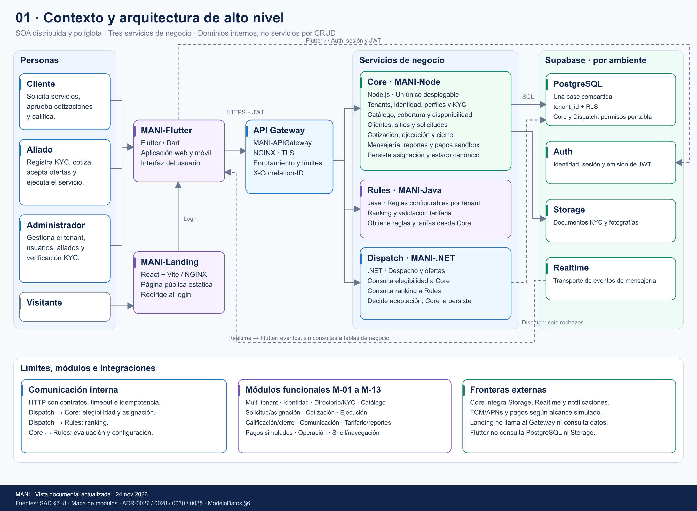
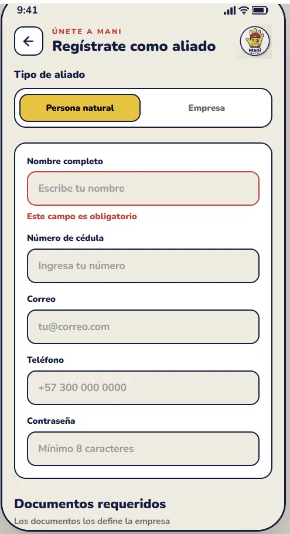
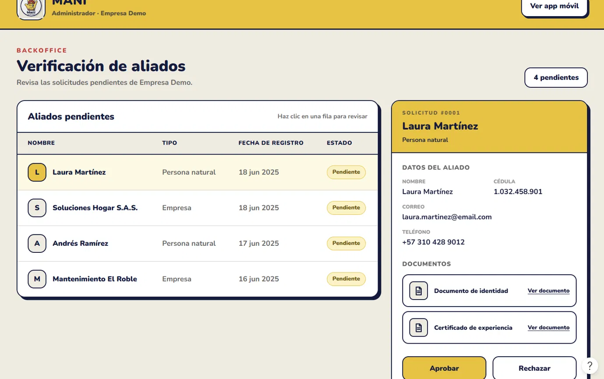
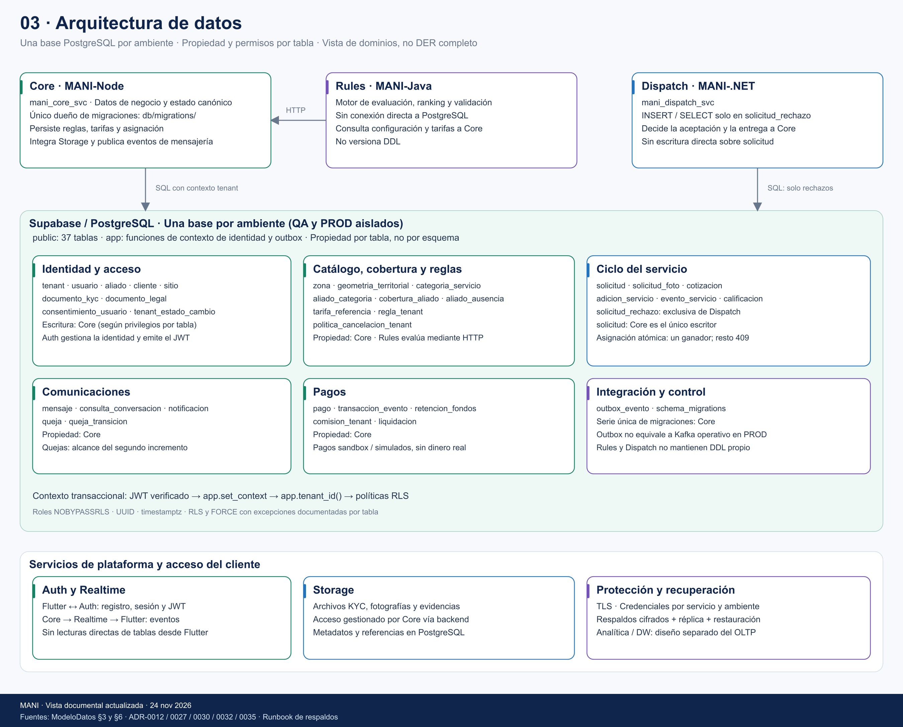
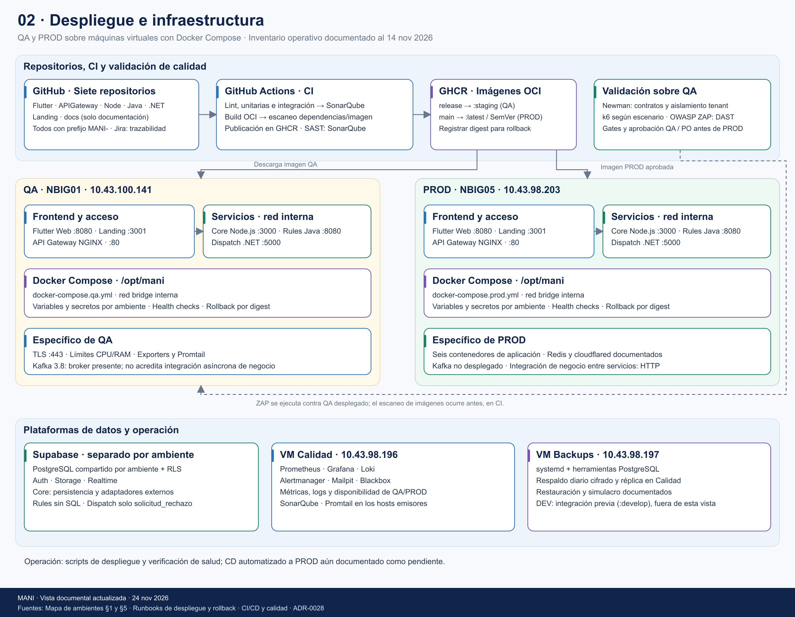

# SAD — Software Architecture Document — MANI

**Producto:** MANI — plataforma SaaS multi-tenant para formalización de operaciones de servicio  
**Documento vivo:** sin número de versión; la vigente es la de `main` y el historial está en el log del repositorio.  
**Arquitectura:** SOA distribuida + API Gateway + enfoque políglota  
**Persistencia:** Supabase como plataforma administrada, PostgreSQL como motor  
**Despliegue:** Docker + Kubernetes  
**Ambientes:** DEV → QA → PROD  
**Estrategia de repositorios:** Multi-repo  
**Diagramas de este documento:** los de alto nivel, inventariados en §4.2. Las vistas C4 las documenta [`SDD.md`](SDD.md) §4  

---

# 1. Propósito

Este documento define la arquitectura de software de MANI y traduce los requerimientos funcionales, no funcionales y restricciones de producto del SRS en decisiones de diseño.

El SRS conserva autoridad sobre **qué debe hacer el sistema**. Este SAD define **cómo se estructura la solución** para satisfacer esos requerimientos.

Para evitar contaminación entre requisitos y solución, esta versión:

- usa RF, RNF y REST del SRS como drivers;
- no toma como drivers las notas históricas de inconsistencias arquitectónicas del SRS;
- no redefine requisitos;
- no duplica el modelo de datos físico ni el DDL, que viven en `ModeloDatos.md`;
- no duplica decisiones históricas completas de ADR, solo referencia las decisiones vigentes.

---

# 2. Alcance arquitectónico

MANI es una plataforma SaaS multi-tenant que soporta:

- administración de tenants;
- autenticación y autorización;
- directorio de aliados y clientes;
- KYC;
- categorías y cobertura por zonas;
- solicitudes;
- despacho;
- cotizaciones;
- ejecución;
- calificaciones;
- mensajería;
- notificaciones;
- tarifarios;
- reportes operativos;
- pagos y funcionalidades administrativas en un segundo incremento.

La arquitectura debe permitir que cada tenant opere con datos y reglas aisladas, sin requerir una versión diferente del software por empresa.

---

# 3. Drivers derivados del SRS

## 3.1 Drivers funcionales

Los principales drivers funcionales que condicionan el diseño son:

| Driver | Origen SRS | Impacto arquitectónico |
|---|---|---|
| Multi-tenancy y administración de tenants | RF-01, RF-02, RF-03 | contexto de tenant en todas las operaciones, configuración por tenant y autorización |
| KYC aislado | RF-05, RF-06, REST-02 | almacenamiento privado, autorización y aislamiento de archivos |
| Cobertura por zonas | RF-07, RF-09, RF-12, REST-01 | catálogo de zonas y servicio de disponibilidad/cobertura |
| Ranking configurable | RF-13 | motor de reglas por tenant |
| Despacho concurrente | RF-14 | servicio transaccional con exclusión atómica |
| Cotización y tarifario | RF-15, RF-16, RF-22, RF-23 | reglas, persistencia y reportes |
| Trazabilidad de ejecución | RF-18 | historial/auditoría de eventos |
| Calificación bidireccional | RF-19 | control de estado de cierre |
| Mensajería y notificaciones | RF-20, RF-21 | realtime + persistencia + push |
| Segundo incremento | RF-24..RF-28 | extensibilidad para pagos, quejas, consola y métricas |

## 3.2 Drivers no funcionales

| Driver | Origen SRS | Prioridad arquitectónica |
|---|---|---|
| Aislamiento multi-tenant | RNF-01 / REST-04 | Crítica |
| Configuración sin despliegue por tenant | RNF-02 / REST-05 | Crítica |
| Idempotencia | RNF-03 | Alta |
| Auditabilidad | RNF-04 | Alta |
| Exclusión concurrente | RNF-05 | Alta |
| Cumplimiento de pagos | RNF-06 / RNF-11 | Alta / segundo incremento |
| Rendimiento y concurrencia | RNF-07 | Alta como riesgo de diseño |
| Uso móvil | RNF-08 | Media |
| Cobertura por zonas | RNF-09 | Alta |
| Configuración KYC/tiempos/comisión | RNF-10 | Alta |

---

# 4. Arquitectura objetivo

MANI adopta una **arquitectura SOA distribuida**, con un **API Gateway** como frontera de entrada y un **enfoque políglota** para los servicios de negocio.

## 4.1 Principios

1. Flutter contiene presentación y lógica de interacción, no reglas de negocio centrales.
2. Toda API operacional entra por NGINX/API Gateway.
3. La lógica de dominio vive en servicios.
4. Cada servicio es responsable de su capacidad funcional.
5. Supabase es la plataforma de persistencia administrada; PostgreSQL es su motor.
6. El aislamiento multi-tenant se aplica en varios niveles: JWT, autorización de servicios y RLS.
7. Los servicios no escriben directamente en datos privados de otros dominios.
8. Los cambios de configuración por tenant no deben requerir nuevo despliegue.
9. La analítica se desacopla del OLTP.
10. Los artefactos desplegados son contenerizados, versionados e inmutables.

---

## 4.2 Inventario de diagramas de alto nivel

Los diagramas de alto nivel de este documento se dibujan a mano y se mantienen a mano. Las vistas C4 (contexto, contenedores, componentes, código, dinámicas y despliegue) viven en [`SDD.md`](SDD.md) §4. Si un diagrama contradice a este documento, manda el documento.

| # | Diagrama | Pregunta que responde | Archivo | Dónde se desarrolla |
|---|---|---|---|---|
| 1 | **Arquitectura general** | ¿Cómo está construida MANI? | [`01-contexto-alto-nivel.png`](diagrams/AltoNivel/actualizados/01-contexto-alto-nivel.png) | §5, §6 y §7 |
| 2 | **Infraestructura, CI/CD y operación** | ¿Cómo se desarrolla, despliega y opera MANI? | [`02-despliegue-infraestructura.png`](diagrams/AltoNivel/actualizados/02-despliegue-infraestructura.png) | §16, §17 y §18 |
| 3 | **Arquitectura de datos** | ¿Qué dominios de datos hay y quién accede a cuáles? | [`03-arquitectura-datos.png`](diagrams/AltoNivel/actualizados/03-arquitectura-datos.png) | §14 |
| 4 | **Tech Radar** | ¿Qué tecnologías se adoptan, se evalúan o se descartan? | — | [`TECH_RADAR.md`](TECH_RADAR.md) |

**Las figuras son clicables** y abren la imagen a resolución completa. Cada figura va acompañada del contenido en texto, que es el que manda si imagen y documento no coinciden.

### 4.2.1 Arquitectura general

Representa la arquitectura lógica de MANI: una plataforma SaaS multi-tenant que gestiona
solicitudes, cotizaciones, asignaciones y ejecución de servicios entre clientes y aliados.

La capa de presentación es **Flutter**, que da acceso web y móvil a clientes, aliados y
administradores de tenant. Toda API operacional entra por el **API Gateway NGINX**, que enruta hacia
el servicio correspondiente.

La capa de negocio son **tres servicios**, y el diagrama muestra el reparto de responsabilidades que
fija §7:

| Servicio | Runtime | De qué responde |
|---|---|---|
| Rules Service | Java | reglas configurables por tenant, ranking del listado de aliados y validación de la cotización contra el tarifario |
| Dispatch Service | .NET | solicitudes, despacho, asignación, control de estados y exclusión concurrente |
| Core Service | Node.js | tenants e identidad, aliados y KYC, clientes y sitios, catálogo, **cobertura y disponibilidad**, cotización, ejecución, calificación, comunicaciones y reportes |

La persistencia es **Supabase sobre PostgreSQL**, con separación por esquemas de dominio,
Row-Level Security por tenant, almacenamiento privado de archivos y transporte de eventos en tiempo
real. Se completa con integraciones externas de notificación y de pagos, y con observabilidad.

Dos precisiones sobre el reparto de responsabilidades:

- **La elegibilidad de aliados la resuelve el Core Service, no el Rules Service.** Es la conjunción
  de categoría declarada, zona de cobertura y franja de agenda (§7.3 y §10); Rules aporta el
  **orden** del listado, no quién es elegible.
- **Core crea la solicitud y escribe su estado; Dispatch orquesta el reparto** y decide quién acepta (§7.4). El Core aporta además la elegibilidad por API.

### 4.2.2 Infraestructura, CI/CD y operación

Representa el modelo operativo, desde la gestión del trabajo hasta la construcción, validación,
publicación y despliegue.

El proyecto usa una estrategia **multi-repo** en GitHub con los siete repositorios de §17, y **Jira**
centraliza actividades, incidencias y seguimiento. Cada repositorio desplegable tiene integración
continua con **GitHub Actions**: pruebas automatizadas, análisis estático con SonarQube, evaluación
de seguridad con OWASP ZAP, construcción de imágenes Docker y publicación en **GHCR**. La promoción
preserva la imagen validada (§18).

Los ambientes son **tres: DEV → QA → PROD** (§16). Supabase aporta PostgreSQL, Auth, Storage y
Realtime gestionados, y la operación se completa con Prometheus y Grafana para métricas y tableros (§19).
Las métricas van a Prometheus y los tableros a Grafana; los **logs centralizados** a **Grafana Loki** con Promtail como recolector, correlacionados por `X-Correlation-ID` ([ADR-0006](adr/ADR-0006-observabilidad.md), [ADR-0038](adr/ADR-0038-logs-centralizados-y-trazas-loki.md)). Las trazas por spans (OpenTelemetry o Tempo) no forman parte de esta arquitectura.

**Kubernetes** es la plataforma de orquestación objetivo (PROY-08). El mecanismo de despliegue operativo es Docker Compose sobre una máquina virtual por ambiente (§16.4).

### 4.2.3 TECHRADAR — priorización tecnológica

Documenta qué tecnologías se adoptan y cuáles se evalúan o se descartan, para estandarizar, controlar
dependencias y evitar duplicidad de herramientas y costo operativo innecesario.

Clasifica por categoría —plataformas, lenguajes y frameworks, técnicas y gestión, herramientas e
infraestructura— en tres niveles: **Sí o sí** para la base adoptada, **Tal vez** para lo sujeto a
evaluación y **Mejor no** para lo que no se prioriza.

La base adoptada incluye Flutter y Dart, Node.js, Java, .NET, PostgreSQL, Supabase, GitHub, NGINX,
Docker, GitHub Actions, GHCR, SonarQube, OWASP ZAP, Newman, k6, OpenAPI, Prometheus, Grafana
y Jira.

Kubernetes figura en el radar como objetivo, **en evaluación** ([`TECH_RADAR.md`](TECH_RADAR.md)).

### 4.2.4 Alcance de los diagramas

Los tres describen la **arquitectura objetivo**. El estado de cada gate de calidad por repositorio y las reglas para considerarlo vinculante están en [`POLITICAS_DEVOPS_HERRAMIENTAS.md`](../06-gobernanza/POLITICAS_DEVOPS_HERRAMIENTAS.md) §6.2.

---

# 5. Vista de contexto

[](diagrams/AltoNivel/actualizados/01-contexto-alto-nivel.png)

> **Figura 1 — Arquitectura general.** Archivo: [`diagrams/AltoNivel/actualizados/01-contexto-alto-nivel.png`](diagrams/AltoNivel/actualizados/01-contexto-alto-nivel.png). Las vistas C4 de contexto y contenedores están en SDD §4.1 y §4.2.

```text
Actores
  Cliente · Aliado · Administrador de tenant · Administrador de plataforma
  Visitante sin sesión (solo la landing comercial)
        ↓
                          [ MANI ]
        ↓
Sistemas externos
  FCM / APNs · Operador de pagos (2.º incremento) · Observabilidad · Data Warehouse / BI
```

---

# 6. Vista de contenedores

La Figura 1 muestra los contenedores. Su vista C4 formal está en SDD §4.2.

```text
Visitante sin sesión
   ↓
Landing comercial (MANI-Landing)        catálogo, tarifas base y estimador de referencia
   ↓ redirección del navegador al login (no es una llamada de API)
Usuarios
   ↓
Flutter Web / Mobile                    presentación e interacción
   ↓ HTTPS
NGINX API Gateway                       entrada única, routing y políticas transversales
   ↓
Rules (Java) · Dispatch (.NET) · Core (Node.js)
   ↓
Supabase: Auth · PostgreSQL + RLS · Storage · Realtime
   ↓
Integraciones: FCM/APNs · Operador de pagos (2.º incremento)
```

---

# 7. Responsabilidad de servicios

## 7.1 Rules Service — Java

Responsable de:

- RF-02: evaluación de reglas configurables por tenant;
- RF-13: ranking de aliados;
- RF-16: validación contra tarifario;
- RF-22: reglas y rangos tarifarios;
- parte de RNF-02 y RNF-10.

No almacena reglas fijas por tenant en código. Obtiene configuración desde persistencia.

## 7.2 Dispatch Service — .NET

Responsable de:

- RF-12: coordinación operacional del despacho de solicitudes que **crea Core** (§7.4, decisión del 17 oct 2026);
- RF-14: elegibilidad, oferta a los aliados y decisión de aceptación/rechazo;
- RNF-03: idempotencia de sus propias ofertas;
- auditoría transaccional del despacho.

**Dispatch no escribe el estado de la solicitud.** Por la decisión 6A del 26 de octubre de 2026 (§7.4), cuando un aliado acepta, Dispatch entrega el resultado a Core con un comando idempotente y Core es quien persiste la asignación. La exclusión concurrente de RNF-05 sigue resolviéndose con una actualización condicional atómica en PostgreSQL (ADR-0016), pero la emite Core, no Dispatch: la primera aceptación válida gana y las posteriores obtienen `409 Conflict`.

## 7.3 Core Service — Node.js

Responsable de:

- RF-01: tenants;
- RF-03 y RF-04: integración de identidad y acceso;
- RF-05 y RF-06: aliados y KYC;
- RF-08 y RF-09: clientes y sitios;
- RF-10 y RF-11: categorías y asociaciones;
- RF-15, RF-17, RF-18, RF-19;
- RF-20 y RF-21;
- RF-23;
- RF-07: cobertura del aliado;
- RF-12: consulta de elegibilidad por categoría y zona, disponibilidad, horarios y zonas, con soporte a RNF-07 en la ruta crítica de consulta;
- segundo incremento RF-24..RF-28, cuando se implemente.

En módulos de alta complejidad puede dividirse internamente por dominios sin convertir cada operación CRUD en un servicio independiente. La **disponibilidad es uno de esos dominios internos**, no un servicio desplegable aparte: vive en el bloque Node junto al catálogo y la comunicación, y es lo que Despacho consulta antes de conformar el listado de candidatos.

### 7.3.1 Dominios internos de Core

Dominios internos según [ADR-0022](adr/ADR-0022-logica-de-negocio-en-servicios.md) y RNF-02. Core sigue siendo **un solo servicio desplegable**: cada dominio es un límite interno, con su archivo de rutas (`src/routes/core/<dominio>.routes.js`) y su carpeta de casos de uso (`src/application/useCases/<dominio>/`), no un servicio por CRUD. El detalle (rutas, tablas, persistencia, verificación y hallazgos completos) está en `MANI-Node/docs/arquitectura/MODULOS_CORE.md`.

| Dominio | Requisitos | Rutas principales (`/api/v1/core/…`) | Datos de Core que escribe |
|---|---|---|---|
| Identidad y registro | RF-03, RF-05, RF-08 | `/auth/*` | `usuario`, `aliado`, `cliente`, `documento_kyc`, `consentimiento_usuario` |
| Tenants | RF-01 | `GET /tenants` (solo `PLATFORM_ADMIN`) | `tenant` (lectura) |
| Perfiles | RF-11, RF-30 | `/profiles/me*` | `usuario`, `aliado_categoria` |
| Disponibilidad | RF-29 | `/profiles/me/unavailability*` | `aliado_ausencia` |
| Verificación KYC | RF-06 | `/aliados/verificacion`, `/aliados/:id/*` | `aliado`, `documento_kyc` |
| Catálogo | RF-07, RF-10 | `/catalog*` (categorías y zonas) | `categoria_servicio`; reglas de categoría en Rules por HTTP |
| Clientes y sitios | RF-08, RF-09 | `/clients/*`, `/sites/:id/*` | `cliente`, `sitio` |
| Legal | RF-31 | `/legal/*` | `consentimiento_usuario` |
| Solicitudes | RF-12, RF-32 | `POST /solicitudes`, `/solicitudes/me*`, `POST /solicitudes/:id/asignacion` (interna) | `solicitud`, `solicitud_foto` |
| Integración con Dispatch | RF-12 (elegibilidad) | `/allies/eligible`, `/allies/me*`, `/solicitudes/:id/context` | ninguno: son lecturas para Dispatch |
| Notificaciones | RF-20 (avisos) | `/profiles/me/inbox`, `/notifications` | `notificacion` |
| Cotización | RF-15, RF-17 | `/solicitudes/:id/cotizaciones`, `/cotizaciones/:id/*` | `cotizacion`, `solicitud`, `evento_servicio` |
| Ejecución del servicio | RF-18 | `/solicitudes/:id/{iniciar,finalizar,ejecucion,eventos*}` | `solicitud`, `evento_servicio`; evidencia en Storage |
| Mensajería | RF-20, RF-21 | `/solicitudes/:id/mensajes` | mensajes del servicio |
| Pagos (sandbox) | RF-24 (simulado, sin dinero real) | `/pagos*` | pagos del sandbox |

**Límites que se cumplen** (prueba de regresión `tests/integration/routes/routeInventory.test.js`, CI y SonarQube en verde):

- Core llama a Dispatch y a Rules solo por HTTP ([ADR-0030](adr/ADR-0030-propiedad-esquema-y-frontera-de-datos.md)); no lee tablas de Dispatch.
- El tenant, el usuario y el rol salen del JWT verificado, no del cuerpo ni de cabeceras.
- Los casos de uso no se importan entre sí: comparten repositorios inyectados desde `container.js`. No hay dependencias circulares.
- La modularización no cambió ninguna ruta pública, ningún middleware de autenticación o rol ni ningún contrato OpenAPI: las 157 rutas de antes siguen registradas igual.

## 7.4 Límites entre servicios

Esta sección precisa los límites de §7.1–§7.3 para que persistencia, contratos HTTP y mensajería partan de la misma base. No reasigna requisitos: hace explícito qué datos es dueño cada servicio y qué no hace. Aplica el principio 7 de §4.1: ningún servicio escribe en datos privados de otro dominio.

### Dueño de los datos

| Servicio | Es dueño de |
|---|---|
| Rules — Java | Reglas configurables por tenant, regla de ranking y tarifario de referencia (RF-02 en lo que es regla, RF-13, RF-22). |
| Dispatch — .NET | Orquestación del despacho, broadcast, elegibilidad, ofertas, la decisión de aceptación/rechazo y la auditoría transaccional del despacho (RF-14). No crea la solicitud ni escribe su estado (decisión 6A). |
| Core — Node.js | Tenants, identidad, aliados y KYC, clientes y sitios, categorías, cobertura y disponibilidad, creación de la solicitud (RF-12), **el estado canónico del servicio desde la creación y después de la asignación** (decisión 6A), cotizaciones, eventos de ejecución, calificaciones, mensajería y reportes (RF-01, RF-03..RF-11, RF-12 consulta de elegibilidad, RF-15, RF-17..RF-21, RF-23). |

### Lo que cada servicio no hace

- **Rules** no persiste solicitudes ni asignaciones, no envía notificaciones y no tiene reglas por tenant fijas en código: evalúa y responde.
- **Dispatch** no decide la elegibilidad por categoría, zona o disponibilidad (la consulta a Core) ni calcula el orden del listado (lo consulta a Rules). No gestiona cotización, ejecución ni calificación. **No escribe `solicitud` ni ninguna tabla de estado del dominio de Core** (decisión 6A): entrega el resultado de la asignación por contrato.
- **Core** no orquesta el despacho, no decide a quién se le ofrece una solicitud ni a quién se le asigna, y no evalúa reglas ni valida contra el tarifario (lo consulta a Rules). Sí **persiste** la asignación que Dispatch decide, porque es el dueño del estado (decisión 6A).
- **Landing** (`MANI-Landing`, no es un servicio) no consulta datos ni Supabase, no llama al Gateway ni a ningún servicio y no participa del flujo transaccional. Su catálogo y sus tarifas base son contenido estático, y el rango del estimador es una referencia que no es una cotización ni se persiste. Su única relación con el resto es la redirección del navegador a `/login` del cliente web, con la categoría o el aliado elegidos como parámetros de consulta. Registro: [ADR-0028](adr/ADR-0028-nombres-repositorios-y-ambientes.md); detalle: `MANI-Landing/docs/ARQUITECTURA_E_INTEGRACION.md`.

### Flujo de RF-12 a RF-16

```text
Cliente → Gateway → Core: crea la solicitud
Dispatch → Core: aliados elegibles (categoría + zona + disponibilidad)
Dispatch → Rules: orden del listado según la regla del tenant (sin regla aplicada: NO_DISPONIBLE)
Dispatch: broadcast de la oferta y decisión de quién acepta
Dispatch → Core: comando de asignación idempotente; Core persiste (409 a las posteriores)
Core: cotización del aliado → Rules: validación contra tarifario (alerta RF-16)
```

### Decidido

**Quién crea la solicitud (RF-12): Core.** Acordado entre la Product Owner y la Scrum Master. Core crea y persiste la solicitud; Dispatch orquesta el reparto a partir de ella.

**Quién es dueño del estado del servicio después de la asignación: Core (decisión 6A).** Decisión de la Scrum Master. Core Node es el **único propietario y escritor** del estado canónico del servicio, desde la creación y también después de la asignación. Dispatch .NET conserva la elegibilidad, la oferta y la decisión de asignación, y comunica el resultado a Core mediante un contrato idempotente. Queda **prohibida la escritura directa por Dispatch** de las tablas de estado del dominio de Core.

#### Contrato de asignación Dispatch → Core

| Aspecto | Definición |
|---|---|
| Operación | `POST /api/v1/core/solicitudes/{id}/asignacion` |
| Actor y tenant | Dispatch reenvía el JWT del aliado que aceptó. El aliado, el tenant y el rol salen de la sesión verificada, nunca del cuerpo, que va vacío. Un rol distinto de aliado se rechaza. |
| Idempotencia | El mismo aliado puede repetir el comando sin efecto adicional: la respuesta devuelve `asignada: false` y el estado ya persistido. Se acepta `Idempotency-Key` para trazar el intento. |
| Concurrencia | Core bloquea la fila de la solicitud (`FOR UPDATE`) y repite el predicado `estado = 'PENDIENTE' AND aliado_id IS NULL` en el `UPDATE`, que hace de versión de la fila (ADR-0016). El primero gana. |
| `correlationId` | Se propaga desde el Gateway y se devuelve en la respuesta. Cada intento queda en un registro JSON con el resultado: `ASIGNADA`, `REINTENTO` o `RECHAZADA` (QS-12). |
| Conflicto (409) | `MANI-SOL-409` si la solicitud ya tiene aliado; `MANI-SOL-409E` si su estado no admite asignación. |
| Rechazo (403) | `MANI-SOL-403` rol no permitido o cuenta del aliado inactiva, `MANI-SOL-403V` aliado sin verificar, `MANI-SOL-403O` sin oferta para esa solicitud, `MANI-SOL-403E` no atiende la categoría o la zona. |
| No encontrada (404) | `MANI-SOL-404`, sin distinguir si la solicitud no existe o es de otro tenant. |
| Dependencia no disponible (503) | Core responde 503 cuando falta la dependencia y **no sustituye el resultado por lógica local** (criterio T2). El acceso falla cerrado. |

La frontera en base de datos la aplica la migración `0019_frontera_asignacion_6a.sql` de Core, que revoca `UPDATE` sobre `solicitud` al rol de Dispatch y retira la política que permitía la escritura directa. La tabla `solicitud` está físicamente en el esquema `despacho` aunque Core es su único dueño y escritor ([`ModeloDatos.md`](ModeloDatos.md) §6.1).

#### Lo que queda del lado de Dispatch

| Aspecto | Definición |
|---|---|
| Rechazos | Son del dominio de Dispatch (`solicitud_rechazo`). Rechazar es idempotente; el motivo es del catálogo o nulo (`422 MANI-SOL-422M`). Un aliado que ya rechazó y luego intenta aceptar recibe `409 MANI-DSP-409R`, sin llegar a Core. |
| Elegibles sin los que rechazaron | Dispatch envía a Core los aliados que rechazaron en `excludeAllyIds`, y Core los quita antes de paginar. Core no lee `solicitud_rechazo`. |
| Orquestación | Solo con la solicitud `PENDIENTE` (`409 MANI-DSP-409E`). Core guarda una sola oferta por aliado y solicitud (índice único de la migración `0019`), así que repetir la orquestación no duplica ofertas. |
| Bandeja del aliado | `GET /api/v1/dispatch/offers/me` lee la bandeja de Core (`GET /allies/me/offers`, interna) y quita lo que el aliado rechazó. Sin la dirección de solicitudes ajenas. |
| Falla cerrada | Si Core no responde o responde algo inesperado, Dispatch responde `503 CORE_SERVICE_UNAVAILABLE` y no da nada por asignado. |

Contratos: `core-internal.yaml` y `dispatch.yaml` en MANI-APIGateway. El orden de los elegibles lo calcula Rules (RF-13): sin una evaluación real de Rules, Dispatch responde `ranking.estado = NO_DISPONIBLE` y nunca presenta un puntaje simulado como orden real.

# 8. Multi-tenancy y seguridad

## 8.1 Identificación de tenant

Para operaciones autenticadas:

```text
Authorization: Bearer <JWT>
```

El `tenant_id` se obtiene de un JWT firmado emitido por **Supabase Auth (GoTrue)**, el cual actúa como el **Proveedor de Identidad (IdP)** oficial de la plataforma:
- Supabase Auth gestiona el registro, login y emisión del token portador (JWT).
- El JWT desacopla la autenticación entre los microservicios políglotas (Node.js, Java, .NET) y el API Gateway mediante un modelo *stateless* (sin estado ni consultas repetitivas a la base de datos).
- La firma digital del JWT encapsula el claim `app_metadata.tenant_id`, impidiendo la suplantación de tenant (*anti-spoofing*).
- El API Gateway valida perimetralmente el JWT y propaga los claims confiables vía *Token Relay* y encabezados inyectados (`X-Tenant-Id`, `X-User-Role`, `X-User-Id`).

El cliente no puede decidir el tenant de autorización mediante un header libre.

En preautenticación puede utilizarse `X-Tenant-Slug` únicamente como contexto de resolución, nunca como fuente de autorización.

## 8.2 Capas de control

```text
Cliente
  ↓
API Gateway
  ↓  valida token / políticas de acceso
Servicio
  ↓  valida rol y permiso
Supabase / PostgreSQL
  ↓  RLS por tenant
Datos
```

La arquitectura cumple RNF-01 mediante defensa en profundidad.

## 8.3 Acceso del cliente a Supabase

El cliente Flutter alcanza Supabase por **exactamente dos caminos**, y **no existe ninguna
excepción**:

| Camino | Para qué | Por qué es legítimo |
|---|---|---|
| `Flutter → Supabase Auth` | iniciar sesión, registrar usuario y refrescar el JWT | la identidad la emite Supabase GoTrue y el tenant viaja como claim firmado (ADR-0018, ADR-0027) |
| `Flutter ← Supabase Realtime` | recibir eventos de mensajería mientras el usuario está conectado | Realtime es un **transporte de eventos**: no lee tablas de negocio, no ejecuta reglas y no decide nada. El evento lo publica el Core después de persistir el mensaje |

Queda prohibido y retirado del cliente, sin excepción transitoria ni de disponibilidades:

- `.from()` — acceso a tablas vía PostgREST;
- `.rpc()` — invocación de funciones almacenadas;
- `.storage.from()` — acceso directo a Storage. Los documentos KYC se suben por endpoint
  intermediario o URL prefirmada que emite el Core.

La consulta de disponibilidades **no** es una excepción: entra por el Gateway al Core como
cualquier otra lectura de negocio. Esto materializa
[ADR-0022](adr/ADR-0022-logica-de-negocio-en-servicios.md) y
[ADR-0027](adr/ADR-0027-alcance-supabase-cliente-flutter.md).

El detalle, con la tabla de dependencias permitidas y prohibidas, está en
[`SDD.md`](SDD.md) §2.2 y §14.

## 8.4 Documentos KYC

Los documentos se almacenan en Supabase Storage.

Convención:

```text
tenant_id/aliado_id/documento
```

Controles:

- bucket privado;
- políticas de acceso;
- separación por tenant;
- separación por aliado;
- administrador de tenant limitado a su tenant.

Esto responde a RF-05, RF-06 y REST-02.

## 8.5 Vista de interfaz del registro y la verificación de aliados

Las pantallas de registro y verificación de aliados tienen mockup aprobado en Figma. El archivo fuente es
[MANI — Figma Make](https://www.figma.com/make/VsrVQhwNp6r9t0WEpcpX8s/Review-design-link) y las exportaciones
versionadas viven en [`../01-producto/MOCKUPS/`](../01-producto/MOCKUPS/). Las dos figuras siguientes ilustran cómo la
interfaz materializa los controles de esta sección: la carga de documentos KYC definidos por el tenant y una
bandeja de verificación limitada a la empresa del administrador.

[](../01-producto/MOCKUPS/registro-aliado-persona-natural.png)

**Figura 8.1 — Registro de aliado (persona natural).** Selector de tipo de aliado, datos de identificación y
sección de documentos requeridos, cuya lista la configura cada tenant (RF-02, RNF-10). La variante de empresa es una pantalla aparte. Fuente: [Figma](https://www.figma.com/make/VsrVQhwNp6r9t0WEpcpX8s/Review-design-link).

[](../01-producto/MOCKUPS/backoffice-verificacion-aliados.png)

**Figura 8.2 — Bandeja de verificación del Backoffice.** El administrador ve solo los aliados pendientes de su
tenant, consulta sus documentos y aprueba o rechaza; el rechazo exige un motivo. Responde a RF-06 y
RNF-01. Fuente: [Figma](https://www.figma.com/make/VsrVQhwNp6r9t0WEpcpX8s/Review-design-link).

Exportaciones disponibles en `../01-producto/MOCKUPS/`:

| Archivo | Pantalla |
|---|---|
| `perfil-acceso-registros.png` | Acceso a los registros desde el perfil |
| `registro-aliado-persona-natural.png` | Registro de aliado persona natural |
| `registro-aliado-empresa.png` | Registro de aliado empresa |
| `registro-aliado-confirmacion.png` | Confirmación: registro pendiente de verificación |
| `backoffice-verificacion-aliados.png` | Bandeja de verificación de aliados |
| `backoffice-aliado-aprobado.png` | Aliado aprobado en la bandeja |
| `registro-cliente.png` | Registro de cliente persona natural |

---

# 9. Configuración por tenant

RF-02, RNF-02, RNF-10 y REST-05 exigen evitar código específico por empresa.

La configuración se mantiene como datos:

- documentos KYC requeridos;
- reglas de ranking;
- categorías;
- tarifarios;
- comisión;
- tiempos;
- parámetros operativos.

```text
Tenant
  ↓
Configuración / Reglas
  ↓
Rules Service
  ↓
Comportamiento dinámico
```

Una modificación de una regla de tenant no exige un despliegue de software.

---

# 10. Cobertura y disponibilidad

El diseño respeta REST-01 y RNF-09:

- cobertura mediante catálogo de zonas;
- granularidad operativa MVP: localidad/comuna;
- no radio geográfico;
- no geolocalización en tiempo real;
- no cálculo de proximidad;
- match exacto por identificador de zona.

```text
Sitio
  └── Zona

Aliado
  ├── Categoría
  └── CoberturaZona

Elegible =
  misma categoría
  AND
  misma zona
  AND
  disponible
```

---

# 11. Ciclo del servicio

```text
Solicitud
  → Selección de aliados válidos (categoría + zona)
  → Broadcast
  → Aceptación atómica
  → Cotización
  → Aceptación / ajuste del cliente
  → Ejecución
  → Calificación del cliente  +  Calificación del aliado
  → Cierre
```

El cierre solo ocurre cuando ambas calificaciones requeridas por RF-19 existen.

---

# 12. Mensajería y notificaciones

MANI tiene **dos planos de mensajería distintos** y no se mezclan: la notificación hacia el usuario
final y el evento de negocio entre servicios. El primero lo gobierna ADR-0017; el segundo,
[ADR-0029](adr/ADR-0029-comunicacion-asincrona-kafka.md).

## 12.1 Notificación hacia el usuario final

Para RF-20 y RF-21:

- Supabase Realtime entrega eventos mientras los participantes están conectados;
- FCM/APNs entrega push cuando el cliente está en background o desconectado;
- los mensajes asociados al servicio se persisten;
- el historial de conversación puede consultarse posteriormente;
- Realtime transporta eventos, pero no ejecuta reglas de negocio.

Esto evita que una reconexión implique pérdida del estado del servicio.

## 12.2 Evento de negocio entre servicios

Realtime es un transporte hacia un usuario conectado: no garantiza entrega a un consumidor
desconectado, no reintenta y no ordena por agregado. **No es el bus de integración entre
servicios.** Esa integración la decide ADR-0029: bus de eventos con **Apache Kafka**, con la configuración del capítulo 22 del SDD. La publicación confiable desde el outbox y los consumidores idempotentes siguen el patrón del capítulo 20 del SDD.

Entre servicios, las llamadas síncronas son HTTP por la red interna y fallan cerrado —`503` hacia el llamador, sin degradar a lógica local— según el patrón que fija ADR-0030 §2.

Cuatro eventos de negocio, cada uno con un único productor, que es el servicio dueño de la capacidad
(ADR-0022, SAD §7.4):

| Evento | Productor | Se emite cuando |
|---|---|---|
| `SolicitudCreada` | Core Service | la solicitud queda persistida y lista para repartirse (RF-12) |
| `AliadoAsignado` | Core Service (decisión 6A) | la actualización condicional de ADR-0016 confirma la asignación |
| `CotizacionAceptada` | Core Service | el cliente acepta una cotización validada contra el tarifario |
| `ServicioFinalizado` | Core Service | la ejecución del servicio concluye y la solicitud pasa a `FINALIZADA` (RF-18, RF-19) |

Ningún servicio emite un evento de un dominio ajeno. Todo evento viaja con el sobre obligatorio de
ADR-0029 §2 —`event_id`, `event_type`, `event_version`, `occurred_at`, `tenant_id`,
`correlation_id`, `partition_key`, `data`— y su esquema formal `v1` junto con las reglas de
versionado se especifican en el capítulo 20 del [SDD](SDD.md). `tenant_id`
es obligatorio porque el aislamiento multi-tenant (RNF-01) también aplica a los eventos, y
`correlation_id` continúa el `X-Correlation-ID` del Gateway para seguir una transacción de extremo a
extremo atravesando el bus (RNF-07).

La publicación usa **transactional outbox** desde la primera implementación, nunca doble escritura:
el servicio escribe el evento en `outbox_evento` dentro de la misma
transacción que cambia el estado, y un relay aparte lo publica y lo marca enviado
(`ModeloDatos.md` §6.3, §7 y §8). El consumidor es idempotente por `event_id`. La razón es
concreta: con doble escritura, una caída entre el `COMMIT` y la publicación deja una solicitud
asignada sin evento, o publica dos veces y produce una segunda asignación aparente, que es lo que
RNF-05 prohíbe.

---

# 13. Auditabilidad

RNF-04 y RF-18 requieren reconstrucción de los eventos relevantes.

Se mantienen:

- historial de estados de solicitud;
- actor;
- fecha/hora;
- operación;
- correlation ID;
- eventos de despacho;
- cambios de cotización;
- eventos de ejecución;
- auditoría de operaciones sensibles.

Para el segundo incremento, las operaciones financieras requieren registro inmutable.

---

# 14. Persistencia

[](diagrams/AltoNivel/actualizados/03-arquitectura-datos.png)

> **Figura 3 — Arquitectura de datos.** Archivo: [`diagrams/AltoNivel/actualizados/03-arquitectura-datos.png`](diagrams/AltoNivel/actualizados/03-arquitectura-datos.png). Muestra dominios y fronteras de acceso; el DER detallado está en [`ModeloDatos.md`](ModeloDatos.md).

MANI utiliza:

> **Supabase como plataforma administrada y PostgreSQL como motor relacional.**

No se consideran Supabase y PostgreSQL alternativas distintas.

Capacidades utilizadas:

- PostgreSQL;
- RLS;
- Auth;
- Storage;
- Realtime.

El detalle conceptual, lógico, físico, DDL y diccionario vive en `ModeloDatos.md`, que es la
**especificación normativa** del modelo. El **DDL ejecutable** es una sola serie de migraciones
propiedad de Core Service, con numeración incremental e inmutable y registro en
`schema_migrations`; Rules y Dispatch no versionan DDL y abren PR de migración contra esa serie.
`MANI-APIGateway/database/` y `MANI-Flutter/database/` quedan congelados como histórico y no son
la fuente ([ADR-0030](adr/ADR-0030-propiedad-esquema-y-frontera-de-datos.md) §1).

Los permisos por esquema que hacen exigible esa frontera —un rol por servicio, sin `SELECT` sobre
esquemas ajenos y FK sostenidas con `REFERENCES`— están en `ModeloDatos.md` §6.3.

---

# 15. Data Warehouse y análisis

RF-28 requiere métricas operativas por tenant en el segundo incremento.

La solución analítica se mantiene separada del flujo transaccional:

```text
Supabase / PostgreSQL (OLTP) → CDC / ELT incremental → Data Warehouse → Dashboards / Analytics
```

Esto evita ejecutar consultas analíticas intensivas directamente sobre las tablas operacionales.

El modelo dimensional se especifica en `ModeloDatos.md`.

---

# 16. Vista de despliegue

[](diagrams/AltoNivel/actualizados/02-despliegue-infraestructura.png)

> **Figura 2 — Infraestructura de alto nivel.** Archivo: [`diagrams/AltoNivel/actualizados/02-despliegue-infraestructura.png`](diagrams/AltoNivel/actualizados/02-despliegue-infraestructura.png). La vista C4 de despliegue está en SDD §9.1. Los demás ambientes comparten esa topología y cambian escalado, secretos y datos (SDD §10).

MANI mantiene tres ambientes:

```text
DEV → QA → PROD
```

No se define STAGING como cuarto ambiente.

## 16.1 DEV

- desarrollo e integración;
- Docker local cuando aplique;
- Kubernetes para la validación del modelo de despliegue cuando corresponda
- datos sintéticos;
- sin datos reales de usuarios o KYC.

## 16.2 QA

- pruebas funcionales;
- integración;
- contract tests;
- aislamiento multi-tenant;
- Newman;
- OWASP ZAP;
- pruebas de concurrencia;
- Supabase separado de producción.

## 16.3 PROD

- usuarios y datos reales;
- Supabase productivo;
- artefactos inmutables;
- controles de acceso productivos;
- monitoreo y alertamiento.

## 16.4 Kubernetes

Kubernetes es el orquestador de la solución contenerizada.

La decisión de proveedor de cómputo o dimensionamiento físico puede cambiar sin alterar la arquitectura lógica descrita en este SAD.

---

# 17. Estrategia multi-repositorio

La solución mantiene una estrategia **multi-repo**:

| Repositorio | Tecnología | Responsabilidad principal |
|---|---|---|
| `MANI-Flutter` | Flutter / Dart | Cliente web y móvil |
| `MANI-APIGateway` | NGINX | Punto de entrada y enrutamiento de APIs |
| `MANI-Java` | Java | Reglas de negocio por tenant |
| `MANI-.NET` | .NET | Solicitudes, despacho y asignación |
| `MANI-Node` | Node.js | Servicios core y disponibilidades |
| `MANI-Landing` | React 19 + Vite 8, servida por NGINX | Página comercial pública: entrada a la plataforma |
| `MANI-docs` | Markdown / diagramas / ADR | Documentación arquitectónica y técnica |

Son **siete repositorios** y seis desplegables ([ADR-0028](adr/ADR-0028-nombres-repositorios-y-ambientes.md)).
No existe `MANI-Availability` —la disponibilidad es un dominio del Core— ni `MANI-Infra`: la infraestructura de datos y el stack local viven en `MANI-APIGateway` (ADR-0004).

Cada unidad desplegable mantiene:

- dependencias;
- pruebas;
- build;
- versionamiento;
- pipeline;
- artefacto contenerizado.

`MANI-docs` mantiene SDD, ADR, modelo de datos y diagramas técnicos.

---

# 18. CI/CD

```text
Pull Request
  → Unit / Integration / Contract Tests
  → SonarQube
  → Docker Build
  → Dependency / Image Scan
  → Deploy QA
  → Newman
  → OWASP ZAP
  → Promoción del mismo artefacto a PROD
```

Principio:

> **Build once, deploy many.**

El artefacto validado se promueve sin reconstruirse.

---

# 19. Observabilidad

Se emplean:

- Prometheus para métricas;
- Grafana para dashboards;
- correlation ID para seguimiento entre servicios;
- alertas integradas con Jira.

La instrumentación cubre:

- API Gateway;
- Rules Service;
- Dispatch Service;
- Core Service;
- infraestructura Kubernetes.

## 19.1 Métricas expuestas

Cada servicio publica sus métricas en el endpoint canónico `/metrics`, en formato Prometheus
(`text/plain; version=0.0.4; charset=utf-8`). Core las expone en `/metrics` y `/api/v1/metrics`; el
Gateway en `/metrics` y `/api/v1/core/metrics`, como ruta pública sin token para los scrapers
internos.

| Métrica | Tipo | Etiquetas | Qué permite medir |
|---|---|---|---|
| `http_requests_total` | Counter | `method`, `route`, `status_code` | Tasa de 401, 403 y 5xx por ruta normalizada |
| `http_request_duration_seconds` | Histogram | `method`, `route`, `status_code` | Latencia por petición, contra los umbrales de [`SDD.md`](SDD.md) §7.4 |
| `auth_validations_total` | Counter | `result`, `reason` | Validaciones de JWT, discriminando el claim que falta |

`auth_validations_total` distingue el motivo, que es lo que hace útil la métrica para el
aislamiento multi-tenant (RNF-01): `result="success"` con `reason="ok"` cuando el token trae los
claims obligatorios, y `result="failure"` con `reason` igual a `missing_tenant_claim` (sin
`app_metadata.tenant_id`), `missing_user_role` (sin `sub` o sin `app_metadata.user_role`),
`missing_authorization_header`, `malformed_authorization_header` (sin prefijo `Bearer`),
`invalid_signature`, `token_expired` o `invalid_token`. Los dos primeros motivos identifican un
token que intenta evadir el Custom Access Token Hook de Supabase, no un error del usuario.

## 19.2 Alertas de autenticación

Reglas Prometheus de `monitoring/alerts/auth-alerts.yml`, presentes en `MANI-Node` y en
`MANI-APIGateway`. Cubren el riesgo **R-4** (falta de telemetría del perímetro de autenticación) y
se emiten etiquetadas con `hallazgo: R-4` para poder trazarlas:

| Alerta | Dispara cuando | Durante | Severidad |
|---|---|---|---|
| `HighAuth401Rate` | la proporción de respuestas 401 sobre el total supera el 5 % en 5 min | 2 min | `warning` |
| `IncompleteClaimsAttemptsDetected` | aparece cualquier validación fallida con `reason=~"missing_.*"` | 1 min | `critical` |

El umbral de 401 es una tasa, no un contador: busca fuerza bruta o expiración masiva, no un fallo
aislado. La segunda alerta no tiene umbral porque un solo token sin `tenant_id` o sin `user_role`
ya es un intento de evadir el aislamiento.

Esta sección documenta el contrato de observabilidad; las pruebas que lo acreditan son `tests/integration/routes/metrics.routes.test.js` de
`MANI-Node` y el guion `tests/gateway/ruta-publica-metrics.sh` del Gateway, ejecutados en
`.github/workflows/ci.yml`.

---

# 20. Atributos de calidad priorizados

Este SAD declara **qué atributo es prioritario y por qué**. Los umbrales con los que se verifica
viven únicamente en [`SDD.md`](SDD.md) §7, y los escenarios con los que QA los comprueba en
[`SDD.md`](SDD.md) §8.

| Atributo | Prioridad | Por qué lo es en MANI | Driver | Umbrales |
|---|---|---|---|---|
| **Seguridad** | P1 | el aislamiento multi-tenant cubre datos, archivos KYC, usuarios y configuración; una fuga cruza empresas, no usuarios | RNF-01, REST-02, REST-04 | [SDD §7.2](SDD.md) |
| **Fiabilidad** | P1 | el despacho debe terminar en exactamente una asignación válida y las operaciones críticas toleran reintentos | RNF-03, RNF-05 | [SDD §7.3](SDD.md) |
| **Eficiencia de desempeño** | P1 | la consulta de elegibilidad y el ranking están en la ruta crítica de cada solicitud | RNF-07 | [SDD §7.4](SDD.md) |
| **Mantenibilidad** | P1 | tres runtimes y varios dominios elevan el costo de cambio; sin límites claros aparece el monolito distribuido | PROY-07 | [SDD §7.5](SDD.md) |
| **Flexibilidad** | P1 | cada tenant configura sus reglas sin despliegue propio, y la plataforma de orquestación aún puede cambiar | RNF-02, RNF-10, REST-05 | [SDD §7.6](SDD.md) |
| **Compatibilidad** | P2 | los servicios se integran entre tecnologías distintas y con terceros | PROY-07 | [SDD §7.7](SDD.md) |
| **Adecuación funcional** | P2 | la exactitud de reglas, asignaciones y estados es verificable por pruebas | RF-13, RF-14, RF-16 | [SDD §7.8](SDD.md) |
| **Capacidad de interacción** | P2 | clientes y aliados operan desde móvil | RNF-08 | [SDD §7.9](SDD.md) |
| **Protección / Safety** | P3 | no es un sistema safety-critical, pero debe evitar operaciones irreversibles inseguras | — | [SDD §7.10](SDD.md) |

## 20.1 Decisiones que esta priorización obliga

La priorización no es declarativa: condiciona el diseño descrito en este documento.

| Prioridad | Decisión que obliga | Dónde está |
|---|---|---|
| Seguridad P1 | defensa en profundidad: JWT + autorización en servicio + RLS, y aislamiento equivalente en Storage | §8 |
| Seguridad P1 | el cliente alcanza Supabase solo por Auth y Realtime | §8.3 |
| Fiabilidad P1 | exclusión concurrente por actualización condicional atómica en Dispatch | §7.2, §11 |
| Fiabilidad P1 | efectos secundarios por eventos: un fallo de push no revierte una operación confirmada | §12, §21 |
| Desempeño P1 | índice de búsqueda de elegibilidad por categoría, zona, fecha y estado | §7.3, §10 |
| Mantenibilidad P1 | propiedad de datos por dominio; ningún servicio escribe el esquema de otro | §14, ModeloDatos §13 |
| Flexibilidad P1 | configuración por tenant como datos, no como código ni como rama | §9 |
| Flexibilidad P1 | artefactos OCI inmutables y configuración externa, para que la orquestación pueda cambiar | §18 |

> **Por qué esta sección no trae cifras.** Antes repetía umbrales que contradecían al SDD: `p95 ≤ 1 s`
> aquí frente a `p95 ≤ 500 ms` allí, y 20 usuarios concurrentes frente a 300 sesiones. Con dos
> fuentes para el mismo número, ninguna era verificable. Cambiar un umbral es cambiar el SDD.

---

# 21. Patrones arquitectónicos

## 21.1 SOA

Capacidades de negocio separadas en servicios con contratos explícitos.

## 21.2 API Gateway

NGINX concentra:

- entrada;
- autenticación inicial;
- routing;
- rate limiting;
- políticas transversales.

## 21.3 Layered Architecture interna

Cada servicio mantiene:

```text
API
↓
Application
↓
Domain
↓
Ports
↑
Adapters / Infrastructure
```

## 21.4 Repository / Ports and Adapters

La lógica del dominio no depende directamente de Supabase/PostgreSQL.

## 21.5 Event-driven para efectos secundarios

Aplicable a:

- notificaciones;
- auditoría;
- analítica;
- eventos no críticos para la respuesta sincrónica.

---

# 22. Patrones de diseño

| Patrón | Uso |
|---|---|
| Strategy | reglas variables por tenant |
| Factory | selección de estrategia |
| Repository | persistencia |
| Adapter | FCM/APNs, pagos, proveedores |
| Facade/Application Service | coordinación de casos de uso |
| Observer/Publish-Subscribe | notificaciones y eventos |
| Circuit Breaker | integraciones externas |
| Retry | fallas transitorias |
| Idempotency Key | evitar duplicados |
| Outbox | consistencia entre transacción y publicación de eventos |

---

# 23. Riesgos arquitectónicos

## Lógica de negocio en Flutter

**Riesgo:** duplicación, exposición de reglas y clientes inconsistentes.  
**Control:** mover lógica al backend.

## Acceso directo indiscriminado a Supabase

**Riesgo:** bypass de controles y acoplamiento.  
**Control:** servicios como frontera principal; RLS como defensa adicional.

## Servicios excesivamente pequeños

**Riesgo:** monolito distribuido.  
**Control:** dividir por capacidad de negocio, no por operación CRUD.

## Dependencias síncronas largas

**Riesgo:** fallos en cascada.  
**Control:** eventos para efectos secundarios y circuit breaker.

## Pérdida de aislamiento multi-tenant

**Riesgo:** exposición de datos entre empresas.  
**Control:** JWT + autorización + RLS + pruebas automatizadas.

## Doble asignación

**Riesgo:** inconsistencia operacional.  
**Control:** exclusión atómica en PostgreSQL.

## Consultas analíticas sobre OLTP

**Riesgo:** degradación del flujo operacional.  
**Control:** Data Warehouse separado.

## Complejidad políglota

**Riesgo:** mayor costo de operación y soporte.  
**Control:** contratos estandarizados, CI/CD homogéneo y límites claros por servicio.

## Custodia de pagos del segundo incremento

**Riesgo:** si MANI retiene en cuentas propias el dinero de los clientes (escrow), podría incurrir en captación masiva y habitual de dineros del público sin autorización (Código Penal art. 316; Decreto 1981 de 1988).  
**Control:** la custodia del dinero queda en un operador de pagos regulado y MANI solo gestiona el estado del pago (ADR-0024; RNF-06, RNF-11).

## 23.1 Riesgos de las operaciones sensibles de negocio

Los riesgos anteriores son de estructura. Esta sección recorre las **operaciones de negocio** que mueven dinero, cambian reglas o deciden sobre una persona, como pide [QAS-38](SDD.md) («cada operación sensible aparece en el análisis con su mitigación»).

Cada control se describe como está en el código. Donde el control no cubre todo el riesgo, la columna **Riesgo residual** lo dice y nombra el escenario de calidad que lo mide.

| # | Operación (historia) | Riesgo | Control implementado | Riesgo residual |
|---|---|---|---|---|
| 1 | Pago al aceptar cotización | Cobro duplicado por reintento o doble clic | Clave de idempotencia con huella del cuerpo: la misma clave con otro cuerpo devuelve `409` (migración `0041`); el backend rechaza un segundo pago aprobado sobre la misma cotización | La pantalla sigue mostrando «Pagar (sandbox)» después de pagar (observación de la PO, 2026-11-21); el backend sí bloquea |
| 2 | Retención y liberación de fondos | Captación de dineros del público sin autorización | Custodia en operador regulado (ADR-0024); en el MVP el pago es simulado. La liberación bloquea las retenciones con `FOR UPDATE` y ocurre al finalizar el servicio (decisión de la PO) | El flujo financiero real no existe en el MVP; la integración con un operador queda fuera de lo entregado |
| 3 | Aceptar solicitud / asignación | Doble asignación | Exclusión atómica en PostgreSQL y frontera de asignación 6A (ADR-0035): Dispatch decide, Core escribe; `409` al segundo aceptante | Bajo carga, `eligible-allies` tiene un p95 de 8,2 s frente a 500 ms (QAS-03, QAS-19). Dispatch espera hasta 10 s la respuesta de Core, alineado con la espera del pool de Core (`MANI-.NET/Infrastructure/Core/ClientesDeCore.cs`) |
| 4 | Aislamiento entre tenants (transversal) | Exposición de datos entre empresas | JWT ES256 + autorización por rol en cada caso de uso + RLS con roles de servicio sin `BYPASSRLS` (ADR-0032) | Fila D10 de [HU-VAL-01](../06-gobernanza/VALIDACION_HU-VAL-01.md) pendiente de evidencia en PROD |
| 5 | Aprobar o rechazar aliado, KYC | Aprobar a alguien sin verificar; dos administradores deciden distinto a la vez; decisión sin responsable | `ResolveAllyVerificationUseCase`: solo `ADMIN` del tenant; no aprueba sin documentos KYC (`MANI-VER-422K`); el rechazo exige motivo de 10 a 500 caracteres (`MANI-VER-422M`); solo resuelve un aliado `PENDIENTE` y el segundo administrador recibe `409` (`MANI-VER-409`); guarda `verificado_por` y la fecha | La auditoría con `correlation_id` se escribe en el log, no en una tabla (QAS-12). La verificación KYC es simulada: no consulta fuentes externas de identidad |
| 6 | Carga y consulta de documentos KYC | Acceso a documentos de identidad por quien no debe, dentro o fuera del tenant | `GetKycDocumentSignedUrlUseCase`: solo `ADMIN`; el documento debe pertenecer al aliado y al tenant del token (`MANI-VER-404` si no); URL firmada con vencimiento máximo de 900 s. Bucket privado con políticas por tenant. Cifrado en reposo del disco y los respaldos (ADR-0037) | Un rol de base de datos con lectura ve los metadatos en claro (exclusión aceptada por la PO el 2026-11-21, ADR-0037). La foto de perfil se sube al mismo bucket `kyc-documentos`: `UpdateOwnProfileUseCase` no indica bucket y toma el de omisión. Ninguna decisión documentada lo justifica. Además Core guarda la ruta interna y no una URL firmada, por eso la foto no se ve (no entregado) |
| 7 | Cancelar solicitud y penalización | Cancelar algo ya en ejecución; carrera con la aceptación; cobrar una penalización que nadie configuró | Solo el cliente dueño cancela (`MANI-SOL-403C`). La fila se bloquea con `FOR UPDATE` en la misma transacción que la aceptación; fuera de los estados cancelables responde `409` (`MANI-SOL-409C`, también al cancelar dos veces). La penalización sale de la política del tenant; sin política activa o con valor 0 **no se cobra** (falla seguro) | — |
| 8 | Liquidación al aliado con comisión | Liquidar dos veces o con una comisión equivocada; errores de redondeo | La comisión tiene una sola fuente: la regla vigente del tenant; una regla inválida **no liquida**. Cálculo en centavos (bruto = comisión + neto). Retenciones bloqueadas con `FOR UPDATE`. El rol de servicio solo tiene `SELECT, INSERT` sobre `liquidacion`: una liquidación no se edita (migración `0029`). Verificado en PROD por la PO: bruto $30.000, comisión 10 %, neto $27.000 | — |
| 9 | Cambiar tarifa de referencia | Cambio silencioso de la referencia de precios; rangos incoherentes | Solo `ADMIN` del tenant. Validación `valorMin ≤ valorTipico ≤ valorMax`, moneda ISO 4217 y vigencia coherente. **Cada versión es inmutable**: editar crea una versión nueva y un disparador impide modificar o borrar (`MANI-TAR-409I`, migración `0030`); hay historial | — |
| 10 | Configurar reglas operativas del tenant | Reglas inválidas que dañan comisiones, penalizaciones o ventanas; dos administradores se pisan | Solo `ADMIN` del tenant. Validación local y en el motor Rules; si Rules no responde, **falla cerrado** con `503`. Concurrencia optimista con `expectedVersion` (`MANI-RGL-409C`). Cada versión es inmutable (disparador, migración `0031`) | La validación está duplicada en Core y en Rules (QAS-21, No cumple): si se cambia en un lado y no en el otro, divergen |
| 11 | Adición de monto por imprevisto | Inflar el precio después de aceptar; dos adiciones simultáneas | Solo el aliado asignado pide y solo el cliente decide. Solo con el servicio en ejecución (`MANI-ADI-409E`); una pendiente a la vez (`MANI-ADI-409P`); tope del 50 % de la cotización aceptada (`MANI-ADI-400T`), comprobado de nuevo al aceptar; la solicitud se bloquea con `FOR UPDATE` | — |
| 12 | Registro inmutable de transacciones | Alterar o borrar el rastro de un pago | `transaccion_evento` no admite `UPDATE`, `DELETE` ni `TRUNCATE` (disparadores, migración `0020`); lo mismo `evento_servicio` (migración `0042`), con actor y correlation ID en cada cambio | — |

**Lectura.** Las doce operaciones tienen riesgo y control identificados. Seis no dejan riesgo residual conocido. Las otras seis lo dejan y está medido en otro escenario: QAS-03 y 19 (rendimiento de la asignación), QAS-12 (auditoría persistida de la aprobación de aliado), QAS-21 (validación duplicada de reglas) y las exclusiones aceptadas del ADR-0024 y el ADR-0037.

---

# 24. Registro de decisiones arquitectónicas

Cada decisión que ata al equipo vive en un ADR en [`adr/`](adr/). Un ADR `Aceptado` es vinculante y prevalece sobre cualquier descripción de este documento; uno `Rechazado` documenta una alternativa evaluada y descartada que no se reintroduce sin una decisión nueva; uno `Propuesto` aún no vincula.

Las decisiones las toma la Mesa de Arquitectura ([ADR-0003](adr/ADR-0003-mesa-arquitectura.md)): ficha previa, al menos dos alternativas reales, quórum de 5 de 7 integrantes, una persona que argumente en contra de la opción preferida y disenso documentado. Un ADR absorbido por otro se retira del registro y su número no se reutiliza. Una respuesta de un asistente de IA, un mensaje de chat o una propuesta en un PR no constituyen una decisión arquitectónica.

| ADR | Tema | Estado |
|---|---|---|
| [ADR-0001](adr/ADR-0001-gestion-documental.md) | Gestión documental del proyecto | Aceptado |
| [ADR-0002](adr/ADR-0002-jira-github.md) | Jira para gestión, GitHub para desarrollo técnico | Aceptado |
| [ADR-0003](adr/ADR-0003-mesa-arquitectura.md) | Gobierno mediante Mesa de Arquitectura | Aceptado |
| [ADR-0004](adr/ADR-0004-cicd-multirepo-ambientes.md) | CI/CD multi-repositorio y promoción de ambientes | Aceptado |
| [ADR-0005](adr/ADR-0005-devsecops.md) | DevSecOps con SAST, DAST y pruebas de API | Aceptado |
| [ADR-0006](adr/ADR-0006-observabilidad.md) | Observabilidad distribuida y gestión de incidentes | Aceptado |
| [ADR-0008](adr/ADR-0008-diagramacion-tecnica.md) | Organización y versionado de diagramas técnicos — *absorbe el antiguo ADR-0020* | Aceptado |
| [ADR-0011](adr/ADR-0011-cobertura-geografica.md) | Cobertura geográfica por zonas | Aceptado |
| [ADR-0012](adr/ADR-0012-persistencia-multitenant.md) | Persistencia operacional y aislamiento multi-tenant | Aceptado |
| [ADR-0013](adr/ADR-0013-storage-kyc.md) | Almacenamiento de documentos KYC | Aceptado |
| [ADR-0015](adr/ADR-0015-pruebas-aislamiento-multitenant.md) | Pruebas automatizadas de aislamiento multi-tenant | Aceptado |
| [ADR-0016](adr/ADR-0016-despacho-concurrencia.md) | Despacho broadcast y exclusión concurrente — *absorbe el antiguo ADR-0021; evidencia en PoC-001* | Aceptado |
| [ADR-0017](adr/ADR-0017-realtime-notificaciones.md) | Mensajería en tiempo real y notificaciones push | Aceptado |
| [ADR-0018](adr/ADR-0018-identificacion-tenant.md) | Identificación y propagación segura del tenant | Aceptado |
| [ADR-0019](adr/ADR-0019-arquitectura-soa-poliglota.md) | Arquitectura SOA distribuida, multi-tenant y políglota | Aceptado |
| [ADR-0022](adr/ADR-0022-logica-de-negocio-en-servicios.md) | La lógica de negocio vive en los servicios; se retira de Flutter y de las funciones PL/pgSQL | Aceptado |
| [ADR-0024](adr/ADR-0024-modelo-custodia-pagos.md) | Modelo de custodia de pagos: el dinero lo custodia un operador regulado y MANI gestiona el estado — *absorbe el antiguo ADR-0023, con su análisis regulatorio* | Aceptado |
| [ADR-0025](adr/ADR-0025-integracion-jira-github.md) | Integración Jira–GitHub con GitHub for Atlassian y convención `[SCRUM-<id>]` | Aceptado |
| [ADR-0027](adr/ADR-0027-alcance-supabase-cliente-flutter.md) | Alcance de `supabase_flutter`: solo Auth y Realtime; retiro de PostgREST, RPC y Storage | Aceptado |
| [ADR-0028](adr/ADR-0028-nombres-repositorios-y-ambientes.md) | Nombres de los repositorios y de los ambientes | Aceptado |
| [ADR-0029](adr/ADR-0029-comunicacion-asincrona-kafka.md) | Comunicación asíncrona con Kafka | Aceptado |
| [ADR-0030](adr/ADR-0030-propiedad-esquema-y-frontera-de-datos.md) | Propiedad del esquema y frontera de datos entre servicios | Aceptado |
| [ADR-0031](adr/ADR-0031-politica-configuracion-jwt-ambientes.md) | Configuración, validación perimetral y propagación de JWT por ambiente | Aceptado |
| [ADR-0032](adr/ADR-0032-identidad-de-servicio-en-base-de-datos.md) | Identidad de servicio en base de datos | Aceptado |
| [ADR-0034](adr/ADR-0034-contrato-comun-proveedores-externos.md) | Contrato y política comunes para proveedores externos de pagos y notificaciones | Aceptado |
| [ADR-0035](adr/ADR-0035-frontera-de-asignacion-6a.md) | Frontera de la asignación: Dispatch decide y Core escribe (decisión 6A) | Aceptado |
| [ADR-0036](adr/ADR-0036-pertenencia-del-cliente-a-tenant.md) | Pertenencia del cliente a un tenant | Aceptado |
| [ADR-0037](adr/ADR-0037-cifrado-de-datos-personales-en-reposo.md) | Cifrado de datos personales en reposo | Aceptado |
| [ADR-0038](adr/ADR-0038-logs-centralizados-y-trazas-loki.md) | Logs centralizados y trazabilidad por `correlation_id` con Grafana Loki | Aceptado |
| [ADR-0014](adr/ADR-0014-feature-toggle.md) | Feature Toggle como mecanismo de diferencias por tenant | | Rechazado |
| [ADR-0014](adr/ADR-0014-feature-toggle.md) | Feature Toggle como mecanismo de diferencias por tenant | Rechazado |

Los números no son contiguos y no se reutilizan: 0007, 0009, 0010, 0020, 0021, 0023 y 0033 se retiraron porque otro ADR absorbió su contenido o porque no llegaron a decidirse, y 0026 nunca se emitió. El siguiente número libre es ADR-0039.

---

# 25. Documentos relacionados

- `SRS_MANI.md` — fuente de verdad de requerimientos.
- [`SDD.md`](SDD.md) — diseño de bajo nivel: vistas C4, calidad, despliegue, contratos de eventos, secuencias y módulos.
- [`ModeloDatos.md`](ModeloDatos.md) — diseño conceptual, lógico, físico y analítico.
- [`TECH_RADAR.md`](TECH_RADAR.md) — tecnologías adoptadas, en evaluación y descartadas.
- [`adr/`](adr/) — decisiones arquitectónicas.
- [`../01-producto/MOCKUPS/`](../01-producto/MOCKUPS/) — mockups de interfaz exportados desde Figma que referencia la §8.5.
