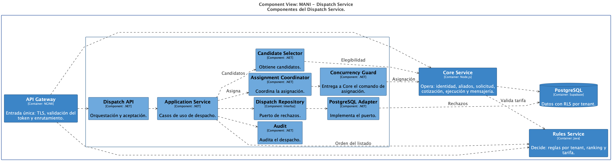
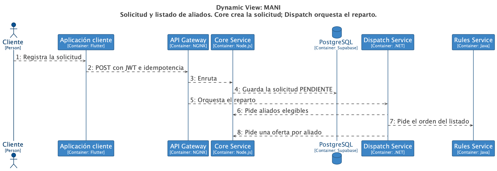
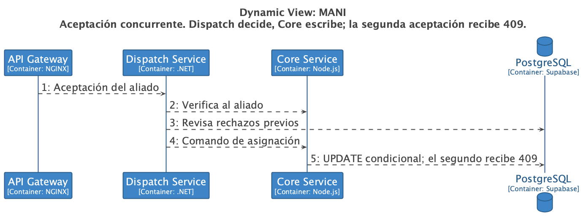
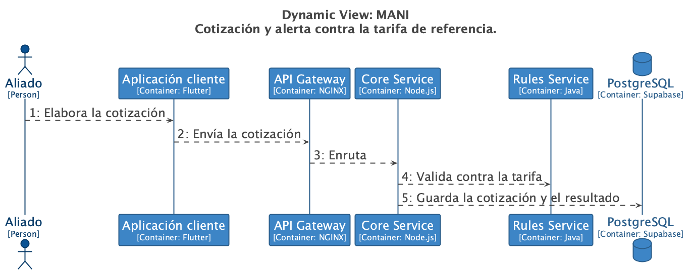
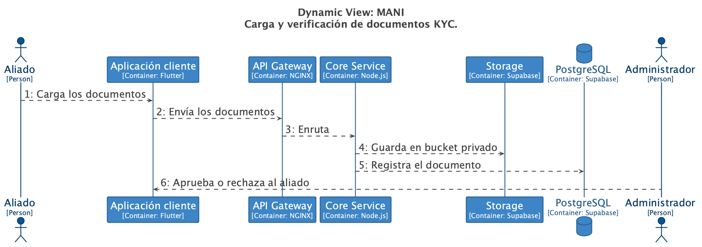
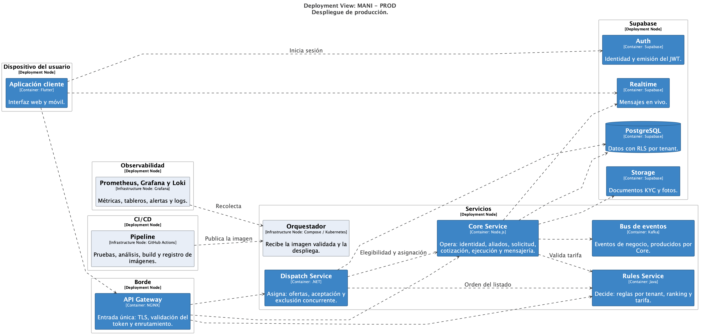

# SDD — Software Design Description
## MANI

**Arquitectura objetivo:** SOA + API Gateway + enfoque políglota  
**Norma de calidad de referencia:** ISO/IEC 25010:2023  
**Documento de datos asociado:** [ModeloDatos.md](ModeloDatos.md)  
**Documento vivo:** sin número de versión; la vigente es la de `main`. Es el **único lugar** donde viven los umbrales de calidad (§7 y §8).  
**Alcance:** arquitectura de software, vistas C4, atributos de calidad, patrones, despliegue, ambientes y vista física.  
**Fuente de los diagramas C4:** [`workspace.dsl`](diagrams/c4/workspace.dsl) — modelo Structurizr DSL, exportado a la estructura de [ADR-0008](adr/ADR-0008-diagramacion-tecnica.md) (`diagrams/c4/`, `diagrams/despliegue/` y `diagrams/flujos/dinamicos/`), con las vistas `panorama` (System Landscape), `contexto` (N1), `contenedores` (N2), `componentes-rules`, `componentes-dispatch`, `componentes-core` (N3), las dinámicas `dinamico-solicitud`, `dinamico-aceptacion`, `dinamico-cotizacion`, `dinamico-kyc`, `dinamico-mensajeria`, y la de despliegue `despliegue-prod`. Los diagramas de alto nivel (DHL) los referencia el [`SAD.md`](SAD.md).

---

## 1. Propósito

Este Software Design Description (SDD) define la arquitectura de MANI desde la perspectiva de software. El documento cubre:

- arquitectura orientada a servicios (SOA);
- API Gateway como punto de entrada;
- enfoque políglota para servicios especializados;
- vistas C4 en los niveles de contexto, contenedores, componentes y código;
- decisiones y patrones arquitectónicos;
- atributos de calidad priorizados con base en ISO/IEC 25010:2023;
- escenarios medibles y umbrales de aceptación;
- vista de despliegue y ambientes;
- diseño físico del repositorio y de la infraestructura;
- estrategia de versionamiento, entrega y rollback.

> **Separación documental:** este SDD no redefine el modelo conceptual, lógico o físico de datos. La definición canónica de entidades, relaciones, DDL, diccionario de datos, Data Warehouse y flujo analítico se mantiene en [ModeloDatos.md](ModeloDatos.md).

---

## 2. Alcance y principios

MANI es una plataforma multi-tenant para la creación y atención de solicitudes de servicio, cotización, selección y asignación de aliados, gestión KYC, disponibilidad, notificaciones y pagos.

Los principios que gobiernan el diseño son:

1. **La presentación no implementa reglas de negocio.**
2. **Los servicios son propietarios de su lógica de dominio.**
3. **El API Gateway es el punto de entrada de las APIs operacionales.**
4. **La persistencia se encapsula detrás de servicios y repositorios.**
5. **La tecnología puede variar por servicio, pero los contratos de integración son estables.**
6. **Los datos analíticos se separan del procesamiento transaccional.**
7. **Las decisiones arquitectónicas deben responder a atributos de calidad medibles.**

## 2.1 Decisiones explícitas de línea base

Para evitar ambigüedades entre ADR, diagramas y despliegue, se fijan las siguientes decisiones:

| Tema | Decisión |
|---|---|
| Ambientes | **3 ambientes: DEV → QA → PROD** |
| Repositorios | **Multi-repo** |
| Persistencia | **Supabase como plataforma administrada** |
| Motor de base de datos | **PostgreSQL provisto por Supabase** |
| Aislamiento multi-tenant | **JWT + autorización en servicios + RLS en PostgreSQL/Supabase** |
| Orquestación | **Kubernetes** |
| Contenedores | **Docker/OCI** |
| CI/CD | **GitHub Actions** |
| Integración entre servicios, Sprint 4 | **HTTP sincrónico por red interna, falla cerrado (`503`)** |
| Integración entre servicios, Sprint 5 | **Bus de eventos con Apache Kafka** |
| Eventos de negocio | **Cuatro:** `SolicitudCreada`, `CotizacionAceptada` y `ServicioFinalizado` (Core), `AliadoAsignado` (Dispatch) — esquemas `v1` y versionado en [`CONTRATOS_EVENTOS.md`](CONTRATOS_EVENTOS.md) |
| Publicación de eventos | **Transactional outbox**, obligatorio desde la primera implementación |
| Consumo de eventos | **Idempotente por `event_id`** |
| DDL ejecutable | **Serie única de migraciones propiedad de Core Service** |

**Supabase y PostgreSQL no son dos alternativas de persistencia.** Supabase es la plataforma administrada utilizada por MANI y PostgreSQL es su motor relacional subyacente.

**Kafka y Realtime no son dos alternativas de mensajería.** Realtime notifica al usuario conectado
(ADR-0017); Kafka transporta eventos de negocio entre servicios
([ADR-0029](adr/ADR-0029-comunicacion-asincrona-kafka.md)). Son dos planos distintos, detallados
en SAD §12.1 y §12.2. Mientras el bus no exista, la integración entre servicios es HTTP sincrónico
con falla cerrado: si la dependencia no responde, el llamador devuelve `503` y **no** sustituye la
respuesta por lógica local ni por un valor por omisión (ADR-0030 §2).

**`ModeloDatos.md` no es el DDL ejecutable.** Es la especificación normativa del modelo; lo que se
aplica a la base es la serie única de migraciones propiedad de Core Service, con numeración
incremental e inmutable. Rules y Dispatch no versionan DDL: abren PR de migración contra esa serie
([ADR-0030](adr/ADR-0030-propiedad-esquema-y-frontera-de-datos.md) §1). La propiedad por
servicio que enuncia §4.2 es **estado objetivo**, no descripción del presente.

## 2.2 Acceso del cliente a Supabase

El cliente Flutter alcanza Supabase por **exactamente dos caminos**, y **no existe ninguna
excepción**:

| Camino | Para qué | Por qué es legítimo |
|---|---|---|
| `Flutter → Supabase Auth` | iniciar sesión, registrar usuario y refrescar el JWT | la identidad la emite Supabase GoTrue y el tenant viaja como claim firmado (ADR-0018, ADR-0027) |
| `Flutter ← Supabase Realtime` | recibir eventos de mensajería mientras el usuario está conectado | Realtime es un **transporte de eventos**: no lee tablas de negocio, no ejecuta reglas y no decide nada. El evento lo publica el Core después de persistir el mensaje |

Todo lo demás —consultas, escrituras, archivos, procedimientos— va por
`Flutter → API Gateway → servicio → Supabase`.

Queda prohibido y retirado, **sin excepción transitoria ni de disponibilidades**:

- `.from()` — acceso a tablas vía PostgREST;
- `.rpc()` — invocación de funciones almacenadas;
- `.storage.from()` — acceso directo a Storage. Los documentos KYC se suben por endpoint
  intermediario o URL prefirmada que emite el Core.

La consulta de disponibilidades **no** es una excepción: entra por el Gateway al Core como
cualquier otra lectura de negocio.

> **Esta sección sustituye a la «excepción transitoria de disponibilidades».** Esa excepción
> quedaba abierta sin fecha de cierre y contradecía a [ADR-0027](adr/ADR-0027-alcance-supabase-cliente-flutter.md),
> que está `Aceptado` y retira `.from()`, `.rpc()` y `.storage.from()` del cliente, y a
> [ADR-0022](adr/ADR-0022-logica-de-negocio-en-servicios.md), que saca la lógica de negocio del
> cliente y de las funciones PL/pgSQL.

---

# 3. Estilo arquitectónico

## 3.1 SOA

MANI se define como una **arquitectura orientada a servicios (SOA)**. Las capacidades del negocio se organizan en servicios con responsabilidades explícitas, interfaces contractuales y bajo acoplamiento.

Capacidades principales:

| Servicio / capacidad | Responsabilidad |
|---|---|
| Reglas por Tenant | ranking, validación tarifaria, políticas KYC y configuración por tenant |
| Despacho y Asignación | solicitudes, candidatos, aceptación/rechazo, exclusiones, concurrencia y auditoría |
| Core de Negocio | usuarios, tenants, aliados, KYC, catálogos, notificaciones, reportes operativos y **cobertura, zonas, horarios y disponibilidad operacional**, que son un dominio interno y no un servicio aparte (§4.3.3, `SAD.md` §7.3) |
| Integraciones | FCM/APNs, pasarela de pagos, observabilidad y servicios externos |

La orientación a servicios permite que la lógica del dominio no quede acoplada a Flutter ni a la base de datos.

## 3.2 API Gateway

NGINX funciona como frontera de entrada para las APIs.

Responsabilidades:

- terminación HTTPS;
- enrutamiento;
- autenticación y propagación de identidad;
- rate limiting;
- balanceo;
- control de CORS;
- trazabilidad mediante correlation ID;
- políticas básicas de seguridad.

El Gateway **no debe contener reglas de negocio**.

## 3.3 Enfoque políglota

La solución utiliza diferentes tecnologías de implementación según el servicio:

| Componente | Tecnología |
|---|---|
| Aplicación web/móvil | Flutter / Dart |
| Gateway | NGINX |
| Servicio de reglas | Java |
| Despacho y asignación | .NET |
| Servicios restantes | Node.js |
| Persistencia | Supabase (PostgreSQL como motor) |
| Contenedores | Docker |
| Orquestación | Kubernetes |
| CI/CD | GitHub Actions |

El reparto no es por gusto ni por coleccionar frameworks: cada stack tiene una responsabilidad delimitada y los diagramas C4 la muestran agrupando los contenedores por bloque.

```text
JAVA            .NET            NODE
decide          asigna          opera
  ↓               ↓               ↓
reglas de       despacho y      servicios funcionales
negocio         asignación      de la plataforma
```

- **MANI-Rules-Service — decide.** Un único servicio: evalúa si una condición de negocio se cumple. Ranking, requisitos KYC, tarifarios y reglas por tenant. La elegibilidad la resuelve Core (SAD §4.2.1 y §7.3); Rules aporta el orden del listado, no quién es elegible. No es un backend general.
- **MANI-Dispatch-Service — asigna.** Un único servicio: selecciona aliados válidos, asigna, controla estados y exclusiones. Consume Rules antes de asignar; no reimplementa las reglas.
- **MANI-Core-Service — opera.** El núcleo funcional: usuarios y tenants, identidad, aliados, solicitudes, cotizaciones, documentos y multimedia, notificaciones, reportes, disponibilidad y ubicación.

> **Quién crea la solicitud: punto abierto, verificado el 2026-10-20.** La implementación fusionada
> sigue el criterio ARQ-03 **«Core crea, Dispatch orquesta»**: `POST /solicitudes` vive en el Core
> Node y persiste la solicitud en una sola transacción (`Trama-AS/MANI-Node#44`, SCRUM-1072,
> fusionado en `develop` el 2026-10-19, 355 pruebas en verde), mientras Dispatch orquesta el reparto
> (`Trama-AS/MANI-.NET#2`, SCRUM-1073). Eso coincide con ADR-0029 §1, que hace a Core el productor de
> `SolicitudCreada`. **Contradice a [`SAD.md`](./SAD.md) §4.2.1**, que afirma que «las solicitudes
> pertenecen a Dispatch», y a `ModeloDatos.md` §13, que asigna `despacho.solicitud` a Dispatch. El
> conflicto es entre documentos de línea base y requiere decisión de Mesa; este documento no lo
> resuelve por su cuenta.

El enfoque políglota no implica libertad tecnológica irrestricta. Cada tecnología debe justificar su existencia, mantener contratos estables y cumplir los mismos criterios de seguridad, observabilidad, pruebas y despliegue.

---

# 4. Vistas C4

Las vistas de esta sección se generan desde [`workspace.dsl`](diagrams/c4/workspace.dsl), que es su fuente. Cada subsección indica la vista que le corresponde y mantiene en texto la estructura y las responsabilidades, para que el documento se lea sin renderizar.

El modelo cubre las cuatro vistas que Structurizr sí puede describir, y ninguna queda solo en prosa:

| Vista | Pregunta que responde | Dónde |
|---|---|---|
| Panorama — System Landscape | qué sistemas existen en el mapa y a cuáles toca cada actor | §4.5 |
| Estática — contexto, contenedores, componentes | qué existe y cómo se relaciona | §4.1 a §4.3 |
| Dinámica | en qué orden ocurre cada flujo crítico | §4.6 |
| Despliegue | dónde se ejecuta cada contenedor, de dónde sale y quién lo vigila | §9 |

El Nivel 4 (Code) se mantiene en §4.4: Structurizr describe contenedores y componentes, no clases.

## 4.0 Inventario de diagramas

**Las doce vistas del proyecto están definidas en [`workspace.dsl`](diagrams/c4/workspace.dsl)
y exportadas a [`diagrams/c4/`](diagrams/c4/), [`diagrams/despliegue/`](diagrams/despliegue/) y [`diagrams/flujos/dinamicos/`](diagrams/flujos/dinamicos) según [ADR-0008](adr/ADR-0008-diagramacion-tecnica.md).** El DSL es la fuente: un diagrama no se
edita en la imagen, se cambia en el modelo y se vuelve a exportar. Si una vista no aparece en esta
tabla, no es oficial.

| # | Vista en el DSL | Tipo | Qué muestra | Imagen | Sección |
|---|---|---|---|---|---|
| 1 | `panorama` | System Landscape | El mapa completo: MANI como único sistema propio, sus actores —incluido el visitante sin sesión de la landing— y las plataformas externas con las que convive. Es la vista para explicar el proyecto a quien no lo conoce | [`panorama.png`](diagrams/c4/contexto/panorama.png) | §4.5 |
| 2 | `contexto` | C4 Nivel 1 | MANI como una sola caja, sus actores y los sistemas externos. A diferencia del panorama, pone el foco en un único sistema | [`contexto.png`](diagrams/c4/contexto/contexto.png) | §4.1 |
| 3 | `contenedores` | C4 Nivel 2 | Las unidades desplegables —landing comercial, cliente, Gateway y los tres servicios—, los almacenes de Supabase, las integraciones y la analítica | [`contenedores.png`](diagrams/c4/contenedores/contenedores.png) | §4.2 |
| 4 | `componentes-rules` | C4 Nivel 3 | Dentro del Rules Service: controlador, servicio de aplicación, las estrategias por tipo de regla, el puerto y su adaptador | [`componentes-rules.png`](diagrams/c4/componentes/componentes-rules.png) | §4.3.1 |
| 5 | `componentes-dispatch` | C4 Nivel 3 | Dentro del Dispatch Service: selector de candidatos, coordinador de asignación, **concurrency guard** y auditoría | [`componentes-dispatch.png`](diagrams/c4/componentes/componentes-dispatch.png) | §4.3.2 |
| 6 | `componentes-core` | C4 Nivel 3 | Dentro del Core Service: identidad y tenants, KYC, catálogo, cobertura y disponibilidad, ciclo del servicio, comunicaciones, reportes y adaptadores externos | [`componentes-core.png`](diagrams/c4/componentes/componentes-core.png) | §4.3.3 |
| 7 | `dinamico-solicitud` | Dinámica | El orden en que se crea una solicitud: el despacho pide elegibilidad al Core y el orden del listado al Rules Service | [`dinamico-solicitud.png`](diagrams/flujos/dinamicos/dinamico-solicitud.png) | §4.6.1 |
| 8 | `dinamico-aceptacion` | Dinámica | Dos aliados aceptan a la vez y la actualización condicional atómica deja pasar solo al primero; el segundo recibe `409` | [`dinamico-aceptacion.png`](diagrams/flujos/dinamicos/dinamico-aceptacion.png) | §4.6.2 |
| 9 | `dinamico-cotizacion` | Dinámica | El Core persiste la cotización y el Rules Service la contrasta contra el tarifario de referencia | [`dinamico-cotizacion.png`](diagrams/flujos/dinamicos/dinamico-cotizacion.png) | §4.6.3 |
| 10 | `dinamico-kyc` | Dinámica | Los documentos del aliado llegan al bucket privado y el administrador del tenant aprueba o rechaza | [`dinamico-kyc.png`](diagrams/flujos/dinamicos/dinamico-kyc.png) | §4.6.4 |
| 11 | `dinamico-mensajeria` | Dinámica | El mensaje se persiste primero, Realtime lo transporta al participante conectado y el push cubre al desconectado | [`dinamico-mensajeria.png`](diagrams/flujos/dinamicos/dinamico-mensajeria.png) | §4.6.5 |
| 12 | `despliegue-prod` | Despliegue | Dónde se ejecuta cada contenedor en producción, de dónde sale su imagen y quién lo vigila | [`despliegue-prod.png`](diagrams/despliegue/despliegue-prod.png) | §9 |

Dos aclaraciones sobre el alcance de la tabla:

- **El Nivel 4 (Code) no está en el DSL** y por eso no tiene fila: Structurizr describe
  contenedores y componentes, no clases. Vive como texto en §4.4.
- **Los diagramas de alto nivel no son vistas del modelo.** `DHL.png`, `Infra.png` y
  `TechRadar.png` viven en [`diagrams/c4/contexto/`](diagrams/c4/contexto/), [`diagrams/despliegue/`](diagrams/despliegue/) y [`diagrams/TechRadar.png`](diagrams/TechRadar.png), no se generan desde el DSL y los
  referencian el [`SAD.md`](SAD.md) y el [`TECH_RADAR.md`](TECH_RADAR.md).

Cada subsección de abajo repite en texto la estructura de su vista, para que el documento se pueda
leer sin abrir las imágenes.


> ### ⚠️ Las imágenes exportadas están desactualizadas y cuatro están recortadas
>
> **Las imágenes exportadas no corresponden al `workspace.dsl` vigente.** Son
> exportaciones de una versión anterior del modelo. Mientras no se regeneren, **manda el DSL y manda
> el texto de este documento**, nunca la imagen.
>
> Diferencias comprobadas entre lo que muestran las imágenes y lo que dice el modelo:
>
> | La imagen muestra | El modelo dice |
> |---|---|
> | `Availability Service` como contenedor propio | no existe: la disponibilidad es un dominio del Core Service |
> | `dinamico-aceptacion` cita ADR-0021 | ADR-0021 se retiró el 2026-10-23; la decisión vigente es ADR-0016, que lo absorbe |
>
> **Lo que no es desfase de las imágenes.** Los grupos `MANI-Core-Node`, `MANI-Rules-Java` y
> `MANI-Dispatch-DotNet` y el contenedor `Core Services` **no son un resto de las exportaciones:
> están así en el `workspace.dsl` vigente** (`diagrams/c4/workspace.dsl:76,91,106,108`). Son los
> nombres de [ADR-0004](adr/ADR-0004-cicd-multirepo-ambientes.md). Los nombres `MANI-Core-Service`,
> `MANI-Rules-Service` y `MANI-Dispatch-Service` que usan §13 y el SAD §17 vienen de
> [ADR-0028](adr/ADR-0028-nombres-repositorios-y-ambientes.md), `Aceptado` desde el 2026-10-23, que
> supersede parcialmente a ADR-0004 en la lista de repositorios. **Alinear el DSL con ADR-0028 es
> trabajo pendiente**, no un error de las imágenes.
>
> **Además, una exportación sigue cortada por el borde derecho**, con nodos partidos a media
> palabra: `dinamico-aceptacion`, que mide exactamente 4096 px de ancho.
>
> `contenedores`, `componentes-rules` y `componentes-dispatch` ya se regeneraron con el límite
> elevado y están completas (7820, 6580 y 6580 px de ancho respectivamente).
>
> La causa no es el modelo: es el límite por defecto de PlantUML, que es el renderizador de estas
> vistas. `PLANTUML_LIMIT_SIZE` vale 4096 px y **recorta en lugar de escalar**. Al regenerar hay que
> subirlo:
>
> ```bash
> export PLANTUML_LIMIT_SIZE=16384
> ```
>
> Las demás vistas están completas y se leen bien; el problema de recorte afecta solo a esa.

### Cómo leer las imágenes

**Todas las figuras son clicables: abren la imagen a resolución completa.** Hace falta usarlo,
porque varias vistas son muy anchas y al escalarlas al ancho de la página las etiquetas quedan
ilegibles. Estas son las que casi siempre hay que abrir:

| Vista | Resolución | Proporción |
|---|---|---|
| `dinamico-aceptacion` | 4096 × 660 | 6,2 : 1 |
| `dinamico-cotizacion` | 3499 × 672 | 5,2 : 1 |
| `dinamico-kyc` | 2969 × 634 | 4,7 : 1 |
| `dinamico-solicitud` | 2705 × 672 | 4,0 : 1 |
| `dinamico-mensajeria` | 2578 × 677 | 3,8 : 1 |
| `componentes-rules` | 6580 × 2108 | 3,1 : 1 |
| `componentes-dispatch` | 6580 × 2327 | 2,8 : 1 |
| `contenedores` | 7820 × 5302 | 1,5 : 1 |
| `componentes-core` | 5000 × 3828 | 1,3 : 1 |

Las vistas dinámicas son anchas por naturaleza: una secuencia crece hacia los lados con cada paso.
Por eso **cada figura va acompañada del flujo en texto**, que es normativo: el documento se puede
leer y revisar sin abrir ninguna imagen, y en una revisión de PR el texto es lo que se compara.

Si una imagen contradice al texto, manda el texto: la imagen es una exportación del modelo y puede
estar sin regenerar.

## 4.1 Nivel 1 — System Context

**Objetivo:** mostrar MANI como un sistema y sus relaciones con personas y sistemas externos.

[](diagrams/c4/contexto/contexto.png)

> **Figura 1 — Contexto del sistema (C4 Nivel 1).** Generada desde la vista `contexto` de [`workspace.dsl`](diagrams/c4/workspace.dsl); imagen en [`diagrams/c4/contexto/contexto.png`](diagrams/c4/contexto/contexto.png).

```text
Cliente              → crea solicitudes y aprueba cotizaciones
Aliado               → cotiza, acepta y ejecuta servicios; gestiona KYC        → [ MANI ]
Administrador tenant → administra usuarios, aliados, tenant y KYC
Visitante (sin sesión) → conoce los servicios y estima un precio en la landing

[ MANI ] → FCM / APNs                    notificaciones
         → Operador de pagos             API de pagos
         → Plataforma de observabilidad  métricas, logs y trazas
         → Data Warehouse                datos operacionales para análisis
```

### Responsabilidades de frontera

- **MANI** ejecuta el flujo transaccional.
- **FCM/APNs** entrega notificaciones push.
- **Pasarela de pagos** procesa pagos; MANI conserva referencias y estados, no datos sensibles de tarjeta.
- **Observabilidad** recibe métricas, logs y trazas.
- **Data Warehouse** recibe datos mediante procesos desacoplados del flujo transaccional.

---

## 4.2 Nivel 2 — Containers

**Objetivo:** mostrar las unidades desplegables y almacenes principales.

[](diagrams/c4/contenedores/contenedores.png)

> **Figura 2 — Contenedores (C4 Nivel 2).** Generada desde la vista `contenedores` de [`workspace.dsl`](diagrams/c4/workspace.dsl); imagen en [`diagrams/c4/contenedores/contenedores.png`](diagrams/c4/contenedores/contenedores.png).

```text
Visitante → Landing comercial (React + Vite) ──redirección del navegador a /login──┐
                                                                                    ↓
Usuarios → Flutter Web / Mobile → (HTTPS) → NGINX API Gateway
                      enrutamiento · control de acceso · token · rate limiting
                                                   ↓
   ┌── decide ──────┬── asigna ────────┬── opera ──────────────────┐
   Rules Service     Dispatch Service    Core Service
   (Java)            (.NET)              (Node.js)
        ↓                 ↓                   ↓
   Supabase Rules    Supabase Dispatch   Supabase Core
        └────────── PostgreSQL + RLS por tenant ──────────┘
                                                   ↓
   Core → FCM/APNs · Operador de pagos · Storage · Realtime
   Gateway y servicios → telemetría → Prometheus / Grafana
   PostgreSQL → carga incremental → CDC/ELT → Data Warehouse → BI
```

Dispatch consulta a Core la elegibilidad por categoría y zona, y a Rules el orden del listado; Core consulta a Rules para validar la cotización contra el tarifario. Son llamadas HTTPS entre servicios, no accesos cruzados a datos.

### Reglas de dependencia

- Flutter consume contratos expuestos por el Gateway.
- La landing comercial no consume ningún contrato: no llama al Gateway, a los servicios ni a Supabase. Solo redirige el navegador al login de Flutter Web (SAD §7.4, [ADR-0028](adr/ADR-0028-nombres-repositorios-y-ambientes.md)).
- Cada servicio es dueño de su almacén: Rules de `Supabase Rules`, Dispatch de `Supabase Dispatch` y Core de `Supabase Core`, que incluye el dominio de disponibilidad.
- Los servicios no acceden directamente a tablas propiedad de otro dominio.
- Las integraciones externas se encapsulan mediante adaptadores.
- El Data Warehouse no participa en transacciones operacionales.
- El detalle de esquemas, entidades y modelo dimensional se encuentra en `ModeloDatos.md`.

---

## 4.3 Nivel 3 — Components

### 4.3.1 Rules Service — Java

[](diagrams/c4/componentes/componentes-rules.png)

> **Figura 3 — Rules Service, Java (C4 Nivel 3).** Generada desde la vista `componentes-rules` de [`workspace.dsl`](diagrams/c4/workspace.dsl); imagen en [`diagrams/c4/componentes/componentes-rules.png`](diagrams/c4/componentes/componentes-rules.png).

```text
Rules REST Controller
  → Rules Application Service
       → Rule Strategy Factory → Ranking Strategy | Tariff Validation Strategy | KYC Policy Strategy
       → Rule Repository Port  → Supabase Adapter (PostgreSQL) → Reglas DB
```

Responsabilidades:

- seleccionar reglas por tenant;
- calcular ranking de aliados;
- validar cotización contra tarifario;
- validar requisitos KYC;
- desacoplar lógica de reglas de la persistencia.

### 4.3.2 Dispatch Service — .NET

[](diagrams/c4/componentes/componentes-dispatch.png)

> **Figura 4 — Dispatch Service, .NET (C4 Nivel 3).** Generada desde la vista `componentes-dispatch` de [`workspace.dsl`](diagrams/c4/workspace.dsl); imagen en [`diagrams/c4/componentes/componentes-dispatch.png`](diagrams/c4/componentes/componentes-dispatch.png).

```text
Dispatch API
  → Dispatch Application Service
       → Candidate Selector
       → Assignment Coordinator → Concurrency Guard
       → Audit Component
       → Dispatch Repository Port → PostgreSQL Adapter → Dispatch DB
```

Responsabilidades:

- crear solicitudes;
- obtener candidatos válidos;
- coordinar asignación;
- evitar doble aceptación;
- responder conflicto `409` cuando la asignación ya fue tomada;
- auditar cambios de estado.

### 4.3.3 Core Service — Node.js

[](diagrams/c4/componentes/componentes-core.png)

> **Figura 5 — Core Service, Node.js (C4 Nivel 3).** Generada desde la vista `componentes-core` de [`workspace.dsl`](diagrams/c4/workspace.dsl); imagen en [`diagrams/c4/componentes/componentes-core.png`](diagrams/c4/componentes/componentes-core.png).

```text
Core API
  → Users/Tenants Component ─┐
  → KYC Orchestrator ────────┤
  → Catalog Component ───────┤
  → Availability Component ──┼→ Repositories → Core DB
  → Notification Component ──┤
  → Operational Reporting ───┘

KYC Orchestrator y Notification Component → External Adapters → Storage · Realtime · FCM/APNs
```

**Availability Component** concentra cobertura del aliado, horarios y solapamientos, zonas y elegibilidad por categoría y zona (RF-07, RF-12, RNF-07). Es el componente que Despacho consulta en caliente antes de conformar el listado de candidatos. La lógica pertenece al servicio, no al cliente Flutter (§2.2, [ADR-0022](adr/ADR-0022-logica-de-negocio-en-servicios.md), `Propuesto`).

> **Diseño, no implementación.** Verificado el 2026-10-20: este componente no existe. La elegibilidad
> se resuelve hoy en funciones PL/pgSQL (`_sol_aliado_elegible`, `_sol_zona_cubierta` en
> `MANI-Flutter/database/migrations/005_aceptar_rechazar_solicitud.sql:119` y
> `006_crear_solicitud.sql:66`) que el cliente invoca por RPC, y el Core desplegado en QA es un stub.
> Migrarla al servicio es trabajo pendiente, no estado actual.

La disponibilidad **no es un servicio desplegable aparte**. Vive en el bloque Node como un dominio más de Core, igual que el catálogo o la comunicación: separarla en su propio despliegue sería convertir un dominio en un servicio sin ganar nada a cambio (SAD, riesgo *Servicios excesivamente pequeños*).

---

## 4.4 Nivel 4 — Code

El nivel 4 expresa la estructura interna de código. No pretende congelar clases concretas para siempre; define las dependencias que deben preservarse.

### Ejemplo: Rules Service

```text
RulesController
  +evaluateRule(request)
  +rankAllies(request)
      ↓
RulesApplicationService
  +evaluate(context)
  +rank(context)
      ↓                              ↓
RuleStrategyFactory             RuleRepository  «interfaz»
  +resolve(ruleType)              +findByTenant(tenantId)
      ↓                              ↑
RuleStrategy  «interfaz»        PostgresRuleRepository
  +supports(ruleType)             +findByTenant(tenantId)
  +evaluate(context)
      ↑
  RankingStrategy · TariffStrategy · KycStrategy   (implementaciones)
```

### Dispatch Service — ruta de aceptación de una solicitud

Único diagrama de nivel 4 levantado desde el código real, no desde el diseño previsto. Baja desde el componente `Concurrency Guard` de §4.3.2 hasta las clases de `MANI-.NET` que lo implementan.


> **Figura 6b — Nivel 4, aceptación concurrente en Dispatch.** Fuente del diagrama: [`diagrams/c4/codigo/aceptacion-concurrente.puml`](diagrams/c4/codigo/aceptacion-concurrente.puml). Declarado en el workspace como vista de imagen `codigo-aceptacion`, porque el DSL de Structurizr no describe clases: su elemento más fino es el componente.

Lo que el diagrama fija:

- `AcceptDispatchOfferUseCase` exige perfil de aliado **VERIFICADO** antes de tocar la asignación; sin él responde `MANI-SOL-403V`.
- La asignación se resuelve en una sola sentencia condicional (`UPDATE solicitud SET aliado_id … WHERE estado = 'PENDIENTE' AND aliado_id IS NULL`) dentro de `PostgresSolicitudAssignmentRepository`. La exclusión es del motor, no del número de réplicas.
- `AssignmentStatus` distingue `Assigned`, `AlreadyAssigned` (reintento idempotente del mismo ganador, `200`), `Conflict` (`409`), `NotFound` y `InvalidState`.
- `IAllyRepository` lo implementa `CoreAllyClient` **sobre HTTP**, no sobre SQL contra tablas de Core: es la frontera de datos de [ADR-0030](adr/ADR-0030-propiedad-esquema-y-frontera-de-datos.md) hecha código. Si Core no responde, `CoreServiceUnavailableException` propaga `503` y no se degrada a lógica local.

### Regla de dependencia de código

La dependencia debe apuntar desde adaptadores hacia contratos internos, no desde el dominio hacia frameworks externos:

```text
Controller / Adapter
        ↓
Application / Use Cases
        ↓
Domain
        ↑
Ports / Interfaces
        ↑
DB / External Adapters
```

---

## 4.5 Panorama de sistemas — System Landscape

**Objetivo:** mostrar el mapa de sistemas alrededor de MANI. Es una pregunta distinta de la del Nivel 1: el contexto mira hacia fuera *desde* MANI, el panorama mira el conjunto y deja ver que MANI es el único sistema propio y que todo lo demás es proveedor o plataforma de destino.

[](diagrams/c4/contexto/panorama.png)

> **Figura 6 — Panorama de sistemas (System Landscape).** Generada desde la vista `panorama` de [`workspace.dsl`](diagrams/c4/workspace.dsl); imagen en [`diagrams/c4/contexto/panorama.png`](diagrams/c4/contexto/panorama.png).

```text
Cliente · Aliado · Administrador de tenant · Administrador de plataforma
                              ↓
                          [ MANI ]  ← único sistema propio
                              ↓
   FCM / APNs · Operador de pagos · Observabilidad · Data Warehouse / BI
                     (proveedores y plataformas de destino)
```

Consecuencia de diseño: cada sistema externo entra al modelo por un adaptador, nunca por acoplamiento directo de un servicio al proveedor (§6 y §14).

---

## 4.6 Vistas dinámicas

**Objetivo:** mostrar el orden de los flujos que la estructura estática no explica. Cada paso de estas vistas corresponde a una relación ya declarada en el modelo: una vista dinámica no inventa colaboraciones que la estructura no permita.

> Los mismos flujos, en **PlantUML suelto y con las ramas de error** (`alt`, `409 Conflict`, destinatario desconectado), están en [`SECUENCIAS.md`](SECUENCIAS.md). Esa notación admite lo que el modelo C4 no expresa: dos actores compitiendo y los caminos alternativos.

| Vista | Flujo | Requisitos |
|---|---|---|
| `dinamico-solicitud` | solicitud y conformación del listado de aliados | RF-12, RF-13 |
| `dinamico-aceptacion` | exclusión concurrente en la aceptación | RF-14, RNF-03, RNF-05 |
| `dinamico-cotizacion` | cotización y alerta contra el tarifario | RF-15, RF-16, RF-22 |
| `dinamico-kyc` | carga y verificación de documentos KYC | RF-05, RF-06 |
| `dinamico-mensajeria` | mensajería con notificación de respaldo | RF-20, RF-21 |

### 4.6.1 Solicitud y listado de aliados — `dinamico-solicitud`

[](diagrams/flujos/dinamicos/dinamico-solicitud.png)

> **Figura 7 — Solicitud y listado de aliados.** Generada desde la vista `dinamico-solicitud`; imagen en [`diagrams/flujos/dinamicos/dinamico-solicitud.png`](diagrams/flujos/dinamicos/dinamico-solicitud.png).

```text
1. Cliente            → Flutter          registra la solicitud
2. Flutter            → API Gateway      POST con el JWT del tenant
3. API Gateway        → Dispatch         enruta tras validar el token
4. Dispatch           → Core             aliados elegibles por categoría y zona (RF-12)
5. Dispatch           → Rules            orden del listado según la regla del tenant (RF-13)
6. Dispatch           → PostgreSQL       persiste solicitud y candidatos notificados
```

Quien orquesta es el despacho: pregunta elegibilidad al dominio de disponibilidad en Core y el orden a Reglas. Ni el cliente Flutter ni el Gateway deciden nada de esto.

### 4.6.2 Aceptación concurrente — `dinamico-aceptacion`

[](diagrams/flujos/dinamicos/dinamico-aceptacion.png)

> **Figura 8 — Aceptación concurrente.** Generada desde la vista `dinamico-aceptacion`; imagen en [`diagrams/flujos/dinamicos/dinamico-aceptacion.png`](diagrams/flujos/dinamicos/dinamico-aceptacion.png).

Vista a nivel de componentes del Servicio de Despacho. Dos aliados aceptan la misma solicitud al mismo tiempo:

```text
1. API Gateway          → Dispatch API             aceptación con clave de idempotencia (RNF-03)
2. Dispatch API         → Application Service      invoca el caso de uso
3. Application Service  → Assignment Coordinator   coordina la asignación
4. Coordinator          → Concurrency Guard        delega la exclusión concurrente
5. Concurrency Guard    → Repository Port          actualización condicional: solo si sigue libre
6. Repository Port      → PostgreSQL Adapter       implementación
7. Adapter              → PostgreSQL               UPDATE condicionado al estado previo
8. Application Service  → Audit Component          audita el cambio de estado (RNF-04)
```

La primera aceptación afecta una fila y gana. La segunda no afecta ninguna y recibe `409 Conflict`. La garantía está en la actualización condicional, no en la aplicación.

### 4.6.3 Cotización y tarifario — `dinamico-cotizacion`

[](diagrams/flujos/dinamicos/dinamico-cotizacion.png)

> **Figura 9 — Cotización y tarifario.** Generada desde la vista `dinamico-cotizacion`; imagen en [`diagrams/flujos/dinamicos/dinamico-cotizacion.png`](diagrams/flujos/dinamicos/dinamico-cotizacion.png).

```text
1. Aliado        → Flutter        cotización separando mano de obra y materiales (RF-15)
2. Flutter       → API Gateway    envía la cotización
3. API Gateway   → Core           enruta tras validar el token
4. Core          → Rules          valida el valor contra el rango del tarifario (RF-16)
5. Rules         → PostgreSQL     lee mínimo, típico y máximo del tenant (RF-22)
6. Core          → PostgreSQL     persiste la cotización con el resultado
```

Core es dueño de la cotización (§7.3 del SAD) y Reglas es dueño del tarifario (§7.1 del SAD): la validación es una llamada entre servicios, no lógica duplicada en Core.

### 4.6.4 KYC del aliado — `dinamico-kyc`

[](diagrams/flujos/dinamicos/dinamico-kyc.png)

> **Figura 10 — KYC del aliado.** Generada desde la vista `dinamico-kyc`; imagen en [`diagrams/flujos/dinamicos/dinamico-kyc.png`](diagrams/flujos/dinamicos/dinamico-kyc.png).

```text
1. Aliado                 → Flutter        carga los documentos requeridos por el tenant
2. Flutter                → API Gateway    envía los documentos
3. API Gateway            → Core           enruta tras validar el token
4. Core                   → Rules          qué documentos exige este tenant (RF-02, RNF-10)
5. Core                   → Storage        bucket privado tenant_id/aliado_id/documento
6. Core                   → PostgreSQL     registra el documento; aliado en verificación
7. Administrador tenant   → Flutter        aprueba o rechaza al aliado (RF-06)
```

La aprobación es una decisión humana del tenant, no un efecto automático de la carga.

El paso 4 es el que faltaba en esta vista: la lista de documentos exigidos es configuración del
tenant y la evalúa el Rules Service, igual que el ranking y el tarifario (§4.3.1, `SAD.md` §7.1 y
§9, componente `KYC Policy Strategy` del modelo). Así esta vista coincide con
[`SECUENCIAS.md`](./SECUENCIAS.md) §4, que ya lo mostraba.

> **Diseño, no funcionalidad operativa.** Verificado el 2026-10-20: **no existe configuración de
> documentos requeridos por tenant** en ninguna parte. La tabla `documento_kyc` del DDL real guarda
> solo lo ya cargado, con `tipo_documento` como texto libre y un valor por omisión literal en el
> registro (`MANI-Flutter/database/init/01-schema.sql:97`,
> `03-registro-aliado.sql:88`, `07-registro-aliado-empresa.sql:97`). RF-02 y RNF-10 están sin
> implementar para KYC, y el Core desplegado en QA es un stub sin endpoints de KYC (reporte QA de
> SCRUM-1266 §3, QAS-01 y QAS-09 bloqueados). El paso 4 describe el diseño acordado, no algo que
> hoy ocurra.

### 4.6.5 Mensajería y notificación — `dinamico-mensajeria`

[](diagrams/flujos/dinamicos/dinamico-mensajeria.png)

> **Figura 11 — Mensajería y notificación.** Generada desde la vista `dinamico-mensajeria`; imagen en [`diagrams/flujos/dinamicos/dinamico-mensajeria.png`](diagrams/flujos/dinamicos/dinamico-mensajeria.png).

```text
1. Cliente   → Flutter        escribe un mensaje del servicio
2. Flutter   → API Gateway    envía el mensaje
3. Gateway   → Core           enruta tras validar el token
4. Core      → PostgreSQL     persiste el mensaje
5. Core      → Realtime       publica el evento de mensajería
6. Flutter   → Realtime       el destinatario conectado lo recibe casi en tiempo real
7. Core      → FCM / APNs     si no está conectado, lo notifica por push (RF-21)
```

El mensaje se persiste antes de transportarse: la conversación no vive en el canal de tiempo real. Realtime transporta, no decide.

---

# 5. Patrones arquitectónicos

| Patrón | Aplicación en MANI | Justificación |
|---|---|---|
| SOA | capacidades separadas como servicios | bajo acoplamiento y evolución independiente |
| API Gateway | NGINX | punto de entrada, políticas transversales y ocultamiento de topología interna |
| Layered Architecture interna | API → aplicación → dominio → infraestructura | evita mezclar HTTP, reglas y persistencia |
| Repository / Ports & Adapters | acceso a Supabase mediante interfaces sobre PostgreSQL | desacopla lógica de negocio del proveedor de datos |
| Database ownership por dominio | esquemas/repositorios separados | limita dependencias y cambios cruzados |
| Event-driven para efectos secundarios | notificaciones, auditoría, analítica | reduce cadenas síncronas |
| Externalized Configuration | secretos y configuración fuera del código | portabilidad y seguridad |
| Observability | métricas, logs, trazas y correlation ID | diagnóstico de sistemas distribuidos |

---

# 6. Patrones de diseño

| Patrón | Uso |
|---|---|
| Strategy | reglas variables por tenant |
| Factory | resolución de la estrategia correspondiente |
| Repository | abstracción de persistencia |
| Adapter | FCM/APNs, pagos, KYC y otros proveedores |
| Facade / Application Service | coordinación de casos de uso |
| Observer / Publish-Subscribe | notificaciones, auditoría y eventos analíticos |
| Circuit Breaker | protección frente a fallas de servicios externos |
| Retry con backoff | reintentos controlados en operaciones idempotentes |
| Outbox | publicación confiable de eventos tras una transacción |
| Idempotency Key | evitar pagos, asignaciones o comandos duplicados |

---

# 7. Atributos de calidad — ISO/IEC 25010:2023

ISO/IEC 25010:2023 define un modelo de calidad de producto con nueve características. MANI las utiliza como marco, pero **no todas reciben la misma prioridad**.

Escala:

- **P1 — Crítico:** condiciona decisiones estructurales y aceptación del sistema.
- **P2 — Alto:** debe cumplirse antes de producción, pero no domina todas las decisiones.
- **P3 — Controlado:** se verifica, aunque su impacto arquitectónico es menor para el alcance actual.

Los umbrales siguientes son **objetivos de aceptación inicial del MVP**. Deben recalibrarse con pruebas de carga y datos reales.

## 7.1 Priorización general

| Característica ISO/IEC 25010:2023 | Prioridad | Razón |
|---|---:|---|
| Seguridad | P1 | multi-tenant, KYC, identidad, pagos y datos sensibles |
| Fiabilidad | P1 | solicitudes, despacho y asignación requieren continuidad y consistencia |
| Eficiencia de desempeño | P1 | ranking, disponibilidad y despacho son sensibles a latencia |
| Mantenibilidad | P1 | arquitectura políglota y múltiples servicios elevan el costo de cambio |
| Flexibilidad | P1 | los servicios deben escalar, desplegarse y adaptarse por separado |
| Compatibilidad | P2 | integración entre Java, .NET, Node.js, Flutter y terceros |
| Adecuación funcional | P2 | exactitud de reglas, asignaciones y estados |
| Capacidad de interacción | P2 | cliente, aliado y administrador necesitan flujos claros |
| Protección (Safety) | P3 | no es un sistema safety-critical, pero debe evitar operaciones irreversibles inseguras |

---

## 7.2 Seguridad — P1

| Subcaracterística | Prioridad | Umbral / criterio de aceptación |
|---|---:|---|
| Confidencialidad | P1 | 100% de endpoints privados requieren autenticación; TLS 1.2+; secretos fuera del código |
| Integridad | P1 | 100% de operaciones críticas protegidas por validación de autorización y constraints transaccionales |
| Autenticidad | P1 | tokens firmados y validados en 100% de llamadas protegidas |
| Responsabilidad / accountability | P1 | 100% de cambios críticos generan actor, timestamp y correlation ID |
| No repudio | P2 | pagos, aceptación y cambios críticos conservan evidencia auditable |
| Resistencia | P1 | 0 vulnerabilidades Critical/High conocidas abiertas en release de producción; rate limiting en Gateway |

**Controles arquitectónicos:** JWT/OIDC, API Gateway, RBAC, aislamiento por tenant, RLS cuando aplique, auditoría, SAST con SonarQube, DAST con OWASP ZAP, gestión de secretos y mínimos privilegios.

---

## 7.3 Fiabilidad — P1

| Subcaracterística | Prioridad | Umbral / criterio |
|---|---:|---|
| Ausencia de fallos | P1 | tasa de error 5xx < 1% en ventana de 15 min bajo carga nominal |
| Disponibilidad | P1 | ≥ 99.9% para APIs críticas en la ventana disponible, con un mínimo de 7 días continuos; mensual cuando exista la serie ([acta A/B](../06-gobernanza/ACTA_DECISION_AB_ESCENARIOS_CALIDAD.md)) |
| Tolerancia a fallos | P1 | falla de proveedor de notificaciones no cancela una solicitud o asignación confirmada |
| Recuperabilidad | P1 | RTO ≤ 30 min; RPO ≤ 24 h con respaldo diario cifrado ([acta A/B](../06-gobernanza/ACTA_DECISION_AB_ESCENARIOS_CALIDAD.md)) |

Controles: réplicas, health checks, restart automático, circuit breaker, retry controlado, backups, restauración probada y procesamiento asíncrono de efectos secundarios.

---

## 7.4 Eficiencia de desempeño — P1

| Subcaracterística | Prioridad | Umbral / criterio |
|---|---:|---|
| Comportamiento temporal | P1 | p95 ≤ 500 ms para lecturas internas simples y p95 ≤ 800 ms para comandos críticos, excluyendo tiempo de terceros |
| Utilización de recursos | P2 | utilización sostenida objetivo < 70% CPU por contenedor con la carga nominal; por pod cuando haya Kubernetes ([acta A/B](../06-gobernanza/ACTA_DECISION_AB_ESCENARIOS_CALIDAD.md)) |
| Capacidad | P1 | soportar inicialmente 300 sesiones concurrentes y 50 req/s sostenidos sin incumplir p95 |

Controles: índices, consultas acotadas, paginación, caché selectiva, HPA, pooling, pruebas de carga y métricas.

---

## 7.5 Mantenibilidad — P1

| Subcaracterística | Prioridad | Umbral / criterio |
|---|---:|---|
| Modularidad | P1 | ningún servicio accede directamente a tablas de otro dominio |
| Reusabilidad | P2 | contratos y adaptadores comunes reutilizables sin duplicar reglas de dominio |
| Analizabilidad | P1 | 100% de requests distribuidos con correlation ID; logs estructurados |
| Capacidad para ser modificado | P1 | cambios internos compatibles no exigen modificar consumidores externos |
| Capacidad para ser probado | P1 | cobertura de código nuevo ≥ 80%; casos de uso críticos ≥ 90%; contract tests obligatorios |

**Quality Gate:** 0 issues Blocker/Critical en código nuevo; duplicación de código nuevo < 3%; pipeline debe fallar si el Quality Gate no se cumple.

---

## 7.6 Flexibilidad — P1

| Subcaracterística | Prioridad | Umbral / criterio |
|---|---:|---|
| Adaptabilidad | P1 | backend y Gateway: misma imagen en DEV/QA/PROD con configuración externa; Flutter web: una imagen por ambiente desde el mismo commit, con configuración ajustable al arrancar ([acta A/B](../06-gobernanza/ACTA_DECISION_AB_ESCENARIOS_CALIDAD.md)) |
| Escalabilidad | P1 | servicios críticos escalables de 2 a 6 réplicas sin cambio de código, con escalado manual en Docker Compose; Kubernetes queda como objetivo (ADR-0004) ([acta A/B](../06-gobernanza/ACTA_DECISION_AB_ESCENARIOS_CALIDAD.md)) |
| Instalabilidad | P1 | despliegue por ambiente con un script versionado de un solo comando ≤ 10 min en condiciones normales ([acta A/B](../06-gobernanza/ACTA_DECISION_AB_ESCENARIOS_CALIDAD.md)) |
| Reemplazabilidad | P2 | proveedores externos encapsulados por Adapter; cambio entre el adaptador `mock` y un segundo adaptador de prueba sin alterar dominio ([acta A/B](../06-gobernanza/ACTA_DECISION_AB_ESCENARIOS_CALIDAD.md)) |

---

## 7.7 Compatibilidad — P2

| Subcaracterística | Prioridad | Umbral / criterio |
|---|---:|---|
| Coexistencia | P2 | servicios respetan límites configurados de CPU/memoria y no degradan otros workloads |
| Interoperabilidad | P1 dentro de la característica | 100% de APIs documentadas con OpenAPI; contract tests verdes antes de promoción |

---

## 7.8 Adecuación funcional — P2

| Subcaracterística | Prioridad | Umbral / criterio |
|---|---:|---|
| Completitud funcional | P2 | 100% de historias críticas trazadas a casos de prueba |
| Corrección funcional | P1 dentro de la característica | 100% de escenarios críticos de ranking, tarifa, asignación y conflicto pasan pruebas |
| Pertinencia funcional | P2 | cada endpoint productivo corresponde a un caso de uso identificado |

---

## 7.9 Capacidad de interacción — P2

| Subcaracterística | Prioridad | Umbral / criterio |
|---|---:|---|
| Reconocibilidad | P2 | usuario identifica acción principal de cada flujo sin documentación externa |
| Aprendizabilidad | P3 | usuarios de prueba completan flujos base con ≤ 1 asistencia |
| Operabilidad | P2 | ≥ 90% de éxito en pruebas de tareas críticas |
| Protección contra errores de usuario | P1 dentro de la característica | acciones irreversibles requieren validación/confirmación y errores accionables |
| Involucración | P3 | ManiButton y ManiTextField obligatorios en pantallas nuevas o modificadas ([acta A/B](../06-gobernanza/ACTA_DECISION_AB_ESCENARIOS_CALIDAD.md)) |
| Inclusividad | P2 | criterios de accesibilidad definidos para web/móvil |
| Asistencia al usuario | P3 | errores y estados vacíos incluyen orientación |
| Auto-descriptividad | P2 | formularios y estados críticos explican el siguiente paso |

---

## 7.10 Protección / Safety — P3

MANI no controla maquinaria ni procesos donde un fallo de software implique directamente riesgo de vida. Aun así:

| Subcaracterística | Prioridad | Umbral / criterio |
|---|---:|---|
| Restricción operativa | P2 | estados inválidos de solicitud/asignación deben rechazarse |
| Identificación de riesgos | P3 | operaciones sensibles identificadas en análisis de riesgo |
| Protección ante fallos | P2 | fallas de terceros no deben dejar transacciones críticas en estado ambiguo |
| Advertencia de peligro | P3 | mensajes explícitos antes de cancelaciones/reversiones críticas |
| Integración segura | P2 | integración externa requiere timeout, validación de respuesta y circuit breaker cuando aplique |

---

# 8. Escenarios de calidad priorizados

Esta sección operacionaliza la priorización definida en la sección 7 mediante **un escenario de calidad por cada subcaracterística de ISO/IEC 25010:2023 que la sección 7 prioriza (40 escenarios) y cinco escenarios transversales que no pertenecen a una sola subcaracterística (45 en total)**. Cada escenario identifica la fuente del estímulo, el estímulo, el entorno de ejecución, el artefacto afectado, la respuesta esperada, el umbral esperado, el mecanismo mediante el cual QA debe verificarlo y el resultado más reciente de esa verificación.

Los identificadores **QAS-01 a QAS-09** son los de los nueve escenarios originales, uno por característica, y se conservan porque los citan el backlog, el plan de pruebas, los scripts de k6 y Newman y la evidencia ya archivada. **QAS-10 a QAS-40** cubren las demás subcaracterísticas de la sección 7 y **QAS-41 a QAS-45** son transversales. Los números no siguen el orden de las características: cada característica lista sus escenarios en su propia subsección.

> **Estado del método de verificación — corte 22 de noviembre de 2026 (cierre del Sprint 6).**
> El método de la columna "¿Cómo lo mide QA?" es el acordado para cada escenario, no una declaración de que ya se verificó. La columna "Resultado" dice qué se midió, cuándo y con qué evidencia. Todas las filas tienen corte de noviembre: las que midieron las tareas del Sprint 6 (T-41 a T-46, SCRUM-1678 a 1683) y las demás, revisadas en el [barrido del 22 de noviembre](../07-calidad/monitoreo/evidencia/20261122T025500Z_barrido_qas/informe_barrido.md).
>
> **Conteo de los 45 escenarios:** Cumple 18 (01, 04, 07, 08, 11, 13, 14, 16, 17, 20, 25, 28, 29, 36, 37, 41, 42, 45) · Parcial 14 (02, 06, 09, 10, 12, 22, 23, 26, 33, 38, 39, 40, 43, 44) · No cumple 7 (03, 15, 19, 21, 24, 34, 35) · No medido 6 (05, 18, 27, 30, 31, 32). Los No medido tienen el motivo actualizado: decisión pendiente de la PO (30 a 32), cambio de QA que corresponde a DevOps (05) y métricas por contenedor que el cAdvisor de QA no exporta (18 y 27).
>
> **Herramientas entregadas y en uso:** k6 (v2.3.0 en la VM de Calidad; scripts de QAS-03 y QAS-07 en [`monitoreo_qas/k6/`](../07-calidad/monitoreo/k6)), Newman (colección de QAS-01 y regresión de 77 solicitudes en el gate `qa-regresion` del Gateway), Playwright (humo de ambiente, Landing y carga de Flutter Web, sin recorridos de interfaz) y SonarQube y SonarCloud (gate en verde en los seis repositorios al 21 de octubre).
>
> **Herramientas no entregadas o sin evidencia:** OWASP ZAP no se ha ejecutado (QA-05, SCRUM-1122); Testcontainers como herramienta de QA no tiene entrega (QA-01, SCRUM-1118), aunque Dispatch lo usa en sus propias pruebas; Prometheus y Grafana **sí están aprovisionados desde el 2026-11-14, en la VM de Calidad** (`10.43.98.196`) y no en la de QA, junto con Alertmanager, Loki, Promtail y cinco exportadores de métricas ([`08-infraestructura/01-mapa-ambientes-y-versiones.md`](../08-infraestructura/01-mapa-ambientes-y-versiones.md)); se consultan por túnel SSH porque están ligados a `127.0.0.1`; Kubernetes y HPA son una decisión abierta (INFRA-01, INFRA-02) y QA y PROD corren en Docker Compose sobre máquinas virtuales.
>
> **Interfaz de Flutter:** se verifica con `flutter test` en el CI de Flutter y, como complemento cuando existan los recorridos, con Playwright sobre Flutter Web.
>
> Mientras una herramienta no esté entregada, el escenario que depende de ella se reporta como **bloqueado** o **no medido**, nunca como cumplido. El detalle por nivel de prueba vive en [`wiki/01-producto/TD.md`](../01-producto/TD.md) §2.1.

## 8.1 Cómo leer las tablas

**Prioridad.** Los nueve escenarios originales conservan la prioridad de su característica (sección 7.1); QAS-10 a QAS-45 llevan la de su subcaracterística en la sección 7.2 a 7.10, o P1 si son transversales.

**Umbral esperado.** Es el criterio de aceptación; para QAS-10 a QAS-40 reproduce el de la sección 7. Si un escenario y la sección 7 difieren, prevalece el más restrictivo (ver el cierre de esta sección).

**Resultado.** Estado, fecha de corte y evidencia. El estado usa este vocabulario:

| Estado | Significa |
|---|---|
| **Cumple** | QA ejecutó el método y se cumple el umbral |
| **Parcial** | QA midió una parte del umbral o de los casos, y lo medido cumple; falta el resto |
| **No cumple** | QA midió, o la verificación documental muestra, que no se cumple |
| **Bloqueado** | el método está definido, pero una dependencia (ambiente, componente o medición válida) impide ejecutarlo |
| **No medido** | QA no ha ejecutado el método; la evidencia de desarrollo que exista se cita aparte y **no cuenta como resultado** |

El detalle de cada medición y su evidencia están en [`TD.md`](../01-producto/TD.md) §4.4 y en el [reporte de QA del Sprint 4](../07-calidad/monitoreo/REPORTE_QA_SPRINT4.md) §7. Cuando dos documentos difieren en un resultado, vale el de fecha de corte más reciente.

### Columna «Origen» — de dónde sale cada escenario

Añadida el **2026-11-16**. Dice **qué artefacto exige** cada escenario, para que ninguno comprometa a QA a medir un umbral que nadie pidió. Cuatro valores:

| Valor | Significado |
|---|---|
| `RNF-xx` | El escenario mide un requisito no funcional del [SRS](../01-producto/SRS.md) §6 |
| `restricción` | Deriva de una restricción de proyecto o producto (SRS §3.1 y §3.2) o de un ADR `Aceptado`, que es vinculante. Se nombra cuál entre paréntesis |
| `riesgo` | Deriva de un riesgo registrado o de un *architectural killer* |
| `supuesto` | **No tiene respaldo.** El umbral se adoptó sin requisito que lo pida. No es inválido: es un compromiso que el equipo asumió por su cuenta, y no puede presentarse como exigido por el producto |
| `—` | Sin clasificar todavía |

**Estado de la clasificación.** Están clasificados los **once escenarios de prioridad P1 que no tenían requisito**, tras la revisión de [`REVISION_QAS_SIN_REQUISITO.md`](../06-gobernanza/REVISION_QAS_SIN_REQUISITO.md), aprobada por la SM. Resultado: **uno** tenía requisito y solo faltaba enlazarlo (QAS-15 → `RNF-07`), **seis** derivan de una restricción, y **cuatro** quedan como `supuesto` (QAS-14, QAS-16, QAS-17 y QAS-43).

Los **34 restantes quedan en `—` a propósito**: clasificarlos sería tomar una decisión, no aplicarla, y recorrer los 45 contra los requisitos es trabajo de arquitectura con el PO.


## 8.2 Seguridad — P1

| ID | Subcaracterística | Prioridad | Origen | Fuente | Estímulo | Entorno | Artefacto | Respuesta esperada | Umbral esperado | ¿Cómo lo mide QA? | Resultado |
|---|---|:---:|---|---|---|---|---|---|---|---|---|
| **QAS-01** | **Confidencialidad** | P1 | — | Usuario autenticado de un tenant | Intenta consultar o modificar información perteneciente a otro tenant | QA o PROD en operación normal | API Gateway, servicios de dominio y PostgreSQL/RLS | El servicio rechaza la operación tomando el tenant del claim del JWT firmado y no de un dato enviado por el cliente, no expone información del tenant destino y registra el evento cuando corresponda; RLS actúa como capa adicional de defensa en profundidad | **100% de accesos cross-tenant rechazados** | QA ejecuta con Postman/Newman, a través del Gateway, los seis casos cross-tenant de las Políticas DevOps §13.4 (lectura de otro tenant, listado de recursos ajenos, escritura en otro tenant, borrado ajeno, token expirado o alterado, y documentos KYC de otro tenant o aliado), con tokens y recursos de al menos dos tenants; verifica rechazo de acceso, ausencia de datos ajenos, evidencia de auditoría y que el rechazo ocurre en la autorización del servicio y no solo en RLS. Evidencia: reporte de Newman con versión del servicio y fecha | **Cumple** · corte 2026-11-13 (SCRUM-1678, en revisión). Con TEC-21 desplegado (0037 a 0039), Core conecta como `mani_core_svc` y Dispatch como `mani_dispatch_svc`, sin BYPASSRLS. Los seis casos de §8.12 se rechazan por el Gateway (`404`/`401`) y en el motor con contexto T1 y sin `WHERE tenant_id` (0 filas de T2 en 32 tablas, `42501` al escribir en T2, `MANI-RLS-400` sin tenant); P1, P4 y P5 también pasan. `documento_legal` muestra solo los 2 documentos globales (`tenant_id NULL`). Limitaciones: el caso 4 sin `WHERE` no se ejecutó por una llave foránea; aliado A frente a B del mismo tenant no se probó (el seed trae un aliado por tenant); Storage se niega por permiso sobre el esquema, no por `kyc_isolation`. Evidencia: [informe y corrida](../07-calidad/monitoreo/evidencia/20261113T003051Z_t41_roles_servicio/informe_qas01_qas20.md). Corte anterior (2026-10-21, Parcial, RLS sin ejercer): [Reporte QA §7](../07-calidad/monitoreo/REPORTE_QA_SPRINT4.md#7-monitoreo-de-qa-y-escenarios-qas-01-a-qas-09-scrum-1266) |
| **QAS-10** | **Integridad** | P1 | — | Usuario autenticado o cliente de API | Ejecuta una operación crítica (asignar, cancelar, registrar un pago) sin el rol requerido, con datos que violan una restricción o repitiendo la solicitud | QA con datos de prueba de al menos dos tenants | API Gateway, Core Service y restricciones transaccionales de PostgreSQL | El servicio rechaza la operación no autorizada o inválida, la base conserva el estado previo y las restricciones impiden duplicados y estados incoherentes | **100% de operaciones críticas protegidas por validación de autorización y constraints transaccionales** | QA ejecuta con Newman, por el Gateway, un caso negativo por cada operación crítica (rol incorrecto, payload inválido, reintento duplicado) y verifica el código HTTP, que el estado persistido no cambió y que respondió la validación o el constraint. Evidencia: reporte de Newman y consulta del estado resultante | **Parcial** · corte 2026-11-13 (SCRUM-1664, en revisión). Validación: 7 de 7 operaciones críticas (crear, aceptar solicitud, aceptar cotización, cancelar, pagar, aprobar aliado, cambiar tarifa) rechazan rol incorrecto, payload inválido, otro tenant y reintento duplicado con el código MANI esperado; 33 casos Newman, 64 aserciones, 0 fallidas, y las huellas del estado persistido quedan idénticas. Constraints: responden en pago, retención y tarifa (`23505`, `23P01`, `23514`); **`solicitud.estado` y `cotizacion.estado` no tienen CHECK** y la base acepta un estado inexistente. Pasa a Cumple con ese CHECK. Evidencia: [informe T-27](../07-calidad/monitoreo/evidencia/20261113T010545Z_t27_qas10_negativos/informe_qas10.md). Corte anterior 2026-10-21: regresión del Sprint 4 sin porcentaje sobre operaciones críticas ([Reporte QA §8](../07-calidad/monitoreo/REPORTE_QA_SPRINT4.md#8-regresión-funcional-api-e2e-y-multi-tenant-scrum-1267)) |
| **QAS-11** | **No repudio** | P2 | — | Usuario que realiza una operación crítica (pago, aceptación, cambio de estado) | Niega haber ejecutado la operación, o un actor intenta alterar el registro | QA con datos de prueba | Core Service, Dispatch Service y registros de auditoría en PostgreSQL | Cada operación crítica deja un registro con actor, rol, instante y correlation ID que no puede modificarse ni borrarse | **Pagos, aceptación y cambios críticos conservan evidencia auditable** | QA ejecuta una operación de cada tipo, consulta el registro de auditoría y verifica actor, rol, timestamp y correlation ID; intenta un UPDATE, un DELETE y un TRUNCATE sobre el registro y comprueba que la base los rechaza. Evidencia: consulta del registro y salida del intento rechazado | **Cumple** · corte 2026-11-22 (barrido de QA del Sprint 6). En QA se ejecutó una operación de cada tipo: creación, asignación (T-46), cotización, aceptación de cotización, cancelación y un pago sandbox (`mock`, sin dinero real). Las 7 filas de `evento_servicio` y la de `transaccion_evento` del pago guardan actor, rol, instante y el correlation ID de la petición; `pago` guarda cliente, correlation ID y fecha. Sobre esos registros, `UPDATE` y `DELETE` de `evento_servicio` los rechaza el trigger («es inmutable», SCRUM-1656); `UPDATE`, `DELETE` y `TRUNCATE` de `transaccion_evento` y `pago`, y `TRUNCATE` de `evento_servicio`, los rechaza el permiso (42501). Los intentos corrieron en una transacción que se revirtió. Evidencia: [prueba por API](../07-calidad/monitoreo/evidencia/20261122T025500Z_barrido_qas/qas11_37_42_api_22nov_0318z.txt), [consulta a la base](../07-calidad/monitoreo/evidencia/20261122T025500Z_barrido_qas/qas11_37_42_base_22nov_0319z.txt), [informe del barrido](../07-calidad/monitoreo/evidencia/20261122T025500Z_barrido_qas/informe_barrido.md). Corte anterior: 2026-11-04, No medido. |
| **QAS-12** | **Responsabilidad / accountability** | P1 | — | Usuario autenticado | Ejecuta un cambio crítico (asignación, cancelación, aprobación de aliado, cambio de tarifa) | QA con datos de prueba | API Gateway, servicios de dominio y registros de auditoría | El cambio queda trazado con quién lo hizo, cuándo y con qué correlation ID, que se propaga entre servicios | **100% de cambios críticos generan actor, timestamp y correlation ID** | QA ejecuta cada cambio crítico enviando `X-Correlation-ID` y verifica en la respuesta, en los logs de cada servicio y en el registro de auditoría que aparecen el actor, el timestamp y el mismo ID. Evidencia: tabla cambio ↔ registro con los tres campos | **Parcial** · corte 2026-11-22 (barrido de QA del Sprint 6). Asignación y creación: 10 de 10 eventos con actor, rol y el correlation ID de la petición. Tarifa, reglas, pagos y consultas guardan actor y correlation ID. **La aprobación de aliado no guarda actor ni correlation ID** en la base. Cancelación no ejecutada en este corte. Evidencia: [consulta a la VM de QA](../07-calidad/monitoreo/evidencia/20261122T025500Z_barrido_qas/vm_qa_22nov_0257z.txt), [informe del barrido](../07-calidad/monitoreo/evidencia/20261122T025500Z_barrido_qas/informe_barrido.md). Corte anterior: 2026-10-21, Parcial. |
| **QAS-13** | **Autenticidad** | P1 | — | Cliente que presenta un token | Llama a una ruta protegida con un token válido, expirado, alterado, de otro emisor o ausente | QA con tokens reales de Supabase | API Gateway (`auth_request`), Core Service (`validate-token`) y servicios de dominio | Acepta solo tokens firmados y vigentes, rechaza los demás con 401 y toma tenant y rol únicamente de los claims verificados | **Tokens firmados y validados en 100% de llamadas protegidas** | QA ejecuta con Newman, por el Gateway, los casos de token ausente, expirado, alterado y de otro emisor sobre cada ruta protegida publicada, más un login real con Supabase (ES256), y verifica 401 o 403 sin datos. Evidencia: reporte de Newman y registro del login real | **Cumple** · corte 2026-11-21 (SCRUM-1680, en revisión). Login real con Supabase (ES256 con `kid`, 60 min, `tenant_id` y rol). Por el Gateway, en las 120 operaciones protegidas de los contratos de `release`: sin token, firma alterada y ES256 de otro emisor, **360 de 360 en 401**; token vencido real, 75 de 75 operaciones evaluadas en 401 (las otras 45 escrituras recibieron 429 del límite del Gateway antes de la validación, que es la misma `auth_request` para todas). 0 aceptados, ningún rechazo con datos. Evidencia: [corrida sin 429](../07-calidad/monitoreo/evidencia/20261121T154000Z_t43_solo_medicion/qas13_tokens_vigente_21nov_1654z.txt), [corrida con token vencido](../07-calidad/monitoreo/evidencia/20261121T154000Z_t43_solo_medicion/qas13_tokens_21nov_1640z_con_429.txt), [informe T-43](../07-calidad/monitoreo/evidencia/20261121T154000Z_t43_solo_medicion/informe_t43.md). Corte anterior: 2026-10-21, Parcial. |
| **QAS-14** | **Resistencia** | P1 | `supuesto` | Atacante externo o cliente abusivo | Envía ráfagas de peticiones o explota una vulnerabilidad conocida | QA y candidato a release de producción | API Gateway, servicios de dominio y sus dependencias | El Gateway limita la tasa de peticiones y el análisis estático y dinámico no deja vulnerabilidades graves abiertas | **0 vulnerabilidades Critical/High conocidas abiertas en release de producción; rate limiting en Gateway** | QA consulta SonarQube y SonarCloud (SAST) en los seis repositorios, ejecuta OWASP ZAP (DAST) contra QA y comprueba el rate limiting enviando al Gateway una ráfaga por encima del límite y verificando la respuesta 429. Evidencia: reporte de Sonar, reporte de ZAP y registro de la ráfaga | **Cumple** · corte 2026-11-22 (barrido de QA del Sprint 6). **SAST:** 0 vulnerabilidades de seguridad High o Blocker abiertas en los seis repositorios (SonarQube de la VM y SonarCloud para Flutter); quedan Medium en Core (4) y .NET (2) y Low en .NET y Gateway, sin hotspots. **DAST:** OWASP ZAP contra QA, baseline de la app y escaneo activo de la API con los contratos de core, dispatch y rules (167 rutas): 0 FAIL; las 5 alertas High de inyección SQL son falsos positivos (las 12 variantes repetidas dan el mismo 401 del Gateway y el código usa consultas parametrizadas). Quedan Medium: falta CSP y cabecera anti-clickjacking en la app, y CORS permisivo. **Rate limiting:** 429 por `write_limit` en QAS-13 y 3 respuestas 429 durante el escaneo. **Diferencias:** Sonar analiza `develop` (la edición Community no analiza ramas), el DAST fue sin token (cubre Gateway y rutas públicas) y no se escaneó PROD. Evidencia: [informe de QAS-14](../07-calidad/monitoreo/evidencia/20261122T032900Z_qas14_dast_sast/informe_qas14.md). Corte anterior: 2026-11-04, No cumple. |

## 8.3 Fiabilidad — P1

| ID | Subcaracterística | Prioridad | Origen | Fuente | Estímulo | Entorno | Artefacto | Respuesta esperada | Umbral esperado | ¿Cómo lo mide QA? | Resultado |
|---|---|:---:|---|---|---|---|---|---|---|---|---|
| **QAS-02** | **Tolerancia a fallos** | P1 | — | Proveedor externo de notificaciones | FCM/APNs deja de responder después de confirmarse una operación de negocio | QA con dependencia externa degradada o indisponible, simulada mediante un adaptador de prueba | Core Service, Notification Component y adaptador externo | La operación principal permanece confirmada y la notificación queda disponible para reintento controlado | **0 operaciones confirmadas revertidas únicamente por fallo de notificación** | QA simula timeout, error y caída del proveedor con un adaptador de prueba; tras cada fallo verifica el estado final de la operación, la persistencia del evento de notificación, los logs con correlation ID y la ejecución del mecanismo de retry. Evidencia: registro de cada simulación con el estado final de la operación | **Parcial** · corte 2026-11-22 (barrido de QA del Sprint 6). El bloqueo ya no existe: Core tiene el adaptador `mock_falla` (SCRUM-1662) para simular la caída de push, con reintento por clave de idempotencia, y sus pruebas pasan (55 de 55 en proveedores). En QA el Core corre con el proveedor por omisión (`mock`), así que la falla no se inyectó en QA. Evidencia: [pruebas de proveedores](../07-calidad/monitoreo/evidencia/20261122T025500Z_barrido_qas/core_pruebas_proveedores_22nov.txt), [informe del barrido](../07-calidad/monitoreo/evidencia/20261122T025500Z_barrido_qas/informe_barrido.md). Corte anterior: 2026-10-20, Bloqueado. |
| **QAS-15** | **Ausencia de fallos** | P1 | `RNF-07` | Usuarios y servicios consumidores | Operan el sistema bajo carga nominal durante 15 minutos | QA bajo carga nominal: 300 sesiones concurrentes y 50 req/s sostenidos (sección 7.4) | API Gateway y servicios de dominio sobre su camino real | Los servicios responden sin errores del servidor | **Tasa de error 5xx < 1% en ventana de 15 min bajo carga nominal** | QA ejecuta el escenario k6 de QAS-03 durante 15 minutos con la carga nominal y calcula el porcentaje de respuestas 5xx sobre el total, en el Gateway y en cada servicio. Evidencia: salida de k6 y logs del Gateway | **No cumple** · corte 2026-11-20 (SCRUM-1679, en revisión). Mezcla de 15 min con 300 VUs contra Dispatch y Core reales, con pool de Core en 30 y de Dispatch en 10 (SCRUM-1652): **5xx 81,4 %** (28 719 peticiones). Causa medida: pool de Core agotado (20 956 esperas de conexión vencidas), corte de Dispatch a Core a los 3 s (27 217 cancelaciones; SCRUM-1651 pide ≥ 10 s y no está desplegado) y ~97 ms por consulta a la base. CPU máxima 55 %, sin reinicios. Evidencia: [informe y corrida](../07-calidad/monitoreo/evidencia/20261120T192500Z_t42_carga/informe_qas03_qas15_qas19.md). Cortes anteriores: 2026-11-05, No cumple (66,7 %), [Reporte QA Sprint 5](../07-calidad/REPORTE_QA_SPRINT5.md); 2026-10-20, sobre el stub, [Reporte QA §7](../07-calidad/monitoreo/REPORTE_QA_SPRINT4.md#7-monitoreo-de-qa-y-escenarios-qas-01-a-qas-09-scrum-1266) |
| **QAS-16** | **Disponibilidad** | P1 | `supuesto` | Usuarios del sistema | Consumen las APIs críticas durante un mes calendario | Ambiente con monitoreo continuo (QA mientras no haya serie en PROD) | API Gateway, servicios críticos (Core, Rules, Dispatch) y sondas `/health` | Las APIs críticas responden de forma continua y cada caída queda registrada | **≥ 99.9% para APIs críticas en la ventana disponible, con un mínimo de 7 días continuos; mensual cuando exista la serie** | QA calcula la disponibilidad como la proporción de sondas `/health` exitosas en la ventana (mínimo 7 días continuos; un mes cuando exista la serie), por servicio y por el Gateway, descontando solo las ventanas de mantenimiento declaradas. Evidencia: serie de sondas de la ventana y cálculo | **Cumple** · corte 2026-11-22 (barrido de QA del Sprint 6). Sondas del blackbox, 7 días continuos (15 a 22 nov, unas 20 100 muestras por sonda). QA: Core 99,965 %, Dispatch 99,990 %, Rules 99,995 %, Gateway 99,995 %. PROD: Core 99,965 %, Dispatch, Rules y Gateway 100 %. Todas ≥ 99,9 %, sin descontar ventanas de mantenimiento. Evidencia: [Prometheus](../07-calidad/monitoreo/evidencia/20261122T025500Z_barrido_qas/vm_calidad_prometheus_22nov_0258z.txt), [informe del barrido](../07-calidad/monitoreo/evidencia/20261122T025500Z_barrido_qas/informe_barrido.md). Corte anterior: 2026-11-19, No medido. **Umbral ajustado el 2026-11-21 por el [acta A/B](../06-gobernanza/ACTA_DECISION_AB_ESCENARIOS_CALIDAD.md)** (SCRUM-1685). |
| **QAS-17** | **Recuperabilidad** | P1 | `supuesto` | Falla de infraestructura o corrupción de datos | Se pierde un servicio o la base de datos operacional | QA, con un volcado reciente de la base | Base de datos (Supabase), copias de respaldo y procedimiento de restauración | Se restaura el servicio y los datos desde el último respaldo dentro de los tiempos objetivo | **RTO ≤ 30 min; RPO ≤ 24 h con respaldo diario cifrado** | QA simula la pérdida, restaura desde el respaldo más reciente y cronometra el tiempo hasta que los endpoints críticos responden (RTO); compara la hora del último dato restaurado con la del fallo (RPO). Evidencia: cronometraje, bitácora de la restauración y verificación de integridad | **Cumple con el umbral del [acta A/B](../06-gobernanza/ACTA_DECISION_AB_ESCENARIOS_CALIDAD.md)** · corte 2026-11-21 (SCRUM-1685). RTO de 2 s frente a 30 min, y RPO de hasta 24 h por el respaldo diario, dentro de RPO ≤ 24 h. Con el umbral anterior (RPO ≤ 5 min) era **Parcial**, porque el respaldo es diario por decisión de diseño de DevOps (SCRUM-1666). Medición del 2026-11-15: **Medido con un simulacro cronometrado, resultado `PASS`.** Respaldo diario automático cifrado AES-256-CBC (`mani-backup.timer`, 02:00 COT), con retención y réplica fuera del host. Restauración sobre clúster aislado: **2 s frente al objetivo de 1800 s** (`RTO ≤ 30 min`), en QA y en PROD. Evidencia: [`08-infraestructura/04-respaldos-y-restauracion.md`](../08-infraestructura/04-respaldos-y-restauracion.md) con nombre de archivo, tamaño y cronometraje por ambiente. **Reserva sobre el RPO:** lo medido es el RTO; el RPO real depende de la hora del último respaldo frente a la del fallo, y con un ciclo diario el peor caso son 24 h, muy por encima de los 5 min que fija el umbral. El escenario **cumple en RTO y no en RPO**, y así debe presentarse. |

## 8.4 Eficiencia de desempeño — P1

| ID | Subcaracterística | Prioridad | Origen | Fuente | Estímulo | Entorno | Artefacto | Respuesta esperada | Umbral esperado | ¿Cómo lo mide QA? | Resultado |
|---|---|:---:|---|---|---|---|---|---|---|---|---|
| **QAS-03** | **Comportamiento temporal** | P1 | — | Usuario o servicio consumidor | Consulta disponibilidad de aliados por categoría y zona | QA bajo carga nominal: 300 sesiones concurrentes y 50 req/s sostenidos (sección 7.4) | API Gateway, Core Service (dominio de disponibilidad), persistencia y componentes involucrados en la consulta | El sistema retorna candidatos elegibles dentro del tiempo objetivo | **p95 ≤ 500 ms para la consulta bajo carga nominal** | QA ejecuta un escenario k6 propio de la consulta por categoría y zona con la carga nominal sostenida, registra los tiempos de respuesta del endpoint y calcula el percentil 95; el escenario se aprueba si el p95 permanece dentro del umbral. El camino que acredita el escenario es el único vigente: Gateway → Core Service, dominio de disponibilidad (§2.2). El resultado declara el camino medido, la carga, el ambiente y la fecha, y no se extrapola desde otro escenario. | **No cumple** · corte 2026-11-20 (SCRUM-1679, en revisión). `GET /api/v1/dispatch/requests/{id}/eligible-allies` con 300 VUs y 49,98 req/s por 5 min: **p95 3 025 ms** y 100 % de 5xx (14 995 peticiones). Sin carga (2 req/s) el p95 ya es 2 870 ms y las respuestas exitosas tienen mediana de 1,07 s: cada consulta a la base cuesta ~97 ms y la ruta hace unas 9, así que el umbral no se alcanza solo con más pool. Evidencia: [informe y corrida](../07-calidad/monitoreo/evidencia/20261120T192500Z_t42_carga/informe_qas03_qas15_qas19.md). Cortes anteriores: 2026-11-05, No cumple (p95 3 015 ms), [Reporte QA Sprint 5](../07-calidad/REPORTE_QA_SPRINT5.md); 2026-10-20, línea base sobre el stub `POST /api/v1/dispatch/match`, [TD §4.4](../01-producto/TD.md#44-escenarios-de-calidad-qas-01-a-qas-09-scrum-1266) |
| **QAS-18** | **Utilización de recursos** | P2 | — | Incremento de demanda | La carga sostenida sube hasta la nominal | QA bajo carga controlada | Contenedores de los servicios críticos y plataforma de orquestación | El uso de CPU se mantiene por debajo del objetivo antes de escalar | **Utilización sostenida objetivo < 70% CPU por contenedor con la carga nominal** | QA ejecuta la carga nominal con k6 y registra CPU y memoria por contenedor con cAdvisor, y verifica el valor sostenido frente al objetivo. Kubernetes (medición por pod) sigue como objetivo (ADR-0004). Evidencia: serie de CPU por contenedor junto con la configuración de límites | **No medido** · corte 2026-11-22 (barrido de QA del Sprint 6). Motivo actualizado: los contenedores de QA ya tienen límites (SCRUM-1672), pero el cAdvisor de QA solo exporta la serie del host, sin CPU por contenedor. Evidencia: [series de cAdvisor](../07-calidad/monitoreo/evidencia/20261122T025500Z_barrido_qas/qas18_cpu_contenedores_22nov_0302z.txt), [informe del barrido](../07-calidad/monitoreo/evidencia/20261122T025500Z_barrido_qas/informe_barrido.md). Corte anterior: 2026-11-04, No medido. **Umbral ajustado el 2026-11-21 por el [acta A/B](../06-gobernanza/ACTA_DECISION_AB_ESCENARIOS_CALIDAD.md)** (SCRUM-1685). |
| **QAS-19** | **Capacidad** | P1 | — | Usuarios o servicios consumidores | Alcanzan 300 sesiones concurrentes y 50 req/s sostenidos | QA bajo carga nominal | API Gateway, servicios y persistencia sobre su camino real | El sistema atiende la carga manteniendo los umbrales de latencia | **Soportar inicialmente 300 sesiones concurrentes y 50 req/s sostenidos sin incumplir p95** | QA ejecuta k6 con 300 usuarios virtuales y 50 req/s sostenidos sobre las rutas críticas reales y verifica que el p95 de cada una se mantenga dentro del umbral de la sección 7.4. Evidencia: salida de k6 por ruta, con carga, ambiente y fecha | **No cumple** · corte 2026-11-20 (SCRUM-1679, en revisión). Con 300 VUs y 50 req/s objetivo sobre las rutas reales, el sistema sostuvo **31,9 req/s** con 81,4 % de 5xx y p95 entre 3 y 21 s por ruta. El techo coincide con el cálculo: ~1 s de conexión por petición de elegibles frente a 30 conexiones en el pool de Core. Evidencia: [informe y corrida](../07-calidad/monitoreo/evidencia/20261120T192500Z_t42_carga/informe_qas03_qas15_qas19.md). Cortes anteriores: 2026-11-05, No cumple (39,1 req/s), [Reporte QA Sprint 5](../07-calidad/REPORTE_QA_SPRINT5.md); 2026-10-20, sobre el stub, [Reporte QA §7](../07-calidad/monitoreo/REPORTE_QA_SPRINT4.md#7-monitoreo-de-qa-y-escenarios-qas-01-a-qas-09-scrum-1266) |

## 8.5 Mantenibilidad — P1

| ID | Subcaracterística | Prioridad | Origen | Fuente | Estímulo | Entorno | Artefacto | Respuesta esperada | Umbral esperado | ¿Cómo lo mide QA? | Resultado |
|---|---|:---:|---|---|---|---|---|---|---|---|---|
| **QAS-04** | **Capacidad para ser modificado** | P1 | — | Equipo de desarrollo | Modifica una regla de ranking o comportamiento configurable de un tenant manteniendo el contrato externo | DEV y QA | Rules Service (estrategias de ranking, tarifa y KYC por tenant), su configuración y los contratos de integración | El cambio se implementa solo en Rules Service y su configuración, sin exigir modificaciones en consumidores externos compatibles | **0 cambios obligatorios en Flutter, Gateway, Dispatch ni en otros servicios consumidores de Rules para un cambio interno compatible** | QA ejecuta pruebas de regresión, integración y contract tests (Newman); toma el PR del cambio y verifica por su diff que solo toca Rules Service y su configuración, y que los consumidores existentes continúan operando sin modificaciones derivadas del cambio. Evidencia: enlace al PR y reporte de contract tests | **Cumple** · corte 2026-11-21 (SCRUM-1680, en revisión). MANI-Java#13 (merge `054f464`, 19 nov) cambia solo Rules, sin controladores ni contratos; ningún consumidor (Core, Dispatch, Gateway, Flutter) tuvo commits derivados. Desplegado en QA (`348f6d9`), Rules atendió 678 peticiones de `rank-allies` en la carga de T-42. Evidencia: [PR y consumidores](../07-calidad/monitoreo/evidencia/20261121T154000Z_t43_solo_medicion/qas04_rules_pr13.txt), [informe T-43](../07-calidad/monitoreo/evidencia/20261121T154000Z_t43_solo_medicion/informe_t43.md). Corte anterior: 2026-10-21, No medido. |
| **QAS-20** | **Modularidad** | P1 | `restricción` (ADR-0030) | Equipo de desarrollo | Un servicio necesita un dato que pertenece a otro dominio | DEV y QA | Core, Rules y Dispatch, y sus roles de base de datos | El dato se obtiene por la API o el comando del servicio dueño y el rol de base de datos del servicio no tiene permisos sobre tablas ajenas | **Ningún servicio accede directamente a tablas de otro dominio** | QA revisa las consultas SQL y los permisos (`GRANT`) de cada rol de servicio y verifica que ninguno lee ni escribe tablas de otro dominio; intenta una escritura prohibida con el rol de Dispatch y comprueba el rechazo. Evidencia: informe de conformidad de la frontera de datos y salida de la escritura rechazada | **Cumple** para Core–Dispatch · corte 2026-11-13 (SCRUM-1678, en revisión). Con la conexión real de Dispatch (`mani_dispatch_svc`), toda lectura o escritura sobre tablas de Core (`notificacion`, `aliado`, `cotizacion`, `pago`) y el UPDATE de `solicitud` (decisión 6A) reciben `42501 permission denied`; solo escribe en `solicitud_rechazo`. Privilegios efectivos: lectura de `solicitud`, `tenant` y `zona`, lectura y alta en `solicitud_rechazo`. El código de Dispatch (`930a15b`) no tiene SQL sobre tablas de Core. Pendiente: el rol de Rules no se revisó. Evidencia: [informe y corrida](../07-calidad/monitoreo/evidencia/20261113T003051Z_t41_roles_servicio/informe_qas01_qas20.md). Corte anterior (2026-10-20, Parcial): [`SAD.md`](SAD.md) §7.6 |
| **QAS-21** | **Reusabilidad** | P2 | — | Equipo de desarrollo | Un servicio necesita integrar un proveedor externo o validar un token que otro servicio ya resolvió | DEV | Contratos OpenAPI, adaptadores comunes y reglas de dominio | Se reutiliza el contrato o el adaptador existente sin copiar reglas de dominio | **Contratos y adaptadores comunes reutilizables sin duplicar reglas de dominio** | QA revisa la duplicación que reporta Sonar en los seis repositorios y los puertos y adaptadores compartidos, y lista la lógica de dominio repetida entre servicios. Evidencia: reporte de duplicación y lista de hallazgos | **No cumple** · corte 2026-11-21 (SCRUM-1680, en revisión). Duplicación en Sonar baja: Node 0,6 %, Java 0,0 %, .NET 1,6 %, Gateway 0,0 %, Landing 1,0 % y Flutter 6,3 %. Pero la validación de reglas operativas del tenant está copiada con los mismos límites en Core (`tenantRulesDefaults.js`, antes de llamar a Rules) y en Rules (`TenantRulesValidator.java`), que es lo que el umbral prohíbe. Evidencia: [Sonar](../07-calidad/monitoreo/evidencia/20261121T154000Z_t43_solo_medicion/qas21_sonar_21nov_1544z.txt), [hallazgos](../07-calidad/monitoreo/evidencia/20261121T154000Z_t43_solo_medicion/qas21_duplicacion.txt), [informe T-43](../07-calidad/monitoreo/evidencia/20261121T154000Z_t43_solo_medicion/informe_t43.md). Corte anterior: 2026-11-04, No medido. |
| **QAS-22** | **Analizabilidad** | P1 | — | Equipo de soporte o de desarrollo | Investiga una petición fallida que cruza varios servicios | QA | API Gateway, Core, Rules, Dispatch y sus logs | El `X-Correlation-ID` identifica la petición en todos los servicios y los logs son estructurados | **100% de requests distribuidos con correlation ID; logs estructurados** | QA envía peticiones con y sin `X-Correlation-ID` por el Gateway, verifica que cada respuesta y el log de cada servicio llevan el mismo ID (generado si faltaba) y que los logs pueden leerse como JSON. Evidencia: casos de Playwright y extracto de logs por servicio | **Parcial** · corte 2026-11-22 (barrido de QA del Sprint 6). Correlation ID: Core, Dispatch y Rules devuelven el mismo ID enviado, una sola vez, y lo generan si falta (H-07 ya no se reproduce). Logs: Gateway y Rules en JSON con el ID; **Core y Dispatch en texto plano**. Evidencia: [correlation ID](../07-calidad/monitoreo/evidencia/20261122T025500Z_barrido_qas/qas22_correlacion_22nov.txt), [consulta a la VM de QA](../07-calidad/monitoreo/evidencia/20261122T025500Z_barrido_qas/vm_qa_22nov_0257z.txt), [informe del barrido](../07-calidad/monitoreo/evidencia/20261122T025500Z_barrido_qas/informe_barrido.md). Corte anterior: 2026-10-21, Parcial. |
| **QAS-23** | **Capacidad para ser probado** | P1 | `restricción` (ADR-0005) | Equipo de desarrollo | Integra código nuevo mediante un pull request | CI y SonarQube o SonarCloud | Repositorios de los seis componentes y sus pruebas | El pipeline mide la cobertura y exige contract tests | **Cobertura de código nuevo ≥ 80%; casos de uso críticos ≥ 90%; contract tests obligatorios** | QA consulta la cobertura en SonarQube (y SonarCloud para Flutter), calcula la de los casos de uso críticos con la matriz de pruebas y verifica que el gate del pipeline exige contract tests. Evidencia: consulta a Sonar con fecha y matriz de pruebas | **Parcial** · corte 2026-11-22 (barrido de QA del Sprint 6). El gate exige cobertura de código nuevo ≥ 80 % en Java, .NET, Landing y Flutter; el Gateway la excluye. Contract tests obligatorios solo en el CI del Gateway. La cobertura de casos de uso críticos (≥ 90 %) no se recalculó. Evidencia: [revisión de código](../07-calidad/monitoreo/evidencia/20261122T025500Z_barrido_qas/revision_codigo_22nov.txt), [informe del barrido](../07-calidad/monitoreo/evidencia/20261122T025500Z_barrido_qas/informe_barrido.md). Corte anterior: 2026-10-21, Parcial. |

## 8.6 Flexibilidad — P1

| ID | Subcaracterística | Prioridad | Origen | Fuente | Estímulo | Entorno | Artefacto | Respuesta esperada | Umbral esperado | ¿Cómo lo mide QA? | Resultado |
|---|---|:---:|---|---|---|---|---|---|---|---|---|
| **QAS-05** | **Escalabilidad** | P1 | `restricción` (PROY-08) | Incremento de demanda del sistema | La carga de un servicio crítico supera la capacidad objetivo de las réplicas actuales | Kubernetes en QA bajo carga controlada. **Abierto, pendiente de DevOps (INFRA-01, INFRA-02)**: sin clúster, el escenario no es medible | Deployment, HPA y servicio crítico contenerizado (Rules, Dispatch o Core) | La plataforma incrementa horizontalmente la capacidad del servicio cuando la utilización sostenida de CPU por pod supera el 70% (sección 7.4), sin modificar código ni reconstruir el artefacto | **Escalamiento manual de 2 a 6 réplicas por servicio con `docker compose --scale`, sin cambio de código** | QA escala cada servicio crítico de 2 a 6 réplicas con `docker compose --scale` mientras corre una carga k6, y verifica que el Gateway reparte entre las réplicas, sin errores por el cambio y con la misma imagen. Kubernetes con HPA sigue como objetivo (ADR-0004); se usa Compose porque es la plataforma actual. Evidencia: salida de k6, réplicas por paso y logs del Gateway | **No medido** · corte 2026-11-22 (barrido de QA del Sprint 6). Motivo actualizado: escalar con `docker compose --scale` cambia el QA compartido y es una decisión de DevOps. Evidencia: [informe del barrido](../07-calidad/monitoreo/evidencia/20261122T025500Z_barrido_qas/informe_barrido.md). Corte anterior: 2026-10-21, No medido. **Umbral ajustado el 2026-11-21 por el [acta A/B](../06-gobernanza/ACTA_DECISION_AB_ESCENARIOS_CALIDAD.md)** (SCRUM-1685). |
| **QAS-24** | **Adaptabilidad** | P1 | — | Equipo de DevOps | Promueve la misma versión de un servicio entre DEV, QA y PROD | DEV, QA y PROD | Imágenes de contenedor en GHCR y configuración por ambiente | Se despliega la misma imagen en cada ambiente y solo cambia la configuración externa | **Backend y Gateway: misma imagen en DEV/QA/PROD con configuración externa. Flutter web: una imagen por ambiente desde el mismo commit, con la configuración ajustable al arrancar** | Backend y Gateway: QA compara el digest de la imagen desplegada en cada ambiente. Flutter web: QA compara en GHCR el commit de origen de las tres imágenes y verifica que, al arrancar el contenedor con otras variables, `/assets/.env` cambia sin recompilar (MANI-Flutter#150). Evidencia: tabla servicio ↔ digest o commit por ambiente y la prueba de arranque | **No cumple** · corte 2026-11-22 (barrido de QA del Sprint 6). Cada ambiente usa una imagen distinta (`develop`, `staging` y `latest`, con digests diferentes): las imágenes se construyen por rama y no se promueve la misma. La prueba de arranque de Flutter con otro `.env` no se hizo. Evidencia: [consulta a la VM de QA](../07-calidad/monitoreo/evidencia/20261122T025500Z_barrido_qas/vm_qa_22nov_0257z.txt), [mapa de versiones](../08-infraestructura/01-mapa-ambientes-y-versiones.md), [informe del barrido](../07-calidad/monitoreo/evidencia/20261122T025500Z_barrido_qas/informe_barrido.md). Corte anterior: 2026-11-04, No medido. **Umbral ajustado el 2026-11-21 por el [acta A/B](../06-gobernanza/ACTA_DECISION_AB_ESCENARIOS_CALIDAD.md)** (SCRUM-1685). |
| **QAS-25** | **Instalabilidad** | P1 | `restricción` (ADR-0004) | Equipo de DevOps | Despliega una versión en un ambiente | QA, en condiciones normales | Pipelines de CD y procedimiento de despliegue | El despliegue se ejecuta de forma automatizada y termina con la verificación de salud | **Despliegue por ambiente con un script versionado de un solo comando ≤ 10 min en condiciones normales** | QA ejecuta el script de despliegue versionado del ambiente (`desplegar_release_qa.sh`) y cronometra desde el inicio hasta que `/health` responde 200 en todos los servicios. Evidencia: salida del script con su duración y la verificación de salud | **Cumple** · corte 2026-11-22 (barrido de QA del Sprint 6). Script versionado de un comando, `MANI-APIGateway/infra/qa/desplegar_release_qa.sh` (PR #91): DevOps lo cronometró en 13 s (SCRUM-1674) y el despliegue de `release` del 20 nov terminó con salud en 2 min 24 s (T-42). Evidencia: [despliegue y rollback](../08-infraestructura/03-despliegue-y-rollback.md), [informe del barrido](../07-calidad/monitoreo/evidencia/20261122T025500Z_barrido_qas/informe_barrido.md). Corte anterior: 2026-11-04, No medido. **Umbral ajustado el 2026-11-21 por el [acta A/B](../06-gobernanza/ACTA_DECISION_AB_ESCENARIOS_CALIDAD.md)** (SCRUM-1685). |
| **QAS-26** | **Reemplazabilidad** | P2 | — | Equipo de desarrollo | Cambia el proveedor de notificaciones o de pagos | DEV y QA | Adaptadores de proveedor (componente de notificaciones y pagos) y dominio | Se sustituye el adaptador sin modificar casos de uso ni reglas de dominio | **Proveedores externos encapsulados por Adapter; cambio entre el adaptador `mock` y un segundo adaptador de prueba sin alterar dominio** | QA ejecuta las pruebas de contrato de los proveedores con el adaptador `mock` y con un segundo adaptador de prueba con contrato distinto, y verifica por el diff que el cambio solo toca el adaptador y su configuración. Evidencia: reporte de contract tests y diff | **Parcial** · corte 2026-11-22 (barrido de QA del Sprint 6). Push: dos adaptadores (`mock` y `mock_falla`) elegidos por configuración, con pruebas de contrato comunes; el cambio no toca dominio. Pagos: solo existe `mock`. Evidencia: [pruebas de proveedores](../07-calidad/monitoreo/evidencia/20261122T025500Z_barrido_qas/core_pruebas_proveedores_22nov.txt), [revisión de código](../07-calidad/monitoreo/evidencia/20261122T025500Z_barrido_qas/revision_codigo_22nov.txt), [informe del barrido](../07-calidad/monitoreo/evidencia/20261122T025500Z_barrido_qas/informe_barrido.md). Corte anterior: 2026-11-04, No medido. **Umbral ajustado el 2026-11-21 por el [acta A/B](../06-gobernanza/ACTA_DECISION_AB_ESCENARIOS_CALIDAD.md)** (SCRUM-1685). |

## 8.7 Compatibilidad — P2

| ID | Subcaracterística | Prioridad | Origen | Fuente | Estímulo | Entorno | Artefacto | Respuesta esperada | Umbral esperado | ¿Cómo lo mide QA? | Resultado |
|---|---|:---:|---|---|---|---|---|---|---|---|---|
| **QAS-06** | **Interoperabilidad** | P2 | — | Servicio interno o consumidor autorizado | Consume una API publicada por un servicio implementado en otra tecnología | QA de integración | APIs REST de los servicios publicadas por el API Gateway y sus contratos OpenAPI | Productor y consumidor intercambian información respetando el contrato publicado | **100% de APIs documentadas con OpenAPI y contract tests críticos aprobados antes de promoción** | QA contrasta las APIs publicadas por el Gateway con los contratos OpenAPI (cada API publicada debe tener el suyo), ejecuta contract tests y pruebas de integración/Newman entre servicios de distinta tecnología; valida códigos HTTP, payloads, tipos de datos, campos obligatorios y compatibilidad del contrato. Evidencia: tabla API ↔ contrato y reporte de contract tests | **Parcial** · corte 2026-11-22 (barrido de QA del Sprint 6). Ya no es 1 de 12: los contratos de `release` describen 141 operaciones (T-43) y el CI del Gateway valida los contratos (`validate:openapi`, Spectral) y corre un gate de contrato con Newman. No se verificó en este corte que el 100 % de las rutas publicadas tenga contrato; MANI-docs#81 reporta 127 de 127, sin fusionar. Evidencia: [revisión de código](../07-calidad/monitoreo/evidencia/20261122T025500Z_barrido_qas/revision_codigo_22nov.txt), [informe del barrido](../07-calidad/monitoreo/evidencia/20261122T025500Z_barrido_qas/informe_barrido.md). Corte anterior: 2026-10-19, No cumple. |
| **QAS-27** | **Coexistencia** | P2 | — | Servicios que comparten host | Un servicio consume recursos hasta su límite mientras otros atienden tráfico | QA bajo carga controlada | Contenedores de Gateway, Core, Rules y Dispatch en el mismo host | Cada servicio respeta su límite y los demás mantienen su latencia | **Servicios respetan límites configurados de CPU/memoria y no degradan otros workloads** | QA carga un servicio hasta su límite con k6 y mide CPU, memoria y p95 de los demás servicios, verificando que el límite se respeta y que la latencia de los vecinos no sale del umbral. Evidencia: series por contenedor y p95 de los vecinos | **No medido** · corte 2026-11-22 (barrido de QA del Sprint 6). Motivo actualizado: límites de CPU y memoria configurados en los 13 contenedores de QA, pero sin serie por contenedor en cAdvisor no se puede ver si un servicio degrada a los demás. Evidencia: [series de cAdvisor](../07-calidad/monitoreo/evidencia/20261122T025500Z_barrido_qas/qas18_cpu_contenedores_22nov_0302z.txt), [informe del barrido](../07-calidad/monitoreo/evidencia/20261122T025500Z_barrido_qas/informe_barrido.md). Corte anterior: 2026-11-04, No medido. |

## 8.8 Adecuación funcional — P2

| ID | Subcaracterística | Prioridad | Origen | Fuente | Estímulo | Entorno | Artefacto | Respuesta esperada | Umbral esperado | ¿Cómo lo mide QA? | Resultado |
|---|---|:---:|---|---|---|---|---|---|---|---|---|
| **QAS-07** | **Corrección funcional** | P2 | — | Usuarios o servicios que ejecutan reglas y operaciones críticas | Ejecutan escenarios críticos de ranking, tarifa, asignación o conflicto | QA con datos de prueba controlados | Rules Service, Dispatch Service y servicios involucrados | El sistema produce el resultado funcional definido para cada regla, asignación y transición de estado | **100% de escenarios críticos de ranking, tarifa, asignación y conflicto aprobados** | QA mantiene casos de prueba trazados a los requisitos críticos y verifica resultados esperados, estados persistidos, códigos de respuesta y reglas de negocio; para asignación y conflicto incluye la aceptación concurrente de una misma solicitud sobre Dispatch con k6 (una aceptación confirmada con 200, las demás con 409, 0 dobles asignaciones y reintentos idempotentes). Evidencia: matriz requisito ↔ caso y reporte de ejecución | **Cumple** · corte 2026-11-22 (SCRUM-1683, en revisión). Asignación y conflicto: las 5 rondas de QAS-41 sobre Dispatch real. Ranking: `AllyRankerTest` 12 de 12 y, en QA, `eligible-allies` pone primero al aliado calificado (4,86 de 5, puntaje 0,972) y después al que no tiene calificaciones. Tarifa: `RateEvaluatorTest` y `RatesControllerTest` 19 de 19 y, en QA, la tarifa de referencia de Plomería llega al cliente y al aliado asignado; el aliado que perdió recibe 404. Rules `348f6d9`: 142 de 142 pruebas. Evidencia: [ranking y tarifa en QA](../07-calidad/monitoreo/evidencia/20261122T013000Z_t46_concurrencia/qas07_ranking_vivo_22nov_0155z.txt), [pruebas de Rules](../07-calidad/monitoreo/evidencia/20261122T013000Z_t46_concurrencia/qas07_rules_mvn_test_22nov.txt), [informe T-46](../07-calidad/monitoreo/evidencia/20261122T013000Z_t46_concurrencia/informe_t46.md). Corte anterior: 2026-10-21, Parcial. |
| **QAS-28** | **Completitud funcional** | P2 | — | Equipo de QA | Contrasta las historias críticas con los casos de prueba | QA | Backlog, criterios de aceptación y matriz de pruebas | Cada historia crítica tiene casos que la cubren | **100% de historias críticas trazadas a casos de prueba** | QA cruza las historias críticas del backlog con la matriz de pruebas (`MANI_Matriz_Pruebas_Sprint4.xlsx` y las siguientes) y calcula el porcentaje con al menos un caso. Evidencia: matriz historia ↔ caso | **Cumple** · corte 2026-11-21 (SCRUM-1680, en revisión). 45 de 51 historias críticas (prioridad Highest o High) tenían caso en las matrices; QA definió los 18 casos (C1 a C3) de las 6 que faltaban (SCRUM-871, 872, 876, 881, 1061 y 1071): **51 de 51**. Evidencia: [historia ↔ caso](../07-calidad/monitoreo/evidencia/20261121T154000Z_t43_solo_medicion/qas28_historia_caso.md), [casos nuevos](../07-calidad/monitoreo/evidencia/20261121T154000Z_t43_solo_medicion/qas28_casos_faltantes.md), [informe T-43](../07-calidad/monitoreo/evidencia/20261121T154000Z_t43_solo_medicion/informe_t43.md). Corte anterior: 2026-10-21, Parcial. |
| **QAS-29** | **Pertinencia funcional** | P2 | — | Equipo de QA y arquitectura | Revisa los endpoints publicados | QA | Rutas de Gateway, Core, Rules y Dispatch, y contratos OpenAPI | Cada endpoint responde a un caso de uso identificado en el backlog | **Cada endpoint productivo corresponde a un caso de uso identificado** | QA lista las rutas de los contratos OpenAPI y del inventario de rutas de Core, las asocia a una historia o caso de uso y reporta las rutas sin historia. Evidencia: tabla ruta ↔ historia | **Cumple** · corte 2026-11-21 (SCRUM-1680, en revisión). 141 operaciones en los contratos (137 productivas); 109 citan su historia y QA asoció las otras 28. **0 rutas sin caso de uso.** Evidencia: [ruta ↔ historia](../07-calidad/monitoreo/evidencia/20261121T154000Z_t43_solo_medicion/qas29_ruta_historia.md), [informe T-43](../07-calidad/monitoreo/evidencia/20261121T154000Z_t43_solo_medicion/informe_t43.md). Corte anterior: 2026-11-04, No medido. |

## 8.9 Capacidad de interacción — P2

| ID | Subcaracterística | Prioridad | Origen | Fuente | Estímulo | Entorno | Artefacto | Respuesta esperada | Umbral esperado | ¿Cómo lo mide QA? | Resultado |
|---|---|:---:|---|---|---|---|---|---|---|---|---|
| **QAS-08** | **Protección contra errores de usuario** | P2 | — | Usuario autorizado | Intenta ejecutar una acción irreversible o envía información inválida en un flujo crítico | Aplicación web/móvil en operación normal | Flutter (presentación) y servicio de dominio asociado al caso de uso, detrás del Gateway | El sistema previene la ejecución accidental mediante validación o confirmación y devuelve errores accionables; el servicio valida también las entradas y no depende solo del cliente | **100% de acciones irreversibles definidas requieren validación o confirmación previa** | QA prueba con `flutter test` los flujos de pantalla críticos (confirmación previa, cancelación, entradas inválidas y conservación del estado previo cuando la operación es rechazada) y, como complemento, con Playwright sobre Flutter Web cuando existan esos recorridos; comprueba con Newman que el servicio rechaza con error accionable las entradas inválidas enviadas sin pasar por la interfaz. Evidencia: reporte de `flutter test` y de Newman | **Cumple** · corte 2026-11-21 (SCRUM-1680, en revisión). `flutter test` de `develop` `daba130`: 102 de 102 pruebas de confirmación previa, «Volver» sin efecto, doble toque sin segundo pago y entradas inválidas sin envío. Las acciones irreversibles definidas (cancelar solicitud, rechazar oferta, aprobar o rechazar aliado, eliminar ausencia, pagar) tienen confirmación o protección probada. Evidencia: [pruebas por escenario](../07-calidad/monitoreo/evidencia/20261121T154000Z_t43_solo_medicion/flutter_test_interaccion.md), [informe T-43](../07-calidad/monitoreo/evidencia/20261121T154000Z_t43_solo_medicion/informe_t43.md). Corte anterior: 2026-10-21, No medido. |
| **QAS-30** | **Reconocibilidad** | P2 | — | Usuario de prueba (cliente, aliado o administrador de tenant) | Abre cada flujo principal sin instrucciones | Aplicación web o móvil en QA | Flutter (pantallas de los flujos principales) | El usuario identifica la acción principal de cada flujo sin consultar documentación | **Usuario identifica acción principal de cada flujo sin documentación externa** | QA ejecuta pruebas de tareas con usuarios de prueba por rol, sin guía, y registra si identifican la acción principal de cada flujo. Evidencia: registro por usuario y flujo | **No medido** · corte 2026-11-22 (barrido de QA del Sprint 6). Motivo actualizado: la PO no ha elegido el método de T-45 (SCRUM-1682): prueba con 3 a 5 personas por rol o revisión heurística. Corte anterior: 2026-11-04, No medido. |
| **QAS-31** | **Aprendizabilidad** | P3 | — | Usuario de prueba que no conoce el sistema | Completa por primera vez los flujos base (registro, solicitud de servicio, aceptación) | Aplicación web o móvil en QA | Flutter | Completa cada flujo sin ayuda o con una sola asistencia | **Usuarios de prueba completan flujos base con ≤ 1 asistencia** | QA observa a usuarios de prueba y cuenta las asistencias que necesita cada uno por flujo. Evidencia: registro de asistencias por usuario y flujo | **No medido** · corte 2026-11-22 (barrido de QA del Sprint 6). Motivo actualizado: la PO no ha elegido el método de T-45 (SCRUM-1682). Corte anterior: 2026-11-04, No medido. |
| **QAS-32** | **Operabilidad** | P2 | — | Usuario de prueba | Ejecuta las tareas críticas de su rol | Aplicación web o móvil en QA | Flutter y servicios detrás del Gateway | Completa la tarea sin errores de operación | **≥ 90% de éxito en pruebas de tareas críticas** | QA define las tareas críticas por rol y calcula el porcentaje de éxito de las ejecuciones de los usuarios de prueba, apoyado en `flutter test` y en Playwright sobre Flutter Web para repetir los recorridos. Evidencia: porcentaje de éxito por tarea y reporte de ejecución | **No medido** · corte 2026-11-22 (barrido de QA del Sprint 6). Motivo actualizado: la PO no ha elegido el método de T-45 (SCRUM-1682). Corte anterior: 2026-11-04, No medido. |
| **QAS-33** | **Involucración** | P3 | — | Equipo de desarrollo y diseño | Se añaden pantallas nuevas | DEV | Tema y componentes compartidos de Flutter | Las pantallas usan los componentes del sistema de diseño | **ManiButton y ManiTextField obligatorios en pantallas nuevas o modificadas** | QA revisa cada PR de Flutter que crea o modifica una pantalla y verifica que no agrega botones ni campos nativos (regla del README de MANI-Flutter, PR #149). Evidencia: diff de los PR y conteo de componentes | **Parcial** · corte 2026-11-21 (SCRUM-1680, en revisión). El sistema de diseño existe, pero su adopción es baja: ManiButton 37 % de los botones, ManiTextField 1 % de los campos, ManiCard 46 % de las tarjetas y 115 colores literales en `features/`. Los PR #142 a #147 de MANI-Flutter, que migran pantallas, siguen abiertos. Evidencia: [conteo](../07-calidad/monitoreo/evidencia/20261121T154000Z_t43_solo_medicion/qas33_conteo_componentes.txt), [informe T-43](../07-calidad/monitoreo/evidencia/20261121T154000Z_t43_solo_medicion/informe_t43.md). Corte anterior: 2026-11-04, No medido. **Umbral ajustado el 2026-11-21 por el [acta A/B](../06-gobernanza/ACTA_DECISION_AB_ESCENARIOS_CALIDAD.md)** (SCRUM-1685); falta medir con el umbral nuevo. |
| **QAS-34** | **Inclusividad** | P2 | — | Usuario con necesidades de accesibilidad | Usa la aplicación con lector de pantalla, texto ampliado o bajo contraste | Flutter Web, móvil y Landing | Flutter y Landing | La aplicación cumple los criterios de accesibilidad definidos para web y móvil | **Criterios de accesibilidad definidos para web/móvil** | QA verifica primero que el criterio exista y esté publicado (nivel WCAG y contrastes) y después lo comprueba con Lighthouse o axe sobre Landing y Flutter Web, y revisando el uso de `Semantics` y el escalado de texto en Flutter. Evidencia: documento del criterio y reporte de Lighthouse o axe | **No cumple** · corte 2026-11-21 (SCRUM-1680, en revisión). Ningún documento fija un nivel WCAG ni contrastes; definirlo es de arquitectura y PO. Flutter: 15 usos de `Semantics` en 13 archivos, 0 `semanticsLabel`, 0 pruebas de escalado de texto. Lighthouse no se corrió, porque sin criterio no hay contra qué medir. Evidencia: [revisión](../07-calidad/monitoreo/evidencia/20261121T154000Z_t43_solo_medicion/qas34_accesibilidad.txt), [informe T-43](../07-calidad/monitoreo/evidencia/20261121T154000Z_t43_solo_medicion/informe_t43.md). Corte anterior: 2026-11-04, No cumple. |
| **QAS-35** | **Asistencia al usuario** | P3 | — | Usuario | Comete un error o llega a una pantalla sin datos | Aplicación en QA | Flutter y mensajes de error del Gateway | El mensaje dice qué ocurrió y qué hacer, y el estado vacío orienta al siguiente paso | **Errores y estados vacíos incluyen orientación** | QA provoca los errores frecuentes (409, 403, sin conexión, validación), visita los estados vacíos y verifica que cada mensaje orienta; se apoya en `flutter test` de los mensajes por tipo de falla. Evidencia: capturas y reporte de `flutter test` | **No cumple** · corte 2026-11-21 (SCRUM-1680, en revisión). `flutter test`: 289 de 290 pasan. En el recorrido en QA orientan la validación de formularios, la falta de conexión («Sin conexión…» con Reintentar) y los estados vacíos; pero una ruta de otro rol redirige al inicio sin mensaje, y el 500 de «Verificación de aliados» solo mostraba «Algo salió mal. Inténtalo de nuevo.» (3 de 5 casos orientan; el 500 se corrigió el mismo día en el pooler y la pantalla ya carga, en unos 11 s). Evidencia: [recorrido en QA](../07-calidad/monitoreo/evidencia/20261121T154000Z_t43_solo_medicion/qas35_qas36_qas39_recorrido_qa.md), [informe T-43](../07-calidad/monitoreo/evidencia/20261121T154000Z_t43_solo_medicion/informe_t43.md). Corte anterior: 2026-11-04, No medido. |
| **QAS-36** | **Auto-descriptividad** | P2 | — | Usuario | Llena formularios y llega a estados críticos (verificación pendiente, solicitud rechazada) | Aplicación en QA | Flutter | Cada formulario y estado crítico indica qué sigue | **Formularios y estados críticos explican el siguiente paso** | QA recorre los formularios y los estados críticos de cada rol y verifica que el texto indica el siguiente paso, incluidos los estados de espera como la verificación KYC. Evidencia: tabla pantalla ↔ texto del siguiente paso | **Cumple** · corte 2026-11-21 (SCRUM-1680, en revisión). `flutter test`: 100 de 100 pasan. En el recorrido en QA, los 8 formularios y estados críticos de cliente, aliado y admin indican el siguiente paso (asistente de 4 pasos, «Aceptaste esta cotización» con Pagar, efecto de marcar no disponible). Observación: el perfil muestra «Rol: ALLY» y «Estado: VERIFIED». Evidencia: [recorrido en QA](../07-calidad/monitoreo/evidencia/20261121T154000Z_t43_solo_medicion/qas35_qas36_qas39_recorrido_qa.md), [informe T-43](../07-calidad/monitoreo/evidencia/20261121T154000Z_t43_solo_medicion/informe_t43.md). Corte anterior: 2026-11-04, No medido. |

## 8.10 Protección / Safety — P3

| ID | Subcaracterística | Prioridad | Origen | Fuente | Estímulo | Entorno | Artefacto | Respuesta esperada | Umbral esperado | ¿Cómo lo mide QA? | Resultado |
|---|---|:---:|---|---|---|---|---|---|---|---|---|
| **QAS-09** | **Protección ante fallos** | P3 | — | Servicio o integración externa | Se produce una falla durante una operación que modifica información crítica | QA con falla controlada de una dependencia | Servicio de negocio (por ejemplo Core con el adaptador de Storage en la carga de documentos KYC), adaptador externo y persistencia | El sistema evita estados parciales o ambiguos y conserva un estado consistente o recuperable | **0 transacciones críticas en estado ambiguo por fallas de terceros** | QA aplica fault injection, timeouts o respuestas inválidas con adaptadores de prueba durante operaciones críticas y valida estados persistidos, logs, eventos y posibilidad de recuperación sin inconsistencias. A diferencia de QAS-02, la falla ocurre durante la operación y no después de confirmarla. Evidencia: registro de cada inyección con el estado persistido resultante | **Parcial** · corte 2026-11-22 (barrido de QA del Sprint 6). KYC ya está en QA. El Storage de KYC tiene falla inyectable (`STORAGE_FALLA`, SCRUM-1662) y sus pruebas pasan; la falla no se inyectó en QA. Evidencia: [pruebas de proveedores](../07-calidad/monitoreo/evidencia/20261122T025500Z_barrido_qas/core_pruebas_proveedores_22nov.txt), [informe del barrido](../07-calidad/monitoreo/evidencia/20261122T025500Z_barrido_qas/informe_barrido.md). Corte anterior: 2026-10-20, Bloqueado. |
| **QAS-37** | **Restricción operativa** | P2 | — | Usuario o servicio | Intenta una transición inválida (aceptar una solicitud cancelada, cancelar un servicio ya ejecutado, asignar a un aliado no elegible) | QA con datos de prueba | Core y Dispatch (estados de solicitud, asignación y ejecución) | El servicio rechaza la transición con un código de conflicto y el estado no cambia | **Estados inválidos de solicitud/asignación deben rechazarse** | QA ejecuta con Newman una matriz de transiciones inválidas por estado y verifica el código (409 o 403), el mensaje y que el estado persistido no cambió. Evidencia: reporte de Newman y consulta del estado | **Cumple** · corte 2026-11-22 (barrido de QA del Sprint 6). Matriz de 9 transiciones inválidas en QA, todas rechazadas con el código esperado y sin cambio del estado persistido (leído antes y después): segunda cotización con una pendiente (`MANI-COT-409P`), pagar una cotización pendiente (`MANI-PAG-409E`), rechazar una cotización aceptada (`MANI-COT-409R`), cotizar una solicitud ACEPTADA (`MANI-COT-409E`), segundo pago de una cotización pagada (`MANI-PAG-409A`), cancelar una solicitud CANCELADA (`MANI-SOL-409C`), aceptar una CANCELADA (`MANI-SOL-409E`), cotizarla sin estar asignado (`MANI-COT-403A`). En T-46: aceptar una solicitud ya asignada (`MANI-SOL-409`) y sin oferta (403). **Diferencia de método:** script Python por el Gateway en lugar de Newman. Evidencia: [prueba por API](../07-calidad/monitoreo/evidencia/20261122T025500Z_barrido_qas/qas11_37_42_api_22nov_0318z.txt), [consulta a la base](../07-calidad/monitoreo/evidencia/20261122T025500Z_barrido_qas/qas11_37_42_base_22nov_0319z.txt), [informe del barrido](../07-calidad/monitoreo/evidencia/20261122T025500Z_barrido_qas/informe_barrido.md). Corte anterior: 2026-11-04, No medido. |
| **QAS-38** | **Identificación de riesgos** | P3 | — | Equipo de arquitectura y QA | Revisa las operaciones sensibles del sistema | Documentación vigente | Análisis de riesgos y Architectural Killers (sección 16 y `riesgos-y-puntos-abiertos.md`) | Cada operación sensible (pagos, asignación, KYC, cancelación) aparece en el análisis con su mitigación | **Operaciones sensibles identificadas en análisis de riesgo** | QA lista las operaciones sensibles del backlog y verifica que cada una figura en el análisis de riesgos con su mitigación; reporta las que faltan. Evidencia: tabla operación ↔ riesgo ↔ mitigación | **Parcial** · corte 2026-11-21 (SCRUM-1680, en revisión). 4 de 12 operaciones sensibles figuran en SAD §23 o SDD §16 con mitigación (33 %): pago, escrow, asignación y aislamiento multi-tenant. Faltan KYC, cancelación y penalización, liquidación, tarifa, reglas del tenant, adición de monto y registro inmutable. Evidencia: [operación ↔ riesgo](../07-calidad/monitoreo/evidencia/20261121T154000Z_t43_solo_medicion/qas38_operacion_riesgo.md), [informe T-43](../07-calidad/monitoreo/evidencia/20261121T154000Z_t43_solo_medicion/informe_t43.md). Corte anterior: 2026-11-04, No medido. |
| **QAS-39** | **Advertencia de peligro** | P3 | — | Usuario autorizado | Va a cancelar un servicio, rechazar una oferta o aprobar o rechazar a un aliado | Aplicación en QA | Flutter | Antes de ejecutar muestra un mensaje explícito de la consecuencia y permite volver | **Mensajes explícitos antes de cancelaciones/reversiones críticas** | QA recorre las cancelaciones y reversiones críticas y verifica el mensaje y que «Volver» conserva el estado; se apoya en `flutter test` (por ejemplo la prueba de cancelación). Evidencia: capturas y reporte de `flutter test` | **Parcial** · corte 2026-11-21 (SCRUM-1680, en revisión). `flutter test`: 116 de 116 pasan. En QA, cancelar y rechazar solicitud avisan que no se puede deshacer y «Volver» conserva el estado; eliminar ausencia pide confirmación. Ocultar categoría y cerrar sesión no piden confirmación (confirmado en la app); falta que la PO decida si son reversiones críticas. Aprobar y rechazar aliado piden confirmación y «Cancelar» no cambia nada (probado tras el arreglo del pooler, 21 nov 22:26Z). Evidencia: [recorrido en QA](../07-calidad/monitoreo/evidencia/20261121T154000Z_t43_solo_medicion/qas35_qas36_qas39_recorrido_qa.md), [informe T-43](../07-calidad/monitoreo/evidencia/20261121T154000Z_t43_solo_medicion/informe_t43.md). Corte anterior: 2026-11-04, No medido. |
| **QAS-40** | **Integración segura** | P2 | — | Servicio consumidor | Una dependencia externa tarda, responde con datos inválidos o falla repetidamente | QA con adaptador de prueba | Adaptadores de proveedores y clientes HTTP entre servicios | La llamada termina por timeout, la respuesta se valida y, tras fallas repetidas, se corta el circuito | **Integración externa requiere timeout, validación de respuesta y circuit breaker cuando aplique** | QA inyecta demora, respuesta malformada y caídas repetidas en el adaptador de prueba y verifica el timeout, el rechazo de la respuesta inválida y la apertura del circuito. Evidencia: registro de cada inyección | **Parcial** · corte 2026-11-22 (barrido de QA del Sprint 6). Timeouts: Dispatch 3 s hacia Core; Core 3 s hacia Dispatch y Rules con un reintento; proveedores 5 y 10 s. Validación de respuesta con contratos de proveedores (pruebas pasan). **Circuit breaker solo en Rules**; Core y Dispatch no lo tienen. Sin inyección en QA. Evidencia: [revisión de código](../07-calidad/monitoreo/evidencia/20261122T025500Z_barrido_qas/revision_codigo_22nov.txt), [pruebas de proveedores](../07-calidad/monitoreo/evidencia/20261122T025500Z_barrido_qas/core_pruebas_proveedores_22nov.txt), [informe del barrido](../07-calidad/monitoreo/evidencia/20261122T025500Z_barrido_qas/informe_barrido.md). Corte anterior: 2026-11-04, No medido. |

## 8.11 Escenarios transversales

Escenarios que atraviesan varias subcaracterísticas de la sección 7 o que ya estaban descritos dentro del método de otro escenario. Se proponen aquí para que tengan su propio umbral y resultado.

| ID | Subcaracterística | Prioridad | Origen | Fuente | Estímulo | Entorno | Artefacto | Respuesta esperada | Umbral esperado | ¿Cómo lo mide QA? | Resultado |
|---|---|:---:|---|---|---|---|---|---|---|---|---|
| **QAS-41** | **Concurrencia de asignación** | P1 | — | Dos o más aliados elegibles | Aceptan a la vez la misma solicitud | QA con 50 aceptaciones concurrentes | Dispatch Service, comando de asignación de Core y PostgreSQL | Una aceptación se confirma, las demás reciben conflicto y la solicitud queda con un solo aliado | **Una aceptación confirmada con 200, las demás con 409, 0 dobles asignaciones y reintentos idempotentes** | QA ejecuta el escenario k6 `qas07_aceptacion_concurrente.js` sobre Dispatch real y verifica con `qas07_verificar_asignacion.sql` que quedó una sola asignación; repite la petición ganadora para comprobar la idempotencia. Evidencia: salida de k6 y de la verificación SQL | **Cumple** · corte 2026-11-22 (SCRUM-1683, en revisión). Dispatch `eedb112` y Core `73c28f4` en QA: 5 rondas de 37 aceptaciones simultáneas entre 2 aliados con oferta. En cada una, 1 asignación, todos los 200 con el mismo aliado, todos los 409 para el otro, 0 respuestas inesperadas y reintento del ganador en 200 con `isRetry: true`. La base confirma un solo aliado por solicitud, el ganador de k6, y un solo aviso de asignación. **Nota:** 37 y no 50 aceptaciones, porque el Gateway admite 41 escrituras de golpe por IP; y 2 aliados, los únicos del tenant 1 con login, categoría y zona en común. Evidencia: [rondas](../07-calidad/monitoreo/evidencia/20261122T013000Z_t46_concurrencia/qas41_rondas_22nov_0147z.txt), [verificación en base](../07-calidad/monitoreo/evidencia/20261122T013000Z_t46_concurrencia/qas41_verificacion_base_22nov_0152z.txt), [informe T-46](../07-calidad/monitoreo/evidencia/20261122T013000Z_t46_concurrencia/informe_t46.md). Corte anterior: 2026-10-20, No medido (stub). |
| **QAS-42** | **Idempotencia de reintentos** | P1 | — | Cliente o servicio que reintenta | Reenvía la misma operación con la misma `Idempotency-Key` (crear solicitud, aceptar, pagar) tras un timeout o un corte de red | QA | API Gateway, Core y Dispatch | Se devuelve el resultado original sin crear un segundo registro ni repetir el efecto, y la misma clave con otro cuerpo se rechaza | **0 duplicados por reintento con la misma `Idempotency-Key`; la misma clave con otro cuerpo se rechaza con 409** | QA repite cada operación con clave usando Newman, verifica el mismo código y cuerpo y que existe un solo registro, y envía la misma clave con un cuerpo distinto. Evidencia: reporte de Newman y conteo de registros | **Cumple** · corte 2026-11-22 (barrido de QA del Sprint 6). En QA: el reintento del pago con la misma clave y cuerpo devuelve 200 con el mismo pago, y la base tiene **un solo pago**; la misma clave con otro escenario se rechaza con 409 `MANI-PAG-409K`. Crear solicitud con la misma clave y cuerpo devuelve 200 con el mismo id, la base tiene **una sola solicitud**, y la misma clave con otra descripción se rechaza con 409 `MANI-SOL-409K`. La aceptación repetida devuelve 200 con `isRetry: true` sin segunda asignación (T-46). **Diferencia de método:** script Python por el Gateway en lugar de Newman; mensajes y orquestación no se repitieron. Evidencia: [prueba por API](../07-calidad/monitoreo/evidencia/20261122T025500Z_barrido_qas/qas11_37_42_api_22nov_0318z.txt), [consulta a la base](../07-calidad/monitoreo/evidencia/20261122T025500Z_barrido_qas/qas11_37_42_base_22nov_0319z.txt), [informe del barrido](../07-calidad/monitoreo/evidencia/20261122T025500Z_barrido_qas/informe_barrido.md). Corte anterior: 2026-10-21, Parcial. |
| **QAS-43** | **Confidencialidad en tránsito (TLS)** | P1 | `supuesto` | Cliente o atacante en la red | Se conecta al Gateway por HTTP o con una versión antigua de TLS | QA y PROD | API Gateway (terminación TLS) | Solo se aceptan conexiones TLS 1.2 o superior y HTTP redirige a HTTPS | **TLS 1.2+** | QA ejecuta `openssl s_client` y `testssl.sh` contra el Gateway de cada ambiente, comprueba las versiones aceptadas y la redirección de HTTP a HTTPS. Evidencia: salida de las herramientas por ambiente | **Parcial** · corte 2026-11-22 (barrido de QA del Sprint 6). En la VM de QA, el 443 acepta TLS 1.2 y 1.3, rechaza TLS 1.1 y el 80 redirige con 301 a HTTPS. Pero **el 8080 sirve la app y la API por HTTP sin TLS** y es el puerto que se usa en QA; desde fuera de la VM, 80 y 443 no responden. PROD no se midió. Evidencia: [consulta a la VM de QA](../07-calidad/monitoreo/evidencia/20261122T025500Z_barrido_qas/vm_qa_22nov_0257z.txt), [TLS desde fuera](../07-calidad/monitoreo/evidencia/20261122T025500Z_barrido_qas/qas43_tls_22nov.txt), [informe del barrido](../07-calidad/monitoreo/evidencia/20261122T025500Z_barrido_qas/informe_barrido.md). Corte anterior: 2026-10-20, No medido. |
| **QAS-44** | **Reversión de despliegue** | P1 | `restricción` (ADR-0004) | Equipo de DevOps | Una versión desplegada falla y se decide volver a la anterior | QA | Imágenes versionadas en GHCR y despliegue por Docker Compose | Se redespliega la imagen previa y el servicio vuelve a estado saludable; las migraciones destructivas siguen expand/contract | **Objetivo de rollback operacional ≤ 5 min** | QA despliega una versión de prueba, fuerza el fallo, ejecuta el procedimiento de rollback a la imagen previa y cronometra hasta que `/health` responde 200 y una petición crítica se repite con éxito. Evidencia: cronometraje y registro del despliegue | **Parcial** · corte 2026-11-21 (SCRUM-1680, en revisión). Simulacro de SCRUM-1675 (14 nov): rollback de `gateway` por digest con `rollback_qa.sh` y `check-qa.sh` 6 de 6 en 200 en **8 s** (umbral 5 min). No se forzó un fallo ni se repitió una petición crítica, como pide el método. Evidencia: [Runbook C](../08-infraestructura/03-despliegue-y-rollback.md#4-runbook-c--rollback-cronometrado-por-digest-sha256-scrum-1675), [informe T-43](../07-calidad/monitoreo/evidencia/20261121T154000Z_t43_solo_medicion/informe_t43.md). Corte anterior: 2026-11-04, No medido. |
| **QAS-45** | **Quality Gate de código nuevo** | P1 | `restricción` (ADR-0005) | Equipo de desarrollo | Abre un pull request con código nuevo | CI y SonarQube o SonarCloud | Pipeline de los seis repositorios y Quality Gate (ADR-0005) | El pipeline falla si el código nuevo incumple el gate | **0 issues Blocker/Critical en código nuevo; duplicación de código nuevo < 3%; el pipeline falla si el Quality Gate no se cumple** | QA consulta el resultado del gate en Sonar en cada repositorio y abre un PR de prueba que lo incumpla para verificar que el pipeline lo bloquea. Evidencia: consulta a Sonar y ejecución del PR de prueba | **Cumple** · corte 2026-11-15 (SCRUM-1681, en revisión). Bloqueo probado en los seis repositorios: Node (PR #42), y un PR de prueba que incumple el gate en Java #12, .NET #35, APIGateway #96 y Landing #7 (`MANI ADR-0005`, `new_violations` > 0 → gate FAILED y merge BLOCKED por ruleset) y en Flutter #139 (SonarQube Cloud, BLOCKED). En Flutter, el gate `Sonar way` no bloqueaba issues Critical nuevos (el #137 se fusionó con 1), y la organización no permite gates propios. Por eso se agregó al job obligatorio un paso que consulta `api/issues/search` y falla con Blocker/Critical nuevos ([MANI-Flutter#140](https://github.com/Trama-AS/MANI-Flutter/pull/140)). Prueba: el #141, con 1 Critical y cobertura del 100 %, pasó el gate y quedó BLOCKED por ese paso. Los 42 Critical de `develop` se corrigen en Sprint 6, sin quedar como deuda (7 constantes, 7 refactor y 28 extracciones de widgets). Evidencia: [informe T-44](../07-calidad/monitoreo/evidencia/20261115T182000Z_t44_quality_gate/informe_qas45.md). Corte anterior 2026-10-21: gate en verde en los seis repositorios, sin prueba de bloqueo ([TD](../01-producto/TD.md)) |

Los escenarios anteriores complementan los umbrales específicos definidos en las subsecciones 7.2 a 7.10. Cuando exista diferencia entre un escenario de esta sección y un criterio más restrictivo definido para una subcaracterística en la sección 7, **prevalece el criterio más restrictivo**.

## 8.12 Desglose de QAS-01 — los seis casos cross-tenant

Los seis casos que QAS-01 exige, en la forma acordada en CFG-23a.3 (SCRUM-1197). Datos: tenants T1 y T2 del seed de QA (`seed_qa_multitenant.sql`), con un usuario por rol en cada uno (CFG-23c-1).

**Cada caso tiene dos verificaciones.** La del servicio, a través del Gateway, es la que exige QAS-01. La del motor exige que, con el rol de servicio y el contexto de T1, el recurso de T2 no aparezca **aunque la consulta no filtre por tenant**; esa segunda es el criterio de cierre de SCRUM-1334 y la única que demuestra que RLS opera. Mientras los servicios conecten con `BYPASSRLS` ([`ModeloDatos.md`](ModeloDatos.md) §6.4), la verificación del motor solo pasa después del paso 5 del despliegue de §6.5.

| # | Escenario | Respuesta esperada del servicio (vía Gateway) | Resultado esperado en el motor (`mani_*_svc`, contexto T1) |
|---|---|---|---|
| 1 | **Lectura de otro tenant.** Token de T1 pide por id un recurso de T2 | `404`, sin distinguir «no existe» de «no es tuyo» | `SELECT … WHERE id = <T2>` → 0 filas |
| 2 | **Listado de recursos ajenos.** Token de T1 lista una colección | `200` solo con recursos de T1 | `SELECT` sin `WHERE tenant_id` → solo filas de T1 |
| 3 | **Escritura en otro tenant.** Token de T1 crea con `tenantId` de T2 en el cuerpo, o edita un id de T2 | `403 TENANT_MISMATCH` o `404`; nada persistido en T2 | `INSERT` con `tenant_id` T2 → `42501`; `UPDATE` que mude una fila a T2 → `42501`; `UPDATE` de fila de T2 → 0 filas |
| 4 | **Borrado ajeno.** Token de T1 desactiva o borra un id de T2 | `404`; el recurso de T2 intacto | `DELETE … WHERE id = <T2>` → 0 filas; un `DELETE` sin `WHERE` solo alcanza T1 |
| 5 | **Token expirado o alterado.** Firma inválida, `exp` vencido o sin `tenant_id` | `401` en el Gateway (ADR-0031); el servicio no recibe la petición | sin `set_context` o con claim corrupto → 0 filas y escritura rechazada; `set_context` sin tenant → `MANI-RLS-400` |
| 6 | **Documentos KYC de otro aliado o tenant.** El aliado A de T1 pide el KYC del aliado B y uno de T2; el admin de T1 pide los de T2; acceso a un objeto de Storage bajo ruta `{T2}/{user_id}/…` | `403` o `404` para A sobre B y sobre T2; el admin de T1 ve solo los de T1; Storage deniega toda lectura o escritura sobre `{T2}/…` con contexto T1 | A ve solo su `documento_kyc` y no puede dar de alta a nombre de B; el admin de T1 ve los de T1 y ninguno de T2; `kyc_isolation` rechaza las rutas con prefijo `{T2}/…` |

Cuatro propiedades más que CFG-23c debe incluir, porque protegen el mecanismo y no un endpoint:

| # | Propiedad | Resultado esperado |
|---|---|---|
| P1 | El contexto no se hereda entre transacciones de la misma conexión del pool | la siguiente transacción sin `set_context` ve 0 filas |
| P3 | Frontera de datos (ADR-0030) | `mani_dispatch_svc` recibe `permission denied` en `notificacion` y en `aliado` |
| P4 | Rol en la aceptación (H-02 / KI-13) | un `cliente` no puede aceptar; un `aliado` de T1 no acepta una solicitud de T2 |
| P5 | Un cliente no fabrica contexto | `authenticated` y `anon` no pueden ejecutar `app.set_context` |

Evidencia exigida por caso (Políticas DevOps §13.4): reporte de Newman con la versión del servicio y la fecha, salida SQL de la verificación del motor con el `X-Correlation-ID` de la petición, y ausencia de datos de T2 en ambas.

---

# 9. Vista de despliegue

## 9.1 Producción

[](diagrams/despliegue/despliegue-prod.png)

> **Figura 12 — Despliegue de producción.** Generada desde la vista `despliegue-prod` de [`workspace.dsl`](diagrams/c4/workspace.dsl); imagen en [`diagrams/despliegue/despliegue-prod.png`](diagrams/despliegue/despliegue-prod.png).

```text
Web / Mobile Users → DNS + TLS + balanceador → NGINX Ingress / API Gateway (2 réplicas)
                                          ↓
Clúster Kubernetes — producción (proveedor y topología pendientes: INFRA-01, INFRA-02)
  Namespace de servicios
    Rules — decide (Java) · Dispatch — asigna (.NET) · Core — opera (Node.js)
    2 réplicas mínimo cada uno, HPA hasta 6
  Gestor de secretos → inyecta credenciales y configuración fuera de la imagen
                                          ↓
Supabase — proyecto productivo
  PostgreSQL por dominio: reglas · despacho · core (RLS por tenant)
  Auth · Storage (bucket privado) · Realtime
                                          ↓
Core → FCM/APNs + Operador de pagos
PostgreSQL → CDC/ELT → Data Warehouse

GitHub Actions → pipeline de calidad y seguridad → registro de imágenes → clúster
Prometheus → recolecta métricas del Gateway y de los pods → Grafana (dashboards y alertas)
```

La vista incluye deliberadamente **de dónde sale** lo que corre —el pipeline promueve exactamente la misma imagen verificada— y **quién lo vigila**. Ambas cosas son parte del despliegue y no se deducen de la estructura lógica.

### Reglas físicas

- contenedores inmutables;
- al menos dos réplicas para servicios críticos en producción;
- readiness y liveness probes;
- requests/limits de CPU y memoria;
- HPA para servicios sensibles a carga;
- secretos suministrados desde gestor seguro;
- bases productivas no accesibles desde Internet pública salvo controles explícitos;
- acceso administrativo con privilegio mínimo.

Los demás ambientes no se modelan como vistas aparte: Local, DEV y QA comparten esta topología y solo cambian escalado, secretos y datos (§10). Un diagrama por ambiente repetiría la misma información sin añadir ninguna decisión arquitectónica.

---

# 10. Ambientes

MANI adopta **tres ambientes de despliegue**. No se define un ambiente STAGING independiente.

| Ambiente | Objetivo | Infraestructura | Datos |
|---|---|---|---|
| Local | desarrollo individual | Docker Compose + Flutter + servicios + Supabase local | datos sintéticos |
| DEV | integración continua temprana | Kubernetes con aislamiento lógico del ambiente — **Abierto, pendiente de DevOps (INFRA-01, INFRA-02; issue #…)**: hoy DEV corre en máquinas personales con Docker local (INFRAESTRUCTURA_MANI §25) | datos sintéticos |
| QA | pruebas funcionales, integración, seguridad y validación previa a producción | Kubernetes con aislamiento lógico + instancia/base separada — **Abierto, pendiente de DevOps (INFRA-01, INFRA-02; issue #…)**: hoy Docker sobre una VM por ambiente | dataset controlado y anonimizado |
| PROD | operación real | Kubernetes productivo + Supabase productivo — **Abierto, pendiente de DevOps (INFRA-01, INFRA-02; issue #…)**: hoy Docker sobre una VM por ambiente | datos reales |

### Reglas

- el flujo oficial es **DEV → QA → PROD**;
- no existe STAGING como ambiente obligatorio;
- no compartir bases, secretos ni credenciales entre ambientes;
- no copiar datos KYC o datos personales reales a DEV o QA;
- configuración y secretos son externos a las imágenes;
- la misma imagen de contenedor validada se promueve entre QA y PROD;
- únicamente cambian parámetros externos, secretos y escalado;
- Kubernetes sigue siendo el orquestador; la separación física por clúster o namespace puede ajustarse sin cambiar esta decisión.

---

# 11. Flujo CI/CD y promoción

```text
Commit / Pull Request
  → Unit + Integration + Contract Tests
  → SonarQube (SAST)
  → Build Images
  → Dependency / Image Scan
  → Deploy QA
  → Newman + OWASP ZAP
  → Promoción del mismo artefacto validado a PROD
  → Verificación post-despliegue
```

Un artefacto que no pasa los gates de calidad **no se reconstruye para producción**; se promueve exactamente la misma imagen verificada.

---

# 12. Versionamiento de despliegue

## 12.1 Servicios

Se utiliza **Semantic Versioning**:

```text
MAJOR.MINOR.PATCH
```

Ejemplo:

```text
rules-service:2.3.1
dispatch-service:1.8.0
core-service:1.5.4
```

- **MAJOR:** cambio incompatible de contrato.
- **MINOR:** funcionalidad compatible.
- **PATCH:** corrección compatible.

La imagen final debe quedar además fijada por digest o commit SHA.

## 12.2 API

Los cambios incompatibles se versionan en la ruta o contrato:

```text
/api/v1/...
/api/v2/...
```

Una versión MAJOR anterior se mantiene durante una ventana de transición definida.

## 12.3 Base de datos

Las migraciones son incrementales e inmutables:

```text
V001__initial_schema.sql
V002__add_assignment_status.sql
V003__add_rule_priority.sql
```

No se modifica una migración ya ejecutada en ambientes compartidos; se crea una nueva.

## 12.4 Releases

Ejemplo:

```text
v1.4.0-dev.3
v1.4.0-rc.1
v1.4.0
```

La etiqueta final representa el release productivo.

## 12.5 Rollback

- rollback de aplicación mediante imagen previa;
- migraciones destructivas requieren estrategia expand/contract;
- cambios de esquema incompatibles no se despliegan en el mismo paso que la eliminación de compatibilidad;
- objetivo de rollback operacional: ≤ 5 min.

---

# 13. Vista física de repositorios

MANI mantiene una estrategia **multi-repositorio**. La arquitectura distribuida no se representa como un monorepo.

```text
GitHub / Organización MANI
├── MANI-Frontend
│   └── aplicación web/móvil Flutter
├── MANI-API-Gateway
│   └── configuración NGINX / API Gateway
├── MANI-Rules-Service
│   └── servicio de reglas por tenant
├── MANI-Dispatch-Service
│   └── servicio de despacho y asignación
├── MANI-Core-Service
│   ├── tenants, identidad, clientes y sitios, aliados y KYC, catálogo
│   ├── cobertura, disponibilidad y elegibilidad
│   ├── cotización, ejecución y calificación
│   └── comunicaciones
├── MANI-Landing
│   └── página comercial pública (React + Vite); solo redirige al login del cliente
└── MANI-Docs
    ├── product/        SRS y backlog
    ├── architecture/   SAD.md, SDD.md, ModeloDatos.md, workspace.dsl, TECH_RADAR.md
    ├── adr/
    ├── governance/     gobierno, políticas DevOps e infraestructura
    ├── diagrams/       HLD (DHL) y LLD (vistas exportadas)
    └── wiki/           navegación y reglas derivadas
```

### Responsabilidades

- cada repositorio desplegable mantiene su propio ciclo de build, test y versionamiento;
- `MANI-API-Gateway` es además la raíz de composición del despliegue: guarda `database/`, `scripts/`,
  `supabase/` y el Compose por ambiente (ADR-0004, enmienda del 2026-10-07);
- **no existe `MANI-Infra`**: DevOps lo borró el 2026-10-06. Dónde vivirán los manifests de
  orquestación y la configuración de observabilidad queda abierto con INFRA-01 e INFRA-02;
- **no existe `MANI-Availability`**: la cobertura y la disponibilidad son un dominio del
  `MANI-Core-Service` ([ADR-0028](adr/ADR-0028-nombres-repositorios-y-ambientes.md));
- `MANI-Landing` tiene pipeline e imagen propios, no accede a datos ni al Gateway y su única relación con el resto es la redirección al login de `MANI-Frontend` ([ADR-0028](adr/ADR-0028-nombres-repositorios-y-ambientes.md));
- `MANI-Docs` contiene la documentación técnica oficial y no se despliega;
- GitHub Actions puede reutilizar workflows compartidos, pero cada artefacto se construye y versiona de manera independiente;
- la promoción entre ambientes preserva el mismo artefacto validado;
- la estrategia multi-repo es una decisión explícita del proyecto (ADR-0004) y los nombres los fija [ADR-0028](adr/ADR-0028-nombres-repositorios-y-ambientes.md).

> **Pendiente de decisión — `MANI-Availability`.** Desde §4.3.3 la disponibilidad es un dominio interno de Core, no un servicio desplegable, así que ese repositorio ya no corresponde a ningún artefacto desplegable propio. La lista de repositorios la fija [ADR-0004](adr/ADR-0004-cicd-multirepo-ambientes.md) y la supersede parcialmente [ADR-0028](adr/ADR-0028-nombres-repositorios-y-ambientes.md), `Aceptado` desde el 2026-10-23, que propone su retiro. El repositorio no existe en la organización; este documento registra el retiro como decidido en ADR-0028 y pendiente de ejecución.

---

# 14. Dependencias permitidas y prohibidas

## Permitidas

```text
Flutter → API Gateway
API Gateway → Servicios
Servicio → Repositorio propio
Servicio → Adapter → Proveedor externo
OLTP → CDC/ELT → Data Warehouse
```

## Prohibidas

```text
Flutter → tabla operacional
Servicio A → tablas privadas de Servicio B
Data Warehouse → escritura en OLTP
Gateway → implementación de reglas de dominio
Servicio → credenciales hard-coded
DEV/QA → base de datos PROD
```

---

# 15. Decisiones arquitectónicas principales

## DA-01 — SOA

**Decisión:** organizar capacidades del negocio como servicios.  
**Motivo:** modificabilidad, interoperabilidad y separación de responsabilidades.  
**Costo:** mayor complejidad operacional y de observabilidad.

## DA-02 — API Gateway

**Decisión:** NGINX como frontera única de API.  
**Motivo:** centralizar políticas transversales sin replicarlas en clientes.  
**Costo:** componente crítico que debe ser redundante.

## DA-03 — Arquitectura políglota

**Decisión:** Java, .NET y Node.js según dominio.  
**Motivo:** aprovechar componentes especializados y permitir evolución independiente.  
**Costo:** más toolchains, imágenes, skills y pipelines.

## DA-04 — Propiedad de datos por dominio

**Decisión:** cada servicio modifica únicamente su propio modelo de persistencia.  
**Motivo:** reducir acoplamiento.  
**Costo:** algunas consultas requieren APIs, eventos o modelos analíticos.

## DA-05 — Data Warehouse separado

**Decisión:** analítica fuera de OLTP.  
**Motivo:** evitar que reporting degrade transacciones.  
**Costo:** consistencia analítica eventual y necesidad de pipeline de datos.

---

# 16. Architectural Killers y mitigaciones

| Riesgo | Efecto | Mitigación |
|---|---|---|
| lógica de negocio en Flutter | duplicación y clientes inconsistentes | mover casos de uso a servicios |
| acceso directo indiscriminado a Supabase | acoplamiento y bypass de controles | APIs, RLS y encapsulación |
| base compartida sin ownership | monolito distribuido | propiedad por dominio |
| cadena síncrona extensa | fallos en cascada | eventos, timeout y circuit breaker |
| exceso de servicios pequeños | complejidad sin beneficio | límites por capacidad de negocio |
| tecnologías sin justificación | costo de operación | catálogo tecnológico aprobado |
| falta de idempotencia | pagos/asignaciones duplicadas | idempotency keys y constraints |
| sin observabilidad | incidentes difíciles de diagnosticar | métricas, logs, trazas y correlation ID |
| migraciones destructivas | rollback inviable | expand/contract y compatibilidad temporal |
| analítica sobre OLTP | degradación del flujo operativo | Data Warehouse desacoplado |

---

# 17. Trazabilidad arquitectura ↔ calidad

| Decisión | Atributos favorecidos |
|---|---|
| SOA | mantenibilidad, flexibilidad, compatibilidad |
| API Gateway | seguridad, interoperabilidad, fiabilidad |
| separación por dominio | modularidad, modificabilidad, integridad |
| Kubernetes | disponibilidad, escalabilidad, recuperabilidad |
| Docker | instalabilidad, adaptabilidad, reproducibilidad |
| CI/CD | testabilidad, modificabilidad, seguridad |
| observabilidad | analizabilidad, fiabilidad |
| Strategy/Factory | modificabilidad, modularidad |
| Adapter | reemplazabilidad, interoperabilidad |
| Circuit Breaker | tolerancia a fallos |
| Data Warehouse separado | desempeño, escalabilidad y mantenibilidad |

---

# 18. Relación con el diseño de datos

Este SDD define **quién es responsable de los datos y cómo se accede a ellos**, pero no sustituye su especificación.

Consultar [ModeloDatos.md](ModeloDatos.md) para:

- modelo conceptual;
- modelo lógico;
- DER;
- modelo físico;
- DDL;
- diccionario de datos;
- separación de esquemas;
- integridad y restricciones;
- Data Warehouse;
- modelo estrella;
- dimensiones y hechos;
- CDC/ELT y frescura analítica.

---

# 19. Criterio de aceptación arquitectónica

Una versión puede promoverse a producción únicamente si:

1. cumple los Quality Gates de seguridad y mantenibilidad;
2. contract tests e integración están en verde;
3. no introduce accesos cruzados de datos no autorizados;
4. mantiene los umbrales P1 definidos en este SDD;
5. las migraciones tienen estrategia de compatibilidad y rollback;
6. existe telemetría para las operaciones críticas;
7. el artefacto desplegado es el mismo que fue validado en los ambientes previos.

---

# 20. Referencias

- ISO/IEC 25010:2023, *Systems and software engineering — Systems and software Quality Requirements and Evaluation (SQuaRE) — Product quality model*.
- C4 Model, vistas de contexto, contenedores, componentes y código. Modelo del proyecto en [`workspace.dsl`](diagrams/c4/workspace.dsl).
- OpenAPI para contratos HTTP.
- OWASP para controles de seguridad de aplicaciones y APIs.
