# SDD — Software Design Description
## MANI

**Arquitectura objetivo:** SOA + API Gateway + enfoque políglota  
**Norma de calidad de referencia:** ISO/IEC 25010:2023  
**Documento de datos asociado:** [ModeloDatos.md](ModeloDatos.md)  
**Documento vivo:** sin número de versión; la vigente es la de `main`. Es el **único lugar** donde viven los umbrales de calidad (§7 y §8).  
**Alcance:** diseño detallado: vistas C4 de nivel 2 a 4, atributos de calidad y escenarios, despliegue y ambientes, comunicación entre servicios, contratos de eventos, secuencias, Kafka y diseño de los módulos M-04 y de la app Flutter. La visión de alto nivel está en [SAD.md](SAD.md).  
**Fuente de los diagramas C4:** [`workspace.dsl`](diagrams/c4/workspace.dsl) — modelo Structurizr DSL, exportado a la estructura de [ADR-0008](adr/ADR-0008-diagramacion-tecnica.md) (`diagrams/c4/`, `diagrams/despliegue/` y `diagrams/flujos/`), con las vistas `panorama` (System Landscape), `contexto` (N1), `contenedores` (N2), `componentes-rules`, `componentes-dispatch`, `componentes-core` (N3), las dinámicas `dinamico-solicitud`, `dinamico-aceptacion`, `dinamico-cotizacion`, `dinamico-kyc`, `dinamico-mensajeria`, y la de despliegue `despliegue-prod`. Los diagramas de alto nivel (DHL) los referencia el [`SAD.md`](SAD.md).

---

## 1. Propósito

Este Software Design Description (SDD) define la arquitectura de MANI desde la perspectiva de software. El documento cubre:

- arquitectura orientada a servicios (SOA);
- API Gateway como punto de entrada;
- enfoque políglota para servicios especializados;
- vistas C4 en los niveles de contexto, contenedores, componentes y código;
- decisiones y patrones arquitectónicos;
- atributos de calidad priorizados con base en ISO/IEC 25010:2023;
- escenarios medibles y umbrales de aceptación;
- vista de despliegue y ambientes;
- diseño físico del repositorio y de la infraestructura;
- estrategia de versionamiento, entrega y rollback.

> **Separación documental:** este SDD no redefine el modelo conceptual, lógico o físico de datos. La definición canónica de entidades, relaciones, DDL, diccionario de datos, Data Warehouse y flujo analítico se mantiene en [ModeloDatos.md](ModeloDatos.md).

---

## 2. Alcance y principios

MANI es una plataforma multi-tenant para la creación y atención de solicitudes de servicio, cotización, selección y asignación de aliados, gestión KYC, disponibilidad, notificaciones y pagos.

Los principios que gobiernan el diseño son:

1. **La presentación no implementa reglas de negocio.**
2. **Los servicios son propietarios de su lógica de dominio.**
3. **El API Gateway es el punto de entrada de las APIs operacionales.**
4. **La persistencia se encapsula detrás de servicios y repositorios.**
5. **La tecnología puede variar por servicio, pero los contratos de integración son estables.**
6. **Los datos analíticos se separan del procesamiento transaccional.**
7. **Las decisiones arquitectónicas deben responder a atributos de calidad medibles.**

## 2.1 Decisiones explícitas de línea base

Para evitar ambigüedades entre ADR, diagramas y despliegue, se fijan las siguientes decisiones:

| Tema | Decisión |
|---|---|
| Ambientes | **3 ambientes: DEV → QA → PROD** |
| Repositorios | **Multi-repo** |
| Persistencia | **Supabase como plataforma administrada** |
| Motor de base de datos | **PostgreSQL provisto por Supabase** |
| Aislamiento multi-tenant | **JWT + autorización en servicios + RLS en PostgreSQL/Supabase** |
| Orquestación | **Kubernetes** |
| Contenedores | **Docker/OCI** |
| CI/CD | **GitHub Actions** |
| Integración síncrona entre servicios | **HTTP por red interna, falla cerrado (`503`)** |
| Integración asíncrona entre servicios | **Bus de eventos con Apache Kafka** |
| Eventos de negocio | **Cuatro**, los cuatro producidos por Core: `SolicitudCreada`, `AliadoAsignado` (decisión 6A), `CotizacionAceptada` y `ServicioFinalizado` — esquemas `v1` y versionado en §20 |
| Publicación de eventos | **Transactional outbox**, obligatorio desde la primera implementación |
| Consumo de eventos | **Idempotente por `event_id`** |
| DDL ejecutable | **Serie única de migraciones propiedad de Core Service** |

**Supabase y PostgreSQL no son dos alternativas de persistencia.** Supabase es la plataforma administrada utilizada por MANI y PostgreSQL es su motor relacional subyacente.

**Kafka y Realtime no son dos alternativas de mensajería.** Realtime notifica al usuario conectado
(ADR-0017); Kafka transporta eventos de negocio entre servicios
([ADR-0029](adr/ADR-0029-comunicacion-asincrona-kafka.md)). Son dos planos distintos, detallados
en SAD §12.1 y §12.2. Mientras el bus no exista, la integración entre servicios es HTTP sincrónico
con falla cerrado: si la dependencia no responde, el llamador devuelve `503` y **no** sustituye la
respuesta por lógica local ni por un valor por omisión (ADR-0030 §2).

**`ModeloDatos.md` no es el DDL ejecutable.** Es la especificación normativa del modelo; lo que se
aplica a la base es la serie única de migraciones propiedad de Core Service, con numeración
incremental e inmutable. Rules y Dispatch no versionan DDL: abren PR de migración contra esa serie
([ADR-0030](adr/ADR-0030-propiedad-esquema-y-frontera-de-datos.md) §1). La propiedad por
servicio que enuncia §4.2 es **estado objetivo**, no descripción del presente.

## 2.2 Acceso del cliente a Supabase

El cliente Flutter alcanza Supabase por **exactamente dos caminos**, y **no existe ninguna
excepción**:

| Camino | Para qué | Por qué es legítimo |
|---|---|---|
| `Flutter → Supabase Auth` | iniciar sesión, registrar usuario y refrescar el JWT | la identidad la emite Supabase GoTrue y el tenant viaja como claim firmado (ADR-0018, ADR-0027) |
| `Flutter ← Supabase Realtime` | recibir eventos de mensajería mientras el usuario está conectado | Realtime es un **transporte de eventos**: no lee tablas de negocio, no ejecuta reglas y no decide nada. El evento lo publica el Core después de persistir el mensaje |

Todo lo demás —consultas, escrituras, archivos, procedimientos— va por
`Flutter → API Gateway → servicio → Supabase`.

Queda prohibido y retirado, **sin excepción transitoria ni de disponibilidades**:

- `.from()` — acceso a tablas vía PostgREST;
- `.rpc()` — invocación de funciones almacenadas;
- `.storage.from()` — acceso directo a Storage. Los documentos KYC se suben por endpoint
  intermediario o URL prefirmada que emite el Core.

La consulta de disponibilidades **no** es una excepción: entra por el Gateway al Core como
cualquier otra lectura de negocio.

> **Esta sección sustituye a la «excepción transitoria de disponibilidades».** Esa excepción
> quedaba abierta sin fecha de cierre y contradecía a [ADR-0027](adr/ADR-0027-alcance-supabase-cliente-flutter.md),
> que está `Aceptado` y retira `.from()`, `.rpc()` y `.storage.from()` del cliente, y a
> [ADR-0022](adr/ADR-0022-logica-de-negocio-en-servicios.md), que saca la lógica de negocio del
> cliente y de las funciones PL/pgSQL.

---

# 3. Estilo arquitectónico

## 3.1 SOA

MANI se define como una **arquitectura orientada a servicios (SOA)**. Las capacidades del negocio se organizan en servicios con responsabilidades explícitas, interfaces contractuales y bajo acoplamiento.

Capacidades principales:

| Servicio / capacidad | Responsabilidad |
|---|---|
| Reglas por Tenant | ranking, validación tarifaria, políticas KYC y configuración por tenant |
| Despacho y Asignación | solicitudes, candidatos, aceptación/rechazo, exclusiones, concurrencia y auditoría |
| Core de Negocio | usuarios, tenants, aliados, KYC, catálogos, notificaciones, reportes operativos y **cobertura, zonas, horarios y disponibilidad operacional**, que son un dominio interno y no un servicio aparte (§4.3.3, `SAD.md` §7.3) |
| Integraciones | FCM/APNs, pasarela de pagos, observabilidad y servicios externos |

La orientación a servicios permite que la lógica del dominio no quede acoplada a Flutter ni a la base de datos.

## 3.2 API Gateway

NGINX funciona como frontera de entrada para las APIs.

Responsabilidades:

- terminación HTTPS;
- enrutamiento;
- autenticación y propagación de identidad;
- rate limiting;
- balanceo;
- control de CORS;
- trazabilidad mediante correlation ID;
- políticas básicas de seguridad.

El Gateway **no debe contener reglas de negocio**.

## 3.3 Enfoque políglota

La solución utiliza diferentes tecnologías de implementación según el servicio:

| Componente | Tecnología |
|---|---|
| Aplicación web/móvil | Flutter / Dart |
| Gateway | NGINX |
| Servicio de reglas | Java |
| Despacho y asignación | .NET |
| Servicios restantes | Node.js |
| Persistencia | Supabase (PostgreSQL como motor) |
| Contenedores | Docker |
| Orquestación | Kubernetes |
| CI/CD | GitHub Actions |

El reparto no es por gusto ni por coleccionar frameworks: cada stack tiene una responsabilidad delimitada y los diagramas C4 la muestran agrupando los contenedores por bloque.

```text
JAVA            .NET            NODE
decide          asigna          opera
  ↓               ↓               ↓
reglas de       despacho y      servicios funcionales
negocio         asignación      de la plataforma
```

- **MANI-Java — decide.** Un único servicio: evalúa si una condición de negocio se cumple. Ranking, requisitos KYC, tarifarios y reglas por tenant. La elegibilidad la resuelve Core (SAD §4.2.1 y §7.3); Rules aporta el orden del listado, no quién es elegible. No es un backend general.
- **MANI-.NET — asigna.** Un único servicio: selecciona aliados válidos, asigna, controla estados y exclusiones. Consume Rules antes de asignar; no reimplementa las reglas.
- **MANI-Node — opera.** El núcleo funcional: usuarios y tenants, identidad, aliados, solicitudes, cotizaciones, documentos y multimedia, notificaciones, reportes, disponibilidad y ubicación.

**Quién crea la solicitud.** Core crea la solicitud y la persiste en una sola transacción; Dispatch orquesta el reparto (criterio «Core crea, Dispatch orquesta»). Core es además el productor de `SolicitudCreada` ([ADR-0029](adr/ADR-0029-comunicacion-asincrona-kafka.md) §1) y, desde la decisión 6A, el único que escribe el estado de la solicitud (SAD §7.4).

El enfoque políglota no implica libertad tecnológica irrestricta. Cada tecnología debe justificar su existencia, mantener contratos estables y cumplir los mismos criterios de seguridad, observabilidad, pruebas y despliegue.

---

# 4. Vistas C4

Las vistas de esta sección se generan desde [`workspace.dsl`](diagrams/c4/workspace.dsl), que es su fuente. Cada subsección indica la vista que le corresponde y mantiene en texto la estructura y las responsabilidades, para que el documento se lea sin renderizar.

El modelo cubre las cuatro vistas que Structurizr sí puede describir, y ninguna queda solo en prosa:

| Vista | Pregunta que responde | Dónde |
|---|---|---|
| Panorama — System Landscape | qué sistemas existen en el mapa y a cuáles toca cada actor | §4.5 |
| Estática — contexto, contenedores, componentes | qué existe y cómo se relaciona | §4.1 a §4.3 |
| Dinámica | en qué orden ocurre cada flujo crítico | §4.6 |
| Despliegue | dónde se ejecuta cada contenedor, de dónde sale y quién lo vigila | §9 |

El Nivel 4 (Code) se mantiene en §4.4: Structurizr describe contenedores y componentes, no clases.

## 4.0 Inventario de diagramas

**Las doce vistas del proyecto están definidas en [`workspace.dsl`](diagrams/c4/workspace.dsl)
y exportadas a [`diagrams/c4/`](diagrams/c4/), [`diagrams/c4/despliegue/`](diagrams/c4/despliegue/) y [`diagrams/flujos/`](diagrams/flujos/) según [ADR-0008](adr/ADR-0008-diagramacion-tecnica.md).** El DSL es la fuente: un diagrama no se
edita en la imagen, se cambia en el modelo y se vuelve a exportar. Si una vista no aparece en esta
tabla, no es oficial.

| # | Vista en el DSL | Tipo | Qué muestra | Imagen | Sección |
|---|---|---|---|---|---|
| 1 | `panorama` | System Landscape | El mapa completo: MANI como único sistema propio, sus actores —incluido el visitante sin sesión de la landing— y las plataformas externas con las que convive. Es la vista para explicar el proyecto a quien no lo conoce | [`panorama.png`](diagrams/c4/contexto/panorama.png) | §4.5 |
| 2 | `contexto` | C4 Nivel 1 | MANI como una sola caja, sus actores y los sistemas externos. A diferencia del panorama, pone el foco en un único sistema | [`contexto.png`](diagrams/c4/contexto/contexto.png) | §4.1 |
| 3 | `contenedores` | C4 Nivel 2 | Las unidades desplegables —landing comercial, cliente, Gateway y los tres servicios—, los almacenes de Supabase, las integraciones y la analítica | [`contenedores.png`](diagrams/c4/contenedores/contenedores.png) | §4.2 |
| 4 | `componentes-rules` | C4 Nivel 3 | Dentro del Rules Service: controlador, servicio de aplicación, las estrategias por tipo de regla, el puerto y su adaptador | [`componentes-rules.png`](diagrams/c4/componentes/componentes-rules.png) | §4.3.1 |
| 5 | `componentes-dispatch` | C4 Nivel 3 | Dentro del Dispatch Service: selector de candidatos, coordinador de asignación, **concurrency guard** y auditoría | [`componentes-dispatch.png`](diagrams/c4/componentes/componentes-dispatch.png) | §4.3.2 |
| 6 | `componentes-core` | C4 Nivel 3 | Dentro del Core Service: identidad y tenants, KYC, catálogo, cobertura y disponibilidad, ciclo del servicio, comunicaciones, reportes y adaptadores externos | [`componentes-core.png`](diagrams/c4/componentes/componentes-core.png) | §4.3.3 |
| 7 | `dinamico-solicitud` | Dinámica | El orden en que se crea una solicitud: el despacho pide elegibilidad al Core y el orden del listado al Rules Service | [`dinamico-solicitud.png`](diagrams/flujos/dinamico-solicitud.png) | §4.6.1 |
| 8 | `dinamico-aceptacion` | Dinámica | Dos aliados aceptan a la vez y la actualización condicional atómica deja pasar solo al primero; el segundo recibe `409` | [`dinamico-aceptacion.png`](diagrams/flujos/dinamico-aceptacion.png) | §4.6.2 |
| 9 | `dinamico-cotizacion` | Dinámica | El Core persiste la cotización y el Rules Service la contrasta contra el tarifario de referencia | [`dinamico-cotizacion.png`](diagrams/flujos/dinamico-cotizacion.png) | §4.6.3 |
| 10 | `dinamico-kyc` | Dinámica | Los documentos del aliado llegan al bucket privado y el administrador del tenant aprueba o rechaza | [`dinamico-kyc.png`](diagrams/flujos/dinamico-kyc.png) | §4.6.4 |
| 11 | `dinamico-mensajeria` | Dinámica | El mensaje se persiste primero, Realtime lo transporta al participante conectado y el push cubre al desconectado | [`dinamico-mensajeria.png`](diagrams/flujos/dinamico-mensajeria.png) | §4.6.5 |
| 12 | `despliegue-prod` | Despliegue | Dónde se ejecuta cada contenedor en producción, de dónde sale su imagen y quién lo vigila | [`despliegue-prod.png`](diagrams/c4/despliegue/despliegue-prod.png) | §9 |

Dos aclaraciones sobre el alcance de la tabla:

- **El Nivel 4 (Code) no está en el DSL** y por eso no tiene fila: Structurizr describe
  contenedores y componentes, no clases. Vive como texto en §4.4.
- **Las vistas `panorama`, `contexto`, `contenedores` y `despliegue-prod` son también los diagramas de alto nivel del [`SAD.md`](SAD.md);** este documento desarrolla además los niveles 3 y 4, las vistas dinámicas y el detalle del despliegue.

Cada subsección de abajo repite en texto la estructura de su vista, para que el documento se pueda
leer sin abrir las imágenes.


### Cómo leer las imágenes

**Todas las figuras son clicables: abren la imagen a resolución completa.** Hace falta usarlo,
porque varias vistas son muy anchas y al escalarlas al ancho de la página las etiquetas quedan
ilegibles. Estas son las que casi siempre hay que abrir:

| Vista | Resolución | Proporción |
|---|---|---|
| `dinamico-aceptacion` | 1388 × 513 | 2,7 : 1 |
| `dinamico-cotizacion` | 1369 × 547 | 2,5 : 1 |
| `dinamico-kyc` | 1672 × 589 | 2,8 : 1 |
| `dinamico-solicitud` | 1948 × 673 | 2,9 : 1 |
| `dinamico-mensajeria` | 1477 × 631 | 2,3 : 1 |
| `componentes-rules` | 2000 × 812 | 2,5 : 1 |
| `componentes-dispatch` | 3419 × 908 | 3,8 : 1 |
| `componentes-core` | 2427 × 1388 | 1,7 : 1 |
| `contenedores` | 3136 × 1600 | 2,0 : 1 |
| `despliegue-prod` | 3012 × 1447 | 2,1 : 1 |

Las vistas dinámicas son anchas por naturaleza: una secuencia crece hacia los lados con cada paso.
Por eso **cada figura va acompañada del flujo en texto**, que es normativo: el documento se puede
leer y revisar sin abrir ninguna imagen, y en una revisión de PR el texto es lo que se compara.

Si una imagen contradice al texto, manda el texto: la imagen es una exportación del modelo y puede
estar sin regenerar.

## 4.1 Nivel 1 — System Context

**Objetivo:** mostrar MANI como un sistema y sus relaciones con personas y sistemas externos.

[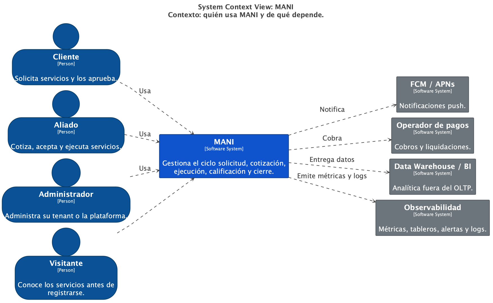](diagrams/c4/contexto/contexto.png)

> **Figura 1 — Contexto del sistema (C4 Nivel 1).** Generada desde la vista `contexto` de [`workspace.dsl`](diagrams/c4/workspace.dsl); imagen en [`diagrams/c4/contexto/contexto.png`](diagrams/c4/contexto/contexto.png).

```text
Cliente              → crea solicitudes y aprueba cotizaciones
Aliado               → cotiza, acepta y ejecuta servicios; gestiona KYC        → [ MANI ]
Administrador tenant → administra usuarios, aliados, tenant y KYC
Visitante (sin sesión) → conoce los servicios y estima un precio en la landing

[ MANI ] → FCM / APNs                    notificaciones
         → Operador de pagos             API de pagos
         → Plataforma de observabilidad  métricas, logs y trazas
         → Data Warehouse                datos operacionales para análisis
```

### Responsabilidades de frontera

- **MANI** ejecuta el flujo transaccional.
- **FCM/APNs** entrega notificaciones push.
- **Pasarela de pagos** procesa pagos; MANI conserva referencias y estados, no datos sensibles de tarjeta.
- **Observabilidad** recibe métricas, logs y trazas.
- **Data Warehouse** recibe datos mediante procesos desacoplados del flujo transaccional.

---

## 4.2 Nivel 2 — Containers

**Objetivo:** mostrar las unidades desplegables y almacenes principales.

[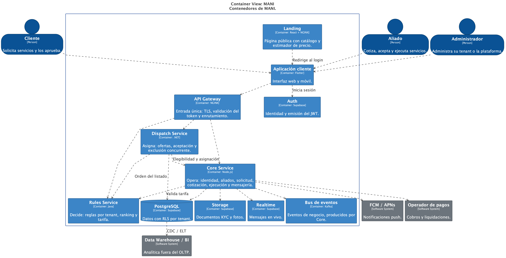](diagrams/c4/contenedores/contenedores.png)

> **Figura 2 — Contenedores (C4 Nivel 2).** Generada desde la vista `contenedores` de [`workspace.dsl`](diagrams/c4/workspace.dsl); imagen en [`diagrams/c4/contenedores/contenedores.png`](diagrams/c4/contenedores/contenedores.png).

```text
Visitante → Landing (React + NGINX) ── redirige al login ──┐
                                                           ↓
Cliente · Aliado · Administrador → Aplicación cliente (Flutter) ── inicia sesión ──→ Auth
                           │ HTTPS
                           ↓
                     API Gateway (NGINX)
        ┌──────────────────┼───────────────────┐
        ↓                  ↓                   ↓
   Rules Service     Dispatch Service     Core Service
   (Java)            (.NET)               (Node.js)
     decide            asigna               opera
        └─────────────────┬───────────────────┘
                          ↓
      PostgreSQL + RLS · Storage · Realtime        (Supabase)
      Core → Bus de eventos (Kafka) · FCM/APNs · Operador de pagos
      PostgreSQL → CDC / ELT → Data Warehouse
```

La observabilidad (Prometheus, Grafana, Loki) recibe de todos los componentes; no se dibuja en esta vista para no saturarla y aparece en el contexto y en el despliegue.

Dispatch consulta a Core la elegibilidad por categoría y zona, y a Rules el orden del listado; Core consulta a Rules para validar la cotización contra el tarifario. Son llamadas HTTPS entre servicios, no accesos cruzados a datos.

### Reglas de dependencia

- Flutter consume contratos expuestos por el Gateway.
- La landing comercial no consume ningún contrato: no llama al Gateway, a los servicios ni a Supabase. Solo redirige el navegador al login de Flutter Web (SAD §7.4, [ADR-0028](adr/ADR-0028-nombres-repositorios-y-ambientes.md)).
- Hay una base PostgreSQL por ambiente. La propiedad se ejerce por tabla: Core escribe todas salvo `solicitud_rechazo`, que escribe Dispatch; Rules no accede a la base (ModeloDatos §6.1).
- Los servicios no acceden directamente a tablas propiedad de otro dominio.
- Las integraciones externas se encapsulan mediante adaptadores.
- El Data Warehouse no participa en transacciones operacionales.
- El detalle de esquemas y entidades se encuentra en `ModeloDatos.md`.

---

## 4.3 Nivel 3 — Components

### 4.3.1 Rules Service — Java

[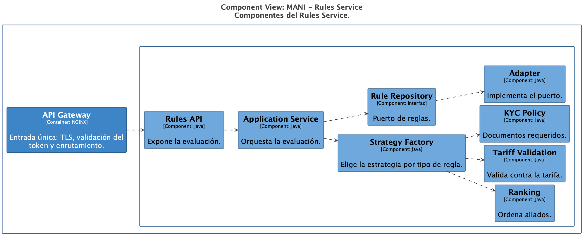](diagrams/c4/componentes/componentes-rules.png)

> **Figura 3 — Rules Service, Java (C4 Nivel 3).** Generada desde la vista `componentes-rules` de [`workspace.dsl`](diagrams/c4/workspace.dsl); imagen en [`diagrams/c4/componentes/componentes-rules.png`](diagrams/c4/componentes/componentes-rules.png).

```text
Rules REST Controller
  → Rules Application Service
       → Rule Strategy Factory → Ranking Strategy | Tariff Validation Strategy | KYC Policy Strategy
       → Rule Repository Port  → Adapter
```

Responsabilidades:

- seleccionar reglas por tenant;
- calcular ranking de aliados;
- validar cotización contra tarifario;
- validar requisitos KYC;
- desacoplar lógica de reglas de la persistencia.

### 4.3.2 Dispatch Service — .NET

[](diagrams/c4/componentes/componentes-dispatch.png)

> **Figura 4 — Dispatch Service, .NET (C4 Nivel 3).** Generada desde la vista `componentes-dispatch` de [`workspace.dsl`](diagrams/c4/workspace.dsl); imagen en [`diagrams/c4/componentes/componentes-dispatch.png`](diagrams/c4/componentes/componentes-dispatch.png).

```text
Dispatch API
  → Dispatch Application Service
       → Candidate Selector
       → Assignment Coordinator → Concurrency Guard
       → Audit Component
       → Dispatch Repository Port → PostgreSQL Adapter → rechazos (`solicitud_rechazo`)
       Concurrency Guard → Core API (comando de asignación)
```

Responsabilidades:

- orquestar el reparto de la solicitud que crea Core;
- obtener candidatos válidos (elegibilidad de Core, orden de Rules);
- coordinar la asignación y entregar a Core el comando que la escribe (decisión 6A);
- evitar doble aceptación: el `Concurrency Guard` pasa la decisión a Core, que ejecuta la actualización condicional atómica;
- responder conflicto `409` cuando la asignación ya fue tomada;
- registrar rechazos y auditar el despacho.

### 4.3.3 Core Service — Node.js

[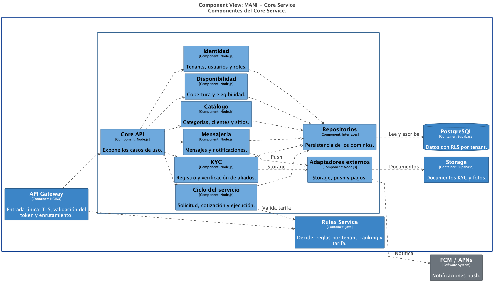](diagrams/c4/componentes/componentes-core.png)

> **Figura 5 — Core Service, Node.js (C4 Nivel 3).** Generada desde la vista `componentes-core` de [`workspace.dsl`](diagrams/c4/workspace.dsl); imagen en [`diagrams/c4/componentes/componentes-core.png`](diagrams/c4/componentes/componentes-core.png).

```text
Core API
  → Identidad ──────────┐
  → KYC ────────────────┤
  → Catálogo ───────────┤
  → Disponibilidad ─────┼→ Repositorios → PostgreSQL
  → Ciclo del servicio ─┤
  → Mensajería ─────────┘

KYC y Mensajería → Adaptadores externos → Storage · FCM/APNs
Ciclo del servicio → Rules Service (validación de tarifa)
```

**Disponibilidad** concentra cobertura del aliado, horarios y solapamientos, zonas y elegibilidad por categoría y zona (RF-07, RF-12, RNF-07). Es el componente que Despacho consulta en caliente antes de conformar el listado de candidatos. La lógica pertenece al servicio, no al cliente Flutter (§2.2, [ADR-0022](adr/ADR-0022-logica-de-negocio-en-servicios.md), `Propuesto`).

La disponibilidad **no es un servicio desplegable aparte**. Vive en el bloque Node como un dominio más de Core, igual que el catálogo o la comunicación: separarla en su propio despliegue sería convertir un dominio en un servicio sin ganar nada a cambio (SAD, riesgo *Servicios excesivamente pequeños*).

---

## 4.4 Nivel 4 — Code

El nivel 4 expresa la estructura interna de código. No pretende congelar clases concretas para siempre; define las dependencias que deben preservarse.

### Ejemplo: Rules Service

```text
RulesController
  +evaluateRule(request)
  +rankAllies(request)
      ↓
RulesApplicationService
  +evaluate(context)
  +rank(context)
      ↓                              ↓
RuleStrategyFactory             RuleRepository  «interfaz»
  +resolve(ruleType)              +findByTenant(tenantId)
      ↓                              ↑
RuleStrategy  «interfaz»        PostgresRuleRepository
  +supports(ruleType)             +findByTenant(tenantId)
  +evaluate(context)
      ↑
  RankingStrategy · TariffStrategy · KycStrategy   (implementaciones)
```

### Dispatch Service — ruta de aceptación de una solicitud

Diagrama de nivel 4 levantado desde el código de `MANI-.NET`. Baja desde el componente `Concurrency Guard` de §4.3.2 hasta las clases que lo implementan.

[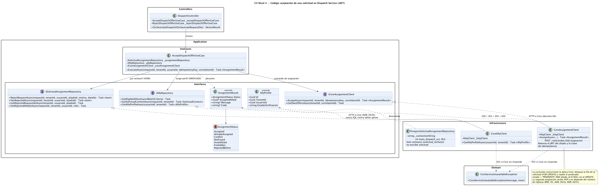](diagrams/c4/codigo/aceptacion-concurrente.png)

> **Figura 6b — Nivel 4, aceptación en Dispatch.** Structurizr no describe clases, así que no es una vista del `workspace.dsl`.

Lo que el diagrama fija:

- `AcceptDispatchOfferUseCase` exige perfil de aliado **VERIFICADO** antes de asignar; sin él responde `MANI-SOL-403V`.
- Si el aliado ya rechazó la oferta, `PostgresSolicitudAssignmentRepository` lo detecta y la respuesta es `409 MANI-DSP-409R` sin llamar a Core. Ese repositorio solo maneja rechazos (`solicitud_rechazo`): Dispatch **no escribe `solicitud`** (decisión 6A).
- La asignación la pide `CoreAssignmentClient` a Core (`POST /solicitudes/{id}/asignacion`), con el JWT del aliado y la clave de idempotencia. Core bloquea la fila y repite el predicado `estado = 'PENDIENTE' AND aliado_id IS NULL` en el `UPDATE`: la exclusión es del motor, no del número de réplicas.
- `AssignmentStatus` distingue `Assigned`, `AlreadyAssigned` (reintento idempotente del mismo ganador, `200`), `Conflict` (`409`), `NotFound`, `InvalidState`, `Forbidden` (Core negó la asignación) y `RejectedBefore`.
- `IAllyRepository` lo implementa `CoreAllyClient` **sobre HTTP**, no sobre SQL contra tablas de Core: es la frontera de datos de [ADR-0030](adr/ADR-0030-propiedad-esquema-y-frontera-de-datos.md) hecha código. Si Core no responde, `CoreServiceUnavailableException` produce `503` y no se da nada por asignado.

### Regla de dependencia de código

La dependencia debe apuntar desde adaptadores hacia contratos internos, no desde el dominio hacia frameworks externos:

```text
Controller / Adapter
        ↓
Application / Use Cases
        ↓
Domain
        ↑
Ports / Interfaces
        ↑
DB / External Adapters
```

---

## 4.5 Panorama de sistemas — System Landscape

**Objetivo:** mostrar el mapa de sistemas alrededor de MANI. Es una pregunta distinta de la del Nivel 1: el contexto mira hacia fuera *desde* MANI, el panorama mira el conjunto y deja ver que MANI es el único sistema propio y que todo lo demás es proveedor o plataforma de destino.

[](diagrams/c4/contexto/panorama.png)

> **Figura 6 — Panorama de sistemas (System Landscape).** Generada desde la vista `panorama` de [`workspace.dsl`](diagrams/c4/workspace.dsl); imagen en [`diagrams/c4/contexto/panorama.png`](diagrams/c4/contexto/panorama.png).

```text
Visitante · Cliente · Aliado · Administrador (de tenant o de plataforma)
                              ↓
                          [ MANI ]  ← único sistema propio
                              ↓
   FCM / APNs · Operador de pagos · Observabilidad · Data Warehouse / BI
                     (proveedores y plataformas de destino)
```

Consecuencia de diseño: cada sistema externo entra al modelo por un adaptador, nunca por acoplamiento directo de un servicio al proveedor (§6 y §14).

---

## 4.6 Vistas dinámicas

**Objetivo:** mostrar el orden de los flujos que la estructura estática no explica. Cada paso de estas vistas corresponde a una relación ya declarada en el modelo: una vista dinámica no inventa colaboraciones que la estructura no permita.

> Los mismos flujos, en **PlantUML suelto y con las ramas de error** (`alt`, `409 Conflict`, destinatario desconectado), están en §21. Esa notación admite lo que el modelo C4 no expresa: dos actores compitiendo y los caminos alternativos.

| Vista | Flujo | Requisitos |
|---|---|---|
| `dinamico-solicitud` | solicitud y conformación del listado de aliados | RF-12, RF-13 |
| `dinamico-aceptacion` | exclusión concurrente en la aceptación | RF-14, RNF-03, RNF-05 |
| `dinamico-cotizacion` | cotización y alerta contra el tarifario | RF-15, RF-16, RF-22 |
| `dinamico-kyc` | carga y verificación de documentos KYC | RF-05, RF-06 |
| `dinamico-mensajeria` | mensajería con notificación de respaldo | RF-20, RF-21 |

### 4.6.1 Solicitud y listado de aliados — `dinamico-solicitud`

[](diagrams/flujos/dinamico-solicitud.png)

> **Figura 7 — Solicitud y listado de aliados.** Generada desde la vista `dinamico-solicitud`; imagen en [`diagrams/flujos/dinamico-solicitud.png`](diagrams/flujos/dinamico-solicitud.png).

```text
1. Cliente            → Flutter          registra la solicitud
2. Flutter            → API Gateway      POST con el JWT del tenant
3. API Gateway        → Dispatch         enruta tras validar el token
4. Dispatch           → Core             aliados elegibles por categoría y zona (RF-12)
5. Dispatch           → Rules            orden del listado según la regla del tenant (RF-13)
6. Dispatch           → PostgreSQL       persiste solicitud y candidatos notificados
```

Quien orquesta es el despacho: pregunta elegibilidad al dominio de disponibilidad en Core y el orden a Reglas. Ni el cliente Flutter ni el Gateway deciden nada de esto.

### 4.6.2 Aceptación concurrente — `dinamico-aceptacion`

[](diagrams/flujos/dinamico-aceptacion.png)

> **Figura 8 — Aceptación concurrente.** Generada desde la vista `dinamico-aceptacion`; imagen en [`diagrams/flujos/dinamico-aceptacion.png`](diagrams/flujos/dinamico-aceptacion.png).

Vista a nivel de componentes del Servicio de Despacho. Dos aliados aceptan la misma solicitud al mismo tiempo:

```text
1. API Gateway          → Dispatch API             aceptación con clave de idempotencia (RNF-03)
2. Dispatch API         → Application Service      invoca el caso de uso
3. Application Service  → Assignment Coordinator   coordina la asignación
4. Coordinator          → Concurrency Guard        delega la exclusión concurrente
5. Concurrency Guard    → Repository Port          actualización condicional: solo si sigue libre
6. Repository Port      → PostgreSQL Adapter       implementación
7. Adapter              → PostgreSQL               UPDATE condicionado al estado previo
8. Application Service  → Audit Component          audita el cambio de estado (RNF-04)
```

La primera aceptación afecta una fila y gana. La segunda no afecta ninguna y recibe `409 Conflict`. La garantía está en la actualización condicional, no en la aplicación.

### 4.6.3 Cotización y tarifario — `dinamico-cotizacion`

[](diagrams/flujos/dinamico-cotizacion.png)

> **Figura 9 — Cotización y tarifario.** Generada desde la vista `dinamico-cotizacion`; imagen en [`diagrams/flujos/dinamico-cotizacion.png`](diagrams/flujos/dinamico-cotizacion.png).

```text
1. Aliado        → Flutter        cotización separando mano de obra y materiales (RF-15)
2. Flutter       → API Gateway    envía la cotización
3. API Gateway   → Core           enruta tras validar el token
4. Core          → Rules          valida el valor contra el rango del tarifario (RF-16)
5. Rules         → PostgreSQL     lee mínimo, típico y máximo del tenant (RF-22)
6. Core          → PostgreSQL     persiste la cotización con el resultado
```

Core es dueño de la cotización (§7.3 del SAD) y Reglas es dueño del tarifario (§7.1 del SAD): la validación es una llamada entre servicios, no lógica duplicada en Core.

### 4.6.4 KYC del aliado — `dinamico-kyc`

[](diagrams/flujos/dinamico-kyc.png)

> **Figura 10 — KYC del aliado.** Generada desde la vista `dinamico-kyc`; imagen en [`diagrams/flujos/dinamico-kyc.png`](diagrams/flujos/dinamico-kyc.png).

```text
1. Aliado                 → Flutter        carga los documentos requeridos por el tenant
2. Flutter                → API Gateway    envía los documentos
3. API Gateway            → Core           enruta tras validar el token
4. Core                   → Rules          qué documentos exige este tenant (RF-02, RNF-10)
5. Core                   → Storage        bucket privado tenant_id/aliado_id/documento
6. Core                   → PostgreSQL     registra el documento; aliado en verificación
7. Administrador tenant   → Flutter        aprueba o rechaza al aliado (RF-06)
```

La aprobación es una decisión humana del tenant, no un efecto automático de la carga.

El paso 4 es el que faltaba en esta vista: la lista de documentos exigidos es configuración del
tenant y la evalúa el Rules Service, igual que el ranking y el tarifario (§4.3.1, `SAD.md` §7.1 y
§9, componente `KYC Policy Strategy` del modelo). Así esta vista coincide con
§21.4, que ya lo mostraba.

### 4.6.5 Mensajería y notificación — `dinamico-mensajeria`

[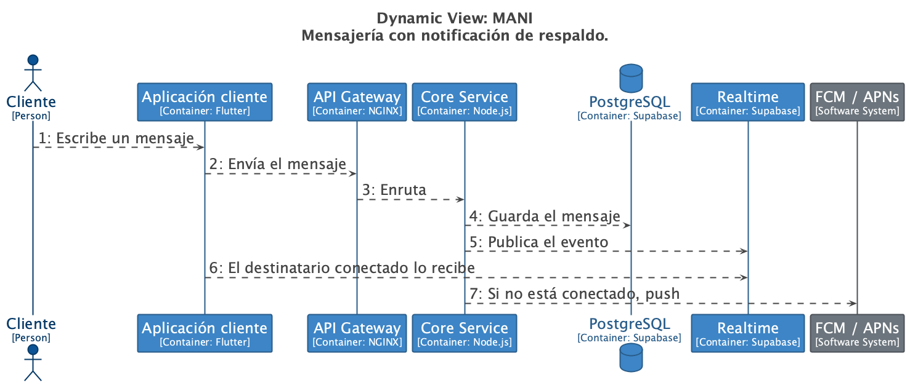](diagrams/flujos/dinamico-mensajeria.png)

> **Figura 11 — Mensajería y notificación.** Generada desde la vista `dinamico-mensajeria`; imagen en [`diagrams/flujos/dinamico-mensajeria.png`](diagrams/flujos/dinamico-mensajeria.png).

```text
1. Cliente   → Flutter        escribe un mensaje del servicio
2. Flutter   → API Gateway    envía el mensaje
3. Gateway   → Core           enruta tras validar el token
4. Core      → PostgreSQL     persiste el mensaje
5. Core      → Realtime       publica el evento de mensajería
6. Flutter   → Realtime       el destinatario conectado lo recibe casi en tiempo real
7. Core      → FCM / APNs     si no está conectado, lo notifica por push (RF-21)
```

El mensaje se persiste antes de transportarse: la conversación no vive en el canal de tiempo real. Realtime transporta, no decide.

---

# 5. Patrones arquitectónicos

| Patrón | Aplicación en MANI | Justificación |
|---|---|---|
| SOA | capacidades separadas como servicios | bajo acoplamiento y evolución independiente |
| API Gateway | NGINX | punto de entrada, políticas transversales y ocultamiento de topología interna |
| Layered Architecture interna | API → aplicación → dominio → infraestructura | evita mezclar HTTP, reglas y persistencia |
| Repository / Ports & Adapters | acceso a Supabase mediante interfaces sobre PostgreSQL | desacopla lógica de negocio del proveedor de datos |
| Database ownership por dominio | esquemas/repositorios separados | limita dependencias y cambios cruzados |
| Event-driven para efectos secundarios | notificaciones, auditoría, analítica | reduce cadenas síncronas |
| Externalized Configuration | secretos y configuración fuera del código | portabilidad y seguridad |
| Observability | métricas, logs, trazas y correlation ID | diagnóstico de sistemas distribuidos |

---

# 6. Patrones de diseño

| Patrón | Uso |
|---|---|
| Strategy | reglas variables por tenant |
| Factory | resolución de la estrategia correspondiente |
| Repository | abstracción de persistencia |
| Adapter | FCM/APNs, pagos, KYC y otros proveedores |
| Facade / Application Service | coordinación de casos de uso |
| Observer / Publish-Subscribe | notificaciones, auditoría y eventos analíticos |
| Circuit Breaker | protección frente a fallas de servicios externos |
| Retry con backoff | reintentos controlados en operaciones idempotentes |
| Outbox | publicación confiable de eventos tras una transacción |
| Idempotency Key | evitar pagos, asignaciones o comandos duplicados |

---

# 7. Atributos de calidad — ISO/IEC 25010:2023

ISO/IEC 25010:2023 define un modelo de calidad de producto con nueve características. MANI las utiliza como marco, pero **no todas reciben la misma prioridad**.

Escala:

- **P1 — Crítico:** condiciona decisiones estructurales y aceptación del sistema.
- **P2 — Alto:** debe cumplirse antes de producción, pero no domina todas las decisiones.
- **P3 — Controlado:** se verifica, aunque su impacto arquitectónico es menor para el alcance actual.

Los umbrales siguientes son **objetivos de aceptación inicial del MVP**. Deben recalibrarse con pruebas de carga y datos reales.

## 7.1 Priorización general

| Característica ISO/IEC 25010:2023 | Prioridad | Razón |
|---|---:|---|
| Seguridad | P1 | multi-tenant, KYC, identidad, pagos y datos sensibles |
| Fiabilidad | P1 | solicitudes, despacho y asignación requieren continuidad y consistencia |
| Eficiencia de desempeño | P1 | ranking, disponibilidad y despacho son sensibles a latencia |
| Mantenibilidad | P1 | arquitectura políglota y múltiples servicios elevan el costo de cambio |
| Flexibilidad | P1 | los servicios deben escalar, desplegarse y adaptarse por separado |
| Compatibilidad | P2 | integración entre Java, .NET, Node.js, Flutter y terceros |
| Adecuación funcional | P2 | exactitud de reglas, asignaciones y estados |
| Capacidad de interacción | P2 | cliente, aliado y administrador necesitan flujos claros |
| Protección (Safety) | P3 | no es un sistema safety-critical, pero debe evitar operaciones irreversibles inseguras |

---

## 7.2 Seguridad — P1

| Subcaracterística | Prioridad | Umbral / criterio de aceptación |
|---|---:|---|
| Confidencialidad | P1 | 100% de endpoints privados requieren autenticación; TLS 1.2+; secretos fuera del código |
| Integridad | P1 | 100% de operaciones críticas protegidas por validación de autorización y constraints transaccionales |
| Autenticidad | P1 | tokens firmados y validados en 100% de llamadas protegidas |
| Responsabilidad / accountability | P1 | 100% de cambios críticos generan actor, timestamp y correlation ID |
| No repudio | P2 | pagos, aceptación y cambios críticos conservan evidencia auditable |
| Resistencia | P1 | 0 vulnerabilidades Critical/High conocidas abiertas en release de producción; rate limiting en Gateway |

**Controles arquitectónicos:** JWT/OIDC, API Gateway, RBAC, aislamiento por tenant, RLS cuando aplique, auditoría, SAST con SonarQube, DAST con OWASP ZAP, gestión de secretos y mínimos privilegios.

---

## 7.3 Fiabilidad — P1

| Subcaracterística | Prioridad | Umbral / criterio |
|---|---:|---|
| Ausencia de fallos | P1 | tasa de error 5xx < 1% en ventana de 15 min bajo carga nominal |
| Disponibilidad | P1 | ≥ 99.9% para APIs críticas en la ventana disponible, con un mínimo de 7 días continuos; mensual cuando exista la serie |
| Tolerancia a fallos | P1 | falla de proveedor de notificaciones no cancela una solicitud o asignación confirmada |
| Recuperabilidad | P1 | RTO ≤ 30 min; RPO ≤ 24 h con respaldo diario cifrado |

Controles: réplicas, health checks, restart automático, circuit breaker, retry controlado, backups, restauración probada y procesamiento asíncrono de efectos secundarios.

---

## 7.4 Eficiencia de desempeño — P1

| Subcaracterística | Prioridad | Umbral / criterio |
|---|---:|---|
| Comportamiento temporal | P1 | p95 ≤ 500 ms para lecturas internas simples y p95 ≤ 800 ms para comandos críticos, excluyendo tiempo de terceros |
| Utilización de recursos | P2 | utilización sostenida objetivo < 70% CPU por contenedor con la carga nominal; por pod cuando haya Kubernetes |
| Capacidad | P1 | soportar inicialmente 300 sesiones concurrentes y 50 req/s sostenidos sin incumplir p95 |

Controles: índices, consultas acotadas, paginación, caché selectiva, HPA, pooling, pruebas de carga y métricas.

---

## 7.5 Mantenibilidad — P1

| Subcaracterística | Prioridad | Umbral / criterio |
|---|---:|---|
| Modularidad | P1 | ningún servicio accede directamente a tablas de otro dominio |
| Reusabilidad | P2 | contratos y adaptadores comunes reutilizables sin duplicar reglas de dominio |
| Analizabilidad | P1 | 100% de requests distribuidos con correlation ID; logs estructurados |
| Capacidad para ser modificado | P1 | cambios internos compatibles no exigen modificar consumidores externos |
| Capacidad para ser probado | P1 | cobertura de código nuevo ≥ 80%; casos de uso críticos ≥ 90%; contract tests obligatorios |

**Quality Gate:** 0 issues Blocker/Critical en código nuevo; duplicación de código nuevo < 3%; pipeline debe fallar si el Quality Gate no se cumple.

---

## 7.6 Flexibilidad — P1

| Subcaracterística | Prioridad | Umbral / criterio |
|---|---:|---|
| Adaptabilidad | P1 | backend y Gateway: misma imagen en DEV/QA/PROD con configuración externa; Flutter web: una imagen por ambiente desde el mismo commit, con configuración ajustable al arrancar |
| Escalabilidad | P1 | servicios críticos escalables de 2 a 6 réplicas sin cambio de código, con escalado manual en Docker Compose; Kubernetes queda como objetivo (ADR-0004) |
| Instalabilidad | P1 | despliegue por ambiente con un script versionado de un solo comando ≤ 10 min en condiciones normales |
| Reemplazabilidad | P2 | proveedores externos encapsulados por Adapter; cambio entre el adaptador `mock` y un segundo adaptador de prueba sin alterar dominio |

---

## 7.7 Compatibilidad — P2

| Subcaracterística | Prioridad | Umbral / criterio |
|---|---:|---|
| Coexistencia | P2 | servicios respetan límites configurados de CPU/memoria y no degradan otros workloads |
| Interoperabilidad | P1 dentro de la característica | 100% de APIs documentadas con OpenAPI; contract tests verdes antes de promoción |

---

## 7.8 Adecuación funcional — P2

| Subcaracterística | Prioridad | Umbral / criterio |
|---|---:|---|
| Completitud funcional | P2 | 100% de historias críticas trazadas a casos de prueba |
| Corrección funcional | P1 dentro de la característica | 100% de escenarios críticos de ranking, tarifa, asignación y conflicto pasan pruebas |
| Pertinencia funcional | P2 | cada endpoint productivo corresponde a un caso de uso identificado |

---

## 7.9 Capacidad de interacción — P2

| Subcaracterística | Prioridad | Umbral / criterio |
|---|---:|---|
| Reconocibilidad | P2 | usuario identifica acción principal de cada flujo sin documentación externa |
| Aprendizabilidad | P3 | usuarios de prueba completan flujos base con ≤ 1 asistencia |
| Operabilidad | P2 | ≥ 90% de éxito en pruebas de tareas críticas |
| Protección contra errores de usuario | P1 dentro de la característica | acciones irreversibles requieren validación/confirmación y errores accionables |
| Involucración | P3 | ManiButton y ManiTextField obligatorios en pantallas nuevas o modificadas |
| Inclusividad | P2 | criterios de accesibilidad definidos para web/móvil |
| Asistencia al usuario | P3 | errores y estados vacíos incluyen orientación |
| Auto-descriptividad | P2 | formularios y estados críticos explican el siguiente paso |

---

## 7.10 Protección / Safety — P3

MANI no controla maquinaria ni procesos donde un fallo de software implique directamente riesgo de vida. Aun así:

| Subcaracterística | Prioridad | Umbral / criterio |
|---|---:|---|
| Restricción operativa | P2 | estados inválidos de solicitud/asignación deben rechazarse |
| Identificación de riesgos | P3 | operaciones sensibles identificadas en análisis de riesgo |
| Protección ante fallos | P2 | fallas de terceros no deben dejar transacciones críticas en estado ambiguo |
| Advertencia de peligro | P3 | mensajes explícitos antes de cancelaciones/reversiones críticas |
| Integración segura | P2 | integración externa requiere timeout, validación de respuesta y circuit breaker cuando aplique |

---

# 8. Escenarios de calidad priorizados

Esta sección operacionaliza la priorización definida en la sección 7 mediante **un escenario de calidad por cada subcaracterística de ISO/IEC 25010:2023 que la sección 7 prioriza (40 escenarios) y cinco escenarios transversales que no pertenecen a una sola subcaracterística (45 en total)**. Cada escenario identifica la fuente del estímulo, el estímulo, el entorno de ejecución, el artefacto afectado, la respuesta esperada, el umbral esperado, el mecanismo mediante el cual QA debe verificarlo y el resultado más reciente de esa verificación (§8.13).

Los identificadores **QAS-01 a QAS-09** son los de los nueve escenarios originales, uno por característica, y se conservan porque los citan el backlog, el plan de pruebas, los scripts de k6 y Newman y la evidencia ya archivada. **QAS-10 a QAS-40** cubren las demás subcaracterísticas de la sección 7 y **QAS-41 a QAS-45** son transversales. Los números no siguen el orden de las características: cada característica lista sus escenarios en su propia subsección.

**Interfaz de Flutter.** Se verifica con `flutter test` en el CI de Flutter y, cuando existan los recorridos, con Playwright sobre Flutter Web.

## 8.1 Cómo leer las tablas

**Prioridad.** Los nueve escenarios originales conservan la prioridad de su característica (sección 7.1); QAS-10 a QAS-45 llevan la de su subcaracterística en la sección 7.2 a 7.10, o P1 si son transversales.

**Umbral esperado.** Es el criterio de aceptación; para QAS-10 a QAS-40 reproduce el de la sección 7. Si un escenario y la sección 7 difieren, prevalece el más restrictivo (ver el cierre de esta sección).

## 8.2 Seguridad — P1

| ID | Subcaracterística | Prioridad | Fuente | Estímulo | Entorno | Artefacto | Respuesta esperada | Umbral esperado | ¿Cómo lo mide QA? |
|---|---|:---:|---|---|---|---|---|---|---|
| **QAS-01** | **Confidencialidad** | P1 | Usuario autenticado de un tenant | Intenta consultar o modificar información perteneciente a otro tenant | QA o PROD en operación normal | API Gateway, servicios de dominio y PostgreSQL/RLS | El servicio rechaza la operación tomando el tenant del claim del JWT firmado y no de un dato enviado por el cliente, no expone información del tenant destino y registra el evento cuando corresponda; RLS actúa como capa adicional de defensa en profundidad | **100% de accesos cross-tenant rechazados** | QA ejecuta con Postman/Newman, a través del Gateway, los seis casos cross-tenant de las Políticas DevOps §13.4 (lectura de otro tenant, listado de recursos ajenos, escritura en otro tenant, borrado ajeno, token expirado o alterado, y documentos KYC de otro tenant o aliado), con tokens y recursos de al menos dos tenants; verifica rechazo de acceso, ausencia de datos ajenos, evidencia de auditoría y que el rechazo ocurre en la autorización del servicio y no solo en RLS. Evidencia: reporte de Newman con versión del servicio y fecha |
| **QAS-10** | **Integridad** | P1 | Usuario autenticado o cliente de API | Ejecuta una operación crítica (asignar, cancelar, registrar un pago) sin el rol requerido, con datos que violan una restricción o repitiendo la solicitud | QA con datos de prueba de al menos dos tenants | API Gateway, Core Service y restricciones transaccionales de PostgreSQL | El servicio rechaza la operación no autorizada o inválida, la base conserva el estado previo y las restricciones impiden duplicados y estados incoherentes | **100% de operaciones críticas protegidas por validación de autorización y constraints transaccionales** | QA ejecuta con Newman, por el Gateway, un caso negativo por cada operación crítica (rol incorrecto, payload inválido, reintento duplicado) y verifica el código HTTP, que el estado persistido no cambió y que respondió la validación o el constraint. Evidencia: reporte de Newman y consulta del estado resultante |
| **QAS-11** | **No repudio** | P2 | Usuario que realiza una operación crítica (pago, aceptación, cambio de estado) | Niega haber ejecutado la operación, o un actor intenta alterar el registro | QA con datos de prueba | Core Service, Dispatch Service y registros de auditoría en PostgreSQL | Cada operación crítica deja un registro con actor, rol, instante y correlation ID que no puede modificarse ni borrarse | **Pagos, aceptación y cambios críticos conservan evidencia auditable** | QA ejecuta una operación de cada tipo, consulta el registro de auditoría y verifica actor, rol, timestamp y correlation ID; intenta un UPDATE, un DELETE y un TRUNCATE sobre el registro y comprueba que la base los rechaza. Evidencia: consulta del registro y salida del intento rechazado |
| **QAS-12** | **Responsabilidad / accountability** | P1 | Usuario autenticado | Ejecuta un cambio crítico (asignación, cancelación, aprobación de aliado, cambio de tarifa) | QA con datos de prueba | API Gateway, servicios de dominio y registros de auditoría | El cambio queda trazado con quién lo hizo, cuándo y con qué correlation ID, que se propaga entre servicios | **100% de cambios críticos generan actor, timestamp y correlation ID** | QA ejecuta cada cambio crítico enviando `X-Correlation-ID` y verifica en la respuesta, en los logs de cada servicio y en el registro de auditoría que aparecen el actor, el timestamp y el mismo ID. Evidencia: tabla cambio ↔ registro con los tres campos |
| **QAS-13** | **Autenticidad** | P1 | Cliente que presenta un token | Llama a una ruta protegida con un token válido, expirado, alterado, de otro emisor o ausente | QA con tokens reales de Supabase | API Gateway (`auth_request`), Core Service (`validate-token`) y servicios de dominio | Acepta solo tokens firmados y vigentes, rechaza los demás con 401 y toma tenant y rol únicamente de los claims verificados | **Tokens firmados y validados en 100% de llamadas protegidas** | QA ejecuta con Newman, por el Gateway, los casos de token ausente, expirado, alterado y de otro emisor sobre cada ruta protegida publicada, más un login real con Supabase (ES256), y verifica 401 o 403 sin datos. Evidencia: reporte de Newman y registro del login real |
| **QAS-14** | **Resistencia** | P1 | Atacante externo o cliente abusivo | Envía ráfagas de peticiones o explota una vulnerabilidad conocida | QA y candidato a release de producción | API Gateway, servicios de dominio y sus dependencias | El Gateway limita la tasa de peticiones y el análisis estático y dinámico no deja vulnerabilidades graves abiertas | **0 vulnerabilidades Critical/High conocidas abiertas en release de producción; rate limiting en Gateway** | QA consulta SonarQube y SonarCloud (SAST) en los seis repositorios, ejecuta OWASP ZAP (DAST) contra QA y comprueba el rate limiting enviando al Gateway una ráfaga por encima del límite y verificando la respuesta 429. Evidencia: reporte de Sonar, reporte de ZAP y registro de la ráfaga |

## 8.3 Fiabilidad — P1

| ID | Subcaracterística | Prioridad | Fuente | Estímulo | Entorno | Artefacto | Respuesta esperada | Umbral esperado | ¿Cómo lo mide QA? |
|---|---|:---:|---|---|---|---|---|---|---|
| **QAS-02** | **Tolerancia a fallos** | P1 | Proveedor externo de notificaciones | FCM/APNs deja de responder después de confirmarse una operación de negocio | QA con dependencia externa degradada o indisponible, simulada mediante un adaptador de prueba | Core Service, Notification Component y adaptador externo | La operación principal permanece confirmada y la notificación queda disponible para reintento controlado | **0 operaciones confirmadas revertidas únicamente por fallo de notificación** | QA simula timeout, error y caída del proveedor con un adaptador de prueba; tras cada fallo verifica el estado final de la operación, la persistencia del evento de notificación, los logs con correlation ID y la ejecución del mecanismo de retry. Evidencia: registro de cada simulación con el estado final de la operación |
| **QAS-15** | **Ausencia de fallos** | P1 | Usuarios y servicios consumidores | Operan el sistema bajo carga nominal durante 15 minutos | QA bajo carga nominal: 300 sesiones concurrentes y 50 req/s sostenidos (sección 7.4) | API Gateway y servicios de dominio sobre su camino real | Los servicios responden sin errores del servidor | **Tasa de error 5xx < 1% en ventana de 15 min bajo carga nominal** | QA ejecuta el escenario k6 de QAS-03 durante 15 minutos con la carga nominal y calcula el porcentaje de respuestas 5xx sobre el total, en el Gateway y en cada servicio. Evidencia: salida de k6 y logs del Gateway |
| **QAS-16** | **Disponibilidad** | P1 | Usuarios del sistema | Consumen las APIs críticas durante un mes calendario | Ambiente con monitoreo continuo (QA mientras no haya serie en PROD) | API Gateway, servicios críticos (Core, Rules, Dispatch) y sondas `/health` | Las APIs críticas responden de forma continua y cada caída queda registrada | **≥ 99.9% para APIs críticas en la ventana disponible, con un mínimo de 7 días continuos; mensual cuando exista la serie** | QA calcula la disponibilidad como la proporción de sondas `/health` exitosas en la ventana (mínimo 7 días continuos; un mes cuando exista la serie), por servicio y por el Gateway, descontando solo las ventanas de mantenimiento declaradas. Evidencia: serie de sondas de la ventana y cálculo |
| **QAS-17** | **Recuperabilidad** | P1 | Falla de infraestructura o corrupción de datos | Se pierde un servicio o la base de datos operacional | QA, con un volcado reciente de la base | Base de datos (Supabase), copias de respaldo y procedimiento de restauración | Se restaura el servicio y los datos desde el último respaldo dentro de los tiempos objetivo | **RTO ≤ 30 min; RPO ≤ 24 h con respaldo diario cifrado** | QA simula la pérdida, restaura desde el respaldo más reciente y cronometra el tiempo hasta que los endpoints críticos responden (RTO); compara la hora del último dato restaurado con la del fallo (RPO). Evidencia: cronometraje, bitácora de la restauración y verificación de integridad |

## 8.4 Eficiencia de desempeño — P1

| ID | Subcaracterística | Prioridad | Fuente | Estímulo | Entorno | Artefacto | Respuesta esperada | Umbral esperado | ¿Cómo lo mide QA? |
|---|---|:---:|---|---|---|---|---|---|---|
| **QAS-03** | **Comportamiento temporal** | P1 | Usuario o servicio consumidor | Consulta disponibilidad de aliados por categoría y zona | QA bajo carga nominal: 300 sesiones concurrentes y 50 req/s sostenidos (sección 7.4) | API Gateway, Core Service (dominio de disponibilidad), persistencia y componentes involucrados en la consulta | El sistema retorna candidatos elegibles dentro del tiempo objetivo | **p95 ≤ 500 ms para la consulta bajo carga nominal** | QA ejecuta un escenario k6 propio de la consulta por categoría y zona con la carga nominal sostenida, registra los tiempos de respuesta del endpoint y calcula el percentil 95; el escenario se aprueba si el p95 permanece dentro del umbral. El camino que acredita el escenario es el único vigente: Gateway → Core Service, dominio de disponibilidad (§2.2). El resultado declara el camino medido, la carga, el ambiente y la fecha, y no se extrapola desde otro escenario. |
| **QAS-18** | **Utilización de recursos** | P2 | Incremento de demanda | La carga sostenida sube hasta la nominal | QA bajo carga controlada | Contenedores de los servicios críticos y plataforma de orquestación | El uso de CPU se mantiene por debajo del objetivo antes de escalar | **Utilización sostenida objetivo < 70% CPU por contenedor con la carga nominal** | QA ejecuta la carga nominal con k6 y registra CPU y memoria por contenedor con cAdvisor, y verifica el valor sostenido frente al objetivo. Kubernetes (medición por pod) sigue como objetivo (ADR-0004). Evidencia: serie de CPU por contenedor junto con la configuración de límites |
| **QAS-19** | **Capacidad** | P1 | Usuarios o servicios consumidores | Alcanzan 300 sesiones concurrentes y 50 req/s sostenidos | QA bajo carga nominal | API Gateway, servicios y persistencia sobre su camino real | El sistema atiende la carga manteniendo los umbrales de latencia | **Soportar inicialmente 300 sesiones concurrentes y 50 req/s sostenidos sin incumplir p95** | QA ejecuta k6 con 300 usuarios virtuales y 50 req/s sostenidos sobre las rutas críticas reales y verifica que el p95 de cada una se mantenga dentro del umbral de la sección 7.4. Evidencia: salida de k6 por ruta, con carga, ambiente y fecha |

## 8.5 Mantenibilidad — P1

| ID | Subcaracterística | Prioridad | Fuente | Estímulo | Entorno | Artefacto | Respuesta esperada | Umbral esperado | ¿Cómo lo mide QA? |
|---|---|:---:|---|---|---|---|---|---|---|
| **QAS-04** | **Capacidad para ser modificado** | P1 | Equipo de desarrollo | Modifica una regla de ranking o comportamiento configurable de un tenant manteniendo el contrato externo | DEV y QA | Rules Service (estrategias de ranking, tarifa y KYC por tenant), su configuración y los contratos de integración | El cambio se implementa solo en Rules Service y su configuración, sin exigir modificaciones en consumidores externos compatibles | **0 cambios obligatorios en Flutter, Gateway, Dispatch ni en otros servicios consumidores de Rules para un cambio interno compatible** | QA ejecuta pruebas de regresión, integración y contract tests (Newman); toma el PR del cambio y verifica por su diff que solo toca Rules Service y su configuración, y que los consumidores existentes continúan operando sin modificaciones derivadas del cambio. Evidencia: enlace al PR y reporte de contract tests |
| **QAS-20** | **Modularidad** | P1 | Equipo de desarrollo | Un servicio necesita un dato que pertenece a otro dominio | DEV y QA | Core, Rules y Dispatch, y sus roles de base de datos | El dato se obtiene por la API o el comando del servicio dueño y el rol de base de datos del servicio no tiene permisos sobre tablas ajenas | **Ningún servicio accede directamente a tablas de otro dominio** | QA revisa las consultas SQL y los permisos (`GRANT`) de cada rol de servicio y verifica que ninguno lee ni escribe tablas de otro dominio; intenta una escritura prohibida con el rol de Dispatch y comprueba el rechazo. Evidencia: informe de conformidad de la frontera de datos y salida de la escritura rechazada |
| **QAS-21** | **Reusabilidad** | P2 | Equipo de desarrollo | Un servicio necesita integrar un proveedor externo o validar un token que otro servicio ya resolvió | DEV | Contratos OpenAPI, adaptadores comunes y reglas de dominio | Se reutiliza el contrato o el adaptador existente sin copiar reglas de dominio | **Contratos y adaptadores comunes reutilizables sin duplicar reglas de dominio** | QA revisa la duplicación que reporta Sonar en los seis repositorios y los puertos y adaptadores compartidos, y lista la lógica de dominio repetida entre servicios. Evidencia: reporte de duplicación y lista de hallazgos |
| **QAS-22** | **Analizabilidad** | P1 | Equipo de soporte o de desarrollo | Investiga una petición fallida que cruza varios servicios | QA | API Gateway, Core, Rules, Dispatch y sus logs | El `X-Correlation-ID` identifica la petición en todos los servicios y los logs son estructurados | **100% de requests distribuidos con correlation ID; logs estructurados** | QA envía peticiones con y sin `X-Correlation-ID` por el Gateway, verifica que cada respuesta y el log de cada servicio llevan el mismo ID (generado si faltaba) y que los logs pueden leerse como JSON. Evidencia: casos de Playwright y extracto de logs por servicio |
| **QAS-23** | **Capacidad para ser probado** | P1 | Equipo de desarrollo | Integra código nuevo mediante un pull request | CI y SonarQube o SonarCloud | Repositorios de los seis componentes y sus pruebas | El pipeline mide la cobertura y exige contract tests | **Cobertura de código nuevo ≥ 80%; casos de uso críticos ≥ 90%; contract tests obligatorios** | QA consulta la cobertura en SonarQube (y SonarCloud para Flutter), calcula la de los casos de uso críticos con la matriz de pruebas y verifica que el gate del pipeline exige contract tests. Evidencia: consulta a Sonar con fecha y matriz de pruebas |

## 8.6 Flexibilidad — P1

| ID | Subcaracterística | Prioridad | Fuente | Estímulo | Entorno | Artefacto | Respuesta esperada | Umbral esperado | ¿Cómo lo mide QA? |
|---|---|:---:|---|---|---|---|---|---|---|
| **QAS-05** | **Escalabilidad** | P1 | Incremento de demanda del sistema | La carga de un servicio crítico supera la capacidad objetivo de las réplicas actuales | Kubernetes en QA bajo carga controlada. **Abierto, pendiente de DevOps (INFRA-01, INFRA-02)**: sin clúster, el escenario no es medible | Deployment, HPA y servicio crítico contenerizado (Rules, Dispatch o Core) | La plataforma incrementa horizontalmente la capacidad del servicio cuando la utilización sostenida de CPU por pod supera el 70% (sección 7.4), sin modificar código ni reconstruir el artefacto | **Escalamiento manual de 2 a 6 réplicas por servicio con `docker compose --scale`, sin cambio de código** | QA escala cada servicio crítico de 2 a 6 réplicas con `docker compose --scale` mientras corre una carga k6, y verifica que el Gateway reparte entre las réplicas, sin errores por el cambio y con la misma imagen. Kubernetes con HPA sigue como objetivo (ADR-0004); se usa Compose porque es la plataforma actual. Evidencia: salida de k6, réplicas por paso y logs del Gateway |
| **QAS-24** | **Adaptabilidad** | P1 | Equipo de DevOps | Promueve la misma versión de un servicio entre DEV, QA y PROD | DEV, QA y PROD | Imágenes de contenedor en GHCR y configuración por ambiente | Se despliega la misma imagen en cada ambiente y solo cambia la configuración externa | **Backend y Gateway: misma imagen en DEV/QA/PROD con configuración externa. Flutter web: una imagen por ambiente desde el mismo commit, con la configuración ajustable al arrancar** | Backend y Gateway: QA compara el digest de la imagen desplegada en cada ambiente. Flutter web: QA compara en GHCR el commit de origen de las tres imágenes y verifica que, al arrancar el contenedor con otras variables, `/assets/.env` cambia sin recompilar (MANI-Flutter#150). Evidencia: tabla servicio ↔ digest o commit por ambiente y la prueba de arranque |
| **QAS-25** | **Instalabilidad** | P1 | Equipo de DevOps | Despliega una versión en un ambiente | QA, en condiciones normales | Pipelines de CD y procedimiento de despliegue | El despliegue se ejecuta de forma automatizada y termina con la verificación de salud | **Despliegue por ambiente con un script versionado de un solo comando ≤ 10 min en condiciones normales** | QA ejecuta el script de despliegue versionado del ambiente (`desplegar_release_qa.sh`) y cronometra desde el inicio hasta que `/health` responde 200 en todos los servicios. Evidencia: salida del script con su duración y la verificación de salud |
| **QAS-26** | **Reemplazabilidad** | P2 | Equipo de desarrollo | Cambia el proveedor de notificaciones o de pagos | DEV y QA | Adaptadores de proveedor (componente de notificaciones y pagos) y dominio | Se sustituye el adaptador sin modificar casos de uso ni reglas de dominio | **Proveedores externos encapsulados por Adapter; cambio entre el adaptador `mock` y un segundo adaptador de prueba sin alterar dominio** | QA ejecuta las pruebas de contrato de los proveedores con el adaptador `mock` y con un segundo adaptador de prueba con contrato distinto, y verifica por el diff que el cambio solo toca el adaptador y su configuración. Evidencia: reporte de contract tests y diff |

## 8.7 Compatibilidad — P2

| ID | Subcaracterística | Prioridad | Fuente | Estímulo | Entorno | Artefacto | Respuesta esperada | Umbral esperado | ¿Cómo lo mide QA? |
|---|---|:---:|---|---|---|---|---|---|---|
| **QAS-06** | **Interoperabilidad** | P2 | Servicio interno o consumidor autorizado | Consume una API publicada por un servicio implementado en otra tecnología | QA de integración | APIs REST de los servicios publicadas por el API Gateway y sus contratos OpenAPI | Productor y consumidor intercambian información respetando el contrato publicado | **100% de APIs documentadas con OpenAPI y contract tests críticos aprobados antes de promoción** | QA contrasta las APIs publicadas por el Gateway con los contratos OpenAPI (cada API publicada debe tener el suyo), ejecuta contract tests y pruebas de integración/Newman entre servicios de distinta tecnología; valida códigos HTTP, payloads, tipos de datos, campos obligatorios y compatibilidad del contrato. Evidencia: tabla API ↔ contrato y reporte de contract tests |
| **QAS-27** | **Coexistencia** | P2 | Servicios que comparten host | Un servicio consume recursos hasta su límite mientras otros atienden tráfico | QA bajo carga controlada | Contenedores de Gateway, Core, Rules y Dispatch en el mismo host | Cada servicio respeta su límite y los demás mantienen su latencia | **Servicios respetan límites configurados de CPU/memoria y no degradan otros workloads** | QA carga un servicio hasta su límite con k6 y mide CPU, memoria y p95 de los demás servicios, verificando que el límite se respeta y que la latencia de los vecinos no sale del umbral. Evidencia: series por contenedor y p95 de los vecinos |

## 8.8 Adecuación funcional — P2

| ID | Subcaracterística | Prioridad | Fuente | Estímulo | Entorno | Artefacto | Respuesta esperada | Umbral esperado | ¿Cómo lo mide QA? |
|---|---|:---:|---|---|---|---|---|---|---|
| **QAS-07** | **Corrección funcional** | P2 | Usuarios o servicios que ejecutan reglas y operaciones críticas | Ejecutan escenarios críticos de ranking, tarifa, asignación o conflicto | QA con datos de prueba controlados | Rules Service, Dispatch Service y servicios involucrados | El sistema produce el resultado funcional definido para cada regla, asignación y transición de estado | **100% de escenarios críticos de ranking, tarifa, asignación y conflicto aprobados** | QA mantiene casos de prueba trazados a los requisitos críticos y verifica resultados esperados, estados persistidos, códigos de respuesta y reglas de negocio; para asignación y conflicto incluye la aceptación concurrente de una misma solicitud sobre Dispatch con k6 (una aceptación confirmada con 200, las demás con 409, 0 dobles asignaciones y reintentos idempotentes). Evidencia: matriz requisito ↔ caso y reporte de ejecución |
| **QAS-28** | **Completitud funcional** | P2 | Equipo de QA | Contrasta las historias críticas con los casos de prueba | QA | Backlog, criterios de aceptación y matriz de pruebas | Cada historia crítica tiene casos que la cubren | **100% de historias críticas trazadas a casos de prueba** | QA cruza las historias críticas del backlog con la matriz de pruebas (`MANI_Matriz_Pruebas_Sprint4.xlsx` y las siguientes) y calcula el porcentaje con al menos un caso. Evidencia: matriz historia ↔ caso |
| **QAS-29** | **Pertinencia funcional** | P2 | Equipo de QA y arquitectura | Revisa los endpoints publicados | QA | Rutas de Gateway, Core, Rules y Dispatch, y contratos OpenAPI | Cada endpoint responde a un caso de uso identificado en el backlog | **Cada endpoint productivo corresponde a un caso de uso identificado** | QA lista las rutas de los contratos OpenAPI y del inventario de rutas de Core, las asocia a una historia o caso de uso y reporta las rutas sin historia. Evidencia: tabla ruta ↔ historia |

## 8.9 Capacidad de interacción — P2

| ID | Subcaracterística | Prioridad | Fuente | Estímulo | Entorno | Artefacto | Respuesta esperada | Umbral esperado | ¿Cómo lo mide QA? |
|---|---|:---:|---|---|---|---|---|---|---|
| **QAS-08** | **Protección contra errores de usuario** | P2 | Usuario autorizado | Intenta ejecutar una acción irreversible o envía información inválida en un flujo crítico | Aplicación web/móvil en operación normal | Flutter (presentación) y servicio de dominio asociado al caso de uso, detrás del Gateway | El sistema previene la ejecución accidental mediante validación o confirmación y devuelve errores accionables; el servicio valida también las entradas y no depende solo del cliente | **100% de acciones irreversibles definidas requieren validación o confirmación previa** | QA prueba con `flutter test` los flujos de pantalla críticos (confirmación previa, cancelación, entradas inválidas y conservación del estado previo cuando la operación es rechazada) y, como complemento, con Playwright sobre Flutter Web cuando existan esos recorridos; comprueba con Newman que el servicio rechaza con error accionable las entradas inválidas enviadas sin pasar por la interfaz. Evidencia: reporte de `flutter test` y de Newman |
| **QAS-30** | **Reconocibilidad** | P2 | Usuario de prueba (cliente, aliado o administrador de tenant) | Abre cada flujo principal sin instrucciones | Aplicación web o móvil en QA | Flutter (pantallas de los flujos principales) | El usuario identifica la acción principal de cada flujo sin consultar documentación | **Usuario identifica acción principal de cada flujo sin documentación externa** | QA ejecuta pruebas de tareas con usuarios de prueba por rol, sin guía, y registra si identifican la acción principal de cada flujo. Evidencia: registro por usuario y flujo |
| **QAS-31** | **Aprendizabilidad** | P3 | Usuario de prueba que no conoce el sistema | Completa por primera vez los flujos base (registro, solicitud de servicio, aceptación) | Aplicación web o móvil en QA | Flutter | Completa cada flujo sin ayuda o con una sola asistencia | **Usuarios de prueba completan flujos base con ≤ 1 asistencia** | QA observa a usuarios de prueba y cuenta las asistencias que necesita cada uno por flujo. Evidencia: registro de asistencias por usuario y flujo |
| **QAS-32** | **Operabilidad** | P2 | Usuario de prueba | Ejecuta las tareas críticas de su rol | Aplicación web o móvil en QA | Flutter y servicios detrás del Gateway | Completa la tarea sin errores de operación | **≥ 90% de éxito en pruebas de tareas críticas** | QA define las tareas críticas por rol y calcula el porcentaje de éxito de las ejecuciones de los usuarios de prueba, apoyado en `flutter test` y en Playwright sobre Flutter Web para repetir los recorridos. Evidencia: porcentaje de éxito por tarea y reporte de ejecución |
| **QAS-33** | **Involucración** | P3 | Equipo de desarrollo y diseño | Se añaden pantallas nuevas | DEV | Tema y componentes compartidos de Flutter | Las pantallas usan los componentes del sistema de diseño | **ManiButton y ManiTextField obligatorios en pantallas nuevas o modificadas** | QA revisa cada PR de Flutter que crea o modifica una pantalla y verifica que no agrega botones ni campos nativos (regla del README de MANI-Flutter, PR #149). Evidencia: diff de los PR y conteo de componentes |
| **QAS-34** | **Inclusividad** | P2 | Usuario con necesidades de accesibilidad | Usa la aplicación con lector de pantalla, texto ampliado o bajo contraste | Flutter Web, móvil y Landing | Flutter y Landing | La aplicación cumple los criterios de accesibilidad definidos para web y móvil | **Criterios de accesibilidad definidos para web/móvil** | QA verifica primero que el criterio exista y esté publicado (nivel WCAG y contrastes) y después lo comprueba con Lighthouse o axe sobre Landing y Flutter Web, y revisando el uso de `Semantics` y el escalado de texto en Flutter. Evidencia: documento del criterio y reporte de Lighthouse o axe |
| **QAS-35** | **Asistencia al usuario** | P3 | Usuario | Comete un error o llega a una pantalla sin datos | Aplicación en QA | Flutter y mensajes de error del Gateway | El mensaje dice qué ocurrió y qué hacer, y el estado vacío orienta al siguiente paso | **Errores y estados vacíos incluyen orientación** | QA provoca los errores frecuentes (409, 403, sin conexión, validación), visita los estados vacíos y verifica que cada mensaje orienta; se apoya en `flutter test` de los mensajes por tipo de falla. Evidencia: capturas y reporte de `flutter test` |
| **QAS-36** | **Auto-descriptividad** | P2 | Usuario | Llena formularios y llega a estados críticos (verificación pendiente, solicitud rechazada) | Aplicación en QA | Flutter | Cada formulario y estado crítico indica qué sigue | **Formularios y estados críticos explican el siguiente paso** | QA recorre los formularios y los estados críticos de cada rol y verifica que el texto indica el siguiente paso, incluidos los estados de espera como la verificación KYC. Evidencia: tabla pantalla ↔ texto del siguiente paso |

## 8.10 Protección / Safety — P3

| ID | Subcaracterística | Prioridad | Fuente | Estímulo | Entorno | Artefacto | Respuesta esperada | Umbral esperado | ¿Cómo lo mide QA? |
|---|---|:---:|---|---|---|---|---|---|---|
| **QAS-09** | **Protección ante fallos** | P3 | Servicio o integración externa | Se produce una falla durante una operación que modifica información crítica | QA con falla controlada de una dependencia | Servicio de negocio (por ejemplo Core con el adaptador de Storage en la carga de documentos KYC), adaptador externo y persistencia | El sistema evita estados parciales o ambiguos y conserva un estado consistente o recuperable | **0 transacciones críticas en estado ambiguo por fallas de terceros** | QA aplica fault injection, timeouts o respuestas inválidas con adaptadores de prueba durante operaciones críticas y valida estados persistidos, logs, eventos y posibilidad de recuperación sin inconsistencias. A diferencia de QAS-02, la falla ocurre durante la operación y no después de confirmarla. Evidencia: registro de cada inyección con el estado persistido resultante |
| **QAS-37** | **Restricción operativa** | P2 | Usuario o servicio | Intenta una transición inválida (aceptar una solicitud cancelada, cancelar un servicio ya ejecutado, asignar a un aliado no elegible) | QA con datos de prueba | Core y Dispatch (estados de solicitud, asignación y ejecución) | El servicio rechaza la transición con un código de conflicto y el estado no cambia | **Estados inválidos de solicitud/asignación deben rechazarse** | QA ejecuta con Newman una matriz de transiciones inválidas por estado y verifica el código (409 o 403), el mensaje y que el estado persistido no cambió. Evidencia: reporte de Newman y consulta del estado |
| **QAS-38** | **Identificación de riesgos** | P3 | Equipo de arquitectura y QA | Revisa las operaciones sensibles del sistema | Documentación vigente | Análisis de riesgos y Architectural Killers (sección 16 y SAD §23) | Cada operación sensible (pagos, asignación, KYC, cancelación) aparece en el análisis con su mitigación | **Operaciones sensibles identificadas en análisis de riesgo** | QA lista las operaciones sensibles del backlog y verifica que cada una figura en el análisis de riesgos con su mitigación; reporta las que faltan. Evidencia: tabla operación ↔ riesgo ↔ mitigación |
| **QAS-39** | **Advertencia de peligro** | P3 | Usuario autorizado | Va a cancelar un servicio, rechazar una oferta o aprobar o rechazar a un aliado | Aplicación en QA | Flutter | Antes de ejecutar muestra un mensaje explícito de la consecuencia y permite volver | **Mensajes explícitos antes de cancelaciones/reversiones críticas** | QA recorre las cancelaciones y reversiones críticas y verifica el mensaje y que «Volver» conserva el estado; se apoya en `flutter test` (por ejemplo la prueba de cancelación). Evidencia: capturas y reporte de `flutter test` |
| **QAS-40** | **Integración segura** | P2 | Servicio consumidor | Una dependencia externa tarda, responde con datos inválidos o falla repetidamente | QA con adaptador de prueba | Adaptadores de proveedores y clientes HTTP entre servicios | La llamada termina por timeout, la respuesta se valida y, tras fallas repetidas, se corta el circuito | **Integración externa requiere timeout, validación de respuesta y circuit breaker cuando aplique** | QA inyecta demora, respuesta malformada y caídas repetidas en el adaptador de prueba y verifica el timeout, el rechazo de la respuesta inválida y la apertura del circuito. Evidencia: registro de cada inyección |

## 8.11 Escenarios transversales

Escenarios que atraviesan varias subcaracterísticas de la sección 7 o que ya estaban descritos dentro del método de otro escenario. Se definen aquí para que tengan su propio umbral.

| ID | Subcaracterística | Prioridad | Fuente | Estímulo | Entorno | Artefacto | Respuesta esperada | Umbral esperado | ¿Cómo lo mide QA? |
|---|---|:---:|---|---|---|---|---|---|---|
| **QAS-41** | **Concurrencia de asignación** | P1 | Dos o más aliados elegibles | Aceptan a la vez la misma solicitud | QA con 50 aceptaciones concurrentes | Dispatch Service, comando de asignación de Core y PostgreSQL | Una aceptación se confirma, las demás reciben conflicto y la solicitud queda con un solo aliado | **Una aceptación confirmada con 200, las demás con 409, 0 dobles asignaciones y reintentos idempotentes** | QA ejecuta el escenario k6 `qas07_aceptacion_concurrente.js` sobre Dispatch real y verifica con `qas07_verificar_asignacion.sql` que quedó una sola asignación; repite la petición ganadora para comprobar la idempotencia. Evidencia: salida de k6 y de la verificación SQL |
| **QAS-42** | **Idempotencia de reintentos** | P1 | Cliente o servicio que reintenta | Reenvía la misma operación con la misma `Idempotency-Key` (crear solicitud, aceptar, pagar) tras un timeout o un corte de red | QA | API Gateway, Core y Dispatch | Se devuelve el resultado original sin crear un segundo registro ni repetir el efecto, y la misma clave con otro cuerpo se rechaza | **0 duplicados por reintento con la misma `Idempotency-Key`; la misma clave con otro cuerpo se rechaza con 409** | QA repite cada operación con clave usando Newman, verifica el mismo código y cuerpo y que existe un solo registro, y envía la misma clave con un cuerpo distinto. Evidencia: reporte de Newman y conteo de registros |
| **QAS-43** | **Confidencialidad en tránsito (TLS)** | P1 | Cliente o atacante en la red | Se conecta al Gateway por HTTP o con una versión antigua de TLS | QA y PROD | API Gateway (terminación TLS) | Solo se aceptan conexiones TLS 1.2 o superior y HTTP redirige a HTTPS | **TLS 1.2+** | QA ejecuta `openssl s_client` y `testssl.sh` contra el Gateway de cada ambiente, comprueba las versiones aceptadas y la redirección de HTTP a HTTPS. Evidencia: salida de las herramientas por ambiente |
| **QAS-44** | **Reversión de despliegue** | P1 | Equipo de DevOps | Una versión desplegada falla y se decide volver a la anterior | QA | Imágenes versionadas en GHCR y despliegue por Docker Compose | Se redespliega la imagen previa y el servicio vuelve a estado saludable; las migraciones destructivas siguen expand/contract | **Objetivo de rollback operacional ≤ 5 min** | QA despliega una versión de prueba, fuerza el fallo, ejecuta el procedimiento de rollback a la imagen previa y cronometra hasta que `/health` responde 200 y una petición crítica se repite con éxito. Evidencia: cronometraje y registro del despliegue |
| **QAS-45** | **Quality Gate de código nuevo** | P1 | Equipo de desarrollo | Abre un pull request con código nuevo | CI y SonarQube o SonarCloud | Pipeline de los seis repositorios y Quality Gate (ADR-0005) | El pipeline falla si el código nuevo incumple el gate | **0 issues Blocker/Critical en código nuevo; duplicación de código nuevo < 3%; el pipeline falla si el Quality Gate no se cumple** | QA consulta el resultado del gate en Sonar en cada repositorio y abre un PR de prueba que lo incumpla para verificar que el pipeline lo bloquea. Evidencia: consulta a Sonar y ejecución del PR de prueba |

Los escenarios anteriores complementan los umbrales específicos definidos en las subsecciones 7.2 a 7.10. Cuando exista diferencia entre un escenario de esta sección y un criterio más restrictivo definido para una subcaracterística en la sección 7, **prevalece el criterio más restrictivo**.

## 8.12 Desglose de QAS-01 — los seis casos cross-tenant

Los seis casos que QAS-01 exige. Datos: tenants T1 y T2 del seed de QA (`seed_qa_multitenant.sql`), con un usuario por rol en cada uno.

**Cada caso tiene dos verificaciones.** La del servicio, a través del Gateway, es la que exige QAS-01. La del motor exige que, con el rol de servicio y el contexto de T1, el recurso de T2 no aparezca **aunque la consulta no filtre por tenant**; esa segunda es la única que demuestra que RLS opera. Mientras los servicios conecten con `BYPASSRLS` ([`ModeloDatos.md`](ModeloDatos.md) §6.4), la verificación del motor solo pasa después del paso 5 del despliegue de §6.5.

| # | Escenario | Respuesta esperada del servicio (vía Gateway) | Resultado esperado en el motor (`mani_*_svc`, contexto T1) |
|---|---|---|---|
| 1 | **Lectura de otro tenant.** Token de T1 pide por id un recurso de T2 | `404`, sin distinguir «no existe» de «no es tuyo» | `SELECT … WHERE id = <T2>` → 0 filas |
| 2 | **Listado de recursos ajenos.** Token de T1 lista una colección | `200` solo con recursos de T1 | `SELECT` sin `WHERE tenant_id` → solo filas de T1 |
| 3 | **Escritura en otro tenant.** Token de T1 crea con `tenantId` de T2 en el cuerpo, o edita un id de T2 | `403 TENANT_MISMATCH` o `404`; nada persistido en T2 | `INSERT` con `tenant_id` T2 → `42501`; `UPDATE` que mude una fila a T2 → `42501`; `UPDATE` de fila de T2 → 0 filas |
| 4 | **Borrado ajeno.** Token de T1 desactiva o borra un id de T2 | `404`; el recurso de T2 intacto | `DELETE … WHERE id = <T2>` → 0 filas; un `DELETE` sin `WHERE` solo alcanza T1 |
| 5 | **Token expirado o alterado.** Firma inválida, `exp` vencido o sin `tenant_id` | `401` en el Gateway (ADR-0031); el servicio no recibe la petición | sin `set_context` o con claim corrupto → 0 filas y escritura rechazada; `set_context` sin tenant → `MANI-RLS-400` |
| 6 | **Documentos KYC de otro aliado o tenant.** El aliado A de T1 pide el KYC del aliado B y uno de T2; el admin de T1 pide los de T2; acceso a un objeto de Storage bajo ruta `{T2}/{user_id}/…` | `403` o `404` para A sobre B y sobre T2; el admin de T1 ve solo los de T1; Storage deniega toda lectura o escritura sobre `{T2}/…` con contexto T1 | A ve solo su `documento_kyc` y no puede dar de alta a nombre de B; el admin de T1 ve los de T1 y ninguno de T2; `kyc_isolation` rechaza las rutas con prefijo `{T2}/…` |

Cuatro propiedades más que la verificación debe incluir, porque protegen el mecanismo y no un endpoint:

| # | Propiedad | Resultado esperado |
|---|---|---|
| P1 | El contexto no se hereda entre transacciones de la misma conexión del pool | la siguiente transacción sin `set_context` ve 0 filas |
| P3 | Frontera de datos (ADR-0030) | `mani_dispatch_svc` recibe `permission denied` en `notificacion` y en `aliado` |
| P4 | Rol en la aceptación (H-02 / KI-13) | un `cliente` no puede aceptar; un `aliado` de T1 no acepta una solicitud de T2 |
| P5 | Un cliente no fabrica contexto | `authenticated` y `anon` no pueden ejecutar `app.set_context` |

Evidencia exigida por caso (Políticas DevOps §13.4): reporte de Newman con la versión del servicio y la fecha, salida SQL de la verificación del motor con el `X-Correlation-ID` de la petición, y ausencia de datos de T2 en ambas.

## 8.13 Estado de los escenarios

Resultado más reciente de QA para cada escenario, con corte del **24 de noviembre de 2026** en MANI-QA, salvo que la fila diga otra cosa. **Conteo:** Cumple 35 · Parcial 4 · No cumple 5 · No medido 1. La herramienta y la posible solución de cada uno están en [`QAS_45_ESTADO_METODO_EVIDENCIA.md`](../07-calidad/QAS_45_ESTADO_METODO_EVIDENCIA.md).

| Estado | Significa |
|---|---|
| **Cumple** | QA ejecutó el método y se cumple el umbral |
| **Parcial** | QA midió una parte del umbral o de los casos, y lo medido cumple; falta el resto |
| **No cumple** | QA midió, o la verificación documental muestra, que no se cumple |
| **No medido** | QA no ha ejecutado el método |

| ID | Subcaracterística | Estado | Corte | Evidencia | Qué falta o límite |
|---|---|---|---|---|---|
| **QAS-01** | Confidencialidad | **Cumple** | 2026-11-23 | [informe y corrida](../07-calidad/monitoreo/evidencia/20261113T003051Z_t41_roles_servicio/informe_qas01_qas20.md), [corrida del 23 nov](../07-calidad/monitoreo/evidencia/20261124T012400Z_remedicion_qas/t41/t41_23nov_2346z.txt) | — |
| **QAS-02** | Tolerancia a fallos | **Cumple** | 2026-11-24 | [corrida](../07-calidad/monitoreo/evidencia/20261124T213300Z_remedicion_tarde/qas02/qas02_tarde_real_24nov_2133z.txt), [informe](../07-calidad/monitoreo/evidencia/20261124T213300Z_remedicion_tarde/informe_remedicion.md) | Límite: Dispatch ofrece en serie y cada elegible suma unos 3,5 s si el push no responde; con muchos elegibles no se midió. |
| **QAS-03** | Comportamiento temporal | **No cumple** | 2026-11-22 | [carga del cierre](../07-calidad/monitoreo/evidencia/20261122T230000Z_cierre_sprint6_qas/carga/qas_carga_22nov_1930z.txt) | Con SCRUM-1651 desplegado ya no hay 5xx, pero `eligible-allies` con 300 VUs tiene p95 de 8.212 ms (umbral 500 ms): las peticiones esperan al Core. Sin carga, 540 ms. |
| **QAS-04** | Capacidad para ser modificado | **Cumple** | 2026-11-21 | [PR y consumidores](../07-calidad/monitoreo/evidencia/20261121T154000Z_t43_solo_medicion/qas04_rules_pr13.txt) | — |
| **QAS-05** | Escalabilidad | **No medido** | 2026-11-22 | [informe del barrido](../07-calidad/monitoreo/evidencia/20261122T025500Z_barrido_qas/informe_barrido.md) | Escalar con `docker compose --scale` cambia el QA compartido. |
| **QAS-06** | Interoperabilidad | **Parcial** | 2026-11-24 | [tabla API ↔ contrato](../07-calidad/monitoreo/evidencia/20261124T040000Z_remedicion_qas/qas06/tabla_api_contrato.csv) | `/api/v1/dispatch/metrics` y `/api/v1/rules/metrics` se publican sin contrato. |
| **QAS-07** | Corrección funcional | **Cumple** | 2026-11-22 | [ranking y tarifa en QA](../07-calidad/monitoreo/evidencia/20261122T013000Z_t46_concurrencia/qas07_ranking_vivo_22nov_0155z.txt) | — |
| **QAS-08** | Protección contra errores de usuario | **Cumple** | 2026-11-21 | [pruebas por escenario](../07-calidad/monitoreo/evidencia/20261121T154000Z_t43_solo_medicion/flutter_test_interaccion.md) | — |
| **QAS-09** | Protección ante fallos | **Cumple** | 2026-11-24 | [corrida](../07-calidad/monitoreo/evidencia/20261124T040000Z_remedicion_qas/qas02_qas09/qas02_09_real_24nov_1503z.txt), [recuperación](../07-calidad/monitoreo/evidencia/20261124T040000Z_remedicion_qas/qas02_qas09/qas02_09_real_recuperacion_24nov_1508z.txt) | No se probó un Storage que no responde ni la falla simultánea de la limpieza. |
| **QAS-10** | Integridad | **Cumple** | 2026-11-22 | [corrida T-27](../07-calidad/monitoreo/evidencia/20261122T230000Z_cierre_sprint6_qas/t27_22nov_1927z.txt) | — |
| **QAS-11** | No repudio | **Cumple** | 2026-11-22 | [prueba por API](../07-calidad/monitoreo/evidencia/20261122T025500Z_barrido_qas/qas11_37_42_api_22nov_0318z.txt) | — |
| **QAS-12** | Responsabilidad / accountability | **Parcial** | 2026-11-22 | [informe del cierre](../07-calidad/monitoreo/evidencia/20261122T230000Z_cierre_sprint6_qas/informe_cierre.md) | La aprobación de aliado no guarda actor ni correlation ID; SCRUM-1657 no la cubre. |
| **QAS-13** | Autenticidad | **Cumple** | 2026-11-21 | [corrida sin 429](../07-calidad/monitoreo/evidencia/20261121T154000Z_t43_solo_medicion/qas13_tokens_vigente_21nov_1654z.txt) | — |
| **QAS-14** | Resistencia | **Cumple** | 2026-11-22 | [informe de QAS-14](../07-calidad/monitoreo/evidencia/20261122T032900Z_qas14_dast_sast/informe_qas14.md) | — |
| **QAS-15** | Ausencia de fallos | **Cumple** | 2026-11-22 | [carga del cierre](../07-calidad/monitoreo/evidencia/20261122T230000Z_cierre_sprint6_qas/carga/qas_carga_22nov_1930z.txt) | — |
| **QAS-16** | Disponibilidad | **Cumple** | 2026-11-22 | [Prometheus](../07-calidad/monitoreo/evidencia/20261122T025500Z_barrido_qas/vm_calidad_prometheus_22nov_0258z.txt) | — |
| **QAS-17** | Recuperabilidad | **Cumple** | 2026-11-21 | [`08-infraestructura/04-respaldos-y-restauracion.md`](../08-infraestructura/04-respaldos-y-restauracion.md) | — |
| **QAS-18** | Utilización de recursos | **Cumple** | 2026-11-24 | [carga y series](../07-calidad/monitoreo/evidencia/20261124T040000Z_remedicion_qas/qas18_qas27/qas18_27_real_24nov_0444z.txt) | Máximo 43,0 % (`promtail`) y Core 37,7 %, con 37,3 req/s de los 50 pedidos. |
| **QAS-19** | Capacidad | **No cumple** | 2026-11-22 | [carga del cierre](../07-calidad/monitoreo/evidencia/20261122T230000Z_cierre_sprint6_qas/carga/qas_carga_22nov_1930z.txt) | 36,4 req/s sostenidas (objetivo 50) con p95 de 7 a 12 s; CPU del Core alrededor del 66 %: el cuello es la base y el pool. |
| **QAS-20** | Modularidad | **Cumple** | 2026-11-24 | [corrida](../07-calidad/monitoreo/evidencia/20261124T040000Z_remedicion_qas/qas01_qas20/qas01_qas20_24nov_0350z.txt), [informe](../07-calidad/monitoreo/evidencia/20261124T040000Z_remedicion_qas/informe_remedicion.md) | — |
| **QAS-21** | Reusabilidad | **Parcial** | 2026-11-24 | [medición](../07-calidad/monitoreo/evidencia/20261124T040000Z_remedicion_qas/qas21/qas21_24nov_0331z.txt) | `comisionValida()` en Core repite el límite de la comisión que está en Rules. |
| **QAS-22** | Analizabilidad | **Cumple** | 2026-11-24 | [logs por servicio](../07-calidad/monitoreo/evidencia/20261124T040000Z_remedicion_qas/qas22/qas22_logs_24nov_0359z.txt), [informe](../07-calidad/monitoreo/evidencia/20261124T040000Z_remedicion_qas/informe_remedicion.md) | — |
| **QAS-23** | Capacidad para ser probado | **Cumple** | 2026-11-24 | [medición](../07-calidad/monitoreo/evidencia/20261124T040000Z_remedicion_qas/qas23/qas23_24nov_0400z.txt), [informe](../07-calidad/monitoreo/evidencia/20261124T040000Z_remedicion_qas/informe_remedicion.md) | — |
| **QAS-24** | Adaptabilidad | **Cumple** | 2026-11-24 | [tabla de digests](../07-calidad/monitoreo/evidencia/20261124T213300Z_remedicion_tarde/qas24/tabla_digests.md), [salida de PROD](../07-calidad/monitoreo/evidencia/20261124T213300Z_remedicion_tarde/qas24/digests_prod_24nov_2152z.txt), [informe](../07-calidad/monitoreo/evidencia/20261124T213300Z_remedicion_tarde/informe_remedicion.md) | Límites: medido entre QA y PROD, porque SCRUM-1723 deja fuera DEV; la lectura en PROD la ejecutó DevOps. En Flutter, PROD corre `220c2c9`, el merge a `main` de `21ffe92` (QA): mismo contenido, otro commit. |
| **QAS-25** | Instalabilidad | **Cumple** | 2026-11-22 | [despliegue y rollback](../08-infraestructura/03-despliegue-y-rollback.md) | — |
| **QAS-26** | Reemplazabilidad | **Cumple** | 2026-11-24 | [pruebas](../07-calidad/monitoreo/evidencia/20261124T040000Z_remedicion_qas/qas26/pruebas.txt), [diff](../07-calidad/monitoreo/evidencia/20261124T040000Z_remedicion_qas/qas26/diff_stat_node148.txt) | — |
| **QAS-27** | Coexistencia | **Cumple** | 2026-11-24 | [carga y series](../07-calidad/monitoreo/evidencia/20261124T040000Z_remedicion_qas/qas18_qas27/qas18_27_real_24nov_0444z.txt) | Rules 99,5 % y Core 99,6 % de su límite; vecinos con p95 de 23 ms o menos. La memoria no llegó a su tope y no se saturaron Gateway ni Dispatch. |
| **QAS-28** | Completitud funcional | **Cumple** | 2026-11-21 | [historia ↔ caso](../07-calidad/monitoreo/evidencia/20261121T154000Z_t43_solo_medicion/qas28_historia_caso.md) | — |
| **QAS-29** | Pertinencia funcional | **Cumple** | 2026-11-21 | [ruta ↔ historia](../07-calidad/monitoreo/evidencia/20261121T154000Z_t43_solo_medicion/qas29_ruta_historia.md) | — |
| **QAS-30** | Reconocibilidad | **Cumple** | 2026-11-24 | [pantallas con sesión](../07-calidad/monitoreo/evidencia/20261124T040000Z_remedicion_qas/qas30/qas30_sesion_24nov.txt), [informe](../07-calidad/monitoreo/evidencia/20261124T040000Z_remedicion_qas/informe_remedicion.md) | Límite: revisión de experto; ventana de referencia 800x865. |
| **QAS-31** | Aprendizabilidad | **Cumple** | 2026-11-23 | [lista de chequeo](../07-calidad/monitoreo/evidencia/20261122T230000Z_cierre_sprint6_qas/t45/lista_chequeo_heuristica.md) | — |
| **QAS-32** | Operabilidad | **Cumple** | 2026-11-23 | [lista de chequeo](../07-calidad/monitoreo/evidencia/20261122T230000Z_cierre_sprint6_qas/t45/lista_chequeo_heuristica.md) | 8 de 8 tareas críticas tras corregir el registro de aliado (MANI-APIGateway#100, MANI-Flutter#159 y #161); en el primer intento fueron 7 de 8. Pagar no se ejecutó. |
| **QAS-33** | Involucración | **No cumple** | 2026-11-24 | [conteo](../07-calidad/monitoreo/evidencia/20261124T040000Z_remedicion_qas/qas33/qas33_a98fa12_24nov.txt) | Los 6 PR nuevos agregan 0 nativos, pero quedan 83 en 31 pantallas tocadas desde la regla. |
| **QAS-34** | Inclusividad | **No cumple** | 2026-11-24 | [Landing](../07-calidad/monitoreo/evidencia/20261124T213300Z_remedicion_tarde/qas34/landing_qa.txt), [app](../07-calidad/monitoreo/evidencia/20261124T213300Z_remedicion_tarde/qas34/app_qa.txt), [revisión completa](../07-calidad/monitoreo/evidencia/20261124T040000Z_remedicion_qas/qas34/qas34_flutter_24nov_0334z.txt) | Corregidos y comprobados en QA: idioma `es-CO`, contraste de la Landing y movimiento reducido. Faltan los campos nombrados por su ejemplo, el zoom en un celular real (solo emulado) y el criterio WCAG 2.2 AA en el SDD §7.9. No se repitió la revisión completa. |
| **QAS-35** | Asistencia al usuario | **No cumple** | 2026-11-24 | [revisión del 24 nov](../07-calidad/monitoreo/evidencia/20261124T040000Z_remedicion_qas/qas35/qas35_a98fa12_24nov.md) | 579 de 579 pruebas de mensajes pasan. No orientan la redirección por rol, los 5xx de verificación ni el archivo grande del registro; la solicitud cancelada sin cotización pide esperar al aliado. |
| **QAS-36** | Auto-descriptividad | **Cumple** | 2026-11-21 | [recorrido en QA](../07-calidad/monitoreo/evidencia/20261121T154000Z_t43_solo_medicion/qas35_qas36_qas39_recorrido_qa.md) | — |
| **QAS-37** | Restricción operativa | **Cumple** | 2026-11-22 | [prueba por API](../07-calidad/monitoreo/evidencia/20261122T025500Z_barrido_qas/qas11_37_42_api_22nov_0318z.txt) | — |
| **QAS-38** | Identificación de riesgos | **Cumple** | 2026-11-23 | [operación ↔ riesgo del 23 nov](../07-calidad/monitoreo/evidencia/20261122T230000Z_cierre_sprint6_qas/qas38/qas38_operacion_riesgo_23nov.md) | — |
| **QAS-39** | Advertencia de peligro | **Cumple** | 2026-11-22 | [recorrido](../07-calidad/monitoreo/evidencia/20261122T230000Z_cierre_sprint6_qas/t45/qas39_qa_1991221_22nov.txt) | — |
| **QAS-40** | Integración segura | **Cumple** | 2026-11-24 | [corrida](../07-calidad/monitoreo/evidencia/20261124T040000Z_remedicion_qas/qas40/qas40_24nov_0352z.txt), [informe](../07-calidad/monitoreo/evidencia/20261124T040000Z_remedicion_qas/informe_remedicion.md) | — |
| **QAS-41** | Concurrencia de asignación | **Cumple** | 2026-11-22 | [rondas](../07-calidad/monitoreo/evidencia/20261122T013000Z_t46_concurrencia/qas41_rondas_22nov_0147z.txt) | — |
| **QAS-42** | Idempotencia de reintentos | **Cumple** | 2026-11-22 | [prueba por API](../07-calidad/monitoreo/evidencia/20261122T025500Z_barrido_qas/qas11_37_42_api_22nov_0318z.txt) | — |
| **QAS-43** | Confidencialidad en tránsito (TLS) | **Parcial** | 2026-11-24 | [medición](../07-calidad/monitoreo/evidencia/20261124T040000Z_remedicion_qas/qas43/qas43_tls_24nov_0329z.txt) | QA cumple. PROD servía la app en el 8080 por HTTP (03:29Z); tras el despliegue del 24 nov ese puerto redirige a HTTPS (301, comprobación puntual de las 21:51Z). Falta medir TLS en PROD. |
| **QAS-44** | Reversión de despliegue | **Cumple** | 2026-11-24 | [corrida](../07-calidad/monitoreo/evidencia/20261124T012400Z_remedicion_qas/qas40_qas44/qas40_44_24nov_0123z.txt), [informe de la remedición](../07-calidad/monitoreo/evidencia/20261124T012400Z_remedicion_qas/informe_remedicion.md) | — |
| **QAS-45** | Quality Gate de código nuevo | **Cumple** | 2026-11-15 | [informe T-44](../07-calidad/monitoreo/evidencia/20261115T182000Z_t44_quality_gate/informe_qas45.md) | — |

---

# 9. Vista de despliegue

## 9.1 Producción

[](diagrams/c4/despliegue/despliegue-prod.png)

> **Figura 12 — Despliegue de producción.** Generada desde la vista `despliegue-prod` de [`workspace.dsl`](diagrams/c4/workspace.dsl); imagen en [`diagrams/c4/despliegue/despliegue-prod.png`](diagrams/c4/despliegue/despliegue-prod.png).

```text
Dispositivo del usuario (Flutter)
        ↓ HTTPS
Borde: API Gateway (NGINX) — TLS, validación del token y enrutamiento
        ↓
Servicios — Docker Compose hoy, Kubernetes como objetivo
  Rules (Java) · Dispatch (.NET) · Core (Node.js) · Bus de eventos (Kafka)
  Orquestador → recibe la imagen validada y la despliega
        ↓
Supabase — plataforma administrada
  PostgreSQL con RLS por tenant · Auth · Storage · Realtime

CI/CD: GitHub Actions → pruebas, análisis, build y registro de imágenes → orquestador
Observabilidad: Prometheus, Grafana y Loki → recolectan de los servicios
```

La vista incluye deliberadamente **de dónde sale** lo que corre —el pipeline promueve exactamente la misma imagen verificada— y **quién lo vigila**. Ambas cosas son parte del despliegue y no se deducen de la estructura lógica.

### Reglas físicas

Las reglas de réplicas, probes, requests/limits y HPA son las del objetivo en Kubernetes; con Docker Compose el escalado es manual (§10).

- contenedores inmutables;
- al menos dos réplicas para servicios críticos en producción;
- readiness y liveness probes;
- requests/limits de CPU y memoria;
- HPA para servicios sensibles a carga;
- secretos suministrados desde gestor seguro;
- bases productivas no accesibles desde Internet pública salvo controles explícitos;
- acceso administrativo con privilegio mínimo.

Los demás ambientes no se modelan como vistas aparte: Local, DEV y QA comparten esta topología y solo cambian escalado, secretos y datos (§10). Un diagrama por ambiente repetiría la misma información sin añadir ninguna decisión arquitectónica.

---

# 10. Ambientes

MANI adopta **tres ambientes de despliegue**. No se define un ambiente STAGING independiente.

| Ambiente | Objetivo | Infraestructura | Datos |
|---|---|---|---|
| Local | desarrollo individual | Docker Compose + Flutter + servicios + Supabase local | datos sintéticos |
| DEV | integración continua temprana | Kubernetes con aislamiento lógico del ambiente | datos sintéticos |
| QA | pruebas funcionales, integración, seguridad y validación previa a producción | Kubernetes con aislamiento lógico + instancia/base separada | dataset controlado y anonimizado |
| PROD | operación real | Kubernetes productivo + Supabase productivo | datos reales |

Kubernetes es el orquestador objetivo ([ADR-0004](adr/ADR-0004-cicd-multirepo-ambientes.md)). El mecanismo de despliegue operativo es Docker Compose sobre una VM por ambiente, con imágenes versionadas en GHCR; el escalado es manual hasta que exista el clúster.

### Reglas

- el flujo oficial es **DEV → QA → PROD**;
- no existe STAGING como ambiente obligatorio;
- no compartir bases, secretos ni credenciales entre ambientes;
- no copiar datos KYC o datos personales reales a DEV o QA;
- configuración y secretos son externos a las imágenes;
- la misma imagen de contenedor validada se promueve entre QA y PROD;
- únicamente cambian parámetros externos, secretos y escalado;
- Kubernetes sigue siendo el orquestador; la separación física por clúster o namespace puede ajustarse sin cambiar esta decisión.

---

# 11. Flujo CI/CD y promoción

```text
Commit / Pull Request
  → Unit + Integration + Contract Tests
  → SonarQube (SAST)
  → Build Images
  → Dependency / Image Scan
  → Deploy QA
  → Newman + OWASP ZAP
  → Promoción del mismo artefacto validado a PROD
  → Verificación post-despliegue
```

Un artefacto que no pasa los gates de calidad **no se reconstruye para producción**; se promueve exactamente la misma imagen verificada.

---

# 12. Versionamiento de despliegue

## 12.1 Servicios

Se utiliza **Semantic Versioning**:

```text
MAJOR.MINOR.PATCH
```

Ejemplo:

```text
rules-service:2.3.1
dispatch-service:1.8.0
core-service:1.5.4
```

- **MAJOR:** cambio incompatible de contrato.
- **MINOR:** funcionalidad compatible.
- **PATCH:** corrección compatible.

La imagen final debe quedar además fijada por digest o commit SHA.

## 12.2 API

Los cambios incompatibles se versionan en la ruta o contrato:

```text
/api/v1/...
/api/v2/...
```

Una versión MAJOR anterior se mantiene durante una ventana de transición definida.

## 12.3 Base de datos

Las migraciones son incrementales e inmutables:

```text
V001__initial_schema.sql
V002__add_assignment_status.sql
V003__add_rule_priority.sql
```

No se modifica una migración ya ejecutada en ambientes compartidos; se crea una nueva.

## 12.4 Releases

Ejemplo:

```text
v1.4.0-dev.3
v1.4.0-rc.1
v1.4.0
```

La etiqueta final representa el release productivo.

## 12.5 Rollback

- rollback de aplicación mediante imagen previa;
- migraciones destructivas requieren estrategia expand/contract;
- cambios de esquema incompatibles no se despliegan en el mismo paso que la eliminación de compatibilidad;
- objetivo de rollback operacional: ≤ 5 min.

---

# 13. Vista física de repositorios

MANI mantiene una estrategia **multi-repositorio**. La arquitectura distribuida no se representa como un monorepo.

```text
GitHub / Organización MANI
├── MANI-Flutter
│   └── aplicación web/móvil Flutter
├── MANI-APIGateway
│   └── configuración NGINX / API Gateway
├── MANI-Java
│   └── servicio de reglas por tenant
├── MANI-.NET
│   └── servicio de despacho y asignación
├── MANI-Node
│   ├── tenants, identidad, clientes y sitios, aliados y KYC, catálogo
│   ├── cobertura, disponibilidad y elegibilidad
│   ├── cotización, ejecución y calificación
│   └── comunicaciones
├── MANI-Landing
│   └── página comercial pública (React + Vite); solo redirige al login del cliente
└── MANI-docs
    ├── product/        SRS y backlog
    ├── architecture/   SAD.md, SDD.md, ModeloDatos.md, workspace.dsl, TECH_RADAR.md
    ├── adr/
    ├── governance/     gobierno, políticas DevOps e infraestructura
    ├── diagrams/       HLD (DHL) y LLD (vistas exportadas)
    └── wiki/           navegación y reglas derivadas
```

### Responsabilidades

- cada repositorio desplegable mantiene su propio ciclo de build, test y versionamiento;
- `MANI-APIGateway` es además la raíz de composición del despliegue: guarda `database/`, `scripts/`,
  `supabase/` y el Compose por ambiente (ADR-0004, enmienda del 2026-10-07);
- **no existe `MANI-Availability`**: la cobertura y la disponibilidad son un dominio del
  `MANI-Node` ([ADR-0028](adr/ADR-0028-nombres-repositorios-y-ambientes.md));
- `MANI-Landing` tiene pipeline e imagen propios, no accede a datos ni al Gateway y su única relación con el resto es la redirección al login de `MANI-Flutter` ([ADR-0028](adr/ADR-0028-nombres-repositorios-y-ambientes.md));
- `MANI-docs` contiene la documentación técnica oficial y no se despliega;
- GitHub Actions puede reutilizar workflows compartidos, pero cada artefacto se construye y versiona de manera independiente;
- la promoción entre ambientes preserva el mismo artefacto validado;
- la estrategia multi-repo es una decisión explícita del proyecto (ADR-0004) y los nombres los fija [ADR-0028](adr/ADR-0028-nombres-repositorios-y-ambientes.md).

---

# 14. Dependencias permitidas y prohibidas

## Permitidas

```text
Flutter → API Gateway
API Gateway → Servicios
Servicio → Repositorio propio
Servicio → Adapter → Proveedor externo
OLTP → CDC/ELT → Data Warehouse
```

## Prohibidas

```text
Flutter → tabla operacional
Servicio A → tablas privadas de Servicio B
Data Warehouse → escritura en OLTP
Gateway → implementación de reglas de dominio
Servicio → credenciales hard-coded
DEV/QA → base de datos PROD
```

---

# 15. Decisiones arquitectónicas principales

## DA-01 — SOA

**Decisión:** organizar capacidades del negocio como servicios.  
**Motivo:** modificabilidad, interoperabilidad y separación de responsabilidades.  
**Costo:** mayor complejidad operacional y de observabilidad.

## DA-02 — API Gateway

**Decisión:** NGINX como frontera única de API.  
**Motivo:** centralizar políticas transversales sin replicarlas en clientes.  
**Costo:** componente crítico que debe ser redundante.

## DA-03 — Arquitectura políglota

**Decisión:** Java, .NET y Node.js según dominio.  
**Motivo:** aprovechar componentes especializados y permitir evolución independiente.  
**Costo:** más toolchains, imágenes, skills y pipelines.

## DA-04 — Propiedad de datos por dominio

**Decisión:** cada servicio modifica únicamente su propio modelo de persistencia.  
**Motivo:** reducir acoplamiento.  
**Costo:** algunas consultas requieren APIs, eventos o modelos analíticos.

## DA-05 — Data Warehouse separado

**Decisión:** analítica fuera de OLTP.  
**Motivo:** evitar que reporting degrade transacciones.  
**Costo:** consistencia analítica eventual y necesidad de pipeline de datos.

---

# 16. Architectural Killers y mitigaciones

| Riesgo | Efecto | Mitigación |
|---|---|---|
| lógica de negocio en Flutter | duplicación y clientes inconsistentes | mover casos de uso a servicios |
| acceso directo indiscriminado a Supabase | acoplamiento y bypass de controles | APIs, RLS y encapsulación |
| base compartida sin ownership | monolito distribuido | propiedad por dominio |
| cadena síncrona extensa | fallos en cascada | eventos, timeout y circuit breaker |
| exceso de servicios pequeños | complejidad sin beneficio | límites por capacidad de negocio |
| tecnologías sin justificación | costo de operación | catálogo tecnológico aprobado |
| falta de idempotencia | pagos/asignaciones duplicadas | idempotency keys y constraints |
| sin observabilidad | incidentes difíciles de diagnosticar | métricas, logs, trazas y correlation ID |
| migraciones destructivas | rollback inviable | expand/contract y compatibilidad temporal |
| analítica sobre OLTP | degradación del flujo operativo | Data Warehouse desacoplado |

---

# 17. Decisiones de diseño y atributos de calidad que favorecen

| Decisión | Atributos favorecidos |
|---|---|
| SOA | mantenibilidad, flexibilidad, compatibilidad |
| API Gateway | seguridad, interoperabilidad, fiabilidad |
| separación por dominio | modularidad, modificabilidad, integridad |
| Kubernetes | disponibilidad, escalabilidad, recuperabilidad |
| Docker | instalabilidad, adaptabilidad, reproducibilidad |
| CI/CD | testabilidad, modificabilidad, seguridad |
| observabilidad | analizabilidad, fiabilidad |
| Strategy/Factory | modificabilidad, modularidad |
| Adapter | reemplazabilidad, interoperabilidad |
| Circuit Breaker | tolerancia a fallos |
| Data Warehouse separado | desempeño, escalabilidad y mantenibilidad |

---

# 18. Relación con el diseño de datos

Este SDD define **quién es responsable de los datos y cómo se accede a ellos**, pero no sustituye su especificación.

Consultar [ModeloDatos.md](ModeloDatos.md) para:

- modelo conceptual;
- modelo lógico;
- DER;
- modelo físico;
- DDL;
- diccionario de datos;
- separación de esquemas;
- integridad y restricciones;
- Data Warehouse;
- modelo estrella;
- dimensiones y hechos;
- CDC/ELT y frescura analítica.

---

# 19. Comunicación entre servicios y Gateway

## 19.1 Enrutamiento en el API Gateway

El `nginx.conf` de `MANI-APIGateway` gobierna la redirección del tráfico HTTP:

| Ruta Externa (Gateway) | Upstream Interno | Servicio Destino | Encabezados Reenviados |
| :--- | :--- | :--- | :--- |
| `/health` | N/A (Respuesta local NGINX) | Gateway | `Content-Type: application/json` |
| `/api/v1/core/*` | `http://core-service:3000/` | Core | `Host`, `X-Real-IP`, `X-Forwarded-For`, `X-Correlation-ID` |
| `/api/v1/rules/*` | `http://rules-service:8080/` | Rules | `Host`, `X-Real-IP`, `X-Forwarded-For`, `X-Correlation-ID` |
| `/api/v1/dispatch/*`| `http://dispatch-service:5000/` | Dispatch| `Host`, `X-Real-IP`, `X-Forwarded-For`, `X-Correlation-ID` |

### 19.1.1 Terminación TLS

El Gateway termina TLS en el borde (§3.2). Solo el Compose de desarrollo local admite el puerto 80 sin cifrar.

## 19.2 Estándares transversales de comunicación

### 19.2.1 Identificación de tenant y autenticación (ADR-0018)

#### Supabase Auth (IdP) y el rol del JWT
El JWT y Supabase Auth no son alternativas: se reparten responsabilidades en una **arquitectura orientada a servicios (SOA) desacoplada (ADR-0019)**:
* **Supabase Auth (GoTrue) es el Proveedor de Identidad (Identity Provider / IdP):** Es el componente responsable del ciclo de vida de credenciales (registro de usuarios, hashing de contraseñas, validación de login y emisión de credenciales).
* **JWT (JSON Web Token) es el Formato del Token Portador (Bearer Token):** Supabase Auth no es una alternativa a JWT; **Supabase Auth emite JWTs** como su artefacto estándar de autenticación.
* **Propósito en la Arquitectura SOA Políglota:**
  1. **Autenticación sin estado (Stateless):** En un ecosistema con múltiples servicios independientes escritos en diferentes tecnologías (**Node.js, Java Spring Boot, C# .NET 8**), mantener sesiones con estado en memoria o forzar a cada servicio a consultar una base de datos centralizada de sesiones en cada petición HTTP introduciría cuellos de botella severos y alto acoplamiento. El JWT viaja autocontenido y firmado digitalmente.
  2. **Garantía Anti-Spoofing del Tenant (RNF-01 / ADR-0018):** El `tenant_id` no se confía de un encabezado manipulable por el usuario; se incrusta dentro de la firma criptográfica del JWT (`app_metadata.tenant_id`) mediante el hook de Supabase. Cualquier alteración invalida la firma de inmediato.
  3. **Inspección Perimetral en el API Gateway:** Al retirar el acceso directo de Flutter a la base de datos (ADR-0027), el Gateway NGINX puede inspeccionar y validar el JWT perimetralmente antes de consumir recursos en los servicios de cómputo internos.

```
┌──────────────┐                  ┌────────────────────────┐
│ MANI-Flutter │                  │ Supabase Auth (GoTrue) │
└──────┬───────┘                  └───────────┬────────────┘
       │ 1. signInWithPassword(email, pass)   │
       ├─────────────────────────────────────►│
       │ 2. Emite JWT firmado con claims      │
       │    (sub, tenant_id, user_role, exp)  │
       │◄─────────────────────────────────────┤
       │
       │ 3. HTTP Request + Authorization: Bearer <JWT>
       ▼
┌────────────────────────┐        ┌────────────────────────┐
│    MANI-APIGateway     ├───────►│    MANI-Node (Core)    │
│     (Proxy NGINX)      │◄───────┤ (/_auth_validate)      │
└──────┬─────────────────┘ 4. Subrequest valida firma      │
       │                      y claim tenant_id obligatorio│
       │ 5. Inyecta headers confiables:
       │    X-Tenant-Id, X-User-Role, X-User-Id + Token Relay
       ├─────────────────────────┬─────────────────────────┐
       ▼                         ▼                         ▼
┌──────────────┐          ┌──────────────┐          ┌──────────────┐
│  MANI-Node   │          │  MANI-Java   │          │  MANI-.NET   │
│ (Core :3000) │          │(Rules :8080) │          │(Disp. :5000) │
└──────────────┘          └──────────────┘          └──────────────┘
```

#### Claims canónicos del JWT
El token portador emitido por Supabase Auth y validado en el ecosistema MANI contiene:

```json
{
  "sub": "b2c86b36-7e37-4d76-90b9-123456789abc",
  "aud": "authenticated",
  "role": "authenticated",
  "email": "aliado@demo.com",
  "app_metadata": {
    "provider": "email",
    "tenant_id": "a0eebc99-9c0b-4ef8-bb6d-6bb9bd380a11",
    "user_role": "aliado"
  },
  "user_metadata": {
    "nombre_completo": "Manicurista Profesional"
  },
  "exp": 1760000000,
  "iat": 1759996400
}
```

#### Validación perimetral y propagación
* **Validación en el API Gateway:** Todas las rutas protegidas (`/api/v1/core/*`, `/api/v1/rules/*`, `/api/v1/dispatch/*`) ejecutan una subpetición interna de validación (`auth_request /_auth_validate`) contra el servicio Core antes de permitir el paso del tráfico.
* **Rechazo Inmediato:** Peticiones sin encabezado `Authorization: Bearer <JWT>`, con token expirado/inválido o **sin claim obligatorio `tenant_id`** son rechazadas directamente en el Gateway con HTTP **`401 Unauthorized`**, sin alcanzar jamás a los servicios backend.
* **Propagación Confiable de Claims (Token Relay):** Tras validar el token criptográficamente y verificar que contiene `app_metadata.tenant_id` y `user_role`, el Gateway inyecta los encabezados autenticados limpios hacia los microservicios aguas abajo:
  - `X-Tenant-Id: <tenant_id>`
  - `X-User-Role: <user_role>`
  - `X-User-Id: <user_id>`
  - `Authorization: Bearer <JWT>` (Token Relay)
* **Anti-Spoofing:** En peticiones pre-autenticadas (ej. `/api/v1/core/auth/*`) se acepta `X-Tenant-Slug` únicamente para resolución previa de tenant, y el Gateway descarta cualquier encabezado `X-Tenant-Id` provisto externamente por el cliente para impedir suplantación.

### 19.2.2 Correlation ID y logs estructurados
* Si el cliente no suministra un encabezado `X-Correlation-ID`, NGINX genera uno por petición (`$request_id`) y oculta el encabezado aguas arriba (`proxy_hide_header 'X-Correlation-ID'`) para emitir un único `X-Correlation-ID` al cliente.
* El mismo identificador se propaga entre los tres servicios (Core, Dispatch y Rules) y cada uno emite todas sus líneas de registro en JSON de una línea (`timestamp`, `level`, `service`, `correlationId`, `correlation_id`, `message`), indexables en Grafana Loki ([ADR-0038](adr/ADR-0038-logs-centralizados-y-trazas-loki.md)) para la depuración distribuida (*RNF-04*).

### 19.2.3 Semántica de respuestas
* Todas las comunicaciones emplean `application/json; charset=utf-8`.
* **Exclusión Concurrente (RNF-05):** Cuando dos manicuristas intentan aceptar una misma orden de servicio simultáneamente:
  - La primera aceptación confirmada retorna **`200 OK`**.
  - Cualquier aceptación posterior retorna de forma atómica e inmediata **`409 Conflict`**.
* **Transiciones finales:** repetir la cancelación de una solicitud que ya está `CANCELADA` retorna **`409 Conflict` (`MANI-SOL-409C`)** sin modificar el estado ni emitir eventos o notificaciones adicionales.

### 19.2.4 Llamadas permitidas entre servicios

Patrón único para toda llamada servicio → servicio, fijado por [ADR-0030](adr/ADR-0030-propiedad-esquema-y-frontera-de-datos.md) §2:

* Puerto declarado en el dominio y cliente en infraestructura.
* `timeout` explícito; reintento **solo** en operaciones idempotentes.
* Propagación de `X-Tenant-Id`, `X-User-Role` y `X-Correlation-ID` tomados del claim verificado, **nunca del cuerpo** de la petición.
* **Falla cerrado:** si la dependencia no responde, `503` al llamador, sin valor por omisión ni lógica local de reemplazo (criterio transversal T2).

| Llamador | Llamado | Para qué | Alternativa prohibida |
|---|---|---|---|
| Dispatch | Core | elegibilidad por categoría y zona | leer `cobertura_aliado` o `aliado_categoria` |
| Dispatch | Core | bandeja de ofertas y solicitudes asignadas (`GET /allies/me/offers`) | leer directamente `solicitud`, `tenant` o `zona` |
| Dispatch | Rules | orden del listado | leer `tarifa_referencia` |
| Dispatch | Core | notificación al usuario | integrar FCM/APNs por su cuenta |
| Core | Rules | veredicto de tarifa | que Rules escriba tarifas o cotizaciones |
| Rules | — | devuelve el veredicto; **Core** escribe el resultado en `cotizacion` | escribir `cotizacion` |

La frontera es exigible por el motor de base de datos: con la migración `0046_retirar_lecturas_core_en_dispatch.sql`, el rol `mani_dispatch_svc` tiene únicamente `SELECT, INSERT` sobre `solicitud_rechazo` y ningún permiso sobre las tablas de Core ([`ModeloDatos.md`](ModeloDatos.md) §6.3). El reparto de dueños de datos está en [`SAD.md`](SAD.md) §7.4.

### 19.2.5 Contratos OpenAPI y contract tests

* Cuatro contratos OpenAPI en `MANI-APIGateway/docs/openapi/` cubren el **100 % de las operaciones** de los tres servicios: `core.yaml` (120 operaciones públicas) más `core-internal.yaml` (7 internas) son las 127 rutas de `MANI-Node`; `dispatch.yaml` cubre las 8 de `MANI-.NET` y `rules.yaml` las 5 de `MANI-Java`.
* El workflow `ci.yml` de `MANI-APIGateway` valida los contratos con Swagger Parser, los revisa con Spectral (sin errores ni advertencias) y corre los contract tests con Newman en `main`, `develop` y `release` antes de cada promoción.

### 19.2.6 Circuit breaker

Cada servicio implementa un disyuntor con la máquina de estados `CLOSED → OPEN → HALF_OPEN → CLOSED` sobre sus llamadas a otros servicios y proveedores:

* **Core (`MANI-Node`):** `CircuitBreaker.js`, integrado en `callProvider`, `RulesServiceHttpClient` y `DispatchServiceHttpClient`.
* **Dispatch (`MANI-.NET`):** `CircuitBreakerPolicy` y `CircuitBreakerDelegatingHandler` en el `HttpClient` hacia Core y Rules.
* **Rules (`MANI-Java`):** `RulesCircuitBreaker`, registrado en `RulesConfiguration`.

Tras un número configurable de fallas pasajeras consecutivas (`502`, `503`, `504`, error de red o timeout) el circuito pasa a `OPEN` y responde `503` de inmediato, sin agotar conexiones ni esperar el timeout. Cumplido el enfriamiento, sondea en `HALF_OPEN` y vuelve a `CLOSED` al primer éxito.


# 20. Contratos y versionado de eventos de negocio

## 20.1 Propósito y alcance

[ADR-0029](adr/ADR-0029-comunicacion-asincrona-kafka.md) adoptó Apache Kafka como bus de integración asíncrona entre servicios, estableció el sobre común obligatorio y fijó la publicación mediante *transactional outbox* desde la primera implementación. Este capítulo especifica:

1. El catálogo canónico de los **cuatro eventos de negocio del ciclo de vida del servicio**: `SolicitudCreada`, `AliadoAsignado`, `CotizacionAceptada` y `ServicioFinalizado`.
2. El esquema formal (`event_version = 1`) del sobre común y del objeto `data` de cada evento, alineado columna a columna con `outbox_evento` y las tablas operacionales de [`ModeloDatos.md`](ModeloDatos.md).
3. Las reglas de particionamiento, aislamiento multi-tenant (`RNF-01`), correlación extremo a extremo (`RNF-07`) y frontera de datos (`ADR-0030` §2).
4. La política de **versionado semántico de eventos**, clasificación de cambios compatibles frente a incompatibles, regla de *Tolerant Reader* y protocolo de transición entre versiones (`vN` → `vN+1`).

## 20.2 Catálogo de eventos, propiedad y topología de publicación

Cada evento tiene **un único servicio productor**, que coincide con el dueño de la capacidad de negocio según [`ADR-0022`](adr/ADR-0022-logica-de-negocio-en-servicios.md) y [`SAD.md`](SAD.md) §7.4. Ningún servicio emite eventos de un dominio ajeno ni escribe en un outbox fuera de su esquema ([`ModeloDatos.md`](ModeloDatos.md) §6.1 y §13).

| Evento (`event_type`) | Versión vigente | Productor único | Tabla Outbox | Tópico Kafka objetivo | Clave de partición (`clave_particion`) | Disparador de negocio | Consumidores previstos |
| :--- | :---: | :--- | :--- | :--- | :--- | :--- | :--- |
| **`SolicitudCreada`** | `1` | Core Service | `outbox_evento` | `mani.servicio.solicitud-creada.v1` | `id_solicitud` | La solicitud queda persistida en estado `PENDIENTE` y lista para evaluación de elegibilidad y reparto (RF-12). | Dispatch Service (orquestación de reparto), Data Warehouse (`dw.fact_solicitud`). |
| **`AliadoAsignado`** | `1` | Core Service (decisión 6A) | `outbox_evento` | `mani.servicio.aliado-asignado.v1` | `id_solicitud` | El comando de asignación que Dispatch entrega a Core gana la actualización condicional atómica de `ADR-0016` y la solicitud queda `ASIGNADA` (RF-14, RNF-05). | Data Warehouse (`dw.fact_asignacion`). Core no lo consume: el aviso al cliente y el evento de la línea de tiempo se escriben en la misma transacción. |
| **`CotizacionAceptada`** | `1` | Core Service | `outbox_evento` | `mani.servicio.cotizacion-aceptada.v1` | `id_solicitud` | El cliente acepta una cotización previamente contrastada contra el tarifario del tenant (`ACEPTADA`, RF-15, RF-16, RF-17). | Dispatch Service (sincronización de estado operativo), Data Warehouse (`dw.fact_cotizacion`). |
| **`ServicioFinalizado`** | `1` | Core Service | `outbox_evento` | `mani.servicio.servicio-finalizado.v1` | `id_solicitud` | La ejecución del servicio concluye y la solicitud transita a `FINALIZADA` (RF-18), habilitando la calificación bidireccional (RF-19). | Core Service (apertura de ventana de calificación `US-04.4.1` y cierre diferido de conversación RF-21), Data Warehouse (`dw.fact_solicitud`). |

> **Decisión 6A.** Core es el único que escribe el estado de la solicitud (§7.4 del SAD), así que `AliadoAsignado` lo emite Core, en la misma transacción del `UPDATE`, desde `outbox_evento`. Dispatch no produce eventos de este catálogo.

### 20.2.1 Orden causal por solicitud y clave de partición

Los cuatro eventos comparten **`clave_particion = id_solicitud`**, incluso cuando el agregado modificado es una fila hija (`id_asignacion` en `AliadoAsignado` o `id_cotizacion` en `CotizacionAceptada`).

- **Razón arquitectónica:** Kafka garantiza orden de entrega únicamente dentro de una misma partición. Usar `id_solicitud` como clave de partición asegura que toda la secuencia de una misma solicitud (`SolicitudCreada` → `AliadoAsignado` → `CotizacionAceptada` → `ServicioFinalizado`) llegue en orden causal a cualquier consumidor sin imponer un cuello de botella de orden global entre solicitudes distintas.

## 20.3 Sobre común obligatorio (`EventEnvelope v1`)

Todo evento persistido en `outbox_evento` y publicado por el proceso relay (que toma los pendientes con `app.outbox_tomar_pendientes`) viaja envuelto en la siguiente estructura canónica:

```json
{
  "event_id": "a7f4c912-3d19-4e82-9a11-7e83d1b04c21",
  "event_type": "SolicitudCreada",
  "event_version": 1,
  "occurred_at": "2026-10-18T15:30:00.000Z",
  "tenant_id": "11111111-1111-4111-8111-111111111111",
  "correlation_id": "f47ac10b-58cc-4372-a567-0e02b2c3d479",
  "partition_key": "9b2e4d10-81c4-4f22-b890-33e019c71a01",
  "data": {}
}
```

### 20.3.1 Mapeo entre el sobre JSON y las tablas Outbox

| Campo en el sobre JSON | Tipo JSON / Formato | Columna en `outbox_evento` | Tipo SQL | Regla de integridad y propósito |
| :--- | :--- | :--- | :--- | :--- |
| `event_id` | `string` (`uuid` v4) | `id` | `UUID PK` | Identificador único global del evento. Es la clave obligatoria de deduplicación en los consumidores idempotentes (`ARQ-08`). |
| `event_type` | `string` (`enum`) | `tipo_evento` | `text CHECK` | Nombre del evento en `PascalCase` (`CHECK` con la expresión regular `^[A-Z][A-Za-z]*$`). Los cuatro eventos de este catálogo los produce Core. |
| `event_version` | `integer` (`>= 1`) | `version_evento` | `SMALLINT NOT NULL` | Versión mayor del esquema de `data`. Inicia en `1` y solo se incrementa ante cambios incompatibles (§5). |
| `occurred_at` | `string` (`date-time` UTC) | `fecha_ocurrencia` | `TIMESTAMPTZ NOT NULL` | Instante exacto de la transacción de negocio en base de datos, **no** el instante en que el relay publica en Kafka (`fecha_publicacion`). |
| `tenant_id` | `string` (`uuid`) | `tenant_id` | `UUID NOT NULL FK` | Obligatorio (`RNF-01`). Todo consumidor valida y aplica contexto de tenant a partir de este campo; está prohibido inferir el tenant inspeccionando `data`. |
| `correlation_id` | `string` (`uuid`) | `correlation_id` | `UUID NOT NULL` | Propaga el encabezado `X-Correlation-ID` originado en el API Gateway (`RNF-07`) para trazabilidad distribuida entre peticiones HTTP y eventos asíncronos. |
| `partition_key` | `string` (`uuid`) | `clave_particion` | `UUID NOT NULL` | Siempre igual a `id_solicitud`. El relay lo utiliza como `Message.key` al publicar en el tópico Kafka. |
| `data` | `object` | `payload` | `JSONB NOT NULL` | Carga útil de dominio sujeta al esquema de `(event_type, event_version)`. Además, `id_agregado` se almacena como columna indexable en `outbox_evento` y coincide con el identificador primario dentro de `data`; `topico` guarda el tópico Kafka de destino. |

## 20.4 Especificación de esquemas por evento (`event_version: 1`)

### Principios de diseño del `payload` (`data`)
1. **Frontera de datos estricta (`ADR-0030` §2):** El evento transporta únicamente identificadores estables (`UUID`), estados canónicos, marcas de tiempo e importes propios del agregado que cambió. Nunca incluye datos privados de otro esquema ni PII sensible (dirección física textual, reglas de acceso al inmueble, teléfono o documento de identidad).
2. **Alineación con la analítica:** Cada evento incluye las claves naturales (`id_solicitud`, `id_categoria`, `id_zona`, `id_aliado`, `id_cliente`) y métricas operativas (`segundos_respuesta`, `valor_mano_obra`, `valor_materiales`, `fuera_de_rango`) necesarias para poblar `dw.fact_solicitud`, `dw.fact_asignacion` y `dw.fact_cotizacion` sin consultas adicionales.

### 20.4.1 `SolicitudCreada` (`event_version: 1`)

- **Productor:** Core Service (`outbox_evento`)
- **Columna `id_agregado` en outbox:** `data.id_solicitud`
- **Columna `clave_particion` en outbox:** `data.id_solicitud`

#### Contrato de `data`

| Campo | Tipo | Requerido | Restricciones / Dominio | Descripción |
| :--- | :--- | :---: | :--- | :--- |
| `id_solicitud` | `string` (`uuid`) | Sí | `== partition_key` | Identificador único de la solicitud creada. |
| `id_cliente` | `string` (`uuid`) | Sí | FK lógica a `core.cliente` | Cliente solicitante dentro del mismo `tenant_id`. |
| `id_sitio` | `string` (`uuid`) \| `null` | Sí (nullable) | FK lógica a `core.sitio_servicio` | Identificador del sitio registrado cuando aplica (RF-09); `null` si se usó dirección puntual. |
| `id_categoria` | `string` (`uuid`) | Sí | FK lógica a `core.categoria` | Categoría activa del servicio solicitado (RF-10). |
| `id_zona` | `string` (`uuid`) | Sí | FK lógica a `core.zona` | Zona geográfica normalizada para cruce exacto de cobertura (ADR-0011, RF-07). |
| `flujo_operativo` | `string` (`enum`) | Sí | `'COTIZACION_ABLE'` \| `'TARIFA_ESTANDAR'` | Flujo operativo configurado en la categoría al momento de crear la solicitud. |
| `requiere_cotizacion_previa` | `boolean` | Sí | Coherente con `flujo_operativo` | Indica si el servicio debe pasar por fase de cotización antes de ejecutarse. |
| `fecha_servicio` | `string` (`date-time`) \| `null` | Sí (nullable) | ISO-8601 UTC o `null` | Fecha/hora programada solicitada por el cliente, o `null` para atención inmediata. |
| `estado` | `string` (`enum`) | Sí | Constante `'PENDIENTE'` | Estado inicial canónico de la solicitud (`ModeloDatos.md` §7). |
| `fecha_creacion` | `string` (`date-time`) | Sí | ISO-8601 UTC | Marca de tiempo de creación persistida en la solicitud. |

> **Exclusión deliberada de PII:** `descripcion`, `direccion` y `reglas_acceso` **no** se publican en el bus de eventos ni en el Data Warehouse. Dispatch solo requiere `(tenant_id, id_solicitud, id_categoria, id_zona, fecha_servicio)` para orquestar la elegibilidad.

#### Ejemplo canónico (`SolicitudCreada v1`)

```json
{
  "event_id": "a7f4c912-3d19-4e82-9a11-7e83d1b04c21",
  "event_type": "SolicitudCreada",
  "event_version": 1,
  "occurred_at": "2026-10-18T15:30:00.000Z",
  "tenant_id": "11111111-1111-4111-8111-111111111111",
  "correlation_id": "f47ac10b-58cc-4372-a567-0e02b2c3d479",
  "partition_key": "9b2e4d10-81c4-4f22-b890-33e019c71a01",
  "data": {
    "id_solicitud": "9b2e4d10-81c4-4f22-b890-33e019c71a01",
    "id_cliente": "22222222-2222-4222-8222-222222222222",
    "id_sitio": "33333333-3333-4333-8333-333333333333",
    "id_categoria": "44444444-4444-4444-8444-444444444444",
    "id_zona": "55555555-5555-4555-8555-555555555555",
    "flujo_operativo": "COTIZACION_ABLE",
    "requiere_cotizacion_previa": true,
    "fecha_servicio": "2026-10-19T14:00:00.000Z",
    "estado": "PENDIENTE",
    "fecha_creacion": "2026-10-18T15:30:00.000Z"
  }
}
```

### 20.4.2 `AliadoAsignado` (`event_version: 1`)

- **Productor:** Core Service (`outbox_evento`), por la decisión 6A
- **Columna `id_agregado` en outbox:** `data.id_asignacion`
- **Columna `clave_particion` en outbox:** `data.id_solicitud`

#### Contrato de `data`

| Campo | Tipo | Requerido | Restricciones / Dominio | Descripción |
| :--- | :--- | :---: | :--- | :--- |
| `id_asignacion` | `string` (`uuid`) | Sí | PK del `evento_servicio` `SOLICITUD_ASIGNADA` en Core | Identificador único del registro de la asignación ganadora. Core no tiene una tabla de asignaciones aparte: la asignación es `solicitud.aliado_id` más ese evento. |
| `id_solicitud` | `string` (`uuid`) | Sí | `== partition_key` | Solicitud asignada. |
| `id_aliado` | `string` (`uuid`) | Sí | FK lógica a `core.aliado` | Aliado que ganó la aceptación concurrente atómica (`ADR-0016`). |
| `id_categoria` | `string` (`uuid`) | Sí | FK lógica a `core.categoria` | Categoría de la solicitud asignada (requerida por `dw.fact_asignacion`). |
| `id_zona` | `string` (`uuid`) | Sí | FK lógica a `core.zona` | Zona de la solicitud asignada (requerida por `dw.fact_asignacion`). |
| `estado_asignacion` | `string` (`enum`) | Sí | Constante `'ACEPTADA'` | El aliado aceptó la oferta y Core registró la asignación. |
| `estado_solicitud` | `string` (`enum`) | Sí | `'ASIGNADA'` | Estado de la solicitud tras la asignación, escrito por Core. |
| `fecha_asignacion` | `string` (`date-time`) | Sí | ISO-8601 UTC | Momento en que Core guardó la oferta (`OFERTA_DESPACHO`) para ese aliado. |
| `fecha_respuesta` | `string` (`date-time`) | Sí | ISO-8601 UTC (`>= fecha_asignacion`) | Momento en que Core confirmó la asignación del aliado ganador. |
| `segundos_respuesta` | `integer` | Sí | `>= 0` | Tiempo de respuesta en segundos (`dw.fact_asignacion.segundos_respuesta`). |

#### Ejemplo canónico (`AliadoAsignado v1`)

```json
{
  "event_id": "b8e5d023-4e20-4f93-8b22-8f94e2c15d32",
  "event_type": "AliadoAsignado",
  "event_version": 1,
  "occurred_at": "2026-10-18T15:31:15.000Z",
  "tenant_id": "11111111-1111-4111-8111-111111111111",
  "correlation_id": "f47ac10b-58cc-4372-a567-0e02b2c3d479",
  "partition_key": "9b2e4d10-81c4-4f22-b890-33e019c71a01",
  "data": {
    "id_asignacion": "66666666-6666-4666-8666-666666666666",
    "id_solicitud": "9b2e4d10-81c4-4f22-b890-33e019c71a01",
    "id_aliado": "77777777-7777-4777-8777-777777777777",
    "id_categoria": "44444444-4444-4444-8444-444444444444",
    "id_zona": "55555555-5555-4555-8555-555555555555",
    "estado_asignacion": "ACEPTADA",
    "estado_solicitud": "ASIGNADA",
    "fecha_asignacion": "2026-10-18T15:30:05.000Z",
    "fecha_respuesta": "2026-10-18T15:31:15.000Z",
    "segundos_respuesta": 70
  }
}
```

### 20.4.3 `CotizacionAceptada` (`event_version: 1`)

- **Productor:** Core Service (`outbox_evento`)
- **Columna `id_agregado` en outbox:** `data.id_cotizacion`
- **Columna `clave_particion` en outbox:** `data.id_solicitud`

#### Contrato de `data`

| Campo | Tipo | Requerido | Restricciones / Dominio | Descripción |
| :--- | :--- | :---: | :--- | :--- |
| `id_cotizacion` | `string` (`uuid`) | Sí | PK de `servicio.cotizacion` | Identificador único de la cotización aceptada. |
| `id_solicitud` | `string` (`uuid`) | Sí | `== partition_key` | Solicitud a la que pertenece la cotización. |
| `id_aliado` | `string` (`uuid`) | Sí | FK lógica a `core.aliado` | Aliado emisor de la cotización. |
| `id_categoria` | `string` (`uuid`) | Sí | FK lógica a `core.categoria` | Categoría tarifada (requerida por `dw.fact_cotizacion`). |
| `id_tarifa` | `string` (`uuid`) \| `null` | Sí (nullable) | FK lógica a `reglas.tarifario` | Tarifa de referencia utilizada por Rules al evaluar el rango (RF-16). |
| `valor_mano_obra` | `number` | Sí | `>= 0` (2 decimales) | Importe correspondiente a mano de obra (`servicio.cotizacion.valor_mano_obra`, RF-15). |
| `valor_materiales` | `number` | Sí | `>= 0` (2 decimales) | Importe correspondiente a materiales (`servicio.cotizacion.valor_materiales`, RF-15). |
| `valor_total` | `number` | Sí | `== valor_mano_obra + valor_materiales` | Importe total aceptado (`ck_cotizacion_total`). |
| `moneda` | `string` | Sí | ISO-4217 `CHAR(3)` (ej. `'COP'`) | Moneda de la cotización. |
| `fuera_de_rango` | `boolean` | Sí | Veredicto de Rules Service | `true` si la cotización aceptada superó o quedó por debajo del rango de referencia (RF-16, RF-23). |
| `estado` | `string` (`enum`) | Sí | Constante `'ACEPTADA'` | Estado confirmado en `servicio.cotizacion` (RF-17). |
| `fecha_aceptacion` | `string` (`date-time`) | Sí | ISO-8601 UTC | Momento en que el cliente aceptó la cotización. |

#### Ejemplo canónico (`CotizacionAceptada v1`)

```json
{
  "event_id": "c9f6e134-5f31-4a04-9c33-9a05f3d26e43",
  "event_type": "CotizacionAceptada",
  "event_version": 1,
  "occurred_at": "2026-10-18T15:45:00.000Z",
  "tenant_id": "11111111-1111-4111-8111-111111111111",
  "correlation_id": "f47ac10b-58cc-4372-a567-0e02b2c3d479",
  "partition_key": "9b2e4d10-81c4-4f22-b890-33e019c71a01",
  "data": {
    "id_cotizacion": "88888888-8888-4888-8888-888888888888",
    "id_solicitud": "9b2e4d10-81c4-4f22-b890-33e019c71a01",
    "id_aliado": "77777777-7777-4777-8777-777777777777",
    "id_categoria": "44444444-4444-4444-8444-444444444444",
    "id_tarifa": "99999999-9999-4999-8999-999999999999",
    "valor_mano_obra": 85000.00,
    "valor_materiales": 35000.00,
    "valor_total": 120000.00,
    "moneda": "COP",
    "fuera_de_rango": false,
    "estado": "ACEPTADA",
    "fecha_aceptacion": "2026-10-18T15:45:00.000Z"
  }
}
```

### 20.4.4 `ServicioFinalizado` (`event_version: 1`)

- **Productor:** Core Service (`outbox_evento`)
- **Columna `id_agregado` en outbox:** `data.id_solicitud`
- **Columna `clave_particion` en outbox:** `data.id_solicitud`

#### Contrato de `data`

| Campo | Tipo | Requerido | Restricciones / Dominio | Descripción |
| :--- | :--- | :---: | :--- | :--- |
| `id_solicitud` | `string` (`uuid`) | Sí | `== partition_key` | Solicitud cuya ejecución concluyó. |
| `id_cliente` | `string` (`uuid`) | Sí | FK lógica a `core.cliente` | Cliente receptor del servicio (habilitado para emitir calificación `rol_autor = 'CLIENTE'`). |
| `id_aliado` | `string` (`uuid`) | Sí | FK lógica a `core.aliado` | Aliado ejecutor del servicio (habilitado para emitir calificación `rol_autor = 'ALIADO'`). |
| `id_categoria` | `string` (`uuid`) | Sí | FK lógica a `core.categoria` | Categoría del servicio finalizado (`dw.fact_solicitud`). |
| `id_zona` | `string` (`uuid`) | Sí | FK lógica a `core.zona` | Zona donde se prestó el servicio (`dw.fact_solicitud`). |
| `id_cotizacion` | `string` (`uuid`) \| `null` | Sí (nullable) | FK lógica a `servicio.cotizacion` | Cotización aceptada asociada, o `null` cuando operó bajo `TARIFA_ESTANDAR` sin cotización previa. |
| `valor_acordado` | `number` \| `null` | Sí (nullable) | `>= 0` o `null` | Valor total acordado del servicio para cierre operativo y liquidación. |
| `moneda` | `string` \| `null` | Sí (nullable) | ISO-4217 `CHAR(3)` o `null` | Moneda del `valor_acordado` (obligatoria si `valor_acordado` no es `null`). |
| `estado_anterior` | `string` (`enum`) | Sí | Constante `'EN_EJECUCION'` | Estado inmediato anterior registrado en `servicio.historial_solicitud` (RF-18). |
| `estado_nuevo` | `string` (`enum`) | Sí | Constante `'FINALIZADA'` | Estado final de ejecución alcanzado. |
| `habilita_calificacion` | `boolean` | Sí | Constante `true` | Señal explícita de apertura de la calificación bidireccional (RF-19). |
| `fecha_finalizacion` | `string` (`date-time`) | Sí | ISO-8601 UTC | Momento exacto de cierre de la ejecución. |

#### Ejemplo canónico (`ServicioFinalizado v1`)

```json
{
  "event_id": "d0a7f245-6a42-4b15-8d44-0b16a4e37f54",
  "event_type": "ServicioFinalizado",
  "event_version": 1,
  "occurred_at": "2026-10-18T17:10:00.000Z",
  "tenant_id": "11111111-1111-4111-8111-111111111111",
  "correlation_id": "f47ac10b-58cc-4372-a567-0e02b2c3d479",
  "partition_key": "9b2e4d10-81c4-4f22-b890-33e019c71a01",
  "data": {
    "id_solicitud": "9b2e4d10-81c4-4f22-b890-33e019c71a01",
    "id_cliente": "22222222-2222-4222-8222-222222222222",
    "id_aliado": "77777777-7777-4777-8777-777777777777",
    "id_categoria": "44444444-4444-4444-8444-444444444444",
    "id_zona": "55555555-5555-4555-8555-555555555555",
    "id_cotizacion": "88888888-8888-4888-8888-888888888888",
    "valor_acordado": 120000.00,
    "moneda": "COP",
    "estado_anterior": "EN_EJECUCION",
    "estado_nuevo": "FINALIZADA",
    "habilita_calificacion": true,
    "fecha_finalizacion": "2026-10-18T17:10:00.000Z"
  }
}
```

## 20.5 Política de versionado y evolución de esquemas

El campo `event_version` del sobre común representa la **versión mayor** del contrato del evento (`SMALLINT` >= 1). No se usan versiones menores (`1.1`) en el sobre porque un cambio compatible no altera la interpretación de los consumidores existentes.

### 20.5.1 Clasificación de cambios

| Tipo de modificación en `data` o en el sobre | Clasificación | Efecto en `event_version` | Efecto en el nombre del tópico Kafka |
| :--- | :--- | :---: | :--- |
| Agregar un campo opcional (`nullable` o con valor por omisión documentado) en `data` | **Compatible** (*Backward / Forward Compatible*) | Se mantiene en `N` | Se mantiene `mani.<dominio>.<evento>.vN` |
| Agregar un nuevo evento al catálogo (`event_type` nuevo) | **Compatible** | Inicia en `1` | Nuevo tópico `mani.<dominio>.<nuevo-evento>.v1` |
| Eliminar un campo existente (requerido u opcional) de `data` | **Incompatible** (*Breaking*) | Sube a `N + 1` | Nuevo tópico `mani.<dominio>.<evento>.v(N+1)` |
| Renombrar una propiedad existente de `data` | **Incompatible** (*Breaking*) | Sube a `N + 1` | Nuevo tópico `mani.<dominio>.<evento>.v(N+1)` |
| Cambiar el tipo primitivo, formato o unidad de medida de un campo (ej. `segundos_respuesta` a milisegundos) | **Incompatible** (*Breaking*) | Sube a `N + 1` | Nuevo tópico `mani.<dominio>.<evento>.v(N+1)` |
| Convertir un campo opcional en obligatorio sin valor por omisión | **Incompatible** (*Breaking*) | Sube a `N + 1` | Nuevo tópico `mani.<dominio>.<evento>.v(N+1)` |
| Cambiar el significado semántico o las invariantes de un campo (ej. romper `valor_total = mano_obra + materiales`) | **Incompatible** (*Breaking*) | Sube a `N + 1` | Nuevo tópico `mani.<dominio>.<evento>.v(N+1)` |

### 20.5.2 Regla de emisión estricta y lectura tolerante (*Strict Producer / Tolerant Reader*)

1. **Productor estricto (*Strict Producer*):** Antes de insertar en `outbox_evento` dentro de la transacción de negocio, el servicio productor valida que el sobre y `data` cumplan todos los campos requeridos, formatos e invariantes de la versión vigente, sin emitir campos no declarados en el contrato (`additionalProperties: false` en el esquema del productor).
2. **Consumidor tolerante (*Tolerant Reader*):** Todo servicio consumidor ignora propiedades adicionales desconocidas dentro de `data` cuando `event_version` coincide con una versión soportada. Esto permite agregar campos opcionales en el productor sin desplegar simultáneamente a los consumidores.
3. **Falla controlada ante versión desconocida:** Si un consumidor recibe un evento con un `event_version` mayor al que soporta, **no** intenta adivinar la estructura ni descarta silenciosamente el mensaje: registra el rechazo con `correlation_id`, `tenant_id`, `event_id` y `event_version`, y encamina el mensaje a la cola de mensajes fallidos (*Dead Letter Queue*, `mani.dlq.<servicio-consumidor>`) para reproceso una vez actualizado el consumidor (`ARQ-08`).

### 20.5.3 Protocolo de migración ante un cambio incompatible (`vN` → `vN+1`)

Dado que el ecosistema MANI es multi-repositorio (`MANI-Node`, `MANI-Java`, `MANI-.NET`) y los despliegues por servicio son independientes (`ADR-0004`), un cambio incompatible nunca se aplica mediante corte abrupto (*big-bang*):

1. **Paso 1 — Registro contractual en `MANI-docs`:** Se añade la especificación `v(N+1)` en este documento y su archivo JSON Schema en `PoC-ARQ06-esquema-versionado-eventos/schemas/` (wiki/07-calidad/PoC), manteniendo `vN` marcada como *Deprecated (ventana de retiro: 1 sprint)*.
2. **Paso 2 — Actualización previa de consumidores (*Consumer-First Deployment*):** Los servicios consumidores se actualizan primero para aceptar tanto `event_version = N` como `event_version = N + 1` (mediante un adaptador/*upcaster* de `vN` → `v(N+1)` en la capa de entrada del consumidor).
3. **Paso 3 — Conmutación del productor:** Una vez desplegados todos los consumidores en QA y PROD, el servicio productor pasa a escribir `version_evento = N + 1` en su tabla `outbox`.
4. **Paso 4 — Drenado y retiro de `vN`:** Cuando `SELECT COUNT(*) FROM outbox_evento WHERE version_evento = N AND fecha_publicacion IS NULL` es `0` y expira la ventana de retención del tópico `vN`, se elimina el soporte de `vN` en el sprint siguiente.

## 20.6 Garantías de aislamiento, idempotencia y verificación

| Garantía | Regla exigible sobre el contrato | Referencia |
| :--- | :--- | :--- |
| **Aislamiento multi-tenant** | Ningún evento es válido sin `tenant_id` (`UUID`). El consumidor ejecuta `withTenantContext(event.tenant_id, ...)` (`ADR-0032`) antes de tocar persistencia. | RNF-01, ADR-0012, ADR-0029 §2, ADR-0032 |
| **Exclusión concurrente y no duplicación de negocio** | `AliadoAsignado` se inserta en `outbox_evento` en la misma transacción en que Core gana el `UPDATE` condicional de `ADR-0016` (decisión 6A); un reintento del mismo aliado no inserta otro. Si el relay reintenta y entrega dos veces el mismo mensaje, el consumidor deduplica por `event_id`. | RNF-05, ADR-0016, ADR-0029 §3 |
| **Trazabilidad extremo a extremo** | `correlation_id` es obligatorio y preserva el `X-Correlation-ID` de la petición HTTP que disparó el cambio de estado. | RNF-07, ADR-0006 |
| **Integridad del esquema Outbox** | `outbox_evento` exige `tipo_evento` en `PascalCase`, `version_evento >= 1`, tenant, clave de partición y `correlation_id`. El catálogo de este capítulo son los cuatro eventos que produce Core. | ModeloDatos.md §7 y §8 |

# 21. Diagramas de secuencia de los flujos críticos

Las vistas dinámicas del DSL (§4.6) mantienen el modelo C4 coherente: cada paso corresponde a una relación declarada. Este capítulo es la otra mitad: **PlantUML editable y pegable en cualquier visor**, que sí expresa lo que el C4 no puede —dos actores compitiendo, ramas `alt`, respuestas de error como `409 Conflict`—. El DSL manda sobre la estructura; este capítulo, sobre el detalle de la interacción.

Para renderizar un bloque, guardarlo como `.puml` y ejecutar `java -jar plantuml.jar -tpng -Playout=smetana archivo.puml`, o pegarlo en un visor de PlantUML.

## 21.1 Solicitud y conformación del listado de aliados

Lo que el diagrama debe dejar claro: **Core crea la solicitud y Dispatch orquesta el reparto** (SAD §7.4, decisión del 17 oct y decisión 6A del 26 oct de 2026). Dispatch pregunta la elegibilidad a Core y el orden a Reglas, y le pide a Core que guarde una oferta por aliado. Ni el cliente Flutter ni el Gateway deciden nada.

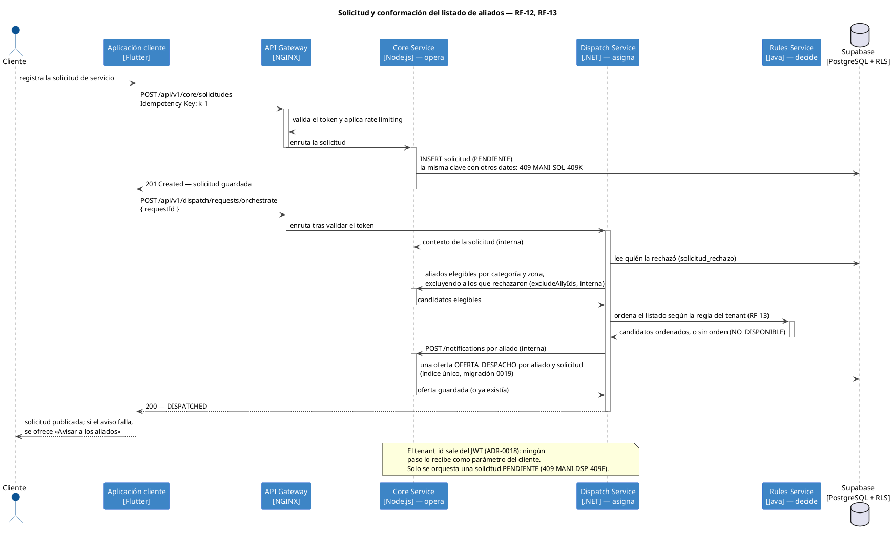

## 21.2 Aceptación concurrente — dos aliados compiten

Este es el flujo que hay que saber defender. La garantía **no** está en la aplicación ni en el número de réplicas: está en una actualización condicional atómica sobre el estado de la solicitud. **Dispatch decide quién acepta y Core escribe** (decisión 6A, SAD §7.4): Dispatch comprueba al aliado y le entrega a Core un comando idempotente; Core bloquea la fila y la primera aceptación gana. La segunda recibe `409 Conflict` sin saber quién ganó.

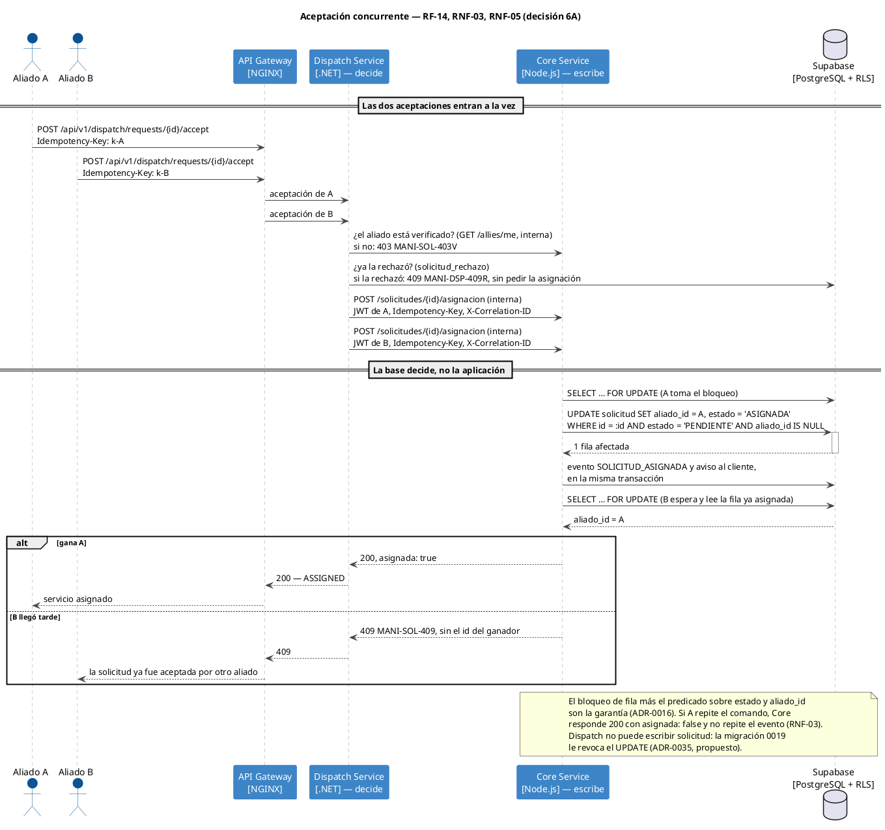

## 21.3 Cotización y validación contra el tarifario

Reparto de responsabilidades: **Core es dueño de la cotización, Reglas es dueño del tarifario.** La validación es una llamada entre servicios, no lógica duplicada en Core. La cotización fuera de rango **se guarda igual**: RF-16 pide alertar, no bloquear, y RF-23 después reporta esas cotizaciones.

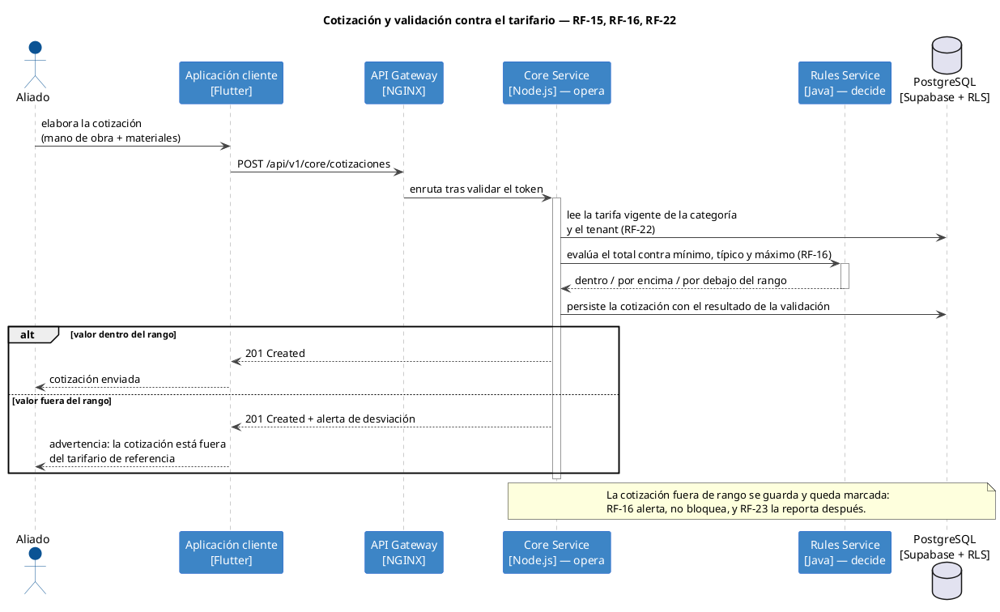

## 21.4 Carga y verificación de documentos KYC

Dos puntos a sostener: los documentos viven en un bucket privado bajo la convención `tenant_id/aliado_id/documento` (ADR-0013), y la aprobación es una **decisión humana del administrador del tenant**, no un efecto automático de la carga.

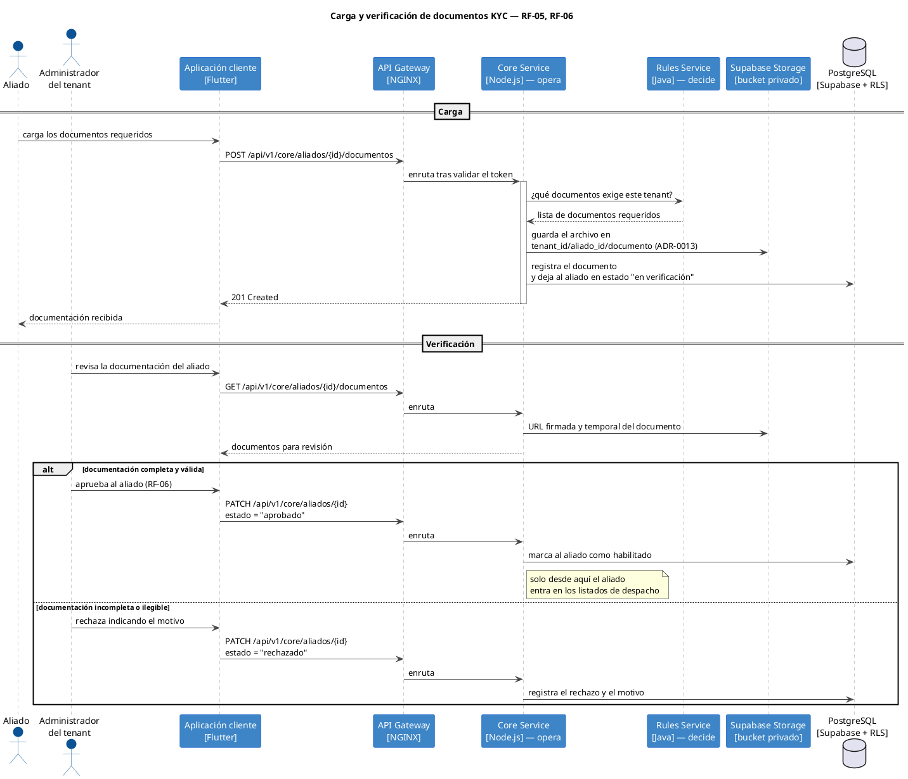

## 21.5 Mensajería del servicio con notificación de respaldo

El mensaje **se persiste antes de transportarse**: la conversación no vive en el canal de tiempo real. Realtime transporta, no decide; si el destinatario no está conectado, el mismo mensaje sale por push.

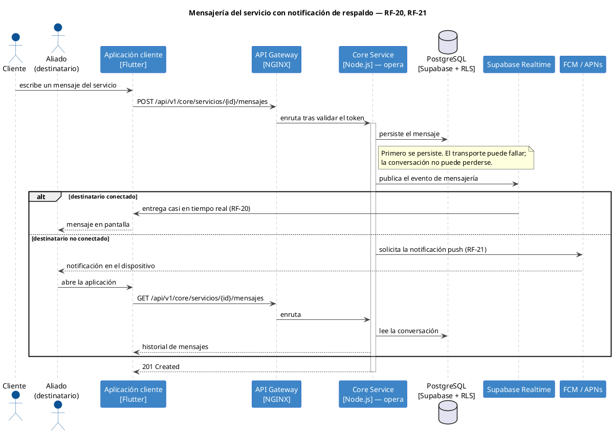

---

# 22. Kafka en DEV y QA

[ADR-0029](adr/ADR-0029-comunicacion-asincrona-kafka.md) adopta Apache Kafka como bus de integración asíncrona entre servicios. Este capítulo describe cómo se configura el broker en DEV y QA; los eventos que viajan por él están en el capítulo 20.

## 22.1 Criterios de configuración

- **Un solo broker Apache Kafka 3.8.0 oficial (`apache/kafka:3.8.0`) en modo KRaft.** Sin ZooKeeper: ahorra cerca de 500 MB de RAM por ambiente y reduce la complejidad operativa.
- **Confinado en la red Docker `mani-network`**, con listener interno `PLAINTEXT://kafka:9092`.
- **Sin auto-creación de tópicos** (`KAFKA_AUTO_CREATE_TOPICS_ENABLE: "false"`): un tópico no declarado es rechazado con `UNKNOWN_TOPIC_OR_PARTITION`.
- **Memoria acotada** (`-Xmx512M -Xms256M`) y retención de 24 horas o 1 GB.
- **Healthcheck nativo** de Docker y volumen persistente `kafka-data`.
- **Alcance de infraestructura:** el broker no cambia la lógica de productores ni de consumidores.

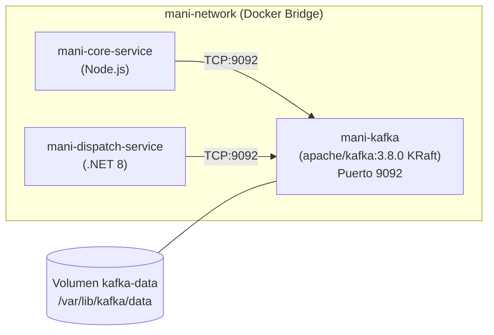

## 22.2 Definición en Docker Compose

Servicio `kafka` de `docker-compose.dev.yml` y `docker-compose.qa.yml`:

```yaml
  kafka:
    image: apache/kafka:3.8.0
    container_name: mani-kafka
    hostname: kafka
    restart: unless-stopped
    ports:
      - "9092:9092"
    environment:
      KAFKA_NODE_ID: 1
      KAFKA_PROCESS_ROLES: broker,controller
      KAFKA_LISTENERS: PLAINTEXT://:9092,CONTROLLER://:9093
      KAFKA_ADVERTISED_LISTENERS: PLAINTEXT://kafka:9092
      KAFKA_LISTENER_SECURITY_PROTOCOL_MAP: PLAINTEXT:PLAINTEXT,CONTROLLER:PLAINTEXT
      KAFKA_CONTROLLER_LISTENER_NAMES: CONTROLLER
      KAFKA_CONTROLLER_QUORUM_VOTERS: 1@kafka:9093
      KAFKA_OFFSETS_TOPIC_REPLICATION_FACTOR: 1
      KAFKA_TRANSACTION_STATE_LOG_REPLICATION_FACTOR: 1
      KAFKA_TRANSACTION_STATE_LOG_MIN_ISR: 1
      KAFKA_GROUP_INITIAL_REBALANCE_DELAY_MS: 0
      KAFKA_NUM_PARTITIONS: 1
      KAFKA_AUTO_CREATE_TOPICS_ENABLE: "false"
      KAFKA_HEAP_OPTS: "-Xmx512M -Xms256M"
      KAFKA_LOG_RETENTION_HOURS: 24
      KAFKA_LOG_RETENTION_BYTES: 1073741824
    healthcheck:
      test: ["CMD-SHELL", "/opt/kafka/bin/kafka-broker-api-versions.sh --bootstrap-server localhost:9092 > /dev/null 2>&1 || exit 1"]
      interval: 15s
      timeout: 10s
      retries: 5
      start_period: 20s
    volumes:
      - kafka-data:/var/lib/kafka/data
    networks:
      - mani-network

volumes:
  kafka-data:
    driver: local
```

## 22.3 Tópicos

Se aprovisionan con el script idempotente `crear_topicos_kafka.sh`. Los nombres siguen `mani.<dominio>.<evento>.vN` (§20.5).

| Tópico | Particiones | Réplicas | Productor único | Consumidores previstos |
| :--- | :---: | :---: | :--- | :--- |
| `mani.servicio.solicitud-creada.v1` | 1 | 1 | Core | Dispatch, Data Warehouse |
| `mani.servicio.aliado-asignado.v1` | 1 | 1 | Core (decisión 6A) | Data Warehouse |
| `mani.servicio.cotizacion-aceptada.v1` | 1 | 1 | Core | Dispatch, Data Warehouse |
| `mani.servicio.servicio-finalizado.v1` | 1 | 1 | Core | Core, Data Warehouse |
| `mani.infra.smoke-test.v1` | 1 | 1 | DevOps / QA | DevOps / QA |

El último es de diagnóstico: sirve para las pruebas de humo de publicar y consumir con el sobre `EventEnvelope v1` y para el monitoreo del ambiente.

## 22.4 Operación

- La conectividad Core → Kafka y Dispatch → Kafka se comprueba por socket TCP a `kafka:9092`.
- El script `verificar_monitoreo.sh` del ambiente QA reporta el contenedor `mani-kafka`, su estado de salud y el puerto 9092.
- Tras un reinicio del contenedor, el broker vuelve a `healthy` y conserva los mensajes del volumen `kafka-data`.

# 23. Módulo M-04: cotización y ejecución del servicio

M-04 cubre lo que pasa entre que un aliado queda asignado a una solicitud y el servicio termina: cotizar, responder la cotización, ejecutar, dejar bitácora y pedir adiciones por imprevistos. La asignación queda fuera: es de M-05 y la frontera está en [ADR-0035](adr/ADR-0035-frontera-de-asignacion-6a.md). También quedan fuera la calificación y el cierre (M-08).

## 23.1 Flujo

```text
Solicitud ASIGNADA (M-05)
  │
  ├─ Aliado: emite cotización v1 (mano de obra + materiales) ─────────► solicitud COTIZANDO
  │     Core calcula el total y la versión; el cliente recibe COTIZACION_RECIBIDA
  │
  ├─ Cliente responde la cotización PENDIENTE:
  │     acepta  ─────────────────────────────────────────────────────► solicitud ACEPTADA
  │     rechaza (con motivo) ────────────────────────────────────────► solicitud RECHAZADA
  │     pide ajuste (con comentario) ─► sigue COTIZANDO; el aliado emite v2, v3…
  │
  ├─ Aliado: marca inicio ───────────────────────────────────────────► solicitud EN_EJECUCION
  │     │
  │     ├─ Aliado: registra eventos (avance, novedad, observación, foto)
  │     ├─ Aliado: pide adición por imprevisto ─► cliente acepta o rechaza
  │     └─ Cliente: consulta el log y el total vigente
  │
  └─ Aliado: marca fin ──────────────────────────────────────────────► solicitud FINALIZADA
        Después siguen la calificación y el cierre (M-08)
```

Una categoría con flujo operativo `TARIFA_ESTANDAR` no pasa por cotización: el aliado puede marcar el inicio desde `ASIGNADA` (RF-22).

Core es el dueño del estado del servicio después de la asignación (decisión 6A, el SAD §7.4). Cada transición la hace Core en una transacción que bloquea la fila de la solicitud, registra el evento en `evento_servicio` y deja la notificación de la otra parte. La hora la pone el servidor de base de datos, nunca la app. La secuencia con Rules (validación contra el tarifario) está en §21.3.

## 23.2 Estados

### 23.2.1 Solicitud

| Desde | Acción | Quién | Hacia | Evento en `evento_servicio` |
|---|---|---|---|---|
| `ASIGNADA` o `COTIZANDO` | Emitir cotización | Aliado asignado | `COTIZANDO` | `COTIZACION_ENVIADA` |
| `COTIZANDO` | Aceptar la cotización | Cliente dueño | `ACEPTADA` | `COTIZACION_ACEPTADA` |
| `COTIZANDO` | Rechazar la cotización | Cliente dueño | `RECHAZADA` | `COTIZACION_RECHAZADA` |
| `COTIZANDO` | Pedir ajuste | Cliente dueño | `COTIZANDO` | `AJUSTE_SOLICITADO` |
| `ACEPTADA` (o `ASIGNADA` con `TARIFA_ESTANDAR`) | Marcar inicio | Aliado asignado | `EN_EJECUCION` | `INICIO_EJECUCION` |
| `EN_EJECUCION` | Marcar fin | Aliado asignado | `FINALIZADA` | `FIN_EJECUCION` |

Registrar eventos y pedir o decidir adiciones **no cambia** el estado de la solicitud.

### 23.2.2 Cotización

`PENDIENTE` → `ACEPTADA` | `RECHAZADA` | `AJUSTE_SOLICITADO`. Cada emisión crea una versión nueva (v1, v2…) y solo puede haber **una `PENDIENTE` a la vez**. Una versión respondida no cambia más: el historial de versiones queda visible para las dos partes.

### 23.2.3 Adición

`PENDIENTE` → `ACEPTADA` | `RECHAZADA`.

- Se pide solo con la solicitud `EN_EJECUCION` y una cotización aceptada.
- El cliente decide con la solicitud `EN_EJECUCION` o `FINALIZADA`.
- Solo una `PENDIENTE` a la vez.
- **Tope:** la suma de adiciones aceptadas no puede pasar del **50 %** del total de la cotización aceptada. El total vigente (cotización + adiciones aceptadas) lo calcula Core y es lo que cobra el pago.

### 23.2.4 Eventos del servicio

Tipos que registra el aliado: avance (`EJECUCION_AVANCE`), novedad (`EJECUCION_NOVEDAD`) y observación (`EJECUCION_OBSERVACION`), con foto opcional.

- Se registran con la solicitud `EN_EJECUCION`.
- Un evento tomado sin conexión (detalle en §24) trae su hora de captura (`ocurridoEn`). Entra aunque el servicio ya haya finalizado, siempre que esa hora esté entre el inicio y el fin de la ejecución. Se aceptan hasta 5 minutos de adelanto del reloj del teléfono.
- La clave de idempotencia evita duplicados al reintentar.
- El log que ve el cliente es la secuencia completa de `evento_servicio`, incluidas las transiciones de §23.2.1, ordenada por la hora de captura (o la de registro si no la hay).

## 23.3 Endpoints del Gateway

Todos entran por el Gateway con el prefijo `/api/v1/core` y llevan `Authorization: Bearer <JWT>` y `X-Correlation-ID`. El aliado, el cliente y el tenant salen del token, nunca del cuerpo. Detalle de cuerpos y respuestas en [`core.yaml`](https://github.com/Trama-AS/MANI-APIGateway/blob/develop/docs/openapi/core.yaml).

| Método y ruta | Quién | Éxito |
|---|---|---|
| `POST /solicitudes/{id}/cotizaciones` | Aliado asignado | 201 |
| `GET /solicitudes/{id}/cotizaciones` | Cliente dueño o aliado asignado | 200 |
| `POST /cotizaciones/{id}/aceptar` | Cliente dueño | 200 |
| `POST /cotizaciones/{id}/rechazar` | Cliente dueño (motivo ≥ 5 caracteres) | 200 |
| `POST /cotizaciones/{id}/ajustar` | Cliente dueño (comentario ≥ 3 caracteres) | 200 |
| `GET /cotizaciones/{id}/evaluacion-tarifa` | Cliente dueño o aliado asignado | 200 |
| `POST /solicitudes/{id}/iniciar` | Aliado asignado | 200 |
| `POST /solicitudes/{id}/finalizar` | Aliado asignado | 200 |
| `GET /solicitudes/{id}/ejecucion` | Cliente dueño o aliado asignado | 200 |
| `POST /solicitudes/{id}/eventos` | Aliado asignado | 201 (200 si la clave de idempotencia ya existía) |
| `GET /solicitudes/{id}/eventos` | Cliente dueño o aliado asignado | 200 |
| `GET /solicitudes/{id}/eventos/{eventoId}/evidencia` | Cliente dueño o aliado asignado | 200 (URL temporal de la foto) |
| `POST /solicitudes/{id}/adiciones` | Aliado asignado | 201 |
| `GET /solicitudes/{id}/adiciones` | Cliente dueño o aliado asignado | 200 (adiciones y total vigente) |
| `POST /adiciones/{id}/aceptar` | Cliente dueño | 200 |
| `POST /adiciones/{id}/rechazar` | Cliente dueño | 200 |

Límites que valida Core: observación del inicio o del fin, 500 caracteres; observación de un evento, 2000; texto de la respuesta a una cotización, 500; tiempo adicional de una adición, hasta 7 días.

## 23.4 Errores `MANI-*`

Prefijos: `COT` cotización, `EJE` ejecución, `EVT` eventos, `ADI` adiciones. En los cuatro, el número es el código HTTP y la letra final distingue el caso.

**Comunes a los cuatro prefijos:**

| Código | HTTP | Cuándo |
|---|---|---|
| `MANI-xxx-400` | 400 | Datos inválidos: id mal formado, importe o texto fuera de formato o de longitud |
| `MANI-xxx-401` | 401 | Sin sesión o con token inválido |
| `MANI-xxx-403` | 403 | El rol no puede hacer la operación |
| `MANI-xxx-404` | 404 | La solicitud, la cotización o la adición no existen **o son de otro tenant o de otro cliente**: no se distingue, para no revelar que existen |

Cualquier operación puede responder además 503 si una dependencia no está disponible, y 500 ante un error no controlado.

**Específicos:**

| Código | HTTP | Cuándo | Operación |
|---|---|---|---|
| `MANI-COT-403A` | 403 | Quien cotiza no es el aliado asignado | Emitir |
| `MANI-COT-403C` | 403 | Quien responde no es un cliente activo | Aceptar, rechazar, ajustar |
| `MANI-COT-409E` | 409 | La solicitud no está en un estado que admita la operación (emitir: `ASIGNADA` o `COTIZANDO`; responder: `COTIZANDO`) | Emitir, responder |
| `MANI-COT-409P` | 409 | Ya hay una cotización pendiente de respuesta | Emitir |
| `MANI-COT-409R` | 409 | La cotización ya fue respondida | Responder |
| `MANI-EJE-403A` | 403 | Quien marca no es el aliado asignado | Iniciar, finalizar |
| `MANI-EJE-409E` | 409 | No se puede iniciar: falta la cotización aceptada | Iniciar |
| `MANI-EJE-409I` | 409 | La ejecución ya fue iniciada | Iniciar |
| `MANI-EJE-409F` | 409 | El servicio ya fue finalizado | Iniciar, finalizar |
| `MANI-EJE-409N` | 409 | No se puede finalizar un servicio que no ha iniciado | Finalizar |
| `MANI-EVT-400F` | 400 | La hora de captura está en el futuro (más de 5 min) | Registrar evento |
| `MANI-EVT-403A` | 403 | Quien registra no es el aliado asignado | Registrar evento |
| `MANI-EVT-409E` | 409 | La solicitud no está en ejecución | Registrar evento |
| `MANI-EVT-409T` | 409 | La hora de captura cae antes del inicio o después del fin | Registrar evento sin conexión |
| `MANI-EVT-404E` | 404 | El evento no tiene foto | Evidencia |
| `MANI-ADI-400T` | 400 | La adición supera el tope del 50 % | Pedir, aceptar |
| `MANI-ADI-403A` | 403 | Quien pide no es el aliado asignado | Pedir |
| `MANI-ADI-403C` | 403 | Quien decide no es un cliente activo | Aceptar, rechazar |
| `MANI-ADI-409C` | 409 | No hay cotización aceptada sobre la cual pedir | Pedir |
| `MANI-ADI-409E` | 409 | La solicitud no admite la operación (pedir: `EN_EJECUCION`; decidir: `EN_EJECUCION` o `FINALIZADA`) | Pedir, aceptar, rechazar |
| `MANI-ADI-409P` | 409 | Ya hay una adición pendiente de decisión | Pedir |
| `MANI-ADI-409R` | 409 | La adición ya fue decidida | Aceptar, rechazar |

La app muestra el texto que envía Core, sin el código.

## 23.5 Front (Flutter)

Una sola **pantalla del servicio**, `/cliente/solicitudes/:id/cotizacion` y `/aliado/solicitudes/:id/cotizacion`, armada en `_pantallaServicio` de `lib/core/routing/app_router.dart`. Cada parte tiene su cubit y consulta a Core por su lado:

| Parte | Código |
|---|---|
| Cotización y respuesta | `lib/features/services/quotes/` (`CotizacionPage`, `CotizacionCubit`) |
| Alerta de tarifa | `AlertaTarifaCotizacion`, bajo la cotización vigente |
| Inicio y fin | `lib/features/services/execution/` (`EjecucionSeccion`, `EjecucionCubit`) |
| Bitácora y eventos | `lib/features/services/events/` (`EventosSeccion`, `EventosCubit`, cola sin conexión solo en móvil) |
| Adiciones | `lib/features/services/additions/` (`AdicionesSeccion`, `AdicionesCubit`) |

El botón «Pagar» del cliente cobra el total vigente que calcula Core.

# 24. Cola de eventos sin conexión del aliado

## 24.1 Para qué existe

Durante la ejecución, el aliado registra eventos (avance, novedad, observación, foto) en sitios donde a menudo no hay señal. Sin la cola, ese evento se perdía y había que volver a tomarlo. Con la cola, el evento queda guardado en el teléfono **con la hora en que se tomó** y se envía a Core cuando vuelve la conexión. Esa hora de captura es la oficial: la decisión es de la PO.

**Solo en el móvil.** En la web no hay modo sin conexión: el almacén web está siempre «no disponible» y, sin red, el evento falla con su mensaje de error como cualquier otra acción.

## 24.2 Cómo funciona

```text
Aliado registra un evento ──► POST /solicitudes/{id}/eventos (con clave de idempotencia)
        │
        ├─ Core responde ──────────────► evento registrado (fin)
        ├─ Core rechaza (4xx) ─────────► se muestra el motivo; no se encola
        └─ falla por falta de red ─────► se encola con:
                                          clave del intento, usuario, solicitud, tipo,
                                          observación, foto y hora de captura (UTC)
                                          ▼
                              «N eventos pendientes de enviar» sobre la bitácora,
                              cada uno como «Pendiente de enviar» con su hora
```

Solo se encola cuando el envío falla por **falta de conexión**. Cualquier otra falla (permiso, datos inválidos, solicitud fuera de ejecución) se muestra enseguida y el evento no se guarda.

**Dónde se guarda.** En archivos privados de la app, en la carpeta `cola_eventos` del directorio de soporte de la aplicación. Hay un índice `cola.json` con los datos de cada evento y una foto por evento en un archivo aparte (`<clave>.foto`). Cada escritura reemplaza el índice con un archivo temporal y un `rename`, así que un cierre a mitad de camino no lo corrompe. Una fila incompleta, o cuya foto falta, se descarta: es mejor no enviarla que enviar un evento distinto al que tomó el aliado.

**De quién es.** La cola es del usuario de la sesión. Solo se envían y se muestran los eventos de ese usuario, y la cola entera se vacía cuando la sesión se cierra (`AuthChangeEvent.signedOut`).

## 24.3 Cómo se reintenta

La pantalla del servicio intenta enviar la cola en tres momentos:

1. **Al abrirla.** Después de cargar la bitácora.
2. **Cada 30 s** mientras queden pendientes de esa solicitud. El temporizador se apaga solo cuando no queda nada.
3. **Cuando el aliado lo pide**, con el botón de enviar pendientes que aparece junto al contador.

En cada ronda:

- Se envían **todos** los pendientes del usuario, de cualquier solicitud y **en el orden en que se registraron**. Cada uno lleva su clave de idempotencia y su hora de captura (`ocurridoEn`).
- Si un envío falla por algo **pasajero** (sin conexión, servicio no disponible, 5xx, sesión vencida o una respuesta que la app no reconoce), el evento **se queda** en la cola y la ronda se corta. El siguiente intento empieza por él, así que se conserva el orden.
- Si Core lo **rechaza** de forma definitiva (400, 403, 404 o 409), el evento **sale** de la cola y el aliado ve el motivo.
- Nunca se marca un evento como enviado sin respuesta de Core.
- Hay una sola ronda a la vez: si ya hay una en curso, la nueva espera esa.
- Si algo se envió, la bitácora se vuelve a leer y el aliado ve «Se envió 1 evento que estaba pendiente» o «Se enviaron N eventos…».

**Sin duplicados.** El evento encolado conserva la clave del intento original. Si ese intento sí había llegado a Core y solo se perdió la respuesta, Core encuentra la clave y devuelve el evento que ya tenía: **200** en lugar de 201, sin crear otro. Core revisa la clave **antes** que el estado de la solicitud, así que esto funciona aunque el servicio haya finalizado mientras el teléfono estaba sin señal.

## 24.4 Qué valida Core al recibirlo

La hora de captura queda en la columna `evento_servicio.ocurrido_en` (migración `0026`). La hora del servidor (`timestamp`) se sigue guardando aparte para auditoría. La bitácora se ordena por `ocurrido_en` y, en los eventos que no la tienen, por `timestamp`.

| Regla | Si no se cumple |
|---|---|
| La solicitud está `EN_EJECUCION`, o `FINALIZADA` si la hora de captura cae dentro de la ejecución | `409 MANI-EVT-409E` |
| La hora de captura no está más de **5 minutos** en el futuro (margen para el reloj del teléfono) | `400 MANI-EVT-400F` |
| La hora de captura está **entre el inicio y el fin** de la ejecución | `409 MANI-EVT-409T` |
| Quien envía es el aliado asignado | `403 MANI-EVT-403A` |

Gracias a esa ventana, un evento tomado sin señal entra **aunque el servicio ya haya finalizado** cuando el teléfono recupera la conexión, siempre que se haya tomado mientras el servicio estaba en ejecución. Un servicio cancelado nunca acepta eventos.

## 24.5 Límites

| Límite | Valor | Qué ve el aliado |
|---|---|---|
| Eventos en cola | **20** | Al intentar el 21: «Tienes 20 eventos o 50 MB pendientes de enviar. Conéctate para enviarlos antes de registrar más.» El evento no se guarda |
| Tamaño de la cola | **50 MB**, sumando fotos y observaciones | El mismo mensaje |
| Plataforma | Solo móvil | En la web el evento falla sin red, como cualquier otra acción |
| Observación | 2000 caracteres (lo valida Core) | Error de datos inválidos al enviar |

Límites de comportamiento que conviene conocer:

- **Solo se envía con una pantalla de servicio abierta.** No hay envío en segundo plano: si el aliado recupera la señal pero no abre ninguna pantalla de servicio, los eventos siguen en el teléfono. Al abrir cualquier servicio se envían los de todas las solicitudes.
- **Cerrar sesión borra la cola.** Los pendientes de ese usuario se pierden, y la app no avisa antes.
- **Un solo motivo por ronda.** Si Core rechaza varios eventos en la misma ronda, todos salen de la cola pero el aviso muestra el motivo del primero.
- **La hora de captura es la del reloj del teléfono**, convertida a UTC. Core la acepta con hasta 5 minutos de adelanto y la rechaza si queda fuera de la ejecución.

# 25. Alerta de tarifa y proveedores externos

## 25.1 Alerta de tarifa

### 25.1.1 Qué hace

Cuando hay una cotización, el cliente y el aliado ven bajo la versión vigente si su total está **dentro del rango de referencia** del tarifario o **por debajo o por encima** de él. Es un aviso, no un bloqueo: la cotización se puede aceptar igual.

- **Contra qué tarifa.** La que regía cuando se emitió la cotización, no la de hoy. Core guarda esa versión al emitir, y es la misma que usa el reporte de cotizaciones fuera de rango ().
- **Quién decide si está en rango.** Rules (`POST /api/v1/rules/rates/evaluate`). Core no calcula el resultado: le pasa a Rules el total y los valores mínimo, típico y máximo de la tarifa, y devuelve su respuesta.
- **Tolerancia.** Rules marca `POR_DEBAJO` o `POR_ENCIMA` solo si el total sale del rango ampliado por `mani.rules.rates.tolerance-percent`, que hoy vale **0 %** (`application.properties` de MANI-Java). La desviación se mide siempre contra el mínimo o el máximo de la tarifa, sin la tolerancia: (total − máximo) / máximo, o (mínimo − total) / mínimo, en porcentaje con dos decimales.
- **Solo lee.** Nunca modifica la cotización ni su total.
- **Quién la ve.** El cliente dueño, el aliado asignado y el administrador del tenant. Para cualquier otro la cotización no existe (404).

### 25.1.2 Endpoint

`GET /api/v1/core/cotizaciones/{id}/evaluacion-tarifa`, por el Gateway, con `Authorization: Bearer <JWT>` y `X-Correlation-ID`. `{id}` es el UUID de la cotización.

| Campo de la respuesta | Qué es |
|---|---|
| `cotizacionId`, `solicitudId`, `version` | La cotización evaluada y su versión |
| `total` | Mano de obra + materiales, sin modificar |
| `resultado` | `DENTRO_DE_RANGO`, `POR_DEBAJO`, `POR_ENCIMA` o `SIN_TARIFA` |
| `alerta` | `true` solo con `POR_DEBAJO` o `POR_ENCIMA` |
| `desviacionPorcentaje` | Cuánto se sale del límite que cruzó, en porcentaje; `0` dentro de banda; `null` sin tarifa |
| `tarifa` | `id`, `version`, `valorMin`, `valorTipico`, `valorMax` y `moneda` de la tarifa usada; `null` sin tarifa |
| `reglasVersion` | Versión de las reglas de Rules que evaluaron (p. ej. `rates-v1`); `null` sin tarifa |
| `correlationId` | El de la petición, para rastrearla |

La respuesta va con `Cache-Control: no-store`.

### 25.1.3 Ejemplos

Los identificadores y los importes son ilustrativos.

**Petición**

```http
GET /api/v1/core/cotizaciones/5b0e2c1a-7f3d-4c9e-9a51-2d8b6f4e1c07/evaluacion-tarifa HTTP/1.1
Authorization: Bearer <JWT del cliente o del aliado>
X-Correlation-ID: 9f6d3a2e-1b4c-4e8f-a7d0-3c5b2e9f8a14
```

**Respuesta 200: por encima del rango** (tarifa de 80 000 a 120 000; total 150 000, un 25 % sobre el máximo)

```json
{
  "cotizacionId": "5b0e2c1a-7f3d-4c9e-9a51-2d8b6f4e1c07",
  "solicitudId": "c2a7e9d4-3f1b-4a6c-8e0d-7b5f9a2c4e18",
  "version": 2,
  "total": 150000,
  "resultado": "POR_ENCIMA",
  "alerta": true,
  "desviacionPorcentaje": 25,
  "tarifa": {
    "id": "e4d1b7c9-2a6f-4e3b-9c8d-1f5a7b3e9d20",
    "version": 3,
    "valorMin": 80000,
    "valorTipico": 100000,
    "valorMax": 120000,
    "moneda": "COP"
  },
  "reglasVersion": "rates-v1",
  "correlationId": "9f6d3a2e-1b4c-4e8f-a7d0-3c5b2e9f8a14"
}
```

**Respuesta 200: `SIN_TARIFA`**

```json
{
  "cotizacionId": "5b0e2c1a-7f3d-4c9e-9a51-2d8b6f4e1c07",
  "solicitudId": "c2a7e9d4-3f1b-4a6c-8e0d-7b5f9a2c4e18",
  "version": 1,
  "total": 95000,
  "resultado": "SIN_TARIFA",
  "alerta": false,
  "desviacionPorcentaje": null,
  "tarifa": null,
  "reglasVersion": null,
  "correlationId": "9f6d3a2e-1b4c-4e8f-a7d0-3c5b2e9f8a14"
}
```

### 25.1.4 El caso `SIN_TARIFA`

Sale cuando la categoría **no tenía una tarifa vigente** en el momento en que se emitió la cotización. Entonces:

- Core responde **200** con `resultado: SIN_TARIFA`, `alerta: false` y `tarifa`, `desviacionPorcentaje` y `reglasVersion` en `null`.
- **No llama a Rules**: no hay contra qué evaluar. Por eso este caso sigue funcionando aunque Rules esté caído.
- No es un error ni una alerta. La app muestra «Sin tarifa de referencia para comparar» y explica que la categoría no tenía una tarifa vigente cuando se emitió la cotización.
- Publicar después una tarifa no cambia el resultado de esa cotización, porque se evalúa contra la que regía al emitirla. Una versión nueva de la cotización sí se evalúa con la tarifa vigente al emitirla.

### 25.1.5 Errores

| HTTP | Código | Cuándo |
|---|---|---|
| 400 | `MANI-TAR-400` | El id no es un UUID |
| 401 | — | Sin token, token inválido o expirado |
| 403 | `MANI-TAR-403` | El rol no consulta la evaluación de cotizaciones |
| 404 | `MANI-TAR-404Q` | La cotización no existe o la sesión no la puede ver |
| 502 | `RULES_SERVICE_ERROR` | Rules respondió fuera de contrato |
| 503 | `RULES_SERVICE_UNAVAILABLE` o `MANI-SRV-503` | Rules o la base de datos no están disponibles. Core **no** calcula un resultado propio para reemplazar el de Rules (criterio transversal T2) |

Ante un error, la app muestra «No se pudo comparar la cotización con la tarifa de referencia», sin bloquear la cotización.

### 25.1.6 En la app

`AlertaTarifaCotizacion` (`lib/features/tariffs/presentation/alerta_tarifa_cotizacion.dart`) va bajo la cotización vigente de la pantalla del servicio, para el cliente y para el aliado. Dentro de banda dice «Dentro del rango de referencia» con el rango. Fuera de banda muestra el motivo, por ejemplo «El total ($ 150.000,00) supera el máximo de referencia ($ 120.000,00) en 25 %», y un consejo distinto para cada lado:

- **Aliado:** «El cliente también ve este aviso. Si te pide un ajuste, puedes enviar una nueva versión.»
- **Cliente:** «El aliado también ve este aviso. Puedes aceptarla, pedir un ajuste o rechazarla.»

## 25.2 Contratos con proveedores externos

La decisión completa está en [ADR-0034](adr/ADR-0034-contrato-comun-proveedores-externos.md) y su implementación de referencia en `docs/arquitectura/PROVEEDORES_EXTERNOS.md` de MANI-Node. Resumen:

- **Qué cubre.** Los puertos de los proveedores de **pagos** (`IPaymentProvider`) y de **notificaciones push** (`IPushProvider`) del Core. Hoy los dos son simulados. La llamada de Core a Rules de §25.1 es entre servicios internos y no es parte de este contrato.
- **Contrato de cada adaptador.** Declara `name` y `simulated`, recibe `idempotencyKey`, `correlationId` y una señal de cancelación, nunca devuelve un éxito falso y nunca presenta como real algo simulado.
- **Error común `ProviderError`** con tres causas: `TIMEOUT`, `UNAVAILABLE` (las dos son pasajeras) e `INVALID_RESPONSE`. Un pago rechazado no es un error, sino un desenlace válido.
- **Política única de llamada (`callProvider`).** Tiempo máximo obligatorio por proveedor. Reintento exponencial solo de fallos pasajeros y solo en operaciones idempotentes. `INVALID_RESPONSE` nunca se reintenta.
- **Pagos.** Core no reintenta un cobro: lo reintenta el cliente con su `claveIdempotencia`. **Push:** hasta dos reintentos, con el id de la notificación como clave.
- **Credenciales** de los proveedores reales solo por variables de ambiente, nunca en logs, respuestas ni en el repositorio.
- **Pruebas de contrato obligatorias.** Todo adaptador registrado pasa las mismas pruebas, así que agregar el proveedor real lo somete a ellas sin escribir pruebas nuevas.

# 26. Menú, rutas y guardas por rol (Flutter)

## 26.1 La regla que no hay que olvidar

**El menú y las guardas solo deciden qué pinta la app. No son la autorización.** La autorización la aplican el Gateway y los servicios con el token verificado: Core y Dispatch responden 403 a un rol que no corresponde, aunque alguien fuerce la ruta en el navegador. Por eso la app lee el rol del token sin verificar la firma: ese dato solo decide qué se muestra.

## 26.2 De dónde sale el rol

La app decodifica el *access token* de la sesión y lee `app_metadata.user_role` (o `app_metadata.rol`). No lee `user_metadata`, porque el propio usuario puede editarlo.

| Valor del claim | Rol en la app | Etiqueta en la cabecera |
|---|---|---|
| `cliente`, `client` | `cliente` | Cliente |
| `aliado`, `ally` | `aliado` | Aliado |
| `admin_tenant`, `admin` | `adminTenant` | Administrador |
| `admin_plataforma`, `platform_admin` | `adminPlataforma` | Administración de plataforma |
| Cualquier otro, ausente o token mal formado | `desconocido` | Sin rol |

La comparación no distingue mayúsculas. Un rol que no se reconoce cae en `desconocido` y no abre ninguna pantalla de negocio.

## 26.3 Tabla por rol: menú, rutas e inicio

**La pantalla de inicio es `/inicio` para todos los roles**. Es la primera entrada del menú, y a ella llega quien entra con sesión a `/login` o a una ruta que no es de su rol. Lo que cambia por rol es su contenido (§5).

| Rol | Menú superior, en orden | Prefijos de ruta que puede abrir | Inicio |
|---|---|---|---|
| **Cliente** | Inicio · Nueva solicitud · Mis solicitudes · Historial · Mis sedes · Mis quejas · Avisos · Mi perfil | `/inicio`, `/cliente/`, `/catalogo/`, `/sitios/`, `/perfil/` | `/inicio` |
| **Aliado** | Inicio · Solicitudes · Historial · Cobertura · Categorías · Mis cobros · Disponibilidad · Avisos · Mi perfil | `/inicio`, `/aliado/`, `/categories`, `/catalogo/`, `/sitios/`, `/perfil/` | `/inicio` |
| **Administrador del tenant** | Inicio · Verificación de aliados · Categorías · Cancelaciones · Tarifario · Fuera de rango · Empleados · Auditoría · Conversaciones · Reglas · Quejas · Métricas · Mapa de zonas · Avisos · Mi perfil | `/inicio`, `/admin/`, `/catalogo/`, `/sitios/`, `/perfil/` | `/inicio` |
| **Administrador de plataforma** | Inicio · Tenants · las entradas del rol con el que actúa (§4) · Avisos · Mi perfil | Todos: `/inicio`, `/plataforma/`, `/admin/`, `/cliente/`, `/aliado/`, `/categories`, `/catalogo/`, `/sitios/`, `/perfil/` | `/inicio` |
| **Sin rol** | Inicio · Mi perfil | `/inicio`, `/catalogo/`, `/perfil/` | `/inicio`, con el aviso «Tu cuenta no tiene un rol asignado» |

Dos diferencias entre el menú y las guardas, que son intencionales:

- **«Mapa de zonas» (`/catalogo/mapa`) solo aparece en el menú del administrador**, pero la guarda la abre a todos los roles. El cliente y el aliado llegan a ella desde sus propias pantallas.
- **`/sitios/:id/reglas` no está en ningún menú.** Se abre desde las sedes del cliente o desde la solicitud del aliado.

En pantallas angostas el menú pasa a un botón compacto con las mismas entradas y «Cerrar sesión».

## 26.4 Administrador de plataforma: «Actuar como»

El administrador de plataforma elige un tenant y, si quiere, un usuario de ese tenant con el que actuar.

- Sin usuario elegido, su menú suma las entradas del **administrador del tenant**.
- Si actúa como un cliente o un aliado, suma las entradas de ese rol. El inicio muestra el resumen y los accesos de ese mismo rol.
- La app manda el contexto en las cabeceras `X-Mani-Tenant` y `X-Mani-Actuar-Como` solo cuando la sesión es de administrador de plataforma. Core rechaza con 403 `MANI-PLA-403` a cualquier otro rol que las envíe.
- El contexto se borra al iniciar o cerrar sesión.

## 26.5 Qué muestra el inicio de cada rol

El inicio saluda con el nombre de la sesión, muestra un resumen y repite como tarjetas las entradas del menú del rol (menos «Inicio»).

| Rol | Indicadores del resumen | De dónde salen |
|---|---|---|
| Cliente | Sedes registradas | `GET /api/v1/core/solicitudes/sitios` |
| Aliado | Categorías que atiendo · Estado ahora · Ausencias programadas | `GET /api/v1/core/profiles/me/categories` y `/profiles/me/unavailability` |
| Administrador del tenant | Aliados por verificar · Categorías del catálogo | `GET /api/v1/core/aliados/verificacion` y `/catalog/categories` |
| Administrador de plataforma | Los del rol con el que actúa | Los de ese rol |
| Sin rol | Ninguno; solo el aviso | No aplica |

## 26.6 Cómo decide la guarda

El router llama a `resolverRedireccion` en cada navegación y cada vez que cambia el estado de autenticación:

```text
¿La ruta es pública?
 ├─ Sí ─► ¿hay sesión y la ruta es /login? ─► sí: va a /inicio · no: sigue
 └─ No ─► ¿hay sesión?
           ├─ No ─► /login
           └─ Sí ─► ¿el rol puede abrir el prefijo de la ruta?
                     ├─ Sí ─► sigue
                     └─ No ─► /inicio
```

- **Rutas públicas:** `/login`, `/register-cliente`, `/register-aliado`, `/register-empresa`, `/register-cliente-empresa`, `/forgot-password`, `/reset-password`, y las redirecciones de compatibilidad `/register`, `/registro` y `/registro-*`.
- **`/`** redirige a `/login`.
- **Gana el primer prefijo que coincide** en la tabla de `guardas_ruta.dart`.
- **Una ruta con sesión que no figura en la tabla se niega.** Así una pantalla nueva no queda abierta a todos los roles por olvido.

### 26.6.1 Al añadir una pantalla

1. Declarar la ruta en `app_router.dart`, dentro del `ShellRoute`.
2. Si usa un prefijo nuevo, añadirlo a `_rolesPorPrefijo` en `guardas_ruta.dart`. Sin eso, la guarda la niega a todos.
3. Si debe salir en el menú, añadir la entrada en `menu_por_rol.dart`. Solo se listan rutas que ya existen en el router.
4. Actualizar las pruebas del menú y de las guardas.

---

# 27. Criterio de aceptación arquitectónica

Una versión puede promoverse a producción únicamente si:

1. cumple los Quality Gates de seguridad y mantenibilidad;
2. contract tests e integración están en verde;
3. no introduce accesos cruzados de datos no autorizados;
4. mantiene los umbrales P1 definidos en este SDD;
5. las migraciones tienen estrategia de compatibilidad y rollback;
6. existe telemetría para las operaciones críticas;
7. el artefacto desplegado es el mismo que fue validado en los ambientes previos.

---

# 28. Referencias

- ISO/IEC 25010:2023, *Systems and software engineering — Systems and software Quality Requirements and Evaluation (SQuaRE) — Product quality model*.
- C4 Model, vistas de contexto, contenedores, componentes y código. Modelo del proyecto en [`workspace.dsl`](diagrams/c4/workspace.dsl).
- OpenAPI para contratos HTTP.
- OWASP para controles de seguridad de aplicaciones y APIs.
