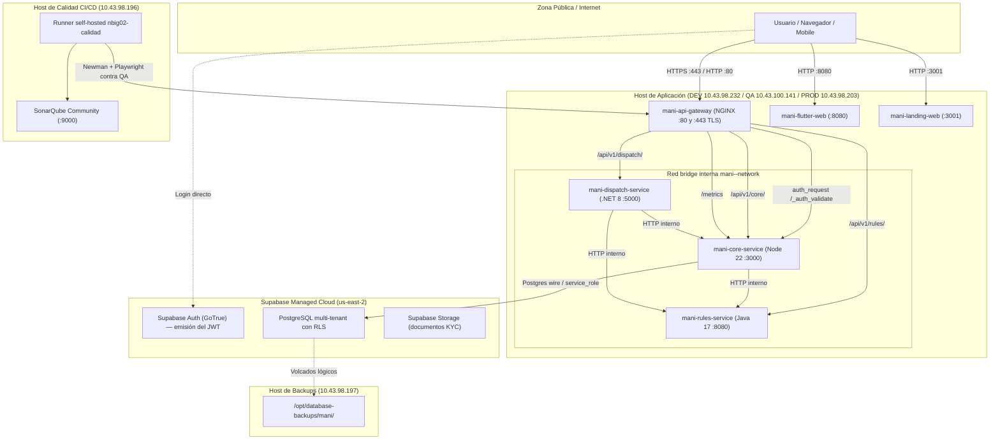
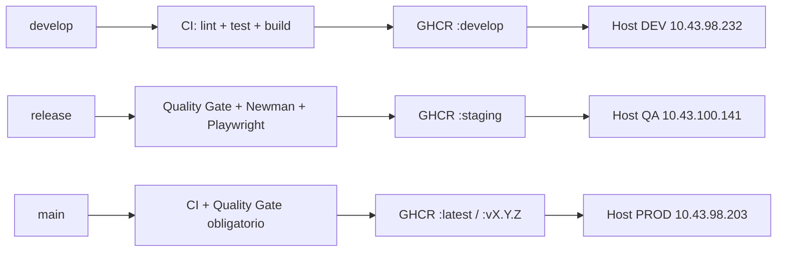

# TRAMA · MANI — Documento de Infraestructura V4
## Vista Física: Topología Operativa, Seguridad, Persistencia, Observabilidad y Guía de Despliegue (DEV, QA, PROD, CI/CD y Backups)

| Metadato | Valor |
| :--- | :--- |
| **Proyecto** | MANI — Plataforma SaaS Multi-Tenant de Formalización de Operaciones de Servicio |
| **Organización** | TRAMA · Ingeniería de Software |
| **Documento** | Documento de Infraestructura V4 (Vista Física del modelo 4+1) |
| **Versión** | 4.0 — Entrega 5 (Sprint 5, último sprint) |
| **Fecha** | 5 de noviembre de 2026 |
| **Estado** | Borrador para revisión: lo verificado contra el código está marcado; lo que exige acceso a las VMs y a Supabase queda como **pendiente de verificación** |
| **Responsables** | Daniel Ávila (DevOps Lead), Nicolás León (DevOps Secundario), Santiago Hernández (QA & Security), Sara Albarracín (Scrum Master) |
| **Base** | [Documento de Infraestructura V3](DOCUMENTO_INFRAESTRUCTURA_V3.md) (Sprint 4, 17-oct-2026) |

---

## Control de Versiones

| Versión | Fecha | Descripción del Cambio | Responsable | Estado |
| :---: | :---: | :--- | :---: | :---: |
| 1.0 | 2026-09-23 | Versión inicial de Entrega 2. Topología teórica preliminar y propuesta de segregación. | Daniel Ávila | Superada |
| 2.0 | 2026-10-07 | Transición arquitectónica (Sprint 3): multi-repo y Gateway NGINX. | Daniel Ávila | Superada |
| 3.0 | 2026-10-17 | Consolidación operativa del Sprint 4: 5 VMs, consolidación Supabase, perímetro JWT, cadena de calidad y runbook. | Daniel Ávila | Superada |
| **4.0** | **2026-11-05** | **Versión del Sprint 5 reconciliada contra los repositorios.** Corrige el inventario de migraciones (serie real `0001`–`0033` en `MANI-Node/db/migrations`, no las 8 de la serie anterior), corrige versiones de runtime, incorpora TLS en el borde ([SCRUM-1456](https://maniservices.atlassian.net/browse/SCRUM-1456), SCRUM-1458), añade la sección de observabilidad (`/metrics` y alertas de autenticación, TEC-14 / hallazgo R-4), documenta los workflows de CI/CD tal como existen por repositorio, registra el estado real de promoción por rama y abre la sección de brechas (Kubernetes y Kafka no implementados). Retira las contraseñas en claro de las VMs. | **Daniel Ávila** | **Vigente** |

---

## Índice

1. [Propósito y Alcance](#1-propósito-y-alcance)
2. [Principios de Infraestructura y Vista Física](#2-principios-de-infraestructura-y-vista-física)
3. [Topología Operativa: Inventario de Máquinas Virtuales](#3-topología-operativa-inventario-de-máquinas-virtuales)
4. [Diagrama de Despliegue Físico](#4-diagrama-de-despliegue-físico)
5. [Perímetro de Seguridad: TLS, NGINX Gateway y Autenticación JWT](#5-perímetro-de-seguridad-tls-nginx-gateway-y-autenticación-jwt)
6. [Persistencia PostgreSQL / Supabase y Serie de Migraciones](#6-persistencia-postgresql--supabase-y-serie-de-migraciones)
7. [Observabilidad: Métricas y Alertas de Autenticación](#7-observabilidad-métricas-y-alertas-de-autenticación)
8. [Cadena de Calidad Automatizada: SonarQube, Newman y Playwright](#8-cadena-de-calidad-automatizada-sonarqube-newman-y-playwright)
9. [Pipeline CI/CD, Workflows Reales y Estado de Promoción](#9-pipeline-cicd-workflows-reales-y-estado-de-promoción)
10. [Guía Operativa de Despliegue, Arranque y Recuperación (Runbook)](#10-guía-operativa-de-despliegue-arranque-y-recuperación-runbook)
11. [Custodia de Respaldos y Plan de Rollback](#11-custodia-de-respaldos-y-plan-de-rollback)
12. [Brechas entre lo Documentado y lo Implementado](#12-brechas-entre-lo-documentado-y-lo-implementado)
13. [Checklist Operativo para Paso a Producción](#13-checklist-operativo-para-paso-a-producción)
14. [Trazabilidad y Criterios de Cierre](#14-trazabilidad-y-criterios-de-cierre)

---

## 1. Propósito y Alcance

Este documento es la **Vista Física del modelo 4+1** de MANI al cierre del Sprint 5. Documenta dónde y cómo se ejecutan los contenedores, cómo se sostiene el aislamiento multi-tenant en reposo y en tránsito, cómo se vigila el sistema, cómo se promueve el software y cómo se recupera ante contingencia.

**Diferencia de método con la V3.** La V3 describió la topología objetivo y la dio por verificada. Esta versión separa dos cosas:

- **Verificado contra los repositorios** (Dockerfiles, `nginx.conf`, workflows de GitHub Actions, migraciones, manifiestos de alertas y ramas publicadas), con la evidencia citada por ruta.
- **Pendiente de verificación**, lo que exige sesión en las VMs (`10.43.x.x`) o acceso a los proyectos Supabase. No se afirma como cumplido.

**Fuera de alcance:** lógica de casos de uso (SDD), contratos OpenAPI (`MANI-APIGateway`) y modelo de datos (ModeloDatos.md).

---

## 2. Principios de Infraestructura y Vista Física

1. **Segregación estricta de ambientes.** Tres ambientes de aplicación (**DEV → QA → PROD**) sobre VMs aisladas, más dos VMs de soporte (**Calidad CI/CD** y **Bases de Datos & Backups**).
2. **Inmutabilidad de artefactos OCI.** La imagen se construye una vez por commit en GitHub Actions, se publica en GHCR y se promueve por tag; a producción se promueve la imagen ya verificada, no una reconstrucción.
3. **Ejecución por Docker Compose sobre VM.** Kubernetes es el objetivo arquitectónico ([ADR-0004](../02-arquitectura/adr/ADR-0004-cicd-multirepo-ambientes.md), PROY-08) pero **no está implementado**: no existe ningún manifiesto de Kubernetes ni chart de Helm en los seis repositorios. Ver §12.
4. **Persistencia administrada con RLS** ([ADR-0012](../02-arquitectura/adr/ADR-0012-persistencia-multitenant.md)): una base PostgreSQL por ambiente en Supabase, con aislamiento impuesto por el motor.
5. **Propiedad del esquema en Core Node** ([ADR-0030](../02-arquitectura/adr/ADR-0030-propiedad-esquema-y-frontera-de-datos.md)): `MANI-Node` gobierna la serie de migraciones; ningún servicio consulta tablas de otro por SQL.
6. **Perímetro fail-closed** ([ADR-0031](../02-arquitectura/adr/ADR-0031-politica-configuracion-jwt-ambientes.md)): NGINX valida el token contra Core antes de enrutar e inyecta encabezados de confianza.
7. **Secretos fuera de la imagen y fuera del repositorio de documentación.** Las credenciales viven en GitHub Environments y en el gestor del equipo. Este documento ya no las transcribe (cambio respecto de la V3, §3).
8. **Observabilidad mínima obligatoria** (TEC-14): cada servicio del perímetro expone `/metrics` y el repositorio versiona las reglas de alerta.

---

## 3. Topología Operativa: Inventario de Máquinas Virtuales

Cinco VMs dedicadas sobre Ubuntu 22.04 LTS:

| Host / VM | Dirección IP | Propósito Operativo | Rama Git / Tag OCI | Puertos Expuestos |
|---|---|---|---|---|
| **Host DEV** | `10.43.98.232` | Desarrollo integrado | `develop` / `:develop` | `80`, `443`, `3001` (Landing), `8080` (Web) |
| **Host QA** | `10.43.100.141` | Staging / certificación QA | `release` / `:staging` | `80`, `443`, `3001`, `8080` |
| **Host PROD** | `10.43.98.203` | Producción MVP | `main` / `:latest` | `80`, `443`, `3001`, `8080` |
| **Host Calidad** | `10.43.98.196` | SonarQube + runner self-hosted `nbig02-calidad` | N/A | `9000` (SonarQube) |
| **Host Backups** | `10.43.98.197` | Custodia de volcados y rollback | N/A | `22` (SSH/SFTP) |

> **Credenciales.** La V3 publicaba usuario y contraseña de las cinco VMs en texto plano dentro del repositorio de documentación. Esta versión las retira. El acceso se solicita al DevOps Lead y las credenciales se custodian en el gestor del equipo y en GitHub Environments. **Acción pendiente:** rotar las contraseñas que estuvieron expuestas en `DOCUMENTO_INFRAESTRUCTURA_V3.md` §3 y en los PDF de la Entrega 6, porque siguen en el historial de git.

### 3.1 Contenedores por host de aplicación

Red bridge interna `mani-<ambiente>-network`. Versiones de runtime **verificadas en los `Dockerfile` de cada repositorio** (corrigen la V3, que daba Node 20):

| Contenedor | Imagen base real | Puerto interno | Mapeo en host | Función |
|---|---|:---:|:---:|---|
| `mani-api-gateway` | `nginx:alpine` (`MANI-APIGateway/Dockerfile`) | `80`, `443` | `0.0.0.0:80`, `0.0.0.0:443` | Reverse proxy perimetral, TLS y validación de token. |
| `mani-core-service` | `node:22-alpine` (`MANI-Node/Dockerfile`) | `3000` | Solo red interna | Identidad, usuarios, aliados, catálogo, solicitudes, cotización, comunicación, reportes. |
| `mani-rules-service` | `eclipse-temurin:17-jre-alpine`, build con `maven:3.9.6` | `8080` | Solo red interna | Motor de reglas, tarifario y ranking. |
| `mani-dispatch-service` | `mcr.microsoft.com/dotnet/aspnet:8.0` | `5000` | Solo red interna | Despacho, asignación atómica y exclusión concurrente. |
| `mani-flutter-web` | build `ghcr.io/cirruslabs/flutter:stable` → `nginx:alpine` | `80` | `0.0.0.0:8080->80` | SPA de clientes y aliados. Configuración por ambiente inyectada en build y en runtime de NGINX (SCRUM-1361). |
| `mani-landing-web` | build `node:20-alpine` (React 19 + Vite) → `nginx:alpine` | `80` | `0.0.0.0:3001->80` | Landing comercial. No consume API ni Supabase. |

### 3.2 Composición local de desarrollo

`MANI-APIGateway/docker-compose.yml` es la composición de referencia y usa perfiles: por omisión levanta `gateway` + `core-service`; `--profile full` añade `rules-service` y `dispatch-service`; `--profile db` levanta `postgres:16-alpine` y Adminer; `--profile web` levanta el cliente Flutter. Sin el perfil `full`, `/api/v1/rules/*` y `/api/v1/dispatch/*` responden 502 y el Gateway arranca igual gracias al `resolver` dinámico de `nginx.conf`.

---

## 4. Diagrama de Despliegue Físico



---

## 5. Perímetro de Seguridad: TLS, NGINX Gateway y Autenticación JWT

Verificado en `MANI-APIGateway/nginx.conf`.

### 5.1 TLS en el borde (nuevo en el Sprint 5)
El Gateway escucha en `80` y en `443 ssl` con `ssl_protocols TLSv1.2 TLSv1.3` y `ssl_ciphers HIGH:!aNULL:!MD5`, con certificado y llave montados en `/etc/nginx/ssl/`. El par versionado en `MANI-APIGateway/ssl/` es de desarrollo; **en QA y PROD debe sustituirse por un certificado emitido para el nombre público y la llave no debe versionarse**. Origen: SCRUM-1456 y SCRUM-1458.

### 5.2 Validación perimetral
1. **Emisión.** Supabase Auth emite el JWT con `tenant_id` y `user_role` en `app_metadata`. ES256 es el algoritmo vigente; la fecha de retiro de HS256 está registrada en [ADR-0031](../02-arquitectura/adr/ADR-0031-politica-configuracion-jwt-ambientes.md).
2. **Intercepción.** Las rutas `/api/v1/core/`, `/api/v1/rules/` y `/api/v1/dispatch/` llevan `auth_request /_auth_validate`.
3. **Subrequest a Core.** `/_auth_validate` llama a `core:3000/api/v1/auth/validate-token` con `proxy_pass_request_body off`. Firma inválida, token vencido o `tenant_id` ausente ⇒ `401`.
4. **Inyección de confianza.** `auth_request_set` captura `X-Tenant-Id`, `X-User-Role` y `X-User-Id` del upstream y los propaga; los servicios no leen claims sin validar.
5. **Excepciones declaradas.** Login y refresh (`/api/v1/core/auth/`), lectura pública de documentos legales (solo `GET`, coincidencia exacta) y el registro inicial que resuelve el tenant por `X-Tenant-Slug` ([ADR-0018](../02-arquitectura/adr/ADR-0018-identificacion-tenant.md)). `dev-token` y `validate-token` quedaron cerrados por expresión regular (SCRUM-1456).

---

## 6. Persistencia PostgreSQL / Supabase y Serie de Migraciones

### 6.1 Instancias
- **PROD:** `MANI` (`tjxueukivwxsgipltqwb`, `us-east-2`).
- **QA:** `MANI-QA` (`hpsxdotaizzclkeufzct`, `us-east-2`).

### 6.2 Serie de migraciones vigente (corrección mayor respecto de la V3)
La V3 declaraba **8 migraciones** (`001_initial_schema` … `008_add_aliado_ausencia`). Esa serie es la anterior a que Core Node asumiera la propiedad del esquema ([ADR-0030](../02-arquitectura/adr/ADR-0030-propiedad-esquema-y-frontera-de-datos.md)).

La serie vigente vive en `MANI-Node/db/migrations` y al 5 de noviembre de 2026 contiene **31 archivos**, numerados `0001` a `0033` con los huecos `0011` y `0012`:

| Rango | Contenido |
|---|---|
| `0001`–`0007` | Identidad del aliado en Core, empresa cliente con múltiples sitios, reglas contextuales de sitio, documentos legales y habeas data, cierre de exposiciones RLS, contexto de identidad y políticas por tenant. |
| `0008`–`0010` | Representante legal del aliado, dirección y foto de usuario, consentimiento obligatorio por tenant. |
| `0013`–`0018` | Contacto del sitio, evidencia e idempotencia de eventos de servicio, pago simulado, política de rechazo de solicitud, idempotencia de mensajes y huella de idempotencia de solicitud. |
| `0019`–`0024` | Frontera de asignación de la decisión 6A, transacción de evento, consulta de conversación, clave de evento de notificación, adición de servicio y unicidad de cobertura del aliado. |
| `0025`–`0029` | Motivo de rechazo obligatorio, `ocurrido_en` de eventos, alta de KYC por admin para empleado directo, módulo M-08 (calificación, cierre y penalización) y retención/liberación/liquidación. |
| `0030`–`0033` | Tarifario de referencia, reglas por tenant, quejas y auditoría de estado del tenant. |

**Pendiente de verificación:** qué subconjunto de esta serie está aplicado en `MANI-QA` y en `MANI` (PROD). Requiere consultar `schema_migrations` en cada proyecto. Hasta hacerlo no puede afirmarse paridad QA↔PROD, y el checklist de §13 lo refleja.

### 6.3 Row Level Security
Última medición registrada (Sprint 4, CFG4-02): 25 políticas activas en PROD y 23 en QA, con filtrado por `tenant_id` tomado del claim. Las migraciones `0005`, `0007` y `0027` de la serie vigente modifican políticas, de modo que **el conteo debe volver a medirse** junto con §6.2.

---

## 7. Observabilidad: Métricas y Alertas de Autenticación

Implementado en el Sprint 5 por TEC-14 (hallazgo R-4 de la revisión de seguridad de identidad).

- **Exposición de métricas.** Core expone `/metrics` y el Gateway lo publica en `/metrics` y `/api/v1/core/metrics` (`MANI-Node`, commit `64cd8cc`; `MANI-APIGateway`, commit `4f61f96`).
- **Reglas de alerta versionadas.** `MANI-Node/monitoring/alerts/auth-alerts.yml` y `MANI-APIGateway/monitoring/alerts/auth-alerts.yml`, en formato de reglas Prometheus:

| Alerta | Expresión | Umbral | Severidad |
|---|---|---|---|
| `HighAuth401Rate` | proporción de respuestas `401` sobre el total | > 5 % durante 2 min | warning |
| `IncompleteClaimsAttemptsDetected` | `auth_validations_total{result="failure",reason=~"missing_.*"}` | > 0 durante 1 min | critical |

- **Pendiente de verificación:** si existe un Prometheus cargando estos archivos en DEV/QA/PROD y a dónde notifica. Los manifiestos están versionados; el despliegue del recolector no está evidenciado en los repositorios.

---

## 8. Cadena de Calidad Automatizada: SonarQube, Newman y Playwright

### 8.1 SonarQube
- Servidor en el **Host de Calidad** `http://10.43.98.196:9000`, Community Build `26.10`, modo MQR.
- Quality Gate `MANI ADR-0005` sobre código nuevo: 0 issues, 100 % de hotspots revisados, cobertura ≥ 80 %, duplicación ≤ 3 %.
- Workflow `quality-gate.yml` presente en `MANI-Node`, `MANI-Java`, `MANI-.NET`, `MANI-APIGateway` y `MANI-Landing`. Dispara en push a `develop`, `release` y `main` y en PR contra `develop`.
- El job de pruebas y cobertura corre en `ubuntu-latest`; el escaneo corre en el runner self-hosted `[self-hosted, calidad]`, con `sonar.qualitygate.wait=true` y timeout de 300 s. En PR desde un fork cae a `ubuntu-latest` para no exponer el runner.

### 8.2 Regresión QA (Newman + Playwright)
`MANI-APIGateway/.github/workflows/qa-regresion.yml`, sobre `develop` y `release`, en el runner `[self-hosted, calidad]`:
1. `newman_qa` genera la colección con `qa/newman/generar_coleccion.js` y ejecuta `qa/ejecutar_newman_qa.sh` contra el ambiente QA; publica el log y el reporte como artefacto `regresion-newman-qa`.
2. `playwright_qa` depende del anterior y ejecuta `qa/ejecutar_playwright_qa.sh`; publica resultados y capturas como `regresion-playwright-qa`.

Los resultados certificados del Sprint 4 (10/10 aserciones Newman, 6/6 Playwright) quedan como antecedente; **los del Sprint 5 los reporta QA en el TD V3** y no se transcriben aquí.

---

## 9. Pipeline CI/CD, Workflows Reales y Estado de Promoción

### 9.1 Workflows existentes por repositorio

| Repositorio | Workflows |
|---|---|
| `MANI-Node` | `ci.yml`, `cd.yml`, `docker-publish.yml`, `quality-gate.yml` |
| `MANI-Java` | `ci.yml`, `docker-publish.yml`, `quality-gate.yml` |
| `MANI-.NET` | `ci.yml`, `docker-publish.yml`, `quality-gate.yml` |
| `MANI-APIGateway` | `ci.yml`, `docker-publish.yml`, `quality-gate.yml`, `qa-regresion.yml` |
| `MANI-Flutter` | `ci.yml`, `docker-publish.yml`, `release.yml`, `staging-artifact.yml` |
| `MANI-Landing` | `docker-publish.yml`, `quality-gate.yml` |

**Despliegue continuo.** Solo `MANI-Node` tiene `cd.yml`. Se encadena por `workflow_run` a la conclusión de CI sobre `main` —no a un push directo—, de modo que nunca despliega un SHA que no pasó CI, y admite `workflow_dispatch` con `image_tag` para redesplegar. Los demás repositorios **no tienen despliegue automatizado**: su promoción es el procedimiento manual del §10.

### 9.2 Estrategia de promoción



### 9.3 Estado de promoción al 5 de noviembre de 2026

Medido sobre las ramas publicadas en `origin`. **El último commit de `main` en los seis repositorios es `chore(release): promover release a main (Sprint 4)`**: lo que corre en PROD con la etiqueta `:latest` es el incremento del Sprint 4.

| Repositorio | `main` | `main`→`release` | `release`→`develop` |
|---|---|:---:|:---:|
| `MANI-Node` | Sprint 4 | 157 commits | 4 |
| `MANI-APIGateway` | Sprint 4 | 109 | 3 |
| `MANI-Flutter` | Sprint 4 | 121 | 47 |
| `MANI-.NET` | Sprint 4 | 20 | 0 |
| `MANI-Java` | Sprint 4 | 0 | 0 |
| `MANI-Landing` | Sprint 4 | 0 | 0 |

Consecuencia operativa: el Sprint 5 está en `release` (certificable en QA) y la promoción a `main` es el acto de cierre que todavía no ocurrió. `MANI-Java` y `MANI-Landing` no recibieron cambios en el Sprint 5.

---

## 10. Guía Operativa de Despliegue, Arranque y Recuperación (Runbook)

### 10.1 Despliegue en una VM

```bash
# 1. Conexión SSH al host objetivo (ejemplo QA)
ssh <usuario>@10.43.100.141

# 2. Directorio de infraestructura
cd /opt/mani

# 3. Autenticación en GHCR si el token expiró
echo $GHCR_PAT | docker login ghcr.io -u <usuario> --password-stdin

# 4. Traer las imágenes promovidas
docker compose pull

# 5. Recrear solo lo que cambió
docker compose up -d --remove-orphans

# 6. Verificación
docker compose ps
curl -i http://localhost/health
curl -ik https://localhost/health
```

### 10.2 Arranque en frío
1. `sudo systemctl status docker`.
2. `ss -tulpn | grep -E ':(80|443|3001|8080)'` para descartar puertos ocupados.
3. `cd /opt/mani && docker compose up -d`.
4. `docker compose logs -f --tail 20`.

### 10.3 Verificación posterior al despliegue
- `GET /health` en el Gateway y salud de cada servicio.
- `GET /metrics` responde en Gateway y Core (§7).
- Una petición sin token a `/api/v1/core/` devuelve `401`.
- Una petición con token de otro tenant no devuelve datos ajenos.

---

## 11. Custodia de Respaldos y Plan de Rollback

### 11.1 Custodia (`10.43.98.197`)
Ningún respaldo ni script SQL operativo vive en `MANI-docs`. Los volcados residen en `/opt/database-backups/mani/pre-consolidation/` (volcados JSON y SQL de PROD y QA previos a la consolidación del Sprint 4).

### 11.2 Rollback de contenedores
```bash
cd /opt/mani
# Fijar la imagen al tag estable anterior en docker-compose.yml y recrear
docker compose up -d --force-recreate <servicio>
```
Como la imagen es inmutable y está etiquetada por SHA, el rollback es volver a desplegar el tag previo; no se reconstruye nada.

### 11.3 Rollback de base de datos
Scripts no destructivos en el host de backups: `rollback_008_add_aliado_ausencia.sql` y `rollback_005_004.sql`, ambos de la serie anterior y conservan los datos en tablas `_bak_*`.

**Brecha:** las migraciones `0001`–`0033` de la serie vigente (§6.2) **no tienen scripts de reversión publicados**. Para el paso a producción del Sprint 5 debe existir, como mínimo, reversión de las que crean tablas y políticas nuevas (`0028`, `0029`, `0030`, `0031`, `0032`, `0033`).

---

## 12. Brechas entre lo Documentado y lo Implementado

| # | Brecha | Evidencia | Impacto |
|---|---|---|---|
| B-01 | **Kubernetes no implementado.** El SAD, el SDD y la V3 describen despliegue sobre clúster; la ejecución real es Docker Compose sobre VM. No hay manifiestos ni charts en ningún repositorio. | Búsqueda de manifiestos en los 6 repos: ninguno | La vista de despliegue del SDD describe un objetivo, no el presente. Decisiones INFRA-01 e INFRA-02 siguen abiertas. |
| B-02 | **Kafka no implementado.** [ADR-0029](../02-arquitectura/adr/ADR-0029-comunicacion-asincrona-kafka.md) difirió el bus al Sprint 5. No hay broker, productor, consumidor ni tabla `outbox` en el código. | Sin coincidencias de `kafka` ni `outbox` en `MANI-Node/src`, `MANI-Node/db`, `MANI-.NET` ni `MANI-Java` | Ninguna capacidad depende hoy de consumo asíncrono; la integración entre servicios es HTTP síncrono. |
| B-03 | **Certificado TLS de desarrollo versionado.** `MANI-APIGateway/ssl/server.crt` y `server.key` están en el repositorio. | Repositorio `MANI-APIGateway` | En QA/PROD debe usarse certificado emitido y la llave debe salir del repositorio. |
| B-04 | **Contraseñas de VM expuestas en el historial.** La V3 §3 las publicó en claro y viajaron en los PDF de la Entrega 6. | `DOCUMENTO_INFRAESTRUCTURA_V3.md` | Rotación obligatoria; retirarlas de la V4 no las borra del historial de git. |
| B-05 | **Estado de migraciones y RLS en QA/PROD sin medir** para la serie vigente. | §6.2 | Bloquea afirmar paridad QA↔PROD en el checklist. |
| B-06 | **CD solo en `MANI-Node`.** Los otros cinco repositorios se despliegan a mano. | Workflows de §9.1 | Riesgo de deriva entre lo que CI validó y lo que corre en la VM. |
| B-07 | **Sin reversión para la serie `0001`–`0033`.** | §11.3 | Un despliegue fallido del Sprint 5 no tiene rollback de datos documentado. |

---

## 13. Checklist Operativo para Paso a Producción

Estado al 5 de noviembre de 2026. Lo no verificable desde el código queda abierto a propósito.

- [ ] **Promoción a `main`:** los seis repositorios siguen en el release del Sprint 4 (§9.3).
- [ ] **Paridad de migraciones QA↔PROD** para la serie `0001`–`0033` (§6.2, B-05).
- [ ] **Recuento de políticas RLS revalidado** tras `0005`, `0007` y `0027` (§6.3).
- [ ] **Certificado TLS propio en QA y PROD**, llave fuera del repositorio (B-03).
- [ ] **Rotación de las contraseñas publicadas en la V3** (B-04).
- [ ] **Scripts de reversión** para las migraciones del Sprint 5 (B-07).
- [x] **Perímetro fail-closed activo** en `nginx.conf`, con `dev-token` y `validate-token` cerrados (§5.2).
- [x] **TLS configurado en el borde** (§5.1).
- [x] **Métricas y alertas de autenticación versionadas** (§7).
- [x] **Quality Gate bloqueante** configurado en los repositorios con `quality-gate.yml` (§8.1).
- [x] **Regresión Newman + Playwright automatizada** contra QA (§8.2).
- [ ] **Respaldo previo al despliegue del Sprint 5** tomado y custodiado en `10.43.98.197`.

---

## 14. Trazabilidad y Criterios de Cierre

| Tema | Referencia | Estado | Evidencia |
|---|---|:---:|---|
| Topología operativa y vista física | DOC4-05 / SCRUM-1248 | Actualizado en V4 | §3 y §4 |
| TLS y cierre de endpoints de diagnóstico | SCRUM-1456 / SCRUM-1458 | Implementado | `nginx.conf` §5 |
| Observabilidad mínima de autenticación | TEC-14 (hallazgo R-4) | Implementado | §7 y manifiestos de alertas |
| Configuración JWT por ambiente | CFG4-04 / [ADR-0031](../02-arquitectura/adr/ADR-0031-politica-configuracion-jwt-ambientes.md) | Vigente | §5.2 |
| Propiedad del esquema y serie de migraciones | [ADR-0030](../02-arquitectura/adr/ADR-0030-propiedad-esquema-y-frontera-de-datos.md) | Implementado, sin verificar en ambientes | §6.2, B-05 |
| Comunicación asíncrona | [ADR-0029](../02-arquitectura/adr/ADR-0029-comunicacion-asincrona-kafka.md) | **No implementado** | B-02 |
| Orquestación en Kubernetes | [ADR-0004](../02-arquitectura/adr/ADR-0004-cicd-multirepo-ambientes.md), PROY-08 | **No implementado** | B-01 |
| Cadena de calidad | CFG4-03 | Vigente y automatizada en CI | §8 |
| Runbook y rollback | SCRUM-1297 | Vigente, con brecha de reversión de datos | §10, §11, B-07 |

Esta versión no declara el cierre de infraestructura del Sprint 5: lo deja condicionado a los seis puntos abiertos del §13.
