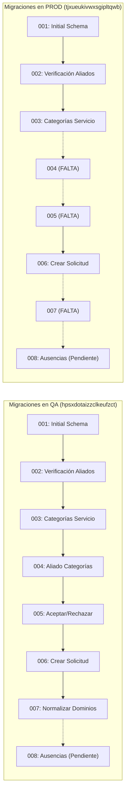

# TRAMA · MANI — Infraestructura

**Proyecto:** MANI — Plataforma Multi-Tenant de Formalización de Operaciones de Servicio  
**Documento:** Infraestructura y Topología de Ambientes  
**Responsable principal:** DevOps  
**Documento vivo:** sin número de versión; la vigente es la de `main`. Las decisiones abiertas están explícitas en §25.  

---

# 1. Propósito

Este documento describe **dónde y cómo se ejecutan los componentes de MANI**, qué se comparte, qué se aísla entre ambientes y qué decisiones de infraestructura permanecen abiertas.

No redefine:

- arquitectura funcional → SAD;
- diseño interno → SDD;
- políticas CI/CD → Políticas DevOps;
- DDL → Modelo de Datos;
- decisiones históricas → ADR.

---

# 2. Principios de infraestructura

1. Tres ambientes oficiales, y son exactamente tres: **DEV → QA → PROD**.
2. **DEV corre en las máquinas personales** de cada desarrollador, con Docker local.
3. **QA y PROD corren en una máquina virtual por ambiente, con Docker.**
4. Datos y secretos aislados por ambiente.
5. Artefactos OCI versionados e inmutables, fijados por tag y digest.
6. Registro centralizado en GHCR.
7. Configuración externa a las imágenes.
8. Misma definición de esquema y RLS entre ambientes.
9. Supabase como plataforma administrada de datos.
10. PostgreSQL como motor de base de datos.
11. **La plataforma de orquestación es una decisión abierta.** Kubernetes es el objetivo exigido por
    PROY-08, pero no es el estado actual (§10).
12. Ningún dato real de PROD se copia a DEV o QA.

---

# 3. Vista general

```text
Usuarios
   │
   ▼
Flutter Web / Mobile ──────────┐
   │                           ├─→ Supabase Auth      sesión y JWT
   │                           └─← Supabase Realtime  eventos de mensajería
   ▼
NGINX API Gateway
   │
   ├── Rules Service ........ Java     · MANI-Rules-Service
   ├── Dispatch Service ..... .NET     · MANI-Dispatch-Service
   └── Core Service ......... Node.js  · MANI-Core-Service
             │
             ▼
        Supabase
        ├── PostgreSQL
        ├── Auth
        ├── Storage
        └── Realtime
```

Tres servicios de negocio. La cobertura y la disponibilidad son un dominio del Core Service, con sus
tablas en el esquema `core`. Los dos únicos caminos del cliente a Supabase son Auth y Realtime
(SAD §8.3).

Servicios externos:

- FCM / APNs;
- operador de pagos en segundo incremento;
- Prometheus;
- Grafana;
- Datadog;
- Data Warehouse.

---

# 4. Ambientes oficiales

```text
DEV → QA → PROD
```

| Ambiente | Dónde corre | Plataforma | Datos |
|---|---|---|---|
| **DEV** | máquina personal de cada desarrollador | Docker local + Supabase de DEV | sintéticos |
| **QA** | VM de QA | Docker + Supabase de QA | dataset controlado y anonimizado |
| **PROD** | VM productiva | Docker + Supabase productivo | reales |

`QA` es un único ambiente y se llama **QA** en todo documento, pipeline y tag. No se usan «TEST»,
«QA» ni «Staging»: `Staging` no constituye un cuarto ambiente oficial y no existe.

---

# 5. Ambiente DEV

## 5.1 Objetivo

DEV se utiliza para:

- desarrollo;
- integración temprana;
- pruebas locales;
- validación de esquema;
- pruebas funcionales antes de QA.

## 5.2 Supabase DEV compartido

Existe un ambiente de **Supabase para DEV**, administrado por el equipo, equivalente conceptualmente a los proyectos utilizados para QA y PROD.

Debe conservar:

- PostgreSQL;
- esquema versionado;
- Auth;
- Storage;
- Realtime;
- RLS;
- datos exclusivamente de desarrollo.

La administración actual del ambiente DEV corresponde a Nicolás León.

## 5.3 Desarrollo en máquinas personales

**DEV no tiene servidor propio: corre en la máquina personal de cada desarrollador**, con Docker
local y el mismo esquema versionado. El Supabase de DEV compartido (§5.2) es el que aporta Auth,
Storage, Realtime y RLS a esas máquinas.

Que DEV sea local tiene dos consecuencias que no son defectos, sino el modelo elegido:

- no existe un «ambiente DEV desplegado» al que promover: el pipeline promueve de QA a PROD, y DEV
  es donde se construye y se prueba antes del Pull Request;
- la paridad con QA la garantizan la misma imagen y el mismo esquema, no la misma máquina.

La configuración local puede incluir:

- PostgreSQL;
- servicios necesarios para desarrollo;
- datos seed;
- herramientas de inspección;
- mocks o servicios locales cuando corresponda.

Cuando una funcionalidad dependa específicamente de Auth, Storage, Realtime o RLS de Supabase, debe probarse también contra un entorno que reproduzca esas capacidades antes de considerarse validada.

El Docker Compose local y el esquema versionado viven en `MANI-API-Gateway` (perfil `db` para PostgreSQL y Adminer; perfil `web` para el cliente Flutter Web, cuya imagen `mani-web:local` se construye en `MANI-Frontend`). Ver §15.

## 5.4 Datos

Solo:

- seeds;
- fixtures;
- usuarios ficticios;
- datos sintéticos.

Nunca información real de PROD.

---

# 6. Ambiente QA

## 6.1 Objetivo

QA sirve para:

- integración multi-servicio;
- pruebas funcionales;
- pruebas de regresión;
- aislamiento multi-tenant;
- pruebas de carga;
- DAST;
- aceptación QA.

## 6.2 Supabase QA

Proyecto dedicado e independiente.

Debe disponer de:

- PostgreSQL;
- Auth;
- Storage;
- Realtime;
- RLS;
- esquema equivalente a PROD;
- datos sintéticos y reseteables.

## 6.3 Aplicaciones y servicios

Las imágenes se descargan desde GHCR hacia la máquina virtual del ambiente.

Los servicios se levantan con Docker Compose sobre esa VM (§9). Es el mecanismo vigente, no una
alternativa provisional a otro ya decidido.

---

# 7. Ambiente PROD

## 7.1 Objetivo

PROD es el ambiente productivo oficial.

Contiene:

- usuarios reales;
- datos reales;
- documentos reales;
- secretos productivos;
- releases versionados.

## 7.2 Supabase PROD

Proyecto dedicado y aislado.

Debe contener:

- PostgreSQL;
- Auth;
- Storage;
- Realtime;
- políticas RLS productivas;
- backups;
- controles de acceso;
- cifrado en tránsito y en reposo según capacidades del proveedor.

## 7.3 Servicios

PROD utiliza únicamente imágenes promovidas y validadas previamente.

No se construye código directamente en PROD.

---

# 8. Registro de contenedores

El registro oficial es:

```text
GitHub Container Registry — GHCR
```

Convención:

```text
ghcr.io/trama-as/<servicio>:<tag>
```

Imágenes publicadas, una por repositorio desplegable:

```text
ghcr.io/trama-as/mani-frontend
ghcr.io/trama-as/mani-api-gateway
ghcr.io/trama-as/mani-rules-service
ghcr.io/trama-as/mani-dispatch-service
ghcr.io/trama-as/mani-core-service
ghcr.io/trama-as/mani-landing
```

Seis imágenes: `MANI-Docs` no se despliega y las disponibilidades van dentro de
`mani-core-service`. `mani-landing` la publica el workflow propio de `MANI-Landing` con los tags
`:develop`, `:staging` y `:latest` ([ADR-0028](../02-arquitectura/adr/ADR-0028-nombres-repositorios-y-ambientes.md)).
No depende de ninguna otra imagen ni otra depende de ella.

La infraestructura obtiene las imágenes desde GHCR.

---

# 9. Docker Compose en máquinas virtuales

Es el **mecanismo de despliegue vigente** de QA y PROD, no un apaño temporal mientras llega otra
cosa: es lo que está decidido y lo que corre hoy.

```text
GHCR
  ↓
pull de imágenes
  ↓
VM del ambiente (QA o PROD)
  ↓
docker compose up -d
```

Compose levanta los contenedores de cada VM. Los archivos viven en `MANI-API-Gateway`, un Compose
por ambiente.

La definición debe:

- fijar imágenes por tag **y digest**, no por `latest`;
- inyectar configuración por ambiente desde fuera del archivo;
- no contener secretos;
- declarar la red interna por la que se comunican los servicios;
- declarar volúmenes cuando aplique;
- declarar health check por contenedor;
- declarar límites de CPU y memoria por contenedor;
- usar `restart: unless-stopped`, para que la caída de un contenedor no arrastre al resto;
- permitir rollback a una imagen anterior sin reconstruir.

Limitación conocida del modelo: una VM con Docker no da autoescalado ni réplicas gestionadas. La
capacidad se añade por configuración y el techo es la VM. No es una decisión de arquitectura: es la
consecuencia de que la orquestación siga abierta (§10).

---

# 10. Orquestación — decisión abierta

**Kubernetes no está decidido ni desplegado.** Es el orquestador exigido como objetivo por PROY-08,
pero la decisión sigue abierta y el estado actual es Docker sobre VM.

## 10.1 Lo que sí está decidido

- Los artefactos son imágenes OCI y se obtienen desde GHCR.
- Azure/AKS **no** se adopta como proveedor obligatorio.
- QA y PROD corren hoy con Docker sobre una VM por ambiente (§9).
- La migración futura no debe requerir reconstruir las imágenes de aplicación.

## 10.2 Lo que está abierto

Nada de lo siguiente está definido, y ninguno se asume en ningún documento ni diagrama:

- si la plataforma final es Kubernetes gestionado, autogestionado u otra alternativa;
- proveedor de cómputo;
- número y tamaño de nodos;
- topología física;
- distribución por ambiente, por clúster o por namespace;
- ingress definitivo;
- estrategia de almacenamiento persistente.

Estas decisiones son `INFRA-01` e `INFRA-02` (§25) y **requieren ADR** antes de declararse
definitivas. Hasta entonces:

- ningún documento declara un clúster como estado actual;
- no se fija proveedor ni dimensionamiento;
- no se documenta capacidad como definitiva;
- no se asume AKS ni Azure.

## 10.3 Por qué Compose no «equivale» a Kubernetes

Docker Compose resuelve composición y ciclo de vida de contenedores en **una** máquina. No da
programación de carga entre nodos, autoescalado, ni recuperación ante la caída del host. Por eso el
diseño no promete réplicas ni HPA mientras este sea el mecanismo vigente (SDD §7.6).

Lo que el modelo actual sí garantiza, y es lo que sostiene la promoción: la imagen es la misma, la
configuración es externa y el rollback es por imagen anterior.

---

# 11. API Gateway

NGINX funciona como API Gateway.

Responsabilidades:

- TLS termination o integración con la capa que lo gestione;
- routing;
- CORS;
- rate limiting cuando se configure;
- validación inicial de JWT;
- propagación de `correlation_id`;
- controles transversales.

---

# 12. Servicios desplegables

| Repositorio | Runtime | Responsabilidad principal |
|---|---|---|
| `MANI-Frontend` | Flutter / Dart | Cliente web y móvil |
| `MANI-API-Gateway` | NGINX | Punto de entrada y enrutamiento de APIs |
| `MANI-Rules-Service` | Java | Reglas de negocio por tenant |
| `MANI-Dispatch-Service` | .NET | Solicitudes, despacho y asignación |
| `MANI-Core-Service` | Node.js | Servicios core y disponibilidades |
| `MANI-Landing` | React 19 + Vite 8, servida por NGINX | Página comercial pública: entrada a la plataforma |

`MANI-Docs` es el séptimo repositorio del proyecto y no se despliega.

Las disponibilidades no tienen contenedor, repositorio ni esquema propios: son un dominio del
`MANI-Core-Service`, con sus tablas en el esquema `core` (SAD §7.3).

No se utiliza Serverpod como backend principal.

---

# 13. Supabase

Supabase se modela como plataforma administrada.

## 13.1 PostgreSQL

Motor relacional operacional.

Contiene:

- tablas;
- llaves;
- restricciones;
- índices;
- RLS.

El DDL oficial vive en el documento/modelo de datos y scripts versionados.

## 13.2 Auth

Responsable de:

- autenticación;
- gestión de credenciales;
- sesiones;
- emisión de JWT.

Cada ambiente utiliza identidades aisladas.

## 13.3 Storage

Documentos KYC en almacenamiento privado.

Convención lógica:

```text
tenant_id/aliado_id/documento
```

## 13.4 Realtime

Utilizado para eventos y mensajería casi en tiempo real.

Realtime no contiene reglas de negocio.

---

# 14. Multi-tenancy

La seguridad se aplica en capas:

```text
JWT firmado
   ↓
NGINX Gateway
   ↓
Servicio
   ↓
RLS PostgreSQL
```

Reglas:

- `tenant_id` autenticado proviene del token;
- no se confía en headers arbitrarios como fuente de autorización;
- cada servicio valida acceso;
- RLS refuerza aislamiento;
- Storage aplica controles equivalentes.

---

# 15. Esquema y migraciones

Principio **schema-first**:

1. el cambio se crea como migración/script versionado;
2. se valida en DEV/local;
3. se valida en QA;
4. se aplica en PROD.

Queda prohibido modificar manualmente el esquema productivo como procedimiento ordinario.

Los tres ambientes deben conservar compatibilidad estructural.

## 15.1 Dónde viven las migraciones

Las migraciones versionadas (`database/migrations/NNN_descripcion.sql`, idempotentes e inmutables una vez fusionadas), los scripts de `database/init/` y las verificaciones de `database/verify/` viven en el repositorio **`MANI-API-Gateway`** (ADR-0004, enmienda del 2026-10-07). Ya no están en `MANI-Frontend`.

Todo cambio de esquema se propone por PR a `MANI-API-Gateway`, con su referencia Jira.

## 15.2 Responsable por ambiente

| Ambiente | Responsable | Cómo |
|---|---|---|
| DEV local | Cada desarrollador | `scripts/migrate-local.*` contra el contenedor `mani-postgres` (perfil `db` del Compose) |
| DEV / QA (Supabase) | DevOps | Aplica `database/migrations/` en orden, después de fusionar el PR. Automatizarlo en el pipeline de `MANI-API-Gateway` queda en CFG-29 |
| PROD | DevOps, con aprobación del PR de release | Solo migraciones ya validadas en QA. Nunca cambios manuales al esquema |

---

# 16. Qué se comparte y qué se aísla

| Componente | Política |
|---|---|
| Código fuente | Compartido por repositorio/versionado |
| Imagen OCI | Compartida/promovida |
| DDL/migraciones | Compartidas |
| Definición de RLS | Compartida |
| Datos | Aislados |
| Usuarios/Auth | Aislados |
| Storage | Aislado |
| Secretos | Aislados |
| Dominios/URLs | Aislados |
| Logs | Aislados por ambiente |
| Configuración | Aislada |
| Supabase | Proyecto/entorno segregado |
| Registro GHCR | Compartido, tags/digests segregados |

---

# 17. Secretos

## DEV
Variables de desarrollo, nunca productivas.

## QA
Secretos propios del ambiente.

## PROD
Secretos exclusivos, acceso restringido.

Prohibiciones:

- credenciales en repositorio;
- secrets dentro de imágenes;
- reutilizar claves productivas en ambientes inferiores.

## Secretos de CI

Los secretos que usan los pipelines se guardan como GitHub Actions secrets del repositorio o del environment, nunca en archivos versionados.

| Repositorio | Secreto | Uso | Estado al 7 oct 2026 |
|---|---|---|---|
| MANI-Core-Service | `SONAR_TOKEN` | análisis de SonarCloud del workflow `Quality Gate` (CFG-41) | **pendiente de crear** por DevOps |

---

# 18. Red y TLS

Cada ambiente debe mantener su propia configuración de red y endpoint.

Ejemplos conceptuales:

```text
DEV      → local / dominio dev
QA  → dominio QA
PROD     → dominio productivo
```

Los nombres concretos se definen cuando exista infraestructura asignada.

Requisitos:

- HTTPS para tráfico externo;
- secretos fuera del código;
- CORS por ambiente;
- reglas de red con mínimo privilegio.

---

# 19. Persistencia y archivos por ambiente

| Capacidad | DEV | QA | PROD |
|---|---|---|---|
| PostgreSQL | Supabase DEV y/o local | Supabase dedicado | Supabase dedicado |
| Auth | DEV | QA | PROD |
| Storage | datos ficticios | datos sintéticos | documentos reales |
| Realtime | desarrollo | pruebas | productivo |
| Datos | ficticios | sintéticos | reales |
| RLS | misma definición | misma definición | misma definición |

---

# 20. Observabilidad

Los componentes deben integrarse con:

- Prometheus;
- Grafana;
- Datadog.

Telemetría mínima:

- latencia;
- requests;
- errores;
- CPU;
- memoria;
- estado de servicios;
- logs estructurados;
- trazas;
- correlation ID.

Los ambientes deben poder distinguirse en etiquetas y dashboards.

---

# 21. Backups y recuperación

Para PROD se requiere:

- backups periódicos de la persistencia;
- verificación de restauración;
- retención acorde al proveedor y necesidades del proyecto;
- registro de incidentes;
- procedimiento de rollback de aplicación.

Los valores exactos de RPO/RTO deben mantenerse sincronizados con SAD/SDD cuando hayan sido ratificados.

No se fija aquí una cifra no aprobada.

---

# 22. Escalabilidad

## Estado vigente — Docker sobre VM

La capacidad se añade por configuración del Compose y por el tamaño de la VM. Lo que el modelo
actual sí da:

- health checks por contenedor;
- reinicio automático del contenedor caído (`restart: unless-stopped`);
- límites de CPU y memoria por servicio, para que uno no consuma la VM;
- rollback por imagen anterior.

Lo que **no** da, y por eso no se promete en ningún documento:

- programación de carga entre varias máquinas;
- autoescalado por métrica;
- recuperación ante la caída del host;
- rolling update sin ventana de indisponibilidad del servicio afectado.

## Cuando se cierre la orquestación

Una vez resueltos INFRA-01 e INFRA-02, la plataforma podrá habilitar réplicas gestionadas,
self-healing a nivel de nodo, rolling updates, balanceo y autoescalado cuando exista métrica y
capacidad justificadas.

El número de réplicas no se fija hasta tener datos de carga, y el umbral de escalabilidad del SDD
(§7.6) está enunciado como propiedad del artefacto precisamente para no depender de esa decisión.

---

# 23. Data Warehouse

El DW se mantiene separado del OLTP.

Flujo conceptual:

```text
Supabase / PostgreSQL OLTP
        ↓
      CDC / ELT
        ↓
      Staging
        ↓
 Transformación / Calidad
        ↓
   Data Warehouse
        ↓
      BI / Métricas
```

El DW no escribe hacia el OLTP.

---

# 24. Promoción entre ambientes

La infraestructura recibe artefactos según la política DevOps:

```text
DEV → QA → PROD
```

Infraestructura no redefine los Quality Gates.

La fuente de verdad para gates es `POLITICAS_DEVOPS_HERRAMIENTAS.md`.

## 24.1 Estado del análisis SonarQube por repositorio

Esta tabla registra solo el estado de la configuración, no los umbrales: los umbrales viven en `POLITICAS_DEVOPS_HERRAMIENTAS.md` §14.1 y ADR-0005.

Un gate se considera **vinculante** solo cuando su check es obligatorio en un ruleset activo de GitHub y existe evidencia de un PR bloqueado. Mientras eso no ocurra, el estado es *preparado* o *activo sin bloqueo* (Políticas §6.2).

**Servidor.** SonarQube Community Build 26.10 (modo MQR) en el Host de Calidad (`10.43.98.196:9000`), no SonarCloud. Los runners hospedados por GitHub no alcanzan la red privada, así que cada repositorio corre su workflow `quality-gate.yml` en dos jobs:

1. **Pruebas y cobertura** en `ubuntu-latest`: ejecuta el código del repositorio y publica el reporte de cobertura (y, en Java, el bytecode) como artefacto.
2. **Sonar Quality Gate** en el runner self-hosted `nbig02-calidad` (grupo de organización `calidad`, label `calidad`): descarga el artefacto y ejecuta el scanner con espera del gate. No instala dependencias ni ejecuta código del repositorio. En PRs desde forks el job corre en `ubuntu-latest` y falla, porque un job omitido cuenta como aprobado.

SonarQube Community no analiza ramas ni PRs. Por eso cada repositorio tiene dos proyectos: `<clave>` (push a `develop`, código nuevo = versión anterior) y `<clave>-pr` (pull requests, código nuevo = último día). Ambos usan el gate `MANI ADR-0005`: 0 issues nuevos, 100 % de hotspots revisados, cobertura ≥ 80 % y duplicación ≤ 3 % sobre código nuevo.

El secreto `SONAR_TOKEN` (token de análisis global) y la variable `SONAR_HOST_URL` están definidos a nivel de la organización `Trama-AS`.

| Repositorio | Proyectos SonarQube | Configuración versionada | Check obligatorio en ruleset | Estado al 19 oct 2026 |
|---|---|---|---|---|
| MANI-Node | `mani-node`, `mani-node-pr` | `sonar-project.properties`, `.github/workflows/quality-gate.yml` ([MANI-Node#40](https://github.com/Trama-AS/MANI-Node/pull/40), [#45](https://github.com/Trama-AS/MANI-Node/pull/45)) | sí: ruleset `Quality Gate SonarQube` en `develop`, `release` y `main` ("Pruebas y cobertura" y "Sonar Quality Gate"), sin bypass | **vinculante**. PR aprobado: [#41](https://github.com/Trama-AS/MANI-Node/pull/41); PR bloqueado por cobertura: [#42](https://github.com/Trama-AS/MANI-Node/pull/42) (SCRUM-1265) |
| MANI-Java | `mani-java`, `mani-java-pr` | `sonar-project.properties`, `.github/workflows/quality-gate.yml` ([MANI-Java#4](https://github.com/Trama-AS/MANI-Java/pull/4), [#5](https://github.com/Trama-AS/MANI-Java/pull/5) para `sonar.java.test.libraries`); se retiró la configuración de SonarCloud del `pom.xml` | sí: mismo ruleset en `develop`, `release` y `main` | **activo con bloqueo**; línea base en `develop`: cobertura 92,3 %, 0 issues, gate aprobado |
| MANI-.NET | `mani-dotnet`, `mani-dotnet-pr` | `.github/workflows/quality-gate.yml` ([MANI-.NET#9](https://github.com/Trama-AS/MANI-.NET/pull/9)): pruebas y cobertura OpenCover en `ubuntu-latest`; SonarScanner for .NET compila la solución en el Host de Calidad y reescribe las rutas del reporte de coverlet. Sin `sonar-project.properties` (el scanner de .NET no lo usa) | sí: mismo ruleset en `develop`, `release` y `main` | **activo con bloqueo**; línea base: cobertura 83,3 %, duplicación 10,1 % y 42 issues heredados, gate aprobado |
| MANI-APIGateway | `mani-apigateway`, `mani-apigateway-pr` | `sonar-project.properties`, `.github/workflows/quality-gate.yml` con un solo job ([MANI-APIGateway#14](https://github.com/Trama-AS/MANI-APIGateway/pull/14)). Analiza Docker, YAML, JSON, scripts JS y secretos; sin cobertura (no hay pruebas unitarias). Las colecciones de Postman generadas se excluyen | sí: ruleset `Quality Gate SonarQube` en `develop`, `release` y `main` solo con "Sonar Quality Gate" | **activo con bloqueo**; línea base: 0 % de duplicación, 0 hotspots, 1 issue (imagen nginx como root). El gate ya bloqueó duplicación nueva en el generador de Postman y se corrigió antes de fusionar |
| MANI-Landing | `mani-landing`, `mani-landing-pr` | `sonar-project.properties`, `.github/workflows/quality-gate.yml` y script `test:coverage` ([MANI-Landing#4](https://github.com/Trama-AS/MANI-Landing/pull/4)). La lógica (`src/utils`, `src/config/flutterWebUrl.js`) exige el umbral; JSX, hook, datos estáticos y `appConfig.js` (lee `import.meta.env`) quedan fuera de la cobertura | sí: mismo ruleset en `develop`, `release` y `main` | **activo con bloqueo**; línea base: cobertura 100 % sobre 146 líneas, 12 issues heredados, gate aprobado |
| MANI-Flutter | no aplica | SonarQube Community no analiza Dart (verificado en `/api/languages/list`). El `sonar-project.properties` existente apunta a SonarCloud y no se usa | ruleset `main` exige "Flutter Lint, Test & Build Check" | **fuera de SonarQube**; gate de cobertura en su propia CI, pendiente de acordar con SCRUM-1117 |
| MANI-docs | no aplica | solo documentación | no | fuera de alcance |

Para activar SonarQube en un repositorio nuevo, en orden: crear `<clave>` y `<clave>-pr` con el gate `MANI ADR-0005` y su período de código nuevo; agregar el repositorio al grupo de runners `calidad`; fusionar `sonar-project.properties` y `quality-gate.yml` (mismos nombres de job); verificar el primer análisis en `develop`; y crear el ruleset `Quality Gate SonarQube` en `develop`, `release` y `main` con los checks del workflow.

Nota sobre `<clave>-pr`: su código nuevo es "último día", así que un PR también evalúa lo que se fusionó en `develop` en las últimas 24 horas. Si el gate falla por código ajeno al PR, se corrige en el PR o en `develop`; no se omite el check.

---

# 25. Decisiones abiertas

A la fecha quedan explícitamente abiertas:

## INFRA-01 — Plataforma y hosting de orquestación
Pendiente decidir si la plataforma final es Kubernetes gestionado, autogestionado u otra
alternativa, y con qué proveedor y dimensionamiento. Requiere ADR.

## INFRA-02 — Topología final
Pendiente definir nodos, namespaces o clusters por ambiente, ingress y networking. Requiere ADR.

**No están abiertas.** Las siguientes decisiones están tomadas y no se vuelven a discutir sin un
ADR que las revise:

| Tema | Estado |
|---|---|
| GHCR como registro de imágenes | **definido** |
| Supabase de DEV compartido | **definido** |
| DEV en máquinas personales con Docker local | **definido** |
| Docker sobre VM, una por ambiente, para QA y PROD | **definido** |
| Tres ambientes: DEV, QA y PROD | **definido** |
| Kubernetes como plataforma | **abierto** — es el objetivo de PROY-08, no una decisión cerrada (§10) |

Esta tabla es la respuesta a «¿esto ya está decidido?». Si un documento dice que GHCR o el modelo de
ambientes están pendientes, está desactualizado y se corrige contra esta sección.

---

# 26. Trazabilidad

Este documento debe mantenerse alineado con:

- ADR-0004 — CI/CD y ambientes;
- ADR-0005 — DevSecOps;
- ADR-0006 — observabilidad;
- ADR-0012 — Supabase/PostgreSQL + RLS;
- ADR-0013 — documentos KYC;
- ADR-0015 — pruebas multi-tenant;
- ADR-0018 — identidad de tenant;
- ADR-0019 — SOA + Gateway + arquitectura políglota;
- SRS — RNF y restricciones;
- SAD;
- SDD;
- Modelo de Datos.

Cuando exista una nueva decisión de hosting/clúster, este documento se actualiza después del ADR correspondiente.

---

# 27. Plan de auditoría, alineación y migración/rollback de Supabase PROD y QA (CFG-26)

> Fusionado desde `governance/PLAN_ALINEACION_SUPABASE_PROD_QA_CFG-26.md` el 22 de octubre de 2026. Dejó de ser un documento aparte: la alineación de ambientes Supabase es infraestructura. Las referencias internas «§N» de este bloque corresponden a §27.N.

- **Código:** CFG-26
- **Subtareas Jira:**
  - `SCRUM-1294`: DevOps - Comparar proyectos Supabase PROD y QA y migraciones (Daniel, DevOps).
  - `SCRUM-1295`: DevOps - Validar estrategia de sincronización y rollback (Daniel, DevOps).
- **Hito / Bloqueo:** Esta entrega debe completarse y validarse **ANTES de SCRUM-1106**.
- **Responsable:** Daniel (DevOps Lead) con validación técnica de Santiago y Mesa de Arquitectura.
- **Fecha:** 17 de Octubre, 2026.
- **Alcance Exclusivo:** INVENTARIO, COMPARACIÓN, ESTRATEGIA DE BACKUPS Y PLAN DE ROLLBACK. *(La ejecución física se ejecuta en CFG4-02 / SCRUM-1298 y SCRUM-1299)*.
- **ADRs Vinculantes:**
  - [`ADR-0012`](../02-arquitectura/adr/ADR-0012-persistencia-multitenant.md): Persistencia multi-tenant mediante esquemas compartidos y Row Level Security (RLS).
  - [`ADR-0015`](../02-arquitectura/adr/ADR-0015-pruebas-aislamiento-multitenant.md): Pruebas de aislamiento multi-tenant.
  - [`ADR-0018`](../02-arquitectura/adr/ADR-0018-identificacion-tenant.md): Identificación de tenant vía claims verificados en token JWT.
  - [`ADR-0030`](../02-arquitectura/adr/ADR-0030-propiedad-esquema-y-frontera-de-datos.md): Propiedad del esquema en Core Node (`MANI-Node`) y frontera de datos entre microservicios vía HTTP sin queries SQL cruzadas.

---

## 27.1 Contexto y Objetivos

Para cumplir con el modelo operativo del MVP y el Sprint 4, el sistema MANI utiliza **una base de datos PostgreSQL compartida por ambiente** provista sobre la infraestructura de Supabase:
- **PROD:** Proyecto Supabase `MANI` (Ref: `tjxueukivwxsgipltqwb`, Región: `us-east-2`, Estado: `ACTIVE_HEALTHY`).
- **QA:** Proyecto Supabase `MANI-QA` (Ref: `hpsxdotaizzclkeufzct`, Región: `us-east-2`, Estado: `ACTIVE_HEALTHY`).

El objetivo de esta tarea (CFG-26) es auditar minuciosamente el estado real de ambos ambientes, identificar las brechas de esquema, migraciones, políticas RLS y datos, y estructurar una estrategia rigurosa de respaldo, migración controlada y procedimiento de rollback seguro que garantice **cero pérdida de datos preexistentes**.

---

## 27.2 Inventario y Matriz Comparativa Detallada (SCRUM-1294)

La auditoría se realizó mediante conexión directa a través del servidor MCP oficial `@supabase/mcp-server-supabase` y llamadas autenticadas a la Management API de Supabase.

### 27.2.1 Resumen Ejecutivo de Ambientes

| Parámetro | Ambiente PROD (`MANI`) | Ambiente QA (`MANI-QA`) | Diagnóstico / Estado |
|---|---|---|---|
| **Project Ref** | `tjxueukivwxsgipltqwb` | `hpsxdotaizzclkeufzct` | Proyectos aislados en `us-east-2`. |
| **URL Base** | `https://tjxueukivwxsgipltqwb.supabase.co` | `https://hpsxdotaizzclkeufzct.supabase.co` | Correctamente separados. |
| **Tablas en esquema `public`** | 19 tablas | 23 tablas | Divergencia: QA contiene 4 tablas adicionales (`consentimiento_usuario`, `documento_legal`, `poc_asignacion_log`, `solicitud_rechazo`). |
| **Migraciones en `schema_migrations`** | 4 registradas (`001`, `002`, `003`, `006`) | 7 registradas (`001`, `002`, `003`, `004`, `005`, `006`, `007`) | Crítico: PROD saltó `004` y `005`, y le falta `007`. |
| **Migración `008` (Sprint 4)** | No aplicada | No aplicada | Pendiente en ambos ambientes (`008_add_aliado_ausencia.sql`). |
| **Políticas RLS en `public`** | 3 políticas (solo en `cobertura_aliado`) | 22 políticas (en 20 tablas públicas) | **Vulnerabilidad Crítica:** PROD tiene 18 tablas sin RLS. |
| **Funciones / RPCs en `public`** | 28 funciones | 32 funciones | PROD carece de las RPCs de categorías y asignación (`guardar_mis_categorias`, `aceptar_solicitud`, etc.). |
| **Triggers en `public`** | 0 triggers | 2 triggers (`trg_aliado_categoria_tenant`) | En PROD falta el disparador de validación de tenant en `aliado_categoria`. |
| **Extensiones requeridas** | `pgcrypto` (1.3), `uuid-ossp` (1.1) | `pgcrypto` (1.3), `uuid-ossp` (1.1) | Ambos requieren `btree_gist` para la migración `008`. |

---

### 27.2.2 Inventario de Tablas y Conteo de Registros

| Tabla | Registros PROD | Registros QA | Propósito y Estado |
|---|:---:|:---:|---|
| `tenant` | 3 | 3 | Entidades tenant del sistema (Plomería Express, Electricistas Pro, Cerrajería Total). |
| `zona` | 0 | 3 | Catálogo geográfico de zonas (Bogotá, Chapinero, Suba). |
| `usuario` | 9 | 64 | Cuentas de usuario registradas (PROD tiene 9 usuarios en producción/staging). |
| `aliado` | 3 | 56 | Perfiles de aliados prestadores de servicio. |
| `cliente` | 0 | 3 | Perfiles de clientes solicitantes de servicio. |
| `categoria_servicio` | 3 | 3 | Catálogo de servicios (Plomería, Electricidad, Cerrajería). |
| `aliado_categoria` | 0 | 56 | Relación de categorías atendidas por aliado. |
| `cobertura_aliado` | 0 | 52 | Zonas cubiertas declaradas por los aliados. |
| `sitio` | 0 | 3 | Direcciones / inmuebles del cliente. |
| `solicitud` | 0 | 1 | Solicitudes de servicio publicadas. |
| `solicitud_foto` | 0 | 0 | Fotos adjuntas a las solicitudes (bucket `solicitudes`). |
| `solicitud_rechazo` | **No existe** | 0 | Creada por migración `005`. Registra rechazos de solicitudes por aliado. |
| `aliado_ausencia` | **No existe** | **No existe** | Creada por migración `008`. Ausencias temporales del aliado. |
| `documento_legal` | **No existe** | 6 | Creada en SCRUM-856 (Términos, Condiciones y Habeas Data). |
| `consentimiento_usuario` | **No existe** | 4 | Creada en SCRUM-856 (Aceptaciones de términos por usuario). |
| `poc_asignacion_log` | **No existe** | 13 | Tabla de telemetría de la PoC CFG-09 (concurrencia de despacho). |
| `cotizacion` | 0 | 0 | Cotizaciones económicas emitidas por aliados. |
| `mensaje` | 0 | 0 | Mensajería de chat entre cliente y aliado en una solicitud. |
| `evento_servicio` | 0 | 0 | Línea de tiempo de eventos de servicio. |
| `calificacion` | 0 | 0 | Calificaciones bidireccionales post-servicio. |
| `notificacion` | 2 | 0 | Bandeja de notificaciones in-app. |
| `documento_kyc` | 0 | 4 | Documentos de identidad y verificación de aliados. |
| `tarifa_referencia` | 0 | 0 | Tarifas mínimas, típicas y máximas por categoría. |
| `schema_migrations` | 4 | 7 | Tabla de control de versiones de base de datos. |

---

### 27.2.3 Comparación de Migraciones Registradas



- **En QA:** Secuencia `001` a `007` perfectamente aplicada y verificada.
- **En PROD:** Se aplicaron `001`, `002`, `003` y se saltó directamente a `006`, omitiendo:
  - `004_aliado_categorias.sql`: Índice único anti-duplicados, trigger de aislamiento de tenant y funciones `guardar_mis_categorias` y `obtener_mis_categorias`.
  - `005_aceptar_rechazar_solicitud.sql`: Tabla `solicitud_rechazo`, asignación atómica anti-doble asignación (`UPDATE ... WHERE estado = 'PENDIENTE' AND aliado_id IS NULL`), funciones `aceptar_solicitud` y `rechazar_solicitud`.
  - `007_normalizar_dominios.sql`: Homologación de dominios a mayúsculas (`ACTIVO`, `VERIFICADO`, `ASIGNADA`), validación de constraints `ck_categoria_estado` y compatibilidad con el Custom Access Token Hook.

---

### 27.2.4 Comparación de Políticas de Seguridad Row Level Security (RLS)

- **En QA:** Cumple [`ADR-0012`](../02-arquitectura/adr/ADR-0012-persistencia-multitenant.md) y [`ADR-0015`](../02-arquitectura/adr/ADR-0015-pruebas-aislamiento-multitenant.md). Dispone de **22 políticas RLS**:
  - `tenant_isolation_<tabla>` en `aliado`, `aliado_categoria`, `calificacion`, `categoria_servicio`, `cliente`, `cobertura_aliado`, `cotizacion`, `documento_kyc`, `evento_servicio`, `mensaje`, `notificacion`, `sitio`, `solicitud`, `tarifa_referencia`, `usuario`. Expresión canónica:
    ```sql
    USING (tenant_id = (((auth.jwt() -> 'app_metadata'::text) ->> 'tenant_id'::text))::uuid)
    ```
  - Catálogos compartidos de lectura global: `lectura_global_tenant` en `tenant`, `lectura_global_zona` en `zona`.
  - Lectura de identidad para emisión de claims: `hook_lee_usuario` en `usuario` para el rol `supabase_auth_admin`.
  - Políticas de servicio en `documento_legal` y `consentimiento_usuario` para `service_role`.
- **En PROD:** Solamente cuenta con **3 políticas** sobre `cobertura_aliado` (`cobertura_aliado_owner_delete`, `_insert`, `_update`). Todas las demás tablas tienen RLS habilitado pero sin políticas declaradas, lo cual rechazaría cualquier lectura proveniente de tokens de usuario estándar (`authenticated`).

---

## 27.3 Estrategia de Backups y Custodia en Host Dedicado (SCRUM-1295)

Para garantizar el cumplimiento de buenas prácticas de ingeniería de software, los artefactos de respaldo binarios y los scripts operativos **no se almacenan en el repositorio de documentación** `MANI-docs`. En su lugar, se custodian en la **Máquina Virtual dedicada de Bases de Datos y Respaldos**:

- **Host Dedicado:** `10.43.98.197` (Ubuntu 22.04.5 LTS Jammy Jellyfish)
- **Usuario de Operación:** `estudiante`
- **Ruta de Almacenamiento en Servidor:** `/opt/database-backups/mani/pre-consolidation/`

### 27.3.1 Artefactos de Respaldo Generados y Custodiados
1. **Ambiente PROD (`tjxueukivwxsgipltqwb`):**
   - Metadata de Esquema y DDL: `/opt/database-backups/mani/pre-consolidation/backup_prod_tjxueukivwxsgipltqwb_pre_consolidation.json` (31 KB)
   - Datos en Sentencias INSERT SQL: `/opt/database-backups/mani/pre-consolidation/backup_prod_tjxueukivwxsgipltqwb_data.sql` (6.8 KB)
2. **Ambiente QA (`hpsxdotaizzclkeufzct`):**
   - Metadata de Esquema y DDL: `/opt/database-backups/mani/pre-consolidation/backup_qa_hpsxdotaizzclkeufzct_pre_consolidation.json` (129 KB)
   - Datos en Sentencias INSERT SQL: `/opt/database-backups/mani/pre-consolidation/backup_qa_hpsxdotaizzclkeufzct_data.sql` (89 KB)

Ambos respaldos verifican la existencia íntegra de los 9 usuarios y 3 aliados de PROD, y de los 64 usuarios y 56 aliados de QA, listos para restauración inmediata mediante `ON CONFLICT DO NOTHING`.

---

## 27.4 Estrategia de Sincronización y Rollback Seguro (SCRUM-1295)

### 27.4.1 Plan de Sincronización en QA (`hpsxdotaizzclkeufzct`)

Dado que QA ya se encuentra en la versión `007`, la única acción pendiente es aplicar la migración del Sprint 4:
1. Validar pre-condiciones: extensión `btree_gist` y tabla `aliado`.
2. Ejecutar `008_add_aliado_ausencia.sql`:
   - Crea `aliado_ausencia` con clave foránea compuesta `(aliado_id, tenant_id)`.
   - Restricción temporal de exclusión `ex_aliado_ausencia_solapamiento`.
   - Política RLS `Aliado lee sus propias ausencias`.
   - Registro en `schema_migrations` (`version = '008'`).

### 27.4.2 Plan de Sincronización en PROD (`tjxueukivwxsgipltqwb`)

Para evitar cualquier conflicto de orden DDL, se aplica la siguiente secuencia:
1. **Paso 1: Aplicar `004_aliado_categorias.sql`:**
   - Crea índice único `uq_aliado_categoria` y trigger de validación de tenant.
   - Crea RPCs `guardar_mis_categorias`, `obtener_mis_categorias`, `listar_categorias_tenant`.
   - Registra `'004'` en `schema_migrations`.
2. **Paso 2: Aplicar `005_aceptar_rechazar_solicitud.sql`:**
   - Crea tabla `solicitud_rechazo` con RLS.
   - Crea funciones de asignación atómica `aceptar_solicitud` y `rechazar_solicitud`.
   - Registra `'005'` en `schema_migrations`.
3. **Paso 3: Re-validar `_sol_zona_cubierta` (corrección de 006):**
   - Asegurar que la función `_sol_zona_cubierta` mantenga el soporte `_zona_activa(z.estado)` introducido en la migración `006`.
4. **Paso 4: Aplicar `007_normalizar_dominios.sql`:**
   - Ejecuta normalización de enumeraciones (ya verificadas en PROD).
   - Valida constraints `ck_categoria_estado` y `ck_categoria_flujo`.
   - Registra `'007'` en `schema_migrations`.
5. **Paso 5: Sincronizar Políticas RLS Multi-Tenant:**
   - Desplegar las políticas `tenant_isolation_*` en las tablas pendientes para alcanzar paridad absoluta con QA y cumplir con [`ADR-0012`](../02-arquitectura/adr/ADR-0012-persistencia-multitenant.md).
6. **Paso 6: Aplicar `008_add_aliado_ausencia.sql`:**
   - Instala `btree_gist`, crea `aliado_ausencia` y su RLS.
   - Registra `'008'` en `schema_migrations`.
7. **Paso 7: Sincronizar tablas legales de Habeas Data:**
   - Crear `documento_legal` y `consentimiento_usuario` con RLS activo para soporte de SCRUM-856.

---

### 27.4.3 Procedimientos de Rollback Seguro y Custodia en VM

Los scripts de contingencia y reversión no destructivos se encuentran almacenados y custodiados en la **Máquina Virtual de Bases de Datos (`10.43.98.197`)** bajo el directorio `/opt/database-backups/mani/rollback/`:

1. **Rollback de 008 (`/opt/database-backups/mani/rollback/rollback_008_add_aliado_ausencia.sql`):**
   - Si la tabla `aliado_ausencia` contiene datos, los preserva automáticamente en `_bak_aliado_ausencia_rollback`.
   - Elimina la política RLS y la tabla `aliado_ausencia`.
   - Retira la restricción única `ux_aliado_id_tenant`.
   - Elimina el registro `'008'` de `schema_migrations`.
2. **Rollback de 005 y 004 (`/opt/database-backups/mani/rollback/rollback_005_004.sql`):**
   - Preserva los datos de `solicitud_rechazo` en `_bak_solicitud_rechazo_rollback`.
   - Retira las RPCs y la tabla `solicitud_rechazo`.
   - Retira triggers e índices de `aliado_categoria`.
   - Elimina los registros `'005'` y `'004'` de `schema_migrations`.

---

## 27.5 Definición de Terminado (DoD) y Criterio de Cierre (CFG-26)

- [x] Inventario completo de conexiones, tablas, esquemas, RLS, migraciones, secrets y seeds documentado.
- [x] Matriz comparativa exhaustiva PROD vs QA validada con datos en vivo.
- [x] Respaldos lógicos JSON y SQL pre-consolidación generados y custodiados en la máquina virtual dedicada `10.43.98.197` en `/opt/database-backups/mani/pre-consolidation/`.
- [x] Scripts de rollback seguros e idempotentes elaborados y custodiados en la máquina virtual dedicada `10.43.98.197` en `/opt/database-backups/mani/rollback/`.
- [x] Plan de sincronización secuencial y transaccional diseñado sin riesgo de sobreescritura destructiva ni pérdida de datos.
- [x] Documento validado y listo para dar paso a la ejecución en `CFG4-02` (SCRUM-1298 y SCRUM-1299) antes de `SCRUM-1106`.
