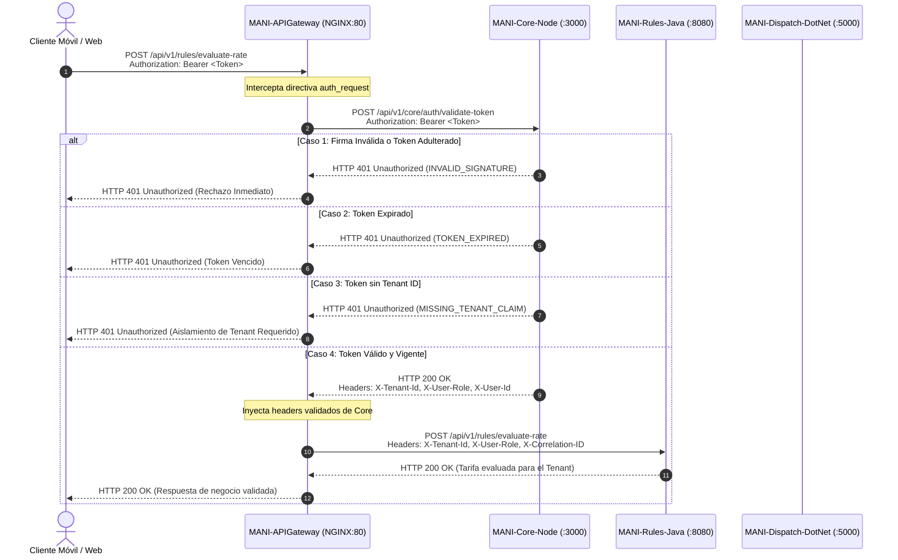

# TRAMA · MANI — Políticas DevOps, Calidad y Herramientas

**Proyecto:** MANI  
**Responsable técnico principal:** Daniel Ávila — DevOps titular  
**Apoyo:** Nicolás León — DevOps secundario  
**Ámbito:** desarrollo, repositorios, CI/CD, pruebas, seguridad, observabilidad y herramientas  
**Documento vivo:** sin número de versión; la vigente es la de `main`  
**Socialización:** [Video — Políticas DevOps: Gitflow y ambientes](https://livejaverianaedu-my.sharepoint.com/:v:/g/personal/ds_avilam_javeriana_edu_co/IQDJum5FxLZUT7eaGJrT-VSUAa4MTwcZkgTP_k2EMLSW_QQ?nav=eyJyZWZlcnJhbEluZm8iOnsicmVmZXJyYWxBcHAiOiJPbmVEcml2ZUZvckJ1c2luZXNzIiwicmVmZXJyYWxBcHBQbGF0Zm9ybSI6IldlYiIsInJlZmVycmFsTW9kZSI6InZpZXciLCJyZWZlcnJhbFZpZXciOiJNeUZpbGVzTGlua0NvcHkifX0&e=dhFbaF) · OneDrive institucional, requiere cuenta Javeriana  

---

# 1. Propósito

Este documento establece **cómo se desarrolla, integra, prueba, asegura y entrega MANI**.

No redefine:

- requerimientos → SRS;
- arquitectura → SAD;
- diseño → SDD;
- infraestructura física/lógica → `INFRAESTRUCTURA_MANI.md`;
- decisiones estructurales → ADR;
- tecnologías vigentes de forma histórica → `TECH_RADAR.md`.

---

# 2. Principios

1. **Multi-repo:** cada unidad desplegable mantiene ciclo técnico independiente.
2. **Build once, deploy many:** el artefacto promovido no se recompila por ambiente.
3. **Automatización primero:** build, test y gates deben ejecutarse en CI.
4. **Seguridad desde CI:** SAST, DAST y pruebas de aislamiento forman parte del ciclo.
5. **Sin secretos en repositorio.**
6. **Ambientes segregados:** DEV → QA → PROD.
7. **Misma definición de esquema y políticas de seguridad entre ambientes.**
8. **Observabilidad integrada.**
9. **Decisiones estructurales mediante ADR.**
10. **No se implementan diferencias por tenant mediante forks del producto.**

---

# 3. Referencia tecnológica

La fuente viva de tecnologías adoptadas, en evaluación o descartadas es `TECH_RADAR.md`.

Stack vigente relevante para DevOps:

- Flutter / Dart
- NGINX
- Java
- .NET
- Node.js
- Supabase
- PostgreSQL
- Docker / OCI
- GitHub Actions
- GHCR
- Postman / Newman
- k6
- SonarQube
- OWASP ZAP
- Prometheus
- Grafana
- Datadog
- Jira

Kubernetes **no está en el stack vigente**: es la plataforma de orquestación objetivo exigida por
PROY-08, con la decisión abierta en INFRA-01 e INFRA-02. El despliegue vigente de QA y PROD es
Docker sobre una máquina virtual por ambiente (§12).

No forman parte de la línea base actual:

- Azure / ACR como proveedor obligatorio;
- Serverpod como backend principal;
- Feature Toggles como requisito arquitectónico obligatorio;
- Repo A / Repo B / Repo C como modelo de organización.

---

# 4. Estrategia multi-repositorio

Siete repositorios, con estos nombres exactos:

| Repositorio | Tecnología | Responsabilidad principal |
|---|---|---|
| `MANI-Frontend` | Flutter / Dart | Cliente web y móvil |
| `MANI-API-Gateway` | NGINX | Punto de entrada y enrutamiento de APIs |
| `MANI-Rules-Service` | Java | Reglas de negocio por tenant |
| `MANI-Dispatch-Service` | .NET | Solicitudes, despacho y asignación |
| `MANI-Core-Service` | Node.js | Servicios core y disponibilidades |
| `MANI-Landing` | React 19 + Vite 8, servida por NGINX | Página comercial pública: entrada a la plataforma |
| `MANI-Docs` | Markdown / diagramas / ADR | Documentación arquitectónica y técnica |

Seis repositorios desplegables; `MANI-Docs` no se despliega. El registro de `MANI-Landing` está en [ADR-0028](../02-arquitectura/adr/ADR-0028-nombres-repositorios-y-ambientes.md).

`MANI-API-Gateway` guarda además el Compose por ambiente y la configuración de observabilidad. No
existe un repositorio de infraestructura aparte.

Las disponibilidades no tienen repositorio propio: son un módulo del `MANI-Core-Service`.

Cada repositorio desplegable debe mantener:

- código;
- dependencias;
- pruebas;
- `Dockerfile`;
- pipeline;
- configuración de build;
- versionamiento;
- artefactos;
- documentación técnica inmediata.

---

# 5. Control de versiones y ramas

> **Socialización en video.** El flujo de ramas de esta sección y la promoción entre ambientes de §7 están
> explicados en el [video de socialización de políticas DevOps (Gitflow y ambientes)](https://livejaverianaedu-my.sharepoint.com/:v:/g/personal/ds_avilam_javeriana_edu_co/IQDJum5FxLZUT7eaGJrT-VSUAa4MTwcZkgTP_k2EMLSW_QQ?nav=eyJyZWZlcnJhbEluZm8iOnsicmVmZXJyYWxBcHAiOiJPbmVEcml2ZUZvckJ1c2luZXNzIiwicmVmZXJyYWxBcHBQbGF0Zm9ybSI6IldlYiIsInJlZmVycmFsTW9kZSI6InZpZXciLCJyZWZlcnJhbFZpZXciOiJNeUZpbGVzTGlua0NvcHkifX0&e=dhFbaF).
> Ante discrepancia entre el video y este documento, manda el documento.

## 5.1 Ramas principales

### `main`
Representa la versión productiva.

- protegida contra push directo;
- solo recibe cambios aprobados;
- releases etiquetados semánticamente.

### `develop`
Rama de integración para el siguiente incremento.

## 5.2 Ramas temporales

### Feature

```text
feature/US-XX-descripcion
```

Nace de `develop` y retorna por Pull Request.

### Fix

```text
fix/BUG-XX-descripcion
```

### Release

```text
release/*
```

Se utiliza para estabilización y promoción hacia QA.

### Hotfix

```text
hotfix/*
```

Nace de `main`; tras corrección debe sincronizarse nuevamente con la línea de desarrollo.

### Spike

```text
spike/*
```

Se utiliza para experimentación técnica. Un spike no se convierte automáticamente en decisión arquitectónica.

---

# 6. Pull Requests

Todo cambio hacia ramas compartidas debe entrar mediante PR.

Un PR debe incluir:

- referencia Jira;
- propósito;
- cambios principales;
- pruebas ejecutadas;
- impacto técnico;
- evidencia relevante;
- actualización documental si aplica.

## 6.1 Revisión

- mínimo un revisor técnico distinto del autor cuando la configuración de GitHub lo permita;
- cambios de arquitectura requieren trazabilidad hacia ADR;
- cambios en datos requieren revisar migraciones, RLS y compatibilidad.

## 6.2 Protección

Los rulesets deben evolucionar para cubrir como mínimo las ramas de integración, release y producción.

Ningún documento debe asumir que una regla está forzada por GitHub si el ruleset todavía no existe. La política puede ser obligatoria aunque su enforcement automático esté pendiente.

---

# 7. Ambientes y promoción

Secuencia oficial:

```text
DEV → QA → PROD
```

`QA` es un único ambiente. El término `staging` puede aparecer como etiqueta técnica histórica, pero no representa un cuarto entorno oficial.

## 7.1 DEV

Objetivos:

- desarrollo;
- integración temprana;
- pruebas locales;
- validación previa al release.

## 7.2 QA

Objetivos:

- pruebas funcionales;
- integración multi-servicio;
- pruebas de contrato;
- pruebas de aislamiento;
- carga;
- DAST;
- aceptación QA.

## 7.3 PROD

Objetivos:

- operación con usuarios reales;
- releases versionados;
- datos reales;
- secretos exclusivos;
- controles de acceso productivos.

---

# 8. Pipeline CI/CD

Flujo lógico:

```text
Push / Pull Request
        ↓
Lint / Format
        ↓
Pruebas unitarias
        ↓
Pruebas de integración
        ↓
SonarQube / Quality Gate
        ↓
Build Docker/OCI
        ↓
Escaneo de dependencias e imagen
        ↓
Publicación en GHCR
        ↓
Promoción a QA
        ↓
Newman / contratos / aislamiento
        ↓
k6 cuando corresponda
        ↓
OWASP ZAP
        ↓
Aprobación
        ↓
Promoción a PROD
```

GitHub Actions es el motor oficial de CI/CD.

---

# 9. Build Once, Deploy Many

La imagen se construye una sola vez.

La misma imagen validada debe promoverse entre ambientes mediante:

- digest;
- tag inmutable;
- release versionado.

Queda prohibido reconstruir código específicamente para PROD como mecanismo ordinario de promoción.

Las diferencias de ambiente se inyectan en tiempo de ejecución.

---

# 10. Registro de imágenes

El registro oficial es **GitHub Container Registry (GHCR)**.

Convención base:

```text
ghcr.io/trama-as/<repositorio>:<tag>
```

Las máquinas virtuales o nodos del ambiente obtienen las imágenes desde GHCR.

Los tags deben permitir distinguir:

- desarrollo;
- release/QA;
- producción;
- versión semántica;
- commit SHA cuando se requiera trazabilidad.

Ejemplos:

```text
dev-<sha>
qa-<sha>
v1.2.0
```

`latest` puede existir como conveniencia, pero no sustituye el tag inmutable usado para trazabilidad.

---

# 11. Contenedores y Compose

Docker/OCI es el estándar de empaquetado.

En la operación actual o de transición, las imágenes pueden descargarse desde GHCR en las máquinas virtuales de cada ambiente y levantarse mediante Docker Compose.

La configuración de Compose debe:

- declarar servicios;
- utilizar variables externas;
- evitar secretos embebidos;
- fijar imágenes por tag/digest;
- declarar la red interna de los servicios;
- declarar health checks y límites de CPU y memoria por contenedor;
- usar `restart: unless-stopped`.

> Compose es el mecanismo de despliegue vigente de QA y PROD (§12). No cierra el requisito de
> orquestación de PROY-08, que sigue abierto como INFRA-01 e INFRA-02.

---

# 12. Orquestación

**El despliegue vigente de QA y PROD es Docker sobre una máquina virtual por ambiente**, con
Compose. DEV corre en las máquinas personales del equipo.

Kubernetes es el orquestador exigido como objetivo por PROY-08, pero **la decisión está abierta**:
no está elegida la plataforma, ni el proveedor, ni la topología. Son INFRA-01 e INFRA-02 de
[`INFRAESTRUCTURA_MANI.md`](INFRAESTRUCTURA_MANI.md) §25 y requieren ADR.

No se asume AKS ni Azure.

Hasta que exista esa decisión:

- no se inventan nodos;
- no se fija proveedor;
- no se documenta capacidad como definitiva;
- ningún pipeline, documento ni diagrama declara un clúster como estado actual;
- Compose sobre VM es el mecanismo de despliegue, no un paso intermedio hacia algo ya decidido.

La transición futura debe conservar los mismos artefactos OCI publicados en GHCR: ese es el
requisito que mantiene la decisión reversible.

---

# 13. Testing

## 13.1 Unitarias

Cada repositorio ejecuta pruebas unitarias correspondientes a su runtime.

## 13.2 Integración

Se validan interacciones entre:

- Gateway;
- servicios;
- persistencia;
- integraciones externas simuladas o controladas.

## 13.3 API y contratos

Postman / Newman se utilizan para:

- pruebas funcionales;
- contratos;
- regresión;
- aislamiento multi-tenant.

## 13.4 Aislamiento multi-tenant

Los cambios relacionados con:

- autenticación;
- tenant;
- RLS;
- endpoints de datos;
- Storage;

deben cubrir casos cross-tenant.

Como mínimo:

1. lectura de otro tenant;
2. listado de recursos ajenos;
3. escritura en otro tenant;
4. borrado ajeno;
5. token expirado o alterado;
6. documentos KYC de otro tenant/aliado.

El resultado esperado es rechazo o ausencia de datos no autorizados.

## 13.5 Rendimiento

k6 se utiliza cuando el escenario lo requiera para:

- concurrencia;
- aceptación simultánea;
- endpoints críticos;
- mensajería;
- consultas de disponibilidad.

Los umbrales de desempeño y carga **viven únicamente en [`SDD.md`](../02-arquitectura/SDD.md) §7 y
§8**. No se repiten ni se redefinen en este documento, en el backlog, en el SAD ni en la wiki: un
umbral que aparezca en otro sitio está desactualizado por definición.

Una tarea de QA que fije su propio objetivo de latencia o de usuarios concurrentes está mal
especificada: debe citar el escenario del SDD §8 que verifica.

---

# 14. DevSecOps

## 14.1 SAST — SonarQube

SonarQube analiza:

- vulnerabilidades;
- bugs;
- code smells;
- duplicación;
- cobertura.

Ningún cambio con vulnerabilidades `Blocker` o `Critical` puede promoverse.

Los umbrales adicionales se mantienen sincronizados con SDD y ADR-0005.

## 14.2 DAST — OWASP ZAP

OWASP ZAP se ejecuta sobre QA.

Debe cubrir, según exposición:

- autenticación;
- headers;
- inyección;
- XSS;
- configuración HTTP;
- endpoints publicados.

Las APIs deben exponer contratos OpenAPI actualizados cuando ello facilite el escaneo automatizado.

## 14.3 Dependencias e imágenes

Antes de promoción se ejecuta análisis automatizado de:

- dependencias;
- vulnerabilidades conocidas;
- imagen OCI.

La herramienta concreta puede cambiar sin modificar esta política, salvo que su elección constituya una decisión arquitectónica.

---

# 15. Gestión de secretos

Prohibido:

- commit de `.env`;
- contraseñas en repositorio;
- tokens en código;
- claves productivas en imágenes.

## 15.1 DEV

- variables locales fuera de Git;
- credenciales exclusivamente de desarrollo.

## 15.2 QA

- secretos propios del ambiente;
- sin acceso a credenciales productivas.

## 15.3 PROD

- secretos exclusivos;
- acceso restringido;
- aprobación de despliegue;
- rotación según necesidad.

Si se adopta una plataforma de orquestación, los secretos pasarán a su gestor nativo
—Secrets/ConfigMaps o equivalente aprobado— sin cambiar el principio: la configuración y los
secretos son externos al artefacto.

---

# 16. Identidad de tenant

Para peticiones autenticadas:

- el `tenant_id` del JWT firmado es la fuente canónica;
- el Gateway valida inicialmente;
- cada servicio valida autorización;
- PostgreSQL RLS refuerza aislamiento.

`X-Tenant-Slug` puede utilizarse antes de autenticación para resolución contextual, pero no autoriza acceso a datos.

---

# 17. Observabilidad

## 17.1 Métricas

**Prometheus** recopila:

- disponibilidad;
- latencia;
- throughput;
- errores;
- CPU;
- memoria;
- métricas de runtime.

## 17.2 Dashboards

**Grafana** visualiza métricas operativas.

## 17.3 APM, logs y trazas

**Datadog** se utiliza para:

- APM;
- logs centralizados;
- trazas;
- alertas.

Los servicios deben emitir logs estructurados y propagar `correlation_id`.

## 17.4 Incidentes

Las alertas críticas pueden generar o alimentar Issues/Incidentes en Jira.

---

# 18. Política de uso de IA

Se permite IA para:

- apoyo de código;
- pruebas;
- documentación;
- diagramas;
- exploración técnica.

Reglas:

1. todo resultado debe ser revisado por una persona;
2. no se introducen credenciales;
3. no se introducen datos reales sensibles;
4. no se introduce información confidencial en herramientas externas no autorizadas;
5. una respuesta de IA no constituye una decisión arquitectónica;
6. una decisión relevante debe pasar por el proceso de gobierno correspondiente;
7. **la autoría del entregable es de la persona que lo firma.** No se añaden líneas de coautoría, firmas, pies ni emojis que atribuyan el trabajo a una herramienta de IA, ni en commits, Pull Requests, documentos, código o comentarios. La regla 1 ya exige revisión humana: quien firma responde por el contenido, y la trazabilidad del cambio la da Jira y el historial de Git, no una etiqueta de herramienta.

---

# 19. Herramientas por etapa

| Etapa | Herramienta principal |
|---|---|
| Plan | Jira |
| Code | GitHub |
| Build | GitHub Actions + Docker |
| Registry | GHCR |
| Test API | Postman / Newman |
| Performance | k6 |
| SAST | SonarQube |
| DAST | OWASP ZAP |
| Despliegue vigente de QA y PROD | Docker Compose sobre una VM por ambiente |
| Ambiente DEV | Docker local en máquinas personales |
| Orquestación objetivo | Kubernetes — **decisión abierta**: INFRA-01, INFRA-02 |
| Métricas | Prometheus |
| Dashboards | Grafana |
| APM / logs | Datadog |
| Diseño | Figma |
| Documentación técnica | Markdown / Mermaid / Structurizr DSL |

---

# 20. Versionamiento de despliegue

El versionamiento de despliegue responde una sola pregunta: **qué artefacto exacto está corriendo en cada
ambiente y de qué commit salió**. Es el complemento operativo de §9 *Build Once, Deploy Many*: §9 define que el
artefacto no se reconstruye, y esta sección define cómo se lo nombra, se lo registra y se vuelve atrás.

## 20.1 Versión semántica por repositorio

Cada repositorio desplegable —`MANI-Frontend`, `MANI-API-Gateway`, `MANI-Core-Service`— versiona de forma independiente con
**SemVer** `MAJOR.MINOR.PATCH`:

| Incremento | Cuándo |
|---|---|
| `MAJOR` | Cambio incompatible en el contrato expuesto: se rompe un consumidor existente |
| `MINOR` | Capacidad nueva compatible hacia atrás |
| `PATCH` | Corrección que no altera el contrato |

Los repositorios no comparten numeración. `MANI-API-Gateway v1.4.0` y `MANI-Core-Service v2.1.3` conviven sin relación entre
sus números, porque se despliegan por separado.

`MANI-Docs` no versiona por SemVer: su unidad de versión es el commit y la entrega académica.

## 20.2 Identidad de un despliegue

Un despliegue queda identificado por cuatro datos, y ninguno es opcional:

```text
repositorio      MANI-Core-Service
versión          v2.1.3
digest           sha256:9f2c...            <- identidad inmutable real
commit           a7b3c91                   <- trazabilidad al código
```

El **digest** es la identidad verdadera del artefacto. El tag puede reapuntarse; el digest no. La promoción entre
ambientes se hace **por digest**, no por tag, de modo que lo validado en QA es bit a bit lo que entra a PROD.

## 20.3 Convención de tags

Sobre la convención base de §10, el tag declara en qué etapa del ciclo está la imagen:

```text
ghcr.io/trama-as/mani-core:dev-a7b3c91     imagen de develop, trazada al commit
ghcr.io/trama-as/mani-core:qa-a7b3c91      candidata promovida a QA
ghcr.io/trama-as/mani-core:v2.1.3          release versionado, inmutable
```

Reglas:

- el tag de versión `vX.Y.Z` **nunca se reescribe**; si hay que corregir, se emite `vX.Y.Z+1`;
- `latest` es conveniencia de desarrollo y no se usa para promover ni para desplegar en QA o PROD;
- todo tag incluye el SHA corto del commit salvo el tag de release, que se resuelve por el *git tag*.

## 20.4 Tag de Git y release

Cada versión desplegada tiene su **tag anotado de Git** en el repositorio, con el mismo número que la imagen, y
su *release* en GitHub con las notas de cambios. El tag se crea sobre `main` después del merge de la rama
`release/*` o `hotfix/*` descritas en §5.2.

Consecuencia práctica: desde una versión corriendo en PROD se llega al código exacto con `git checkout v2.1.3`,
y desde el issue de Jira se llega a la rama, al PR y al despliegue por la integración de §6 y la trazabilidad
Jira ↔ GitHub.

## 20.5 Registro de despliegues

Cada ambiente mantiene un registro de qué está corriendo, versionado en el repositorio dueño del ambiente:

| Campo | Ejemplo |
|---|---|
| Ambiente | `QA` |
| Servicio | `MANI-Core-Service` |
| Versión | `v2.1.3` |
| Digest | `sha256:9f2c...` |
| Commit | `a7b3c91` |
| Fecha y responsable | `2026-10-03 · Daniel` |
| Issue de Jira | `SCRUM-xxxx` |
| Aprobación | manual, según §7.2 |

Sin este registro no se puede responder qué cambió entre dos incidentes, que es justamente lo que el auditor
pregunta.

## 20.6 Compatibilidad entre servicios

Gateway y Core se despliegan por separado, así que pueden quedar en versiones distintas durante una ventana de
despliegue. Por eso:

- un cambio `MAJOR` en el contrato de Core exige que el Gateway lo soporte **antes** de promover Core;
- durante la transición conviven las dos versiones del endpoint, y la vieja se retira en un despliegue posterior;
- el contrato OpenAPI se versiona junto al servicio que lo expone y se valida en CI con las pruebas de contrato
  de §13.3.

## 20.7 Reversión

La reversión es un **redespliegue de un digest anterior**, nunca una reconstrucción ni un revert apurado en
caliente:

1. se identifica el digest de la última versión sana en el registro de §20.5;
2. se redespliega ese digest en el ambiente afectado;
3. se registra la reversión con su causa;
4. la corrección se trabaja en una rama `hotfix/*` y sale como `PATCH` nuevo.

Las migraciones de base de datos son la excepción que obliga a cuidado: una migración aplicada no se revierte
redesplegando la imagen anterior, por lo que toda migración debe ser compatible hacia atrás con la versión
inmediatamente previa del servicio.

---

# 21. Excepciones

Toda excepción a estas políticas debe indicar:

- política afectada;
- razón;
- alcance;
- responsable;
- riesgo;
- fecha;
- duración;
- plan de reversión cuando corresponda.

Una excepción temporal no modifica automáticamente la línea base arquitectónica.

---

# 22. Política de configuración, validación perimetral y propagación de JWT entre ambientes (CFG4-04)

> Fusionada desde `governance/POLITICA_CONFIGURACION_JWT_CFG4-04.md` el 22 de octubre de 2026. Dejó de ser un documento aparte: es una política más de este documento. Complementa §15 (gestión de secretos) y §16 (identidad de tenant). Las referencias internas «§N» de este bloque corresponden a §22.N.

**Código de Tarea:** CFG4-04  
**Subtareas Asociadas:**
1. *DevOps - Auditar configuración y flujo de JWT por ambiente* (Responsable: Daniel Ávila, DevOps)
2. *DevOps - Documentar política JWT y probar configuraciones* (Responsable: Daniel Ávila, DevOps; con validación de Santiago)  
**Fecha de Emisión:** 17 de Octubre de 2026  
**Versión:** 1.0.0  
**Estado:** Aprobado / En Producción (DEV & QA Operativos)  
**Trazabilidad Jira:**
- Tarea Padre: `CFG4-04`
- Tareas Relacionadas: `SCRUM-1102` (Emisión y propagación JWT), `SCRUM-1103` (Core Node), `SCRUM-1104` (Rules Java), `SCRUM-1105` (Dispatch .NET)
- Dependencia Bloqueante: Cierre requerido antes de `SCRUM-1263` (Pase a Producción Sprint 4)
- Decisión de Arquitectura: [`ADR-0031`](../02-arquitectura/adr/ADR-0031-politica-configuracion-jwt-ambientes.md)

---

## 22.1 Resumen Ejecutivo y Justificación de Arquitectura

En respuesta a la revisión académica y a la auditoría técnica de infraestructura, se clarifica formalmente el **propósito fundamental del uso de JSON Web Tokens (JWT) en coexistencia con Supabase Auth**:

### ¿Por qué JWT si ya contamos con Supabase Auth?
1. **Desacoplamiento de la Capa de Identidad y los Servicios Privados:** Supabase Auth actúa como el Proveedor de Identidad (IdP), encargado de registrar credenciales de usuarios, gestionar el ciclo de vida de sesiones y generar tokens criptográficamente firmados. Sin embargo, los microservicios internos de negocio (`MANI-Rules-Java` y `MANI-Dispatch-DotNet`) operan en una red privada aislada (`mani-network`) sin acceso directo a las credenciales maestras de la base de datos de usuarios.
2. **Propagación Segura de Contexto Multi-Tenant:** El JWT permite encapsular de forma inmutable la identidad del usuario (`sub`), el rol (`user_role`) y el identificador de tenencia (`tenant_id`). Esto garantiza que las políticas de seguridad a nivel de fila (Row Level Security - RLS) y las reglas de negocio cuenten con un contexto de ejecución validado criptográficamente.
3. **Validación Perimetral Centralizada (Zero-Trust Interno):** En lugar de forzar a cada microservicio (.NET, Java, Node.js) a consultar directamente a Supabase o mantener dependencias cruzadas de autenticación, el API Gateway (NGINX) intercepta cada petición en el perímetro y delega la validación de firma y claims a un endpoint especializado de Core Node (`/_auth_validate`). Una vez verificado el token, el Gateway inyecta los encabezados canónicos (`X-Tenant-Id`, `X-User-Role`, `X-User-Id`), garantizando que ningún microservicio procese datos sin autenticación verificada.

---

## 22.2 Matriz de Configuración por Ambiente

Para garantizar el principio de mínimo privilegio y aislamiento de entornos, las variables y secretos criptográficos se encuentran estrictamente segregados por ambiente y almacenados fuera de los repositorios de código:

| Parámetro | Ambiente DEV | Ambiente QA (Staging) | Ambiente PROD |
|---|---|---|---|
| **Dirección IP de VM** | `10.43.98.232` | `10.43.100.141` | `10.43.98.203` |
| **Branch Git de Despliegue** | `develop` | `release` | `main` |
| **Tags de Imágenes Docker** | `:develop` | `:staging` | `:latest` |
| **Emisor (Issuer / `iss`)** | `https://mock.supabase.co/auth/v1` / `MANI-Core-Dev` | Supabase GoTrue QA / `MANI-Core-Staging` | Supabase GoTrue PROD |
| **Audiencia (`aud`)** | `authenticated` | `authenticated` | `authenticated` |
| **Algoritmo de Firma** | `HS256` (HMAC SHA-256) | `HS256` (HMAC SHA-256) | `HS256` / `RS256` (Asimétrico JWKS) |
| **Secreto de Validación** | `mani-jwt-secret-dev-sprint4-auth-validation-key` | `mani-jwt-secret-qa-sprint4-auth-validation-key` | Secreto maestro rotativo en `/opt/mani/.env.prod` |
| **Tiempo de Expiración (`exp`)**| 3600 segundos (1 hora) | 3600 segundos (1 hora) | 3600 segundos (1 hora) |
| **Renovación** | Refresh Token vía Supabase / Core | Refresh Token vía Supabase / Core | Refresh Token vía Supabase GoTrue |
| **Ubicación de Secretos** | `/opt/mani/.env.dev` (chmod 600) | `/opt/mani/.env.qa` (chmod 600) | `/opt/mani/.env.prod` (chmod 600) |
| **Presencia en Repositorio** | ❌ Prohibido (`.gitignore`) | ❌ Prohibido (`.gitignore`) | ❌ Prohibido (`.gitignore`) |

---

## 22.3 Estructura Canónica de Claims y Reglas de Tenencia

### 22.3.1 Payload Obligatorio del Token
El validador perimetral de Core Node (`src/routes/auth.routes.js`) exige que todo token procesado contenga obligatoriamente la siguiente estructura:

```json
{
  "sub": "a1b2c3d4-e5f6-7a8b-9c0d-1e2f3a4b5c6d",
  "role": "authenticated",
  "iss": "https://<supabase-instance>.supabase.co/auth/v1",
  "app_metadata": {
    "tenant_id": "a0eebc99-9c0b-4ef8-bb6d-6bb9bd380a11",
    "user_role": "aliado"
  },
  "exp": 1729213200,
  "iat": 1729209600
}
```

### 22.3.2 Reglas de Validación de Claims
1. **Validación Criptográfica Estricta:** El token debe ser firmado con el secreto correspondiente al ambiente actual. Si la firma no coincide o fue manipulada con otra llave, el sistema retorna inmediatamente `HTTP 401 INVALID_SIGNATURE`.
2. **Validación Temporal:** Si el valor `exp` es inferior a la marca de tiempo actual del sistema (`Date.now() / 1000`), el sistema retorna inmediatamente `HTTP 401 TOKEN_EXPIRED`.
3. **Obligatoriedad de Tenencia (Anti-Tenant Leaks):** Si `app_metadata.tenant_id` no está presente o es nulo, el token es rechazado con `HTTP 401 MISSING_TENANT_CLAIM`. Esto previene accesos cruzados entre tenants o bypass de políticas RLS.
4. **Propagación Perimetral de Encabezados Confiables:**
   - `X-Tenant-Id`: Inyectado con el valor de `payload.app_metadata.tenant_id`.
   - `X-User-Role`: Inyectado con `payload.app_metadata.user_role` o `payload.role`.
   - `X-User-Id`: Inyectado con `payload.sub`.
   - `X-Correlation-ID`: Propagado transversalmente para trazabilidad distribuida (SAD §6.2).

---

## 22.4 Retiro de Mecanismos Redundantes e Inseguros

Durante la auditoría del componente `MANI-Node` y `MANI-APIGateway`, se detectaron y corrigieron las siguientes anomalías de seguridad y enrutamiento:

### 22.4.1 Retiro de Fallback Permisivo `jwt.decode` en `MANI-Node` (Vulnerabilidad Crítica)
- **Diagnóstico:** El archivo `src/routes/auth.routes.js` contenía un bloque `catch` que, tras fallar la verificación formal de firma (`jwt.verify`), procedía a decodificar el token con `jwt.decode(token)` y aceptarlo si contenía `exp` y `tenant_id`.
- **Riesgo:** Permitía a cualquier actor malicioso forjar tokens JWT arbitrarios (spoofing) firmados con claves espurias o sin firma válida, saltándose la autenticación perimetral.
- **Acción Correctiva:** Se eliminó por completo el bloque `jwt.decode`. Se implementó un manejador de excepciones estricto que clasifica los errores (`TokenExpiredError`, `JsonWebTokenError`, `MISSING_TENANT_CLAIM`) y rechaza la petición con `401 Unauthorized`.
- **Pruebas:** Se actualizaron las pruebas unitarias en Jest (`tests/auth.test.js`), logrando 212/212 pruebas exitosas (100%).

### 22.4.2 Corrección de Enrutamiento Upstream en `MANI-APIGateway`
- **Diagnóstico:** En `nginx.conf`, las directivas `location /api/v1/rules/` y `location /api/v1/dispatch/` apuntaban a `proxy_pass http://rules_service/;` y `proxy_pass http://dispatch_service/;` con barra inclinada final (`/`).
- **Riesgo:** NGINX eliminaba el prefijo `/api/v1/rules/` de la URI solicitada, reenviando `/evaluate-rate` a Spring Boot. Dado que `RulesController.java` y `DispatchController.cs` esperan la ruta canónica `/api/v1/rules/evaluate-rate` y `/api/v1/dispatch/*`, las peticiones fallaban con `404 Not Found`.
- **Acción Correctiva:** Se modificaron ambas directivas a `proxy_pass http://rules_service;` y `proxy_pass http://dispatch_service;` (sin barra final), permitiendo la preservación íntegra de los prefijos de enrutamiento hacia los microservicios.

---

## 22.5 Diagrama de Secuencia del Flujo Perimetral JWT



---

## 22.6 Evidencia de Pruebas Positivas y Negativas Ejecutadas en DEV y QA

Se ejecutó la suite de pruebas automatizadas de seguridad perimetral (`test_jwt_security_suite.py`) mediante conexión remota SSH directamente contra el API Gateway de cada ambiente.

### 22.6.1 Matriz de Casos de Prueba

| Caso | Tipo | Escenario Evaluado | Resultado Esperado | Resultado DEV | Resultado QA |
|---|---|---|---|---|---|
| **C1** | Positivo | Token válido con `tenant_id` hacia `MANI-Rules-Java` (`/evaluate-rate`) | HTTP 200 OK (`APPLIED`) | ✅ PASS | ✅ PASS |
| **C2** | Negativo | Petición a endpoint protegido sin header `Authorization` | HTTP 401 Unauthorized | ✅ PASS | ✅ PASS |
| **C3** | Negativo | Petición con esquema no soportado (`Basic <token>`) | HTTP 401 Unauthorized | ✅ PASS | ✅ PASS |
| **C4** | Negativo | Token adulterado con secreto espurio (Anti-Spoofing) | HTTP 401 Unauthorized | ✅ PASS | ✅ PASS |
| **C5** | Negativo | Token expirado (`exp < now`) | HTTP 401 Unauthorized | ✅ PASS | ✅ PASS |
| **C6** | Negativo | Token válidamente firmado pero sin claim `tenant_id` | HTTP 401 Unauthorized | ✅ PASS | ✅ PASS |
| **C7** | Positivo | Endpoint `/validate-token` en Core con inyección de headers | HTTP 200 OK (`valid: true`) | ✅ PASS | ✅ PASS |
| **C8** | Positivo | Token válido hacia servicio de emparejamiento `MANI-Dispatch-DotNet` | HTTP 200 OK (Candidatos) | ✅ PASS | ✅ PASS |

### 22.6.2 Registro de Ejecución en Vivo

```text
================================================================================
     SUITE DE PRUEBAS DE SEGURIDAD JWT (CFG4-04): GATEWAY & MICROSERVICIOS
================================================================================

>>>>>>>>>>>>>>> EJECUTANDO PRUEBAS EN AMBIENTE QA (10.43.100.141) <<<<<<<<<<<<<<<
[PASS] Caso 1: Token valido con tenant_id -> HTTP 200: {"surcharge":0.0,"service":"MANI-Rules-Java","finalPrice":35000.0,"cor
[PASS] Caso 2: Peticion sin token -> HTTP 401: {"error":"UNAUTHORIZED","message":"Peticion rechazada en el Gateway: t
[PASS] Caso 3: Formato no Bearer -> HTTP 401: {"error":"UNAUTHORIZED","message":"Peticion rechazada en el Gateway: t
[PASS] Caso 4: Firma adulterada (anti-spoofing) -> HTTP 401: {"error":"UNAUTHORIZED","message":"Peticion rechazada en el Gateway: t
[PASS] Caso 5: Token expirado -> HTTP 401: {"error":"UNAUTHORIZED","message":"Peticion rechazada en el Gateway: t
[PASS] Caso 6: Token sin tenant_id -> HTTP 401: {"error":"UNAUTHORIZED","message":"Peticion rechazada en el Gateway: t
[PASS] Caso 7: Validacion en Core con headers -> HTTP 200: {"valid":true,"userId":"usr-audit-test","tenantId":"a0eebc99-9c0b-4ef8
[PASS] Caso 8: Token valido hacia Dispatch (.NET) -> HTTP 200: {"service":"MANI-Dispatch-DotNet","correlationId":"d0df096b1cb3fd0d480
RESUMEN: 8/8 PRUEBAS EXITOSAS


>>>>>>>>>>>>>>> EJECUTANDO PRUEBAS EN AMBIENTE DEV (10.43.98.232) <<<<<<<<<<<<<<<
[PASS] Caso 1: Token valido con tenant_id -> HTTP 200: {"surcharge":0.0,"service":"MANI-Rules-Java","finalPrice":35000.0,"cor
[PASS] Caso 2: Peticion sin token -> HTTP 401: {"error":"UNAUTHORIZED","message":"Peticion rechazada en el Gateway: t
[PASS] Caso 3: Formato no Bearer -> HTTP 401: {"error":"UNAUTHORIZED","message":"Peticion rechazada en el Gateway: t
[PASS] Caso 4: Firma adulterada (anti-spoofing) -> HTTP 401: {"error":"UNAUTHORIZED","message":"Peticion rechazada en el Gateway: t
[PASS] Caso 5: Token expirado -> HTTP 401: {"error":"UNAUTHORIZED","message":"Peticion rechazada en el Gateway: t
[PASS] Caso 6: Token sin tenant_id -> HTTP 401: {"error":"UNAUTHORIZED","message":"Peticion rechazada en el Gateway: t
[PASS] Caso 7: Validacion en Core con headers -> HTTP 200: {"valid":true,"userId":"usr-audit-test","tenantId":"a0eebc99-9c0b-4ef8
[PASS] Caso 8: Token valido hacia Dispatch (.NET) -> HTTP 200: {"service":"MANI-Dispatch-DotNet","correlationId":"49d6b21d9dbb02f7ae0
RESUMEN: 8/8 PRUEBAS EXITOSAS

================================================================================
```

---

## 22.7 Registro de Cambios y Responsables

| Componente / Repositorio | Archivo Modificado | Cambio Realizado | Responsable |
|---|---|---|---|
| `MANI-Node` | `src/routes/auth.routes.js` | Retiro del fallback permisivo `jwt.decode`; validación estricta de firma criptográfica y claim `tenant_id`. | Daniel Ávila (DevOps) |
| `MANI-Node` | `tests/auth.test.js` | Cobertura de pruebas unitarias para firma inválida, token expirado y formato Bearer (212/212 pruebas exitosas). | Daniel Ávila (DevOps) |
| `MANI-APIGateway` | `nginx.conf` | Corrección de directivas `proxy_pass` en `/api/v1/rules/` y `/api/v1/dispatch/` para preservar prefijos de ruta canónicos. | Daniel Ávila (DevOps) |
| `MANI-APIGateway` | GitHub Actions / Docker | Sincronización en ramas `main`, `release` y `develop` con reconstrucción y publicación de imágenes en GHCR. | Daniel Ávila (DevOps) |
| `MANI-docs` | `adr/ADR-0031-...` | Registro de la decisión de arquitectura sobre política JWT y validación perimetral. | Daniel Ávila (DevOps) |
| `MANI-docs` | `governance/POLITICA_CONFIGURACION_JWT_CFG4-04.md` | Documento formal de política, configuración por ambiente y evidencias de prueba. | Daniel Ávila (DevOps) / Santiago |
| QA & DEV VMs | `/opt/mani/` | Despliegue de imágenes actualizadas, recarga sin downtime de NGINX y verificación de pruebas en vivo. | Daniel Ávila (DevOps) |

---

## 22.8 Criterio de Cierre y Aceptación

1. **Auditoría de Emisión, Validación y Claims:** Completada y documentada formalmente en ADR-0031 y este documento.
2. **Retiro de Inseguridades:** Vulnerabilidad crítica de bypass en `jwt.decode` eliminada y probada al 100%.
3. **Segregación de Secretos:** Llaves segregadas por ambiente en `/opt/mani/.env.dev`, `.env.qa`, `.env.prod`, fuera de los repositorios git.
4. **Pruebas Positivas y Negativas:** 8/8 casos exitosos ejecutados en vivo en las máquinas virtuales de QA y DEV.
5. **Alineación con Hitos:** Tarea padre `CFG4-04` y sus subtareas quedan en estado **Cerrado / Listo para Aprobación**, desbloqueando formalmente la ejecución de `SCRUM-1263`.
