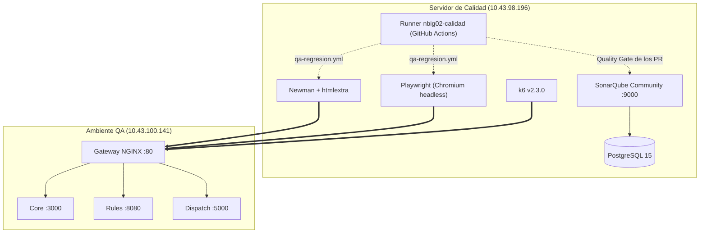

# Reporte general de QA del Sprint 4

| Campo | Valor |
|---|---|
| Sprint | Sprint 4 (cierre del 21 de octubre de 2026) |
| Responsable | Santiago Hernández (QA) |
| Fecha de corte | 21 de octubre de 2026 |
| Ambientes | DEV `10.43.98.232` (rama `develop`), QA `10.43.100.141` (rama `release`, Supabase `MANI-QA`) y Calidad `10.43.98.196` (SonarQube, runners y k6) |
| Estado | Borrador para revisión de la Scrum Master y aceptación de la PO |
| Relación con el TD | [`product/TD.md`](../01-producto/TD.md) (TD V2, SCRUM-1250) es el documento de pruebas del producto y resume este reporte. Aquí está el detalle de QA del sprint |
| Umbrales | No se definen aquí: viven en el [SDD](../02-arquitectura/SDD.md) §7 y §8 y en [ADR-0005](../02-arquitectura/adr/ADR-0005-devsecops.md) |

Este documento reúne en un solo archivo los siete documentos de QA que estaban sueltos en `qa/`. El contenido de cada uno se conserva en la sección indicada, y la versión completa sigue disponible en el historial de git (commit `d970013`).

| Documento original | Tarea | Fecha | Sección de este reporte |
|---|---|---|---|
| `ACTA_AUDITORIA_DEV_QA_CFG4-01.md` | CFG4-01 | 17 oct | 2 |
| `GUIA_OPERATIVA_CALIDAD_QA_CFG4-03.md` | CFG4-03 (QA-INF-01 a QA-INF-03) | 17 oct | 3 |
| `MANI_Matriz_Pruebas_Sprint4.xlsx` | SCRUM-1264 (1271 a 1273) | 16 oct | 5 |
| `PLAN_PRUEBAS_EP-02_MIGRACION.md` | SCRUM-1094 (DOC-38) | 6 oct | 6 y anexos A y B |
| `REPORTE_QA_MONITOREO_QAS_SCRUM-1266.md` | SCRUM-1266 (1274 a 1276) | 20 oct | 7 |
| `REPORTE_QA_REGRESION_SCRUM-1267.md` | SCRUM-1267 (1277 a 1279) | 20 y 21 oct | 8 |
| `MANI_Matriz_Ejecucion_Sprint4.xlsx` | SCRUM-1267 | 21 oct | 8 |

Regla que aplica en todo el reporte: una historia no se considera aprobada por su estado en Jira, sino por la ejecución en QA con evidencia versionada. Un escenario cuya herramienta o dependencia no está disponible se reporta como bloqueado o no medible, nunca como cumplido. Ningún valor está estimado: lo que no se midió se declara como no medido.

---

## 1. Resumen ejecutivo

| Frente | Resultado al 21 de octubre |
|---|---|
| Ambientes DEV y QA (CFG4-01) | Seis contenedores arriba en cada VM con Docker Compose, imágenes de GHCR (`:develop` y `:staging`) y healthchecks en 200 desde el 17 de octubre. La promoción del 20 de octubre no dejó QA operativo sin cambios manuales, que siguen sin versionar (R-08) |
| Cadena de calidad (CFG4-03) | SonarQube, Newman, Playwright y k6 operan desde la VM de Calidad. El runner self-hosted `nbig02-calidad` ejecuta el Quality Gate de los PR y el gate de regresión `qa-regresion.yml` |
| Calidad estática | Quality Gate en verde en los seis repositorios. 0 vulnerabilidades Blocker o Critical; 5 MAJOR y 2 MINOR abiertas que el gate no bloquea porque son código existente |
| Plan de pruebas (SCRUM-1264) | 17 historias, 228 casos diseñados (200 de prioridad Alta), 90 casos cross-tenant aplicables y 17 puntos de integración |
| Regresión (SCRUM-1267) | 27 historias priorizadas: 0 Aprobado, 16 Ejecutado, 0 Fallido, 4 Bloqueado, 1 Sin ejecutar y 6 No disponible. Newman 77 solicitudes y 125 aserciones con 0 fallidas; Playwright 11 de 11 |
| Cobertura de SCRUM-1264 | 20 casos completos y 22 parciales de 228. De los 200 de prioridad Alta, 13 completos (6,5 %) y 19 parciales. ADR-0005 exige ≥ 90 %: **no se cumple** |
| Multi-tenant (SCRUM-1279) | B1 a B6 aprueban por el Gateway. Por historia, 10 de 90 casos aprobados, 5 bloqueados y 75 sin ejecutar. RLS no se ejerce en QA (R-06, R-07, R-09) |
| Escenarios QAS-01 a QAS-09 (SCRUM-1266) | Medidos el 19 y 20 de octubre con servicios stub: QAS-01 y QAS-06 no cumplían, QAS-03 tiene línea base p95 de 12,4 ms sobre el stub y los demás quedaron bloqueados o no medibles. Desde entonces QAS-01 mejoró (H-01 y H-02 resueltos) y ninguno se volvió a medir |
| Defectos | 19 propuestos entre los dos reportes (H-01 a H-08 y R-01 a R-11), con solapamientos. 5 registrados en Jira (SCRUM-1358 a SCRUM-1362): 4 corregidos y verificados y 1 mitigado en QA. Abiertos: R-06, R-07, R-08, R-09, R-11 y los H de observabilidad (sección 9) |
| Aceptación de la PO | Pendiente: los resultados no se han presentado a la PO |

**Dictamen.** El sprint deja una cadena de calidad operativa y una regresión reproducible en QA sin fallas tras las correcciones del 21 de octubre, pero ninguna historia llega a Aprobado: la cobertura de los casos diseñados es incompleta, la regresión usa tokens sintéticos, los flujos de interfaz no se ejecutaron y el aislamiento en la base no se ejerce.

---

## 2. Ambientes DEV y QA (CFG4-01)

Auditoría del 17 de octubre de 2026 a cargo del equipo DevOps y Arquitectura. Objetivo: pasar de componentes *configurados* (código o pipelines en el repositorio, sin servicio corriendo) a componentes *operativos* (servicios corriendo, interconectados, con healthcheck y despliegue repetible).

### 2.1 Topología

| Campo | QA | DEV |
|---|---|---|
| IP | `10.43.100.141` | `10.43.98.232` |
| Sistema operativo | Ubuntu 22.04.5 LTS | Ubuntu 22.04.5 LTS |
| Docker | Engine 29.8.1, Compose v5.5.1 | Engine 29.8.1, Compose v5.5.1 |
| Rama de origen | `release` | `develop` |
| Tag de imágenes (GHCR) | `:staging` | `:develop` |
| Compose | `/opt/mani/docker-compose.qa.yml` | `/opt/mani/docker-compose.dev.yml` |
| Variables | `/opt/mani/.env.qa` | `/opt/mani/.env.dev` |

| Componente | Contenedor | Puerto host | Puerto contenedor | Exposición |
|---|---|---|---|---|
| API Gateway (NGINX) | `mani-api-gateway` | 80 | 80 | Pública, entrada SOA |
| Flutter Web | `mani-flutter-web` | 8080 | 80 | Pública |
| Landing (React y Vite) | `mani-landing-web` | 3001 | 80 | Pública |
| Core (Node.js) | `mani-core-service` | — | 3000 | Privada, `/api/v1/core/*` |
| Rules (Java) | `mani-rules-service` | — | 8080 | Privada, `/api/v1/rules/*` |
| Dispatch (.NET) | `mani-dispatch-service` | — | 5000 | Privada, `/api/v1/dispatch/*` |

Todos comparten la red interna `mani-network`.

### 2.2 Matriz "configurado" frente a "operativo"

| Componente | Falla encontrada | Remediación | Estado final |
|---|---|---|---|
| MANI-Landing | Sin `Dockerfile`, `nginx.conf`, workflow ni ramas `release` y `develop` | `Dockerfile` multi-stage (Node 20 → Nginx Alpine), `nginx.conf` con fallback SPA, workflow `docker-publish.yml` y ramas nuevas | Imagen en GHCR; puerto 3001 en 200 |
| MANI-APIGateway | Solo rama `main`; CI solo publicaba `:latest` | Ramas `release` y `develop`; workflow con `:staging` y `:develop` | Gateway en el puerto 80 enrutando a los servicios |
| MANI-Node | Sin rama `release`; crash loop en DEV por falta de `SUPABASE_JWT_SECRET` y `/health` en `503 DEGRADED` por URL mock | Rama `release`, workflow ajustado y variable inyectada en `.env` de DEV y QA | `/api/v1/core/health` en 200 |
| MANI-Java | Sin rama `release` ni imagen `:staging` | Rama y workflow | `/api/v1/rules/health` en 200 |
| MANI-.NET | Solo rama `main` | Ramas `release` y `develop`; workflow | `/api/v1/dispatch/health` en 200 |
| MANI-Flutter | Ocupaba el puerto 80 del host en ambas VMs | Workflow con `:staging` y `:develop`; contenedor movido a `8080:80` | Flutter Web en 8080; puerto 80 libre para el Gateway |
| Host QA y host DEV | Solo un contenedor suelto de Flutter, sin compose | `/opt/mani` con compose, `.env`, `deploy-*.sh` y `check-*.sh` | Seis contenedores arriba |

### 2.3 Evidencia de salud del 17 de octubre

Salida de `check-qa.sh` y `check-dev.sh`: seis contenedores `Up` en cada VM y respuesta 200 en los seis endpoints (`/health` del Gateway, `/api/v1/{core,rules,dispatch}/health` a través del Gateway, `:8080/` de Flutter y `:3001/` de la landing), con `correlationId` en las respuestas de los servicios. En DEV, el health del Core reportó `database.configured: false`.

### 2.4 Operación

```bash
# Salud (por SSH en cada VM)
/opt/mani/check-qa.sh       # VM de QA
/opt/mani/check-dev.sh      # VM de DEV

# Redespliegue idempotente tras un push a release o develop
sudo /opt/mani/deploy-qa.sh
sudo /opt/mani/deploy-dev.sh
```

`deploy-*.sh` hace `docker compose pull`, recrea los contenedores (`down --remove-orphans && up -d`) y confirma la estabilización.

### 2.5 Dictamen del acta y lo que se observó después

El acta declaró cumplidos los criterios de CFG4-01: ramas `develop` y `release` en todos los repositorios, workflows publicando en GHCR, arranque orquestado con Compose, puertos sin colisiones, healthchecks en 200, secretos fuera del código y matriz con evidencia.

Las verificaciones posteriores de QA matizan ese dictamen:

- 19 oct: el Gateway de QA no corría la cabeza de `release` (H-03), ningún contenedor declara `healthcheck:` (H-04) y `SUPABASE_URL` del Core apuntaba a un mock (H-08). Sección 7.
- 20 oct: la promoción `develop` → `release` no dejó QA operativo; QA tuvo que corregir el compose, `.env.qa` y aplicar migraciones a mano, y esos cambios no están versionados (R-08). Sección 8.2.

---

## 3. Cadena de calidad en QA (CFG4-03)

Configuración del 17 de octubre de 2026 a cargo de Daniel Ávila (DevOps), subtareas QA-INF-01 (SonarQube), QA-INF-02 (runners de Newman y Playwright) y QA-INF-03 (healthchecks, registros y permisos). Habilita las tareas de QA SCRUM-1116 (Quality Gates), SCRUM-1119 (Playwright) y SCRUM-1120 (Newman).

| Host | Rol | Recursos |
|---|---|---|
| Calidad `10.43.98.196` (`NBIG02`) | SonarQube, runners de Newman, Playwright y k6, runner de GitHub Actions | Ubuntu 22.04.5, 11 GiB de RAM, 49 GB de disco. Puertos 9000 y 22 |
| QA `10.43.100.141` | Objetivo de las pruebas | 11 GiB de RAM, 47 GB libres. Puertos 80, 3001, 8080 y 22 |



### 3.1 SonarQube (QA-INF-01)

- SonarQube Community Build 26.10 con PostgreSQL 15 persistente (`/opt/quality/sonarqube/docker-compose.yml`). Parámetros de kernel para Elasticsearch en `/etc/sysctl.d/99-sonarqube.conf` (`vm.max_map_count=262144`, `fs.file-max=65536`).
- Salud: `curl -s http://10.43.98.196:9000/api/system/status` → `"status":"UP"`.
- Credenciales en `/opt/quality/.env.quality` con permisos 600, fuera del repositorio. La contraseña por defecto se cambió y se generó un token global de análisis.
- **Runner self-hosted (QA4-02, SCRUM-1265):** `nbig02-calidad`, registrado en la organización `Trama-AS`, grupo `calidad`, label `calidad`. Instalado en `/home/estudiante/actions-runner` como servicio systemd. `SONAR_TOKEN` es secreto de la organización y `SONAR_HOST_URL` variable de la organización. Detalle por repositorio en [`INFRAESTRUCTURA_MANI.md` §24.1](../06-gobernanza/INFRAESTRUCTURA_MANI.md#241-estado-del-análisis-sonarqube-por-repositorio).

```bash
# Estado y reinicio del runner
cd ~/actions-runner && sudo ./svc.sh status
sudo ./svc.sh stop && sudo ./svc.sh start
pgrep -af Runner.Listener    # un solo proceso; dos fallan con "A session for this runner already exists"

# Registro desde cero (token de Trama-AS > Settings > Actions > Runners > New runner, vence en una hora)
./config.sh remove --local
./config.sh --url https://github.com/Trama-AS --token <token de registro> \
  --name nbig02-calidad --labels calidad --runnergroup calidad --unattended
sudo ./svc.sh install estudiante && sudo ./svc.sh start
```

Si un check "Sonar Quality Gate" queda en cola más de 10 minutos, revisar el servicio. Un run creado antes de cambiar un secreto o variable los recibe vacíos y hay que relanzarlo.

> **Seguridad.** La versión original de la guía publicó en el repositorio la contraseña de administrador de SonarQube y el token global de análisis. Este reporte no los reproduce, pero siguen en el historial de git: hay que rotar ambos (responsable: DevOps).

### 3.2 Runners de Newman y Playwright (QA-INF-02)

| Runner | Instalación | Suite inicial | Resultado del 17 de octubre |
|---|---|---|---|
| Newman | Node.js 20.20.2, `newman` y `newman-reporter-htmlextra`; colecciones en `/opt/quality/runners/newman/collections/` (incluye `mani-aislamiento` y `mani-claims`) | `qa-health-contract.json`: health de Gateway, Core, Rules y Dispatch y rechazo 401 sin token | 5 solicitudes, 10 aserciones, 0 fallidas; promedio 16 ms |
| Playwright | `@playwright/test` con Chromium headless; `baseURL` `http://10.43.100.141` | `qa-perimeter.spec.js`: TC01 a TC06 (health, 401 perimetral y propagación de `X-Correlation-ID`) | 6 de 6 en 1,5 s |

Reportes en `/opt/quality/reports/{newman,playwright}/`. Se comprobó la política de gate rojo: una aserción fallida termina con `exit 1` en Newman y en Playwright y detiene el pipeline.

### 3.3 Healthchecks, registros y permisos (QA-INF-03)

- Los seis servicios de QA respondieron 200 con latencias de 0 a 10 ms.
- El log de acceso de NGINX es JSON con `request_time` y `x_correlation_id`, y registró las peticiones desde Calidad.

### 3.4 Uso por QA

```bash
# Nueva colección Newman
newman run /opt/quality/runners/newman/collections/<coleccion>.json \
  --reporters cli,htmlextra --reporter-htmlextra-export /opt/quality/reports/newman/<reporte>.html

# Nuevas pruebas Playwright
cd /opt/quality/runners/playwright && npx playwright test
```

La regresión del sprint ya no usa estos directorios de la VM: sus suites viven en `qa/` de MANI-APIGateway (sección 8.3).

---

## 4. Calidad estática

Consulta del 21 de octubre a SonarQube (Calidad) y SonarCloud (Flutter). Evidencia: [`td_v2/evidencia/sonar_20261021.json`](td_v2/evidencia/sonar_20261021.json).

Gate `MANI ADR-0005` en SonarQube: violaciones nuevas = 0, cobertura del código nuevo ≥ 80 %, duplicación del código nuevo ≤ 3 % y hotspots nuevos revisados al 100 %.

| Repositorio | Gate | Cobertura total | Duplicación total | Vulnerabilidades abiertas | Último análisis |
|---|---|---|---|---|---|
| MANI-APIGateway | OK | sin dato | 0,0 % | 1 MINOR (`docker:S6471`, imagen como root) | 21 oct, `fc08a33` |
| MANI-Node (Core) | OK | 90,1 % | 1,4 % | 4 MAJOR (`S5693` en `auth.routes.js:28` y `:34`; `S2245` en dos repositorios en memoria) | 21 oct, `8e198ff` |
| MANI-.NET (Dispatch) | OK | 84,5 % | 8,7 % | 1 MAJOR (`S5122`, CORS abierto en `Program.cs:24`) y 1 MINOR (`S6471`) | 21 oct, `a0a18e1` |
| MANI-Java (Rules) | OK | 92,3 % | 0,0 % | 0 | 20 oct, `9f7ab3c` |
| MANI-Landing | OK | 100 % | 1,0 % | 0 | 20 oct, `f79e55b` |
| MANI-Flutter (SonarCloud) | OK | 83,2 % | 13,4 % | 0 | 21 oct, `6b805e2` |

- El gate mide el código nuevo: pasa con vulnerabilidades y duplicación que ya existían.
- En MANI-APIGateway no hay dato de cobertura, así que Sonar omite esa condición.
- El gate de SonarCloud para Flutter evalúa calificaciones del código nuevo y hotspots, no las condiciones de `MANI ADR-0005`. La duplicación total de Flutter (13,4 %) supera el 3 %, aunque el umbral aplica al código nuevo.
- El 20 de octubre el gate del Gateway detectó dos contraseñas de prueba en el generador de la regresión (`S2068`); se corrigió en MANI-APIGateway#18 antes del merge.

---

## 5. Plan de pruebas del Sprint 4 (SCRUM-1264)

Matriz de diseño [`MANI_Matriz_Pruebas_Sprint4.xlsx`](regresion_sprint4/MANI_Matriz_Pruebas_Sprint4.xlsx), subtareas SCRUM-1271 a SCRUM-1273. Corte de fuentes: 16 de octubre de 2026. Es un documento de diseño: ningún caso estaba ejecutado al publicarse. Hojas: `resumen`, `casos`, `integracion`, `trazabilidad`, `cross_tenant`, `qas` y `brechas_supuestos`.

### 5.1 Dimensiones

| Dimensión | Valor |
|---|---|
| Historias con casos | 17 de 17 priorizadas en la matriz |
| Casos diseñados | 228: 200 de prioridad Alta y 28 de prioridad Media |
| Tipo | Multi-tenant 81, positivos 32, regresión 29, seguridad 23, negativos 21, roles 12, errores 8, E2E 7, integración 6, contrato 4, concurrencia 4, rendimiento 1 |
| Herramienta prevista | Newman por el Gateway 174; Playwright 21; revisión estática más prueba unitaria de Flutter 8; SQL manual 8; integración nativa con `node:test` 5; prueba unitaria de Flutter 4; manual 3; xUnit 3; k6 2 |
| Repositorio | MANI-Node 122, MANI-.NET 44, MANI-Flutter 41, MANI-Java 13, MANI-APIGateway 8 |
| Servicios tocados | Gateway 206, persistencia 203, Core 171, Flutter 168, Dispatch 69, Rules 15, Storage 8, Kafka 1 |
| Casos cross-tenant aplicables (X1 a X6) | 90 |

| Historia | Código | Casos | Historia | Código | Casos |
|---|---|---|---|---|---|
| SCRUM-850 | US-02.1.5 | 12 | SCRUM-1060 | US-02.1.2-M3 | 22 |
| SCRUM-852 | US-02.2.2 | 10 | SCRUM-1063 | US-02.1.2-M2 | 18 |
| SCRUM-853 | US-02.2.3 | 10 | SCRUM-1066 | US-02.1.3-M2 | 20 |
| SCRUM-854 | US-02.3.1 | 11 | SCRUM-1068 | US-02.1.4-M2 | 11 |
| SCRUM-855 | US-02.1.6 | 11 | SCRUM-1070 | US-03.1.1-M6 | 16 |
| SCRUM-856 | US-02.3.2 | 11 | SCRUM-1072 | US-04.1.1-M2 | 15 |
| SCRUM-858 | US-03.1.2 | 11 | SCRUM-1073 | US-04.1.1-M6 | 14 |
| SCRUM-861 | US-04.1.2 | 11 | SCRUM-1074 | US-04.1.4-M6 | 14 |
| SCRUM-862 | US-04.1.3 | 11 | | | |

La regresión (sección 8) prioriza 27 historias: las 24 con subtarea "QA - Validar US" y SCRUM-1063, 1066 y 1068. SCRUM-865, 867, 868, 869, 870, 879 y 1335 tienen subtarea QA pero no tienen casos en esta matriz.

### 5.2 Puntos de integración (hoja `integracion`)

| ID | Interacción | Qué se prueba | Herramienta | Riesgo al 16 de octubre |
|---|---|---|---|---|
| CX-01 | Flutter → Supabase Auth | Login y renovación emiten JWT con `tenant_id` y `user_role`; ningún otro uso del SDK | Playwright y revisión estática | Flutter `main` vuelve a `auth.signUp` (B-22) |
| CX-02 | Flutter → Gateway | 0 peticiones a `/rest/v1`, `/rpc` o `/storage/v1` (HAR) | Playwright | Seis datasources de `develop` aún llamaban a Supabase |
| CX-03 | Gateway → `validate-token` de Core | Token válido inyecta `X-Tenant-Id`, `X-User-Role` y `X-User-Id`; inválido, 401 | Newman | Core `develop` no exponía `validate-token` (B-03) |
| CX-04 | Gateway → rutas públicas de Core | `X-Tenant-Slug` solo en registro y login | Newman | `aliados/empresa` caía en una ruta protegida |
| CX-05 | Gateway → rutas protegidas de Core | `X-Tenant-Id` del cliente se sobrescribe con el del token | Newman | Discrepancia sobre quién valida (B-08) |
| CX-06 | Gateway → Rules | Rutas por el Gateway con inyección de cabeceras | Newman | Prefijo recortado (B-04); Rules no valida el JWT |
| CX-07 | Gateway → Dispatch | `match`, `eligible-allies`, `orchestrate`, `accept`, `reject` | Newman | Prefijo recortado (B-04) |
| CX-08 | Core → PostgreSQL | Autorización por claim; RLS como defensa adicional | Integración nativa y SQL | `service-role` anula `auth.uid()`; `/catalog` sin filtro (B-07, B-18) |
| CX-09 | Core → Storage | Ruta `tenant_id/aliado_id/documento`, acceso temporal | Newman y prueba nativa | Mecanismo de acceso temporal sin definir |
| CX-10 | Core → Rules | Reenvío de tenant y rol; error controlado si Rules cae | Prueba nativa y Newman | Timeout por confirmar |
| CX-11 | Core → Dispatch | La solicitud llega una vez; el reintento no duplica | Integración nativa | Mecanismo no definido (B-05, B-06) |
| CX-12 | Dispatch → PostgreSQL | Una aceptación confirmada, resto 409, 0 dobles asignaciones con 50 concurrentes | k6, xUnit y SQL | `main` usaba un diccionario en memoria |
| CX-13 | Rules → configuración | El override de un tenant no se aplica a otro | JUnit 5 y Newman | Un flujo nuevo exige ampliar `ck_categoria_flujo` |
| CX-14, CX-15 | Core y Dispatch → Kafka | `SolicitudCreada` y `AliadoAsignado` | Por definir | Sin ADR, infraestructura ni esquema (B-06) |
| CX-16 | Gateway → OpenAPI | Endpoints publicados frente al contrato | Newman y Spectral | Contrato de Core sin 403 ni 404 (B-05) |
| CX-17 | Gateway → health | 200 de los cuatro antes de cada corrida | Newman | Rules y Dispatch debían estar desplegados |

### 5.3 Relación con los QAS (hoja `qas`)

| QAS | Casos relacionados | Estado de medición al 16 de octubre |
|---|---|---|
| QAS-01 Seguridad | 108 | No medible hasta tener la herramienta |
| QAS-02 Fiabilidad | 0 | No medible: depende del adaptador de ARQ-09 (SCRUM-1240, blocked) |
| QAS-03 Eficiencia | 1 (US0412-R1) | No medible hasta tener la herramienta |
| QAS-04 Mantenibilidad | 1 (US0311M6-R1) | No medible hasta tener la herramienta |
| QAS-05 Escalabilidad | 0 | No medible: Kubernetes no decidido |
| QAS-06 Interoperabilidad | 4 | No medible hasta tener la herramienta |
| QAS-07 Corrección funcional | 5 | No medible hasta tener la herramienta |
| QAS-08 Protección contra errores de usuario | 13 | No medible: Maestro sin ticket |
| QAS-09 Safety | 5 | No medible hasta tener la herramienta |

### 5.4 Supuestos y brechas del diseño (hoja `brechas_supuestos`)

Supuestos:

- **S-01** Alcance de 17 historias, con prioridad Alta para las migraciones y las historias en revisión, porque SCRUM-1257 (criterios de la PO) estaba bloqueada.
- **S-02** Código leído en `develop` para Flutter y Node, y en `main` y ramas feature para Gateway, Java y .NET, que no tenían `develop` en el remoto.
- **S-03** Datos base: `supabase/seed/seed_qa_multitenant.sql` de MANI-APIGateway (tenants `acme-servicios` y `nova-mantenimiento`).
- **S-04** Los casos de token se redactan contra ADR-0018 (el Gateway valida el token).

Brechas, agrupadas por tema (el detalle de B-01 a B-24 y O-01 a O-04 con responsable y ticket está en la hoja):

| Tema | Brechas | Resumen |
|---|---|---|
| Criterios y alcance funcional | B-01, B-14, B-16, B-17, B-21, B-24 | Criterios de la PO pendientes; SCRUM-1068 sin refinar; historias que describen el camino PL/pgSQL contra ADR-0022; reglas por definir en 852, 854, 855 y 856 |
| Contratos y endpoints | B-02, B-05, B-20 | Endpoints sin publicar en Core ni OpenAPI; idempotencia sin definir |
| Gateway e identidad | B-03, B-04, B-07, B-08, B-19 | `validate-token` ausente en `develop`, prefijo recortado hacia Rules y Dispatch, identidad del llamador servicio sin diseñar, configuración JWT por ambiente sin cerrar, Rules sin validar JWT |
| Eventos | B-06 | Kafka sin ADR, infraestructura ni esquema |
| Datos de prueba | B-09, B-10 | Dos semillas incompatibles; faltan segundo cliente empresa, segundo aliado, aliado empresa, segunda categoría, solicitud en curso y versión de TyC |
| Herramientas | B-11, B-12, B-13 | Newman y Playwright sin configurar al 16 de octubre (después se resolvió con CFG4-03); Maestro sin ticket; QAS-05 supone Kubernetes |
| Ramas y repositorios | B-18, B-22 | `/catalog` sin filtro por tenant y `/tenants` sin autenticación en Core `develop`; ramas desalineadas |
| Gestión | B-15, B-23, O-01 a O-04 | SCRUM-1063, 1066 y 1068 sin subtarea QA; TD inexistente al 16 de octubre (después se publicó TD V2); asignaciones y estimaciones por revisar; numeración de QAS desalineada en la wiki |

---

## 6. Antecedente: plan de paridad de las historias migradas de EP-02 (SCRUM-1094)

Plan del 6 de octubre de 2026 (Sprint 3, DOC-38, subtareas SCRUM-1167 a SCRUM-1172). Cubre US-02.1.1-M2/M3 (SCRUM-1065, 1061), US-02.1.2-M2/M3 (SCRUM-1063, 1060), US-02.1.3-M2 (SCRUM-1066) y US-02.2.1-M2 (SCRUM-1064). Es la línea base de V1 del TD y el insumo para autorizar el retiro de funciones PL/pgSQL previsto en ADR-0022.

### 6.1 Cambio de arquitectura que se verifica

| | Arquitectura anterior (entregas 1 a 3) | Arquitectura vigente |
|---|---|---|
| Camino | Flutter → Supabase directo (`.rpc()`, `.from()`, `.storage.from()`) | Flutter → Gateway → Core → Supabase |
| Identidad | El cliente llama a Supabase con su token | Supabase Auth emite el JWT, el tenant viaja como claim y el servicio lo valida |
| Lógica de negocio | Flutter y funciones PL/pgSQL | Servicios (ADR-0022) |
| Aislamiento | RLS por `auth.uid()` | Autorización en el servicio; RLS como defensa adicional |

### 6.2 Criterio de paridad

Comportamiento por comportamiento: cada regla que verificaba la arquitectura anterior (prueba vieja, criterio original o función PL/pgSQL) se lista con su resultado esperado escrito antes de ejecutar. Queda **preservado (P)** si pasa por el camino nuevo con el mismo resultado; **construido y verificado (C)** si no tenía línea base; **no se preserva (NP)** si viola la arquitectura vigente. Una prueba de Flutter con servidor falso verifica el cliente, no cuenta como paridad de una regla que vive en Core.

### 6.3 Inventario de la línea base

- `MANI-Flutter@develop` (`1f4c843`): 39 archivos en `test/` (33 `_test.dart` y 6 `fakes.dart`). US-02.1.3 tiene la prueba de integración `verificacion_aliados_us0213_test.dart` y 71 pruebas unitarias; el cliente del Gateway tiene 28 pruebas y los registros por Gateway, 19. US-02.1.1, US-02.1.2 y US-02.2.1 no tienen prueba vieja propia.
- Colecciones `mani-aislamiento` (seis casos de aislamiento sobre `/rest/v1` y `/storage/v1`) y `mani-claims` (propagación de claims y suplantación). Siguen vigentes como defensa de RLS mientras la llave pública esté en el bundle (CFG-36).
- Funciones PL/pgSQL que se reemplazan: `registrar_aliado_persona_natural`, `registrar_aliado_empresa` (hace *upsert* ante duplicado y no valida documentos), `registrar_cliente_persona_natural` (con `GRANT EXECUTE` a `anon`) y las tres de verificación de aliados (códigos `MANI-VER-*`, bloqueo `FOR UPDATE`, motivo de 10 a 500 caracteres).
- Cifras de referencia del Sprint 2 (`Inf_test-002`): 313 pruebas de Flutter (18 de integración), cobertura de 85,4 % y 135/135 aserciones de Newman. El informe salió del árbol en `cc28e0c` y se recupera con `git show cc28e0c^:Project/Test/Inf_test-002.md`.

### 6.4 Casos diseñados por historia

| Historia | Casos | Tipo predominante | Estado al 6 de octubre |
|---|---|---|---|
| US-02.1.1-M2/M3 | `rgA1P` a `rgB6`, definidos en [`regresion_sprint4/PLAN_REGRESION_US-02.1.1-M4.md`](regresion_sprint4/PLAN_REGRESION_US-02.1.1-M4.md) | P y C | Bloqueado por CFG-16, SCRUM-1065, CFG-22 y CFG-23 |
| US-02.1.2-M2/M3 | US0212-P1 a P4, N1 a N3, V1, X1, X2 | P, y C para el rechazo sin documentos y el duplicado (cambio de *upsert* a 409) | P3 y P4 ejecutables en Flutter; el resto bloqueado por SCRUM-1063 |
| US-02.1.3-M2 | US0213-P1 a P6, N1 a N8, X1, X2 (16 casos; N3 de concurrencia obligatorio por paridad) | P | Fuera del Sprint 3 |
| US-02.2.1-M2 | US0221-P1 a P3, N1 a N3, V1, X1; dos comportamientos NP (*fallback* que escribe en tablas y `GRANT EXECUTE` a `anon`) | P, C y NP | Bloqueado por SCRUM-1064 |

### 6.5 Criterios y estado al cierre del Sprint 3

- **Entrada:** contrato CFG-16, servicio desplegado en QA, CFG-22 y CFG-23b aplicados, semilla verificada y herramienta entregada.
- **Salida:** 100 % de los P con su resultado, 100 % de negativos y cross-tenant con control positivo, NP verificados como ausentes, gates de ADR-0005 o excepción documentada, y diferencias registradas como defecto.
- **Retiro de funciones (ADR-0022):** solo cuando todos los P que dependen de la función cumplen la salida.
- **Estado al 6 de octubre:** pruebas de conexión ejecutadas en local (anexo A); ningún caso de historia ejecutado; ninguna historia alcanzó la salida y **ninguna función PL/pgSQL quedó autorizada para retirarse**.

**Continuidad en el Sprint 4.** La regresión de la sección 8 ejecutó casos de SCRUM-1063 (rechazo sin Cámara de Comercio) y SCRUM-1066 (listado y detalle de verificación), pero no la matriz de paridad de este plan. La autorización de retiro sigue pendiente. Los puntos abiertos PA-01 a PA-28 están en el anexo B.

---

## 7. Monitoreo de QA y escenarios QAS-01 a QAS-09 (SCRUM-1266)

Subtareas SCRUM-1274 (QA-MON-01), SCRUM-1275 (QA-MON-02) y SCRUM-1276 (QA-MON-03). Corte: 20 de octubre de 2026, 00:47 UTC. Las pruebas salieron de la VM de Calidad y, donde se indica, del equipo del autor en la red del campus. Scripts y evidencia: [`monitoreo_qas/`](monitoreo_qas/README.md). Corridas reproducibles: `ejecutar_calidad.sh` (Calidad, 00:28 a 00:35 UTC) y `verificar_monitoreo.sh vm_qa` (QA, 00:31 a 00:45 UTC).

**Contexto que limita todo el capítulo:** el 19 y 20 de octubre QA ejecutaba las imágenes de `release` previas a la promoción, y Core, Rules y Dispatch eran stubs con datos fijos.

### 7.1 Ambiente verificado (QA-MON-01)

| Contenedor | Revisión desplegada | Cabeza de `release` | Coincide |
|---|---|---|---|
| `mani-api-gateway` | `6b475f9` | `9874e93` | **No** (H-03) |
| `mani-core-service` | `6ca27ab` | `6ca27ab` | Sí |
| `mani-rules-service` | `f8582aa` | `f8582aa` | Sí |
| `mani-dispatch-service` | `e40f84e` | `e40f84e` | Sí |
| `mani-flutter-web` | `5e71358` | `5e71358` | Sí |
| `mani-landing-web` | `c015164` | — | No revisado |

Inventario de observabilidad:

| Elemento | Verificado en QA |
|---|---|
| Healthchecks por el Gateway | Sí: 200 en los cuatro, 2 a 14 ms desde Calidad. Core y Dispatch devuelven `X-Correlation-ID` duplicado (H-07) |
| `healthcheck:` de Docker | **No**: ninguno de los seis contenedores lo declara (H-04) |
| Log del Gateway | Sí: JSON con `request_time` y `x_correlation_id`, leído con `docker logs` |
| Logs de servicios | Core escribe texto con `Correlation:`; Rules y Dispatch no registraron las peticiones de la corrida (H-05) |
| Métricas (Prometheus, Grafana, Datadog) | **No hay** contenedores, puertos ni endpoints `/metrics` (H-05) |
| Kafka | No hay broker. ARQ-05 (SCRUM-1236) diferida al Sprint 5 |
| k6 en Calidad | Instalado el 20 de octubre (v2.3.0, sha256 verificado) |
| `SUPABASE_URL` del Core | Apuntaba a `mock.supabase.co`, no a `MANI-QA` (H-08) |

Durante la carga nominal (`docker stats` cada 10 s, sin cubrir la rampa ni el primer minuto): Core 25,8 % de CPU y 74 MiB, Dispatch 12,1 % y 175 MiB, Gateway 9,1 % y 4 MiB, Rules 0,3 % y 53 MiB. El Core sube porque cada petición pasa por su `validate-token`. El log del Gateway registró 16 632 peticiones de la corrida (16 577 con 200, 50 con 409 y 5 con 401); las 16 564 de QAS-03 tuvieron `request_time` p50 de 7 ms, p95 de 11 ms y máximo de 90 ms.

### 7.2 Matriz QAS-01 a QAS-09 (QA-MON-02), con su estado posterior

| QAS | Umbral (SDD §8) | Medido el 19 y 20 de octubre | Estado entonces | Cambio verificado hasta el 21 de octubre |
|---|---|---|---|---|
| 01 Seguridad | 100 % de accesos cross-tenant rechazados | Caso 5: 4 de 4 rechazos 401; `dev-token` emitía tokens aceptados para cualquier tenant y rol | **No cumple** (H-01, H-02); casos 1 a 4 y 6 bloqueados por el stub | H-01 ya no se reproduce (`dev-token` en 404). H-02 corregido (R-10). B1 a B6 aprueban por el Gateway. Pendiente: 75 casos X y RLS |
| 02 Fiabilidad | 0 operaciones revertidas por fallo de notificación | — | **Bloqueado**: sin componente de notificaciones (MANI-Node#43) | Sin cambio |
| 03 Eficiencia | p95 ≤ 500 ms con 300 sesiones y 50 req/s | p95 12,4 ms (k6) y 11 ms (Gateway); 49,99 req/s, 14 998 peticiones, 0 errores | **Bloqueado**, con línea base sobre el stub de Dispatch | Dispatch real desplegado; no se repitió |
| 04 Mantenibilidad | 0 cambios en consumidores ante un cambio compatible de Rules | — | **No medible**: el único cambio de Rules (MANI-Java#2) obligó a cambiar Core | Sin cambio |
| 05 Escalabilidad | 2 a 6 réplicas sin cambio de código | — | **No medible**: Docker Compose, sin Kubernetes | Sin cambio |
| 06 Interoperabilidad | 100 % de APIs con OpenAPI y contract tests | 1 de 12 operaciones con contrato (8,3 %) | **No cumple** ([`qas06_api_vs_contrato.md`](monitoreo_qas/qas06_api_vs_contrato.md)) | MANI-APIGateway#20 agregó al contrato la ruta pública de documentos legales; no se repitió |
| 07 Corrección | Un 200, el resto 409, 0 dobles asignaciones | Arnés: 1×200 y 49×409 con 50 aceptaciones | **Bloqueado**: el stub guardaba la asignación en memoria | Aceptación idempotente y rechazo cross-tenant aprueban contra Dispatch real (1074-01 a 1074-04); la concurrencia no se ejecutó |
| 08 Interacción | 100 % de acciones irreversibles con confirmación | — | **Bloqueado o no medible**: Maestro sin ticket | Sin cambio |
| 09 Safety | 0 transacciones ambiguas por fallas de terceros | — | **Bloqueado**: KYC no estaba en QA y no hay fault injection | Sin cambio |

### 7.3 Detalle de los escenarios ejecutados

**QAS-01, caso 5 y emisión de tokens.** Primera ejecución el 19 de octubre a las 21:48 UTC desde el equipo del autor: `POST /api/v1/core/auth/dev-token` respondió 200 y emitió un JWT HS256 para el tenant pedido; con ese token, `profiles/me`, `rules/evaluate-rate`, `rules/rank-allies` y `dispatch/match` respondieron 200, incluso para un tenant inexistente con rol `admin`. Firma alterada, token vencido, sin `Authorization` y `Authorization: Token` dieron 401. Corrida reproducible el 20 de octubre a las 00:29 UTC desde Calidad con Newman 6.2.3: 10 peticiones, 31 aserciones y 2 fallidas, las de `dev-token`.

**QAS-03, línea base del perímetro.** k6 v2.3.0 desde Calidad sobre `POST /api/v1/dispatch/match` (stub).

| Campo | Humo | Nominal |
|---|---|---|
| Ventana (UTC) | 20 oct, 00:29:08 a 00:29:48 | 20 oct, 00:29:48 a 00:35:54 |
| Carga | 10 VUs, 2 req/s, 30 s sostenidos | 300 VUs, 50 req/s, rampa de 60 s y 5 min sostenidos |
| Peticiones sostenidas | 60 | 14 998 (49,99 req/s) |
| Errores | 0 | 0 |
| p95 (k6) | 11,4 ms | **12,4 ms** (p90 11,1; p99 15,7; máximo 91,9) |
| Validez para QAS-03 | No: stub | No: stub sin base de datos ni elegibilidad |

Una prueba previa desde el equipo del autor dio p95 de 89 ms por la red del equipo: la carga debe salir de Calidad. El SDD pide medir la consulta de aliados en el Core; la implementación la ubica en Dispatch (MANI-.NET#3, que consulta `GET /allies/eligible` de MANI-Node#43).

**QAS-07, validación del arnés.** `k6/qas07_aceptacion_concurrente.js`: 50 aceptaciones simultáneas desde Calidad dieron 1×200 y 49×409. Una primera versión generaba un id por VU y dio 2×200; se corrigió fijando el id en `setup()`. El reintento del ganador recibió 409 (el stub no era idempotente). Valida el arnés, no el escenario.

### 7.4 Límites del monitoreo

- Ninguna prueba usó datos reales de `MANI-QA`: los servicios desplegados no la consultaban.
- No se explicó por qué las rutas protegidas de Rules y Dispatch respondían 200 con el Gateway `6b475f9`; se observó, no se supuso.
- `docker logs` no tiene retención garantizada.
- La corrida se lanzó por la VPN de la Javeriana, pero la carga salió de Calidad.

### 7.5 Dependencias que liberan los escenarios

| Escenario | Se libera con | Responsable |
|---|---|---|
| QAS-01 completo | Core real en QA (ya desplegado el 20 de octubre) y los 75 casos X por historia; RLS ejercido | QA, Core, DevOps |
| QAS-02 | Notification Component con adaptador de prueba (MANI-Node#43) | Core |
| QAS-03 | Repetir la carga con MANI-.NET#3 y MANI-Node#43 desplegados | QA |
| QAS-04 | Un cambio interno compatible de Rules con contract tests en CI | Rules |
| QAS-05 | Kubernetes con HPA y Prometheus (INFRA-01/02) | DevOps |
| QAS-07 | Solicitud PENDIENTE propia en `MANI-QA` y el arnés contra Dispatch real | QA, DevOps |
| QAS-08 | Herramienta para flujos de pantalla y endpoints de escritura | Equipo |
| QAS-09 | KYC en QA y adaptador de fault injection | Core |

### 7.6 Observaciones documentales

- SDD §8, QAS-03: el método cita «la excepción de la sección 2.1», que §2.2 retiró, y nombra a Core cuando la implementación está en Dispatch.
- INFRAESTRUCTURA_MANI §5.2 describe un «Supabase DEV compartido». Según la decisión del 19 de octubre (Daniel, Nicolás León y Sara) solo existen `MANI` (PROD) y `MANI-QA`, y el desarrollo usa base local.
- SDD §8 cita SCRUM-1121 (k6) y SCRUM-1122 (ZAP), que no eran visibles en Jira al 19 de octubre.

---

## 8. Regresión funcional, API, E2E y multi-tenant (SCRUM-1267)

Subtareas SCRUM-1277 (Newman), SCRUM-1278 (Playwright) y SCRUM-1279 (multi-tenant). Ejecución del 20 de octubre y validación de las correcciones el 21. Matriz de ejecución: [`MANI_Matriz_Ejecucion_Sprint4.xlsx`](regresion_sprint4/MANI_Matriz_Ejecucion_Sprint4.xlsx), hojas `resumen_historias`, `cobertura_1264`, `ejecucion_casos`, `defectos_propuestos`, `equivalencias`, `limitaciones`, `criterios` y `ambiente`. Evidencia: [`regresion_sprint4/evidencia/`](regresion_sprint4/evidencia), con la del 21 de octubre en [`20261021_validacion/`](regresion_sprint4/evidencia/20261021_validacion). Suites: `qa/` de MANI-APIGateway, fusionadas en `develop` (#18, `9f67ab1`) y promovidas a `release` (#19, `3c070db`).

| Corrida (UTC) | Newman | Playwright |
|---|---|---|
| 20 oct, primera corrida (`20261020T212453Z`, `20261020T212519Z`) | 91 aserciones, 5 fallidas en los mismos 4 casos | Mismos casos de FW-02 y FW-03; FW-01 fallaba por un error de la prueba (R-05) |
| 20 oct, colección corregida (`20261020T224842Z`, `20261020T224932Z`) | 77 solicitudes, 125 aserciones, 5 fallidas en 853-04, 856-05, 1066-01 y 1066-02 | 11 pruebas, 9 aprobadas (FW-02 y FW-03 por R-04) |
| 20 oct, gate de CI desde Calidad ([run 39513870492](https://github.com/Trama-AS/MANI-APIGateway/actions/runs/39513870492); `20261020T234635Z`, `20261020T235520Z`) | Mismo resultado | Mismo resultado |
| **21 oct, tras las correcciones** (`20261021T161015Z`, `20261021T170129Z`) | **77 solicitudes, 125 aserciones, 0 fallidas** | **11 de 11** |

### 8.1 Criterios de estado

| Estado de la historia | Criterio |
|---|---|
| Aprobado | Todos los casos diseñados aplicables cubiertos, pasan con una identidad que un usuario real puede usar y se verificaron todos los criterios de aceptación |
| Ejecutado | Se ejecutaron casos y ninguno falla por un defecto del sistema, pero la evidencia no alcanza para aprobar |
| Fallido | Al menos un caso válido falla por un defecto del sistema |
| Bloqueado | Una dependencia externa a QA impide ejecutar la historia |
| No disponible | La historia no tiene código fusionado |
| Sin ejecutar | Ya no hay bloqueo y QA no ejecutó sus casos. No es del vocabulario de SCRUM-1267; se declara para no ocultar la brecha |

Por caso multi-tenant (X1 a X6): aprobado o fallido (con "(parcial)" si cubre una parte), bloqueado, no aplica o sin ejecutar. Cada caso de la regresión se marca además como No válido, No concluyente o Excluido cuando no cuenta como evidencia. El origen de cada brecha o fallo es Desarrollo (el código responde distinto al criterio), DevOps (falla la configuración o el despliegue) o QA (la prueba, los datos o la cobertura no corresponden al criterio).

### 8.2 Ambiente y preparación

La promoción `develop` → `release` se hizo el 20 de octubre a las 11:27 (Bogotá) en los seis repositorios (MANI-APIGateway#17, MANI-Node#48, MANI-Java#6, MANI-.NET#10, MANI-Flutter#50 y MANI-Landing#5). QA no quedó operativo (R-08). Para dejarlo en el código de `release`, QA hizo estos cambios con respaldo previo, que corresponden a DevOps según `governance/GOBIERNO_DEL_EQUIPO.md` §2.3 y cuya comunicación formal está pendiente:

1. Bajar las imágenes `:staging` y recrear los seis contenedores.
2. En el compose, `NODE_ENV` de `staging` a `qa` (Core solo acepta `development`, `qa`, `production` o `test`); agregar a Dispatch `SUPABASE_JWT_SECRET`, la cadena de conexión y `CORE_SERVICE_URL`; quitar el valor por defecto de `SUPABASE_URL` hacia el mock.
3. Cargar en `.env.qa` las credenciales de `MANI-QA` (Session pooler, porque la VM no tiene salida IPv6), verificadas sin imprimirlas.
4. Aplicar en `MANI-QA` las migraciones de Core 0001 a 0010 y 0013 de `release` `2745bb0`.
5. El 21 de octubre, montar `flutter.env.qa` en `assets/.env` del contenedor `flutter-web` para mitigar R-04.

| Contenedor | Revisión del 20 de octubre | Revisión desde el 21 de octubre |
|---|---|---|
| mani-api-gateway | 82473d6 | f042817 |
| mani-core-service | 2745bb0 | 8ad4a35 |
| mani-rules-service | e90f32b | e90f32b |
| mani-dispatch-service | 41ba171 | 0998a3d |
| mani-flutter-web | 74bab53 | 8e606e4 |
| mani-landing-web | a82b94e | a82b94e |

El 21 de octubre se promovieron las correcciones (MANI-Node#51 y #53, MANI-.NET#12 y #14, MANI-APIGateway#21) y QA se redesplegó a las 14:57 UTC. Las seis imágenes corresponden a la cabeza de `release` y `develop` no tiene cambios que falten en `release` (`ambiente_qa_20261021.txt`).

### 8.3 Cómo se ejecutó

- **Datos:** tenants `acme-servicios` (t1) y `nova-mantenimiento` (t2) de la semilla. Cada corrida crea datos `QA <corrida>`. `aliado_t1b` no está en la semilla.
- **Identidad:** tokens HS256 sintéticos firmados dentro de la VM con el secreto legado de `MANI-QA`. `MANI-QA` firma con ES256 (`kid a069a215`) y la clave HS256 sigue como anterior sin revocar (`supabase_auth_20261021.txt`). `/auth/dev-token` responde 404 (PER-05).
- **Newman:** colección generada por `qa/newman/generar_coleccion.js`, ejecutada en la VM contra `localhost:80` y desde el runner de Calidad con el mismo resultado.
- **Playwright:** imagen `mcr.microsoft.com/playwright:v1.48.2-jammy`, con trace, capturas y reporte HTML. Los traces quedan en la VM porque contienen tokens de prueba vencidos.
- **Evidencia:** el ejecutor decodifica, enmascara contraseñas y tokens y verifica que no quede ninguna credencial antes de guardar.
- **Base:** consultas de catálogo de solo lectura (`BEGIN READ ONLY ... ROLLBACK`) con las cadenas de Core y Dispatch, sin imprimir credenciales.
- **Correcciones tras la auditoría de la primera corrida:** 1063-01, 856-00, 856-02, 856-06, aserciones de negocio y precondiciones. Primero se verificaron reproduciendo las respuestas guardadas (`verificacion_coleccion_por_reproduccion.txt`) y luego se ejecutaron en QA. Las aserciones pasan de 91 a 125.

### 8.4 Resultado por historia (estado al 21 de octubre)

| Estado QA | Historias |
|---|---|
| Aprobado | 0 |
| Ejecutado | 16: 850, 852, 853, 854, 855, 856, 858, 861, 862, 1063, 1066, 1070, 1072, 1073, 1074, 1335 |
| Fallido | 0 (853, 856 y 1066 lo estaban el 20 de octubre por R-02, R-01 y R-03) |
| Bloqueado | 4: 866, 874, 875, 1068 |
| Sin ejecutar | 1: 1060 (el 20 de octubre estaba bloqueada por R-04 y R-10) |
| No disponible | 6: 865, 867, 868, 869, 870, 879 |

| Historia | Subtarea QA | Casos SCRUM-1264 completos / parciales / diseñados | Estado | Origen | Observación |
|---|---|---|---|---|---|
| SCRUM-850 | SCRUM-1306 | 0 / 3 / 12 | Ejecutado | QA (cobertura) | Alta, correo duplicado y rol cliente, de forma parcial. Sin campos vacíos ni X1 a X5 |
| SCRUM-852 | SCRUM-1307 | 1 / 2 / 10 | Ejecutado | QA (cobertura) | Cliente empresa con dos sedes; X1 aprobado |
| SCRUM-853 | SCRUM-1308 | 3 / 1 / 10 | Ejecutado | QA (cobertura) | El aliado asignado lee las reglas desde el 21 (R-02 corregido); sin asignación, 403; de otro tenant, 404 |
| SCRUM-854 | SCRUM-1309 | 1 / 2 / 11 | Ejecutado | QA (cobertura) | Teléfono actualizado; el rol no se puede cambiar |
| SCRUM-855 | SCRUM-1310 | 2 / 1 / 11 | Ejecutado | QA (cobertura) | Incluye el borrado ajeno (X4). Sin solapamiento, fechas invertidas ni elegibilidad en ausencia |
| SCRUM-856 | SCRUM-1311 | 1 / 1 / 11 | Ejecutado | QA (cobertura) | Documentos legales públicos desde el 21 (R-01 corregido); consentimiento sobre documento de t2 rechazado; no se duplica. 856-02 no concluyente |
| SCRUM-858 | SCRUM-1312 | 3 / 1 / 11 | Ejecutado | QA (cobertura) | Desactivar sin aparecer en la vitrina y aislamiento. Sin C2 ni C3 |
| SCRUM-861 | SCRUM-1313 | 2 / 0 / 11 | Ejecutado | QA (cobertura); R-11 | Elegible y sin aliados de t2 |
| SCRUM-862 | SCRUM-1314 | 2 / 0 / 11 | Ejecutado | QA (cobertura); R-11 | Filtro por persona natural y rechazo de tipo inválido; acepta EMPLEADO_DIRECTO |
| SCRUM-865, 867, 868, 869, 870, 879 | 1315, 1317 a 1320, 1327 | — | No disponible | Desarrollo | PR de MANI-Node #32 a #37 cerrados sin fusionar |
| SCRUM-866, 874, 875 | 1316, 1321, 1326 | — | Bloqueado | Desarrollo | Historias en blocked, sin PR |
| SCRUM-1060 | SCRUM-1328 | 0 / 0 / 22 | Sin ejecutar | QA | Historia de interfaz; ya sin bloqueo |
| SCRUM-1070 | SCRUM-1329 | 0 / 4 / 16 | Ejecutado | QA (cobertura) | Rules rechaza nombre y flujo inválidos a través de Core |
| SCRUM-1072 | SCRUM-1330 | 1 / 2 / 15 | Ejecutado | QA (cobertura) | Creación, reintento con la misma clave, validación y rol |
| SCRUM-1073 | SCRUM-1331 | 0 / 1 / 14 | Ejecutado | QA (cobertura); R-11 | Orquestación y rutas internas cerradas; eventos no ejecutables sin Kafka |
| SCRUM-1074 | SCRUM-1332 | 2 / 2 / 14 | Ejecutado | QA (cobertura); R-11 | Aceptación, reaceptación idempotente y rechazo cross-tenant; concurrencia sin ejecutar |
| SCRUM-1335 | SCRUM-1356 | — | Ejecutado | QA (criterios) | CA-1 y CA-2 con Playwright; CA-3 en parte; CA-4 a CA-7 sin verificar |
| SCRUM-1063 | sin subtarea | 0 / 1 / 18 | Ejecutado | QA (cobertura) | Rechazo sin Cámara de Comercio (US0212M2-N1, parcial) |
| SCRUM-1066 | sin subtarea | 2 / 1 / 20 | Ejecutado | QA (cobertura) | Listado y detalle en 200 desde el 21 (R-03 corregido); aprobar, rechazar, auditoría y X6 sin ejecutar |
| SCRUM-1068 | sin subtarea | 0 / 0 / 11 | Bloqueado | Desarrollo | Historia en blocked, sin PR |

### 8.5 Cobertura de SCRUM-1264

| Casos | Completos | Parciales | Sin ejecutar |
|---|---|---|---|
| Todos (228) | 20 | 22 | 186 |
| Prioridad Alta (200) | 13 | 19 | 168 |
| Previstos con Newman (174) | 20 | 22 | 132 |
| Previstos con Playwright (21) | 0 | 0 | 21 |
| Previstos con otras herramientas (33) | 0 | 0 | 33 |

### 8.6 Recorrido E2E en QA

Prueba `qa/playwright/tests/e2e_solicitud.spec.js`, igual resultado en las tres corridas.

| Paso | Historia | API (por el Gateway) | Resultado | Caso de SCRUM-1264 |
|---|---|---|---|---|
| E2E-01 | SCRUM-1072 | `POST /api/v1/core/solicitudes` | 201, solicitud PENDIENTE | US0411M2-P1 (parcial) |
| E2E-02 | SCRUM-861/862 | `GET /api/v1/dispatch/requests/{id}/eligible-allies?tipo=PERSONA_NATURAL` | 200, aliado de t1 sí y de t2 no | US0412-P1, US0412-S1, US0413-P2 |
| E2E-03 | SCRUM-1073 | `POST /api/v1/dispatch/requests/orchestrate` | 200, oferta a 1 aliado | US0411M6-P1 (parcial) |
| E2E-04 | SCRUM-1074 | `POST /api/v1/dispatch/requests/{id}/accept` dos veces | 200 y 200 (idempotente) | US0414M6-P1, US0414M6-K2 |
| E2E-05 | Cross-tenant | Aceptación por el aliado de t2 | 404 | US0414M6-X3 (parcial) |

El inicio desde Flutter Web no se ejecutó: ya no lo bloquean R-04 ni R-10, pero la suite no lo tiene (L-04).

### 8.7 Regresión multi-tenant (SCRUM-1279)

Los seis casos se definieron en SCRUM-1105 y ADR-0015, y SCRUM-1264 los detalla por historia (hoja `cross_tenant`).

| Caso | Qué se prueba | Resultado |
|---|---|---|
| B1 | Lectura de sedes de un cliente de t2 | 404, aprobado |
| B2 | Listado de categorías sin ids de t2 | 200 sin datos ajenos, aprobado |
| B3 | Escritura en reglas de un sitio de t2 | 404, aprobado |
| B4 | Borrado de la ausencia de otro aliado (855-04) | 404, aprobado |
| B5 | Token expirado, firma alterada, sin `tenant_id` y `X-Tenant-Id` falso | 401, 401, 401 y sin efecto; aprobado |
| B6 | KYC de un aliado de otro tenant | 404 sobre el detalle; URL firmadas de Storage sin probar (L-05) |

Por historia, de 90 casos aplicables: 10 aprobados (US0222-X1, US0223-X1, US0223-X3, US0231-X5 parcial, US0216-X4, US0232-X3, US0312-X1, US0312-X2, US0213M2-X1 y US0414M6-X3 parcial), 5 bloqueados (SCRUM-1068) y 75 sin ejecutar. Ninguna historia cumple el añadido del DoD de seis casos cross-tenant.

El aislamiento comprobado es el de la aplicación. La defensa en la base no se ejerce en QA (`consultas_rls_20261020T225146Z.txt`, repetidas el 21 con igual resultado):

- **R-09:** Core y Dispatch se conectan como `postgres` (`rolbypassrls = t`). `mani_core_svc` y `mani_dispatch_svc` existen sin LOGIN.
- **R-07:** `poc_asignacion_log` tiene RLS sin FORCE y `db/verify/0007` se detiene ahí.
- **R-06:** 15 políticas `tenant_isolation_*` con `TO public` (18 con `TO public` en total).

### 8.8 Discrepancias con Jira

- Las subtareas "QA - Validar US" de 850, 852, 853, 854, 855, 856, 858, 861, 862, 1060, 1070, 1072, 1073, 1074 y 1335 están en Finalizada por merge a `develop` y CI en verde, no por ejecución en QA. Su resultado real: 14 Ejecutado y 1 Sin ejecutar (1060).
- La evidencia se registró el 20 de octubre con un comentario en las 14 subtareas de historias con ejecución. No se cambiaron estados de historias ni subtareas.
- SCRUM-1277 y SCRUM-1278 están en Finalizada; falta la corrida en verde del gate de CI (L-08).
- SCRUM-1063, 1066 y 1068 no tienen subtarea QA (PE4 de SCRUM-1257).
- SCRUM-865, 867, 868, 869, 870, 879 y 1335 tienen subtarea QA pero no casos en SCRUM-1264.
- El estado de SCRUM-1358 a SCRUM-1362 no se actualizó en Jira tras su verificación (el conector no estuvo disponible el 21 de octubre).

### 8.9 Reproducibilidad

```bash
node qa/newman/generar_coleccion.js
COLECCION=qa/newman/mani_regresion_sprint4.postman_collection.json bash qa/ejecutar_newman_qa.sh
SUITE_DIR=qa/playwright bash qa/ejecutar_playwright_qa.sh
```

Se ejecutan en la VM de QA desde una copia de MANI-APIGateway, o desde Calidad indicando las URL de QA (`qa/README.md` de MANI-APIGateway). Las corridas del 21 de octubre salieron de `release` `f042817`, con la colección regenerada sin diferencias. El workflow `.github/workflows/qa-regresion.yml` (jobs `newman_qa` y `playwright_qa`) está habilitado desde el 20 de octubre: environment `qa-regresion` con revisor obligatorio, secreto `QA_JWT_SECRET` y variables `QA_GATEWAY_URL`, `QA_FLUTTER_URL`, `QA_LANDING_URL` y `QA_REGRESION_HABILITADA=true`.

### 8.10 Límites y supuestos

| Id | Tema | Descripción | Origen |
|---|---|---|---|
| L-01 | Identidad de prueba | Tokens HS256 sintéticos, válidos mientras la clave legada no se revoque. El usuario real se verificó solo con `admin.t1` y tres rutas | QA |
| L-02 | Punto de ejecución (cerrada) | La regresión corrió también desde el runner de Calidad. Desde el equipo del QA por la VPN, el puerto 80 de QA responde reset | DevOps |
| L-03 | Cobertura de SCRUM-1264 | 20 completos y 22 parciales de 228; ADR-0005 no se cumple | QA |
| L-04 | Interfaz | Sin flujos Flutter Web → Gateway → servicios en la suite | QA |
| L-05 | B4 y B6 | B4-01 es un control con id inexistente; B6 no cubre URL firmadas | QA |
| L-06 | Expectativas ajustadas | 1074-02 y E2E-04 de 409 a 200 por idempotencia documentada; 853-02 redefinido; 856-02 no concluyente | QA |
| L-07 | Datos de prueba | Cada corrida crea datos en `MANI-QA`; 1074-05 y 1074-06 excluidos para no alterar la solicitud de QAS-07 | QA |
| L-08 | Gate de CI | Ejecutado una vez en rojo por R-01 a R-04; falta la corrida en verde. No es check obligatorio | QA y DevOps |
| L-09 | Aislamiento en el motor | RLS no se ejerce (R-06, R-07, R-09) | Desarrollo y DevOps |
| L-10 | Correcciones sin corrida (cerrada) | La colección corregida se ejecutó en QA el 20 de octubre | QA |
| L-11 | Pruebas de desarrollo y contrato | Los casos previstos con integración nativa, SQL, revisión estática, prueba de Flutter, k6 o manual no forman parte de la regresión; login, refresh y logout siguen PENDIENTE en `postman/MANI-Core` | QA |

**Hallazgo retirado (R-05).** Se propuso que Flutter Web no arrancaba en QA. Era un error de la prueba: el encabezado global `X-Correlation-ID` de Playwright hacía fallar el preflight CORS en el CDN de Google. Sin él, la aplicación llega a `/login` en 3,1 s y FW-01 pasa.

---

## 9. Defectos consolidados del sprint

Los hallazgos de SCRUM-1266 (H y D) y de SCRUM-1267 (R) se numeraron por separado. Esta tabla los unifica. El formato de las propuestas sigue el de los defectos existentes (tipo Error, resumen `BUG-<área>-NN`). Las propuestas que no se registraron quedan a decisión de la Scrum Master, que administra el backlog.

| Id | Equivalente | Propuesta | Severidad | Hallazgo | Origen | Estado al 21 de octubre |
|---|---|---|---|---|---|---|
| R-10 | H-02, D-02 | BUG-SEC-04, [SCRUM-1362](https://maniservices.atlassian.net/browse/SCRUM-1362) | Crítica | `validate-token` aceptaba solo HS256 y Supabase emite ES256: ningún usuario real usaba las rutas protegidas | Desarrollo | **Corregido y verificado**: MANI-Node#52 y MANI-.NET#13 (promovidos con #53 y #14). Login real de `admin.t1` con 200 en Core y Rules; tokens ES256 falsificados, sin `kid` o con `alg: none` con 401. ADR-0031 en MANI-docs#59 |
| — | H-01, D-01 | BUG-SEC-03 (no registrado) | Crítica | `dev-token` público en QA emitía tokens para cualquier tenant y rol | Desarrollo | **No se reproduce** desde el redespliegue del 20 de octubre: PER-05 responde 404 |
| R-04 | — | BUG-QA-07, [SCRUM-1361](https://maniservices.atlassian.net/browse/SCRUM-1361) | Crítica | La imagen `mani-flutter:staging` se construye con `.env.example`: Supabase de producción y Gateway en `localhost` | DevOps, con Flutter | **Mitigado en QA** con el montaje manual de `flutter.env.qa`; FW-02 y FW-03 aprueban. Falta corregir MANI-Flutter |
| R-08 | absorbe D-08 | BUG-QA-08 | Alta | La promoción a `release` no dejó QA operativo; compose y despliegue sin versionar | DevOps | **Abierto**; se sumó el montaje de R-04 |
| R-01 | — | BUG-GW-01, [SCRUM-1359](https://maniservices.atlassian.net/browse/SCRUM-1359) | Alta | El Gateway exigía token en `GET /legal/documents/active` | Desarrollo (Gateway) | **Corregido y verificado**: MANI-APIGateway#20 y #21; 856-05 en 200 |
| R-02 | — | BUG-CORE-01, [SCRUM-1358](https://maniservices.atlassian.net/browse/SCRUM-1358) | Alta | `GET /sites/:id/rules` no dejaba leer al aliado asignado | Desarrollo (Core) | **Corregido y verificado**: MANI-Node#50 y MANI-.NET#11; 853-04 en 200 |
| R-03 | — | BUG-CORE-02, [SCRUM-1360](https://maniservices.atlassian.net/browse/SCRUM-1360) | Alta | El repositorio seleccionaba `documento_kyc.created_at`; la columna es `fecha_carga` | Desarrollo (Core) | **Corregido y verificado**: MANI-Node#49; 1066-01 y 1066-02 en 200 |
| R-09 | — | BUG-SEC-05 | Alta | Core y Dispatch conectan como `postgres` con BYPASSRLS | DevOps | **Abierto** |
| — | H-03, D-03 | BUG-QA-01 | Media | El Gateway de QA no corría la revisión de `release` | DevOps | **No se reproduce**: corrió `82473d6` el 20 y `f042817` desde el 21 |
| — | H-04, D-04 | BUG-QA-02 | Media | Ningún contenedor de QA declara `healthcheck:` | DevOps | **Abierto** (no reverificado el 21) |
| — | H-05, D-05 | BUG-QA-03 | Media | Sin métricas ni logs estructurados en QA | DevOps y servicios | **Abierto**; se sugiere tratarlo dentro de CFG-30 |
| — | H-08, D-08 | BUG-QA-06 | Media | `SUPABASE_URL` del Core apuntaba a un mock | DevOps | Corregido a mano el 20 de octubre; queda dentro de R-08 |
| R-11 | — | BUG-DISP-01 | Media | Los errores de Dispatch no tienen `code` (criterio T5, PE5 de SCRUM-1257) | Desarrollo (Dispatch) | **Abierto**: 862-02 y 1074-04 sin cambio |
| R-06 | — | BUG-SEC-06 | Media | 15 políticas `tenant_isolation_*` con `TO public` | Desarrollo | **Abierto** |
| R-07 | — | BUG-QA-09 | Media | `poc_asignacion_log` sin FORCE RLS detiene `db/verify/0007` | DevOps | **Abierto** |
| — | H-06, D-06 | BUG-QA-04 | Baja | Los 401 del Gateway no indican la causa del rechazo | Gateway | **Abierto** (no reverificado el 21) |
| — | H-07, D-07 | BUG-QA-05 | Baja | `X-Correlation-ID` duplicado en Core y Dispatch | Gateway y servicios | **Abierto** (no reverificado el 21) |
| R-05 | — | — | — | Flutter Web no arrancaba en QA | QA | **Retirado**: error de la prueba |

Cómo se reproduce cada uno, resultado esperado, observado y corrección sugerida: hoja `defectos_propuestos` de la matriz de ejecución y evidencia citada en las secciones 7 y 8.

---

## 10. Cumplimiento del DoD y de los gates

### 10.1 Gates mínimos de ADR-0005

| Gate | Resultado al 21 de octubre | Estado |
|---|---|---|
| 0 vulnerabilidades Blocker o Critical | Ninguna abierta en los seis repositorios (5 MAJOR y 2 MINOR) | Cumple |
| 0 vulnerabilidades High conocidas en producción | Producción no se evaluó | No medido |
| Cobertura del código nuevo ≥ 80 % | Gates en verde; en el Gateway la condición no se evalúa y en Flutter el gate no la incluye | Cumple con salvedades |
| Cobertura de casos críticos ≥ 90 % | 13 de 200 casos Alta completos (6,5 %) y 19 parciales | **No cumple** |
| Duplicación del código nuevo < 3 % | Gates en verde | Cumple |
| DAST con OWASP ZAP en QA | No ejecutado (QA-05, SCRUM-1122) | No medido |

### 10.2 DoD por tarea

| Tarea | Criterio | Estado |
|---|---|---|
| CFG4-01 | Ambientes DEV y QA operativos con evidencia | Cumplido según el acta del 17 de octubre; con los hallazgos posteriores H-03, H-04 y R-08 |
| CFG4-03 | SonarQube, Newman y Playwright operativos contra QA, gate rojo comprobado | Cumplido |
| SCRUM-1264 | Matriz de diseño con 100 % de historias priorizadas | Cumplido: 17 de 17 historias y 228 casos |
| SCRUM-1266 | Matriz QAS con estado y justificación | Cumplido |
| SCRUM-1266 | Scripts versionados y evidencia por escenario ejecutado | Cumplido (`monitoreo_qas/`) |
| SCRUM-1266 | Al menos una medición p95 reproducible | Cumplido, como línea base sobre el stub |
| SCRUM-1266 | Incidentes registrados | Documentados como propuestas D-01 a D-08 |
| SCRUM-1267 | Matriz de ejecución con el 100 % de historias priorizadas | Cumplido: 27 de 27 |
| SCRUM-1267 | Al menos un recorrido E2E en QA | Cumplido por API; el de interfaz no está implementado |
| SCRUM-1267 | Informe de defectos priorizados | Cumplido: 5 registrados, 4 corregidos y 1 mitigado |
| SCRUM-1277 | Colección versionada, CI, evidencia y gate comprobable | Parcial: falta la corrida en verde en CI y los casos PENDIENTE del contrato |
| SCRUM-1278 | Suite reproducible y ejecución en CI contra QA | Parcial: faltan los flujos Flutter Web → Gateway → servicios |
| SCRUM-1279 | Matriz multi-tenant y validación de la PO | Parcial: 10 de 90 casos; RLS no ejercido |
| Todas | Resultados presentados a la PO (Camila Beltrán) | **Pendiente** |

### 10.3 DoD de las historias

| Criterio | Resultado |
|---|---|
| Cambios integrados por PR con revisión y CI en verde | No verificado historia por historia aquí; ver [`backlog/MATRIZ_HISTORIAS_REPOSITORIOS_SPRINT4.md`](MATRIZ_HISTORIAS_REPOSITORIOS_SPRINT4.md) |
| QA ejecutó o validó las pruebas requeridas | Parcial: 16 ejecutadas, ninguna con cobertura completa |
| Sin defectos que impidan la entrega | Se cumple para los defectos de la regresión; quedan abiertos R-06 a R-09 y R-11, que no hacen fallar casos |
| Seis casos cross-tenant por historia | No se cumple en ninguna historia |
| Evidencia en la subtarea QA con IDs de SCRUM-1264 | Registrada en las 14 subtareas con ejecución |
| Aceptación funcional de la PO | Pendiente |

---

## 11. Pendientes para el Sprint 5

| # | Pendiente | Responsable |
|---|---|---|
| 1 | Ampliar la regresión a los casos de SCRUM-1264 sin ejecutar, empezando por los 75 cross-tenant y los 21 de Playwright; completar los casos PENDIENTE del contrato | QA |
| 2 | Ejecutar SCRUM-1060 y agregar a Playwright los flujos Flutter Web → Gateway → servicios | QA |
| 3 | Pasar la regresión a usuarios reales de Supabase Auth y decidir la revocación de la clave HS256 legada | QA y DevOps |
| 4 | Ejecutar el gate de CI en verde | QA y DevOps |
| 5 | Repetir QAS-03 y QAS-06 con servicios reales y ejecutar la concurrencia de QAS-07 con una solicitud propia | QA |
| 6 | Corregir R-04 en MANI-Flutter y versionar el compose de QA con el montaje de `flutter.env.qa` (R-08) | DevOps y Flutter |
| 7 | Corregir R-06, R-07, R-09 y R-11, y reverificar H-04, H-06 y H-07 | Desarrollo y DevOps |
| 8 | Rotar la contraseña de administrador y el token global de SonarQube publicados en el historial | DevOps |
| 9 | Fusionar el ADR-0031 de MANI-docs#59 y actualizar en Jira SCRUM-1358 a SCRUM-1362 | Scrum Master y QA |
| 10 | Verificar CA-3 a CA-7 de SCRUM-1335 | QA |
| 11 | Completar la semilla: `aliado_t1b`, documentos legales por tenant, un usuario sin consentimiento (856-02), un segundo aliado elegible de t1 y `cliente.t2` | QA y DevOps |
| 12 | Restablecer la solicitud de PoC y retirar de la VM los respaldos y traces (requiere autorización) | QA |
| 13 | Recopilar la evidencia de pruebas nativas de Desarrollo para los 33 casos previstos con otras herramientas | QA y Desarrollo |
| 14 | Ejecutar la matriz de paridad de EP-02 para autorizar el retiro de funciones PL/pgSQL (ADR-0022) | QA |
| 15 | Actualizar la nota de estado del SDD §8, INFRAESTRUCTURA_MANI §5.2 y el §0.1 del Backlog V5 | Responsables de cada documento |
| 16 | Presentar los resultados a la PO y obtener su aceptación y la validación de SCRUM-1279 | QA |

---

## 12. Índice de evidencia

| Evidencia | Ubicación |
|---|---|
| Matriz de diseño (SCRUM-1264) | [`MANI_Matriz_Pruebas_Sprint4.xlsx`](regresion_sprint4/MANI_Matriz_Pruebas_Sprint4.xlsx) |
| Matriz de ejecución (SCRUM-1267) | [`MANI_Matriz_Ejecucion_Sprint4.xlsx`](regresion_sprint4/MANI_Matriz_Ejecucion_Sprint4.xlsx) |
| Monitoreo y QAS: scripts, colecciones, k6 y evidencia del 19 y 20 de octubre | [`monitoreo_qas/`](monitoreo_qas/README.md) |
| Regresión: corridas redactadas, consultas de RLS, login real y diagnóstico de Flutter | [`regresion_sprint4/evidencia/`](regresion_sprint4/evidencia) y [`20261021_validacion/`](regresion_sprint4/evidencia/20261021_validacion) |
| Plan de regresión de US-02.1.1-M4 | [`regresion_sprint4/PLAN_REGRESION_US-02.1.1-M4.md`](regresion_sprint4/PLAN_REGRESION_US-02.1.1-M4.md) |
| Calidad estática | [`td_v2/evidencia/sonar_20261021.json`](td_v2/evidencia/sonar_20261021.json) |
| Criterios de aceptación y DoD del Sprint 4 | [`backlog/CRITERIOS_ACEPTACION_SPRINT4.md`](../05-backlog/BACKLOG_MANI.md#6-criterios-de-aceptación-y-dod-de-las-historias-priorizadas-del-sprint-4) |
| Suites de regresión y gate de CI | MANI-APIGateway `qa/` y `.github/workflows/qa-regresion.yml` |
| Reportes de Newman y Playwright de CFG4-03 | VM de Calidad, `/opt/quality/reports/` |
| Documentos originales consolidados aquí | Historial de git, commit `d970013` |

## 13. Trazabilidad con Jira

| Ticket | Relación |
|---|---|
| CFG4-01 (SCRUM-1253) | Sección 2 |
| CFG4-03 (SCRUM-1255), QA-INF-01 a QA-INF-03 | Sección 3 |
| SCRUM-1265 (QA4-02) | Runner y Quality Gate (secciones 3.1 y 4) |
| SCRUM-1264, SCRUM-1271 a SCRUM-1273 | Sección 5 |
| SCRUM-1094 (DOC-38), SCRUM-1167 a SCRUM-1172 | Sección 6 |
| SCRUM-1266 (QA4-03), SCRUM-1274 a SCRUM-1276 | Sección 7 |
| SCRUM-1267 (QA4-04), SCRUM-1277 a SCRUM-1279 | Sección 8 |
| SCRUM-1358 a SCRUM-1362 | Sección 9 |
| SCRUM-1250 (DOC4-07, TD V2) | Resume este reporte |
| SCRUM-1257 | Criterios de aceptación y DoD de QA |

---

## Anexo A. Pruebas de conexión del camino nuevo en local (6 de octubre de 2026)

Ejecutadas en el ambiente local (`docker compose` de MANI-APIGateway `main` `e312793`, con MANI-Node `07069d3`, MANI-Java `ae5d6ce` y MANI-.NET `e2e8370`), no en QA. Resultados esperados escritos antes de ejecutar; el único token enviado fue `token_de_prueba_invalido`.

| Caso | Qué se verifica | Resultado |
|---|---|---|
| CX-01 | Salud del Gateway | Conforme: 200 |
| CX-02 | Salud de Core por el Gateway | Conforme: 200 con el `correlationId` recibido |
| CX-03 | Enrutamiento con recorte de prefijo | Conforme: rutas inexistentes dan 404 de Core |
| CX-04 | Salud de Rules y Dispatch | Conforme; Dispatch responde por un `MapGet("/health")` de `Program.cs` |
| CX-05 | Reenvío del token | Conforme, pero Core aceptaba un token inválido: solo verificaba que existiera el encabezado (PA-16) |
| CX-06 | Quién rechaza un token inválido | Parcial: sin encabezado, el 401 lo emitía Core; con token inválido no había rechazo |
| CX-07 | Propagación de `X-Correlation-ID` | Conforme, con el encabezado duplicado (PA-27) |
| CX-08 | Generación del correlation id por NGINX | Conforme; el log del Gateway lo registraba vacío (PA-27) |
| CX-09 | Formato de error | No conforme: `{"error":"..."}` sin `correlationId` (PA-17) |
| CX-10 | CORS del build web | No conforme: faltaban `X-Tenant-Slug` e `Idempotency-Key` en `Access-Control-Allow-Headers` (PA-19) |
| CX-13 | Rutas de negocio de Rules y Dispatch | No conforme: 404 por el recorte del prefijo (PA-26) |
| CX-11, CX-12 | Contrato y "solo Gateway" | No ejecutados: dependían de CFG-16, CFG-35 y CFG-36 |

Varios de estos hallazgos se resolvieron después: el Gateway valida el token con `auth_request` (CX-05, CX-06), las rutas de Rules y Dispatch responden por el Gateway (CX-13) y la regresión del Sprint 4 las ejerce. El encabezado duplicado (CX-07) se volvió a observar en QA el 20 de octubre (H-07).

## Anexo B. Puntos abiertos del plan de EP-02

PA-01 a PA-17 provienen de `backlog/CRITERIOS_ACEPTACION_US-02.1.1.md`; los demás son del plan.

| ID | Punto | Responsable |
|---|---|---|
| PA-01 | Fecha del contrato de CFG-16 con endpoints de empresa, cliente y verificación | Juan Sebastián Álvarez |
| PA-03 | Documentos obligatorios y quién define la lista | Nicolás León, Juan Sebastián Álvarez |
| PA-04 | Formato de ruta de Storage (`aliado_id` o `uid`) | María Camila Beltrán |
| PA-05 | Tenant ajeno en el cuerpo: ignorar o rechazar | Sara Albarracín, María Camila Beltrán |
| PA-07 | Credencial del cliente para Supabase Auth si la llave pública sale del bundle | Daniel Ávila, Juan Sebastián Álvarez |
| PA-08 | Control positivo de B3 y B4 | Nicolás León |
| PA-09 | Mecanismo y TTL del acceso temporal a KYC | Juan Sebastián Álvarez |
| PA-10 | Falta `cliente.t2` en QA | Daniel Ávila |
| PA-13 | Regresión de US-02.1.2 y US-02.2.1 sin tarea propia | Nicolás León |
| PA-16 | Quién valida el JWT y devuelve el 401 | Daniel Ávila, Juan Sebastián Álvarez |
| PA-17 | Formato de error y campo de correlación | Juan Sebastián Álvarez |
| PA-18 | El 409 por decisión concurrente no está en los criterios de SCRUM-1066 | Nicolás León, María Camila Beltrán |
| PA-19 | CORS sin `X-Tenant-Slug` ni `Idempotency-Key` | Daniel Ávila |
| PA-20 | Maestro sin ticket | Sara Albarracín |
| PA-21 | Primer sitio del cliente creado en "la primera zona activa" sin filtro de tenant | Nicolás León |
| PA-22 | Duplicado de empresa: *upsert* frente a 409 | Nicolás León |
| PA-23 | Restaurar `Inf_test-002` junto a `Inf_test-001` | Santiago, Sara Albarracín |
| PA-24 | `BACKLOG_MANI.md` §3.5 y la wiki contradicen ADR-0022 | María Camila Beltrán |
| PA-25 | La carpeta `quality/` del ticket no existe | Sara Albarracín |
| PA-26 | Rutas de Rules y Dispatch en 404 por el Gateway | Daniel Ávila y responsables de MANI-Java y MANI-.NET |
| PA-27 | Correlation id duplicado y vacío en el log del Gateway | Daniel Ávila |
| PA-28 | El `Dockerfile` de MANI-Java no construye en ARM | Responsables de MANI-Java |
